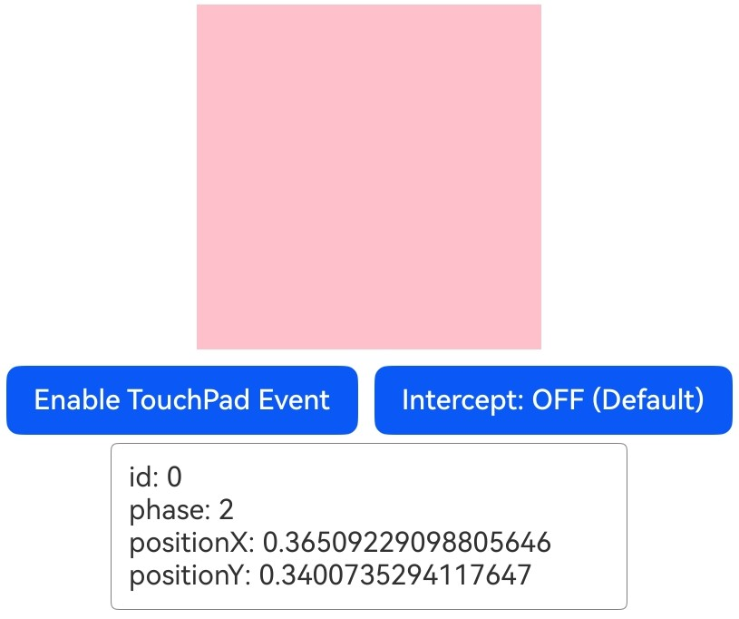

# 触控板原始事件
<!--Kit: ArkUI-->
<!--Subsystem: ArkUI-->
<!--Owner: @zhou-chaobo-->
<!--Designer: @piggyguy-->
<!--Tester: @songyanhong-->
<!--Adviser: @Brillianry_Rui-->

触控板原始事件由用户在触控板上触摸时触发，可用于获取触控板上触点的百分比位置、触点阶段、触控板设备尺寸等信息。该事件独立于触摸、鼠标、轴事件和系统手势事件，适用于需要直接处理触控板原始触点数据、实现自定义触控板交互的场景。

> **说明：**
>
> - 本模块接口仅可在Stage模型下使用。
>
> - 使用本模块接口前，需通过[UIContext.enableTouchPadEvent](../arkts-apis-uicontext-uicontext.md#enabletouchpadevent)启用应用级触控板原始事件上报，否则无法接收到触控板原始事件。
>
> - 触控板原始事件与触摸、鼠标、轴事件相互独立，不会相互转换或影响。触控板单指、双指等操作产生的事件处理请参考[支持触控板输入事件](../../../ui/arkts-interaction-development-guide-touchpad.md)。
>
> - 事件分发可参考[事件交互流程](../../../ui/arkts-interaction-basic-principles.md#事件交互流程)。

**起始版本：** 26.1.0

## onTouchPadEvent

onTouchPadEvent(event: Callback\<TouchPadEvent> | undefined): T

上报原始触控板事件时触发该回调。

**起始版本：** 26.1.0

**原子化服务API：** 从API版本26.1.0开始，该接口支持在原子化服务中使用。

**系统能力：** SystemCapability.ArkUI.ArkUI.Full

**模型约束：** 此接口仅可在Stage模型下使用。

**参数：**

| 参数名 | 类型                              | 必填 | 说明                 |
| ------ | --------------------------------- | ---- | -------------------- |
| event  | Callback\<[TouchPadEvent](#touchpadevent)> \| undefined | 是   | 触控板原始事件触发时调用的回调函数，用于接收并处理[TouchPadEvent](#touchpadevent)对象。传入undefined表示取消注册回调。 |

**返回值：**

| 类型 | 说明 |
| -------- | -------- |
| T | 返回当前组件。 |

**示例：**

该示例演示了启用触控板原始事件上报、注册onTouchPadEvent接收事件参数，以及通过onTouchPadEventIntercept拦截命中测试的完整用法。

```ts
import { UIContext } from '@kit.ArkUI';

@Entry
@Component
struct Index {
  @State info: string = '操作提示\n' +
    '1. 使用触控板将光标移至粉色区域\n' +
    '2. 在粉色区域内进行触控板操作（滑动、点击、双指等）\n' +
    '3. 下方将实时显示 changedContact 信息';
  @State mode: HitTestMode = HitTestMode.Default

  build() {
    Column() {
      Stack() {
        Stack()
          .width(200)
          .height(200)
          .backgroundColor(Color.Pink)
          .onTouchPadEvent((event: TouchPadEvent) => {
            console.info(`Child trigger onTouchPadEvent`)
          })
      }
      .width(200)
      .height(200)
      .backgroundColor(Color.Pink)
      .margin(5)
      .onTouchPadEventIntercept((event: TouchPadEvent) => {
        return this.mode
      })
      .onTouchPadEvent((event: TouchPadEvent) => {
        this.info = `id: ${event.changedContact.id}\n` +
          `phase: ${event.changedContact.phase}\n` +
          `positionX: ${event.changedContact.positionX}\n` +
          `positionY: ${event.changedContact.positionY}`;
      })

      Row() {
        Button('Enable TouchPad Event')
          .margin(5)
          .onClick(() => {
            UIContext.enableTouchPadEvent(true);
          })

        Button(this.mode === HitTestMode.Block ? 'Intercept: ON (Block)' : 'Intercept: OFF (Default)')
          .margin(5)
          .onClick(() => {
            this.mode = this.mode === HitTestMode.Block ? HitTestMode.Default : HitTestMode.Block
          })
      }

      Text(this.info)
        .width(320)
        .padding(10)
        .border({ width: 1, color: Color.Gray, radius: 4 })
    }
    .width('100%')
    .height('100%')
  }
}
```



## onTouchPadEventIntercept

onTouchPadEventIntercept(callback: Callback\<TouchPadEvent, HitTestMode> | undefined): T

绑定触控板事件命中测试的拦截回调。返回的[HitTestMode](ts-appendix-enums.md#hittestmode9)决定组件在当前触控板事件链中的命中测试行为，不影响触摸、鼠标、轴事件或系统手势事件链。

**起始版本：** 26.1.0

**原子化服务API：** 从API版本26.1.0开始，该接口支持在原子化服务中使用。

**系统能力：** SystemCapability.ArkUI.ArkUI.Full

**模型约束：** 此接口仅可在Stage模型下使用。

**参数：**

| 参数名 | 类型                              | 必填 | 说明                 |
| ------ | --------------------------------- | ---- | -------------------- |
| callback  | Callback\<[TouchPadEvent](#touchpadevent), [HitTestMode](ts-appendix-enums.md#hittestmode9)> \| undefined | 是   | 自定义事件拦截回调。在做[触摸测试](../../../ui/arkts-interaction-basic-principles.md#触摸测试)时回调此函数。通过返回值设置组件的[HitTestMode](ts-appendix-enums.md#hittestmode9)。传入undefined表示取消注册回调。 |

**返回值：**

| 类型 | 说明 |
| -------- | -------- |
| T | 返回当前组件。 |

**示例：** 

onTouchPadEventIntercept的用法可参考[onTouchPadEvent](#ontouchpadevent)示例。

## TouchPadEvent

描述原始触控板事件。该事件独立于触摸、鼠标、轴事件和系统手势事件。

**起始版本：** 26.1.0

### 属性

**起始版本：** 26.1.0

**原子化服务API：** 从API版本26.1.0开始，该接口支持在原子化服务中使用。

**系统能力：** SystemCapability.ArkUI.ArkUI.Full

**模型约束：** 此接口仅可在Stage模型下使用。

| 名称                | 类型       | 只读 | 可选   | 说明                        |
| ------------------- | -----------|------|-------- | -------------------------- |
| timestamp           | number      | 否 | 否 | 事件时间戳，表示事件发生时距离系统启动的时间间隔。<br>单位：ns     |
| source              | [SourceType](ts-gesture-settings.md#sourcetype枚举说明8)      | 否 | 否 | 事件的输入源。取值为[SourceType](ts-gesture-settings.md#sourcetype枚举说明8)枚举中的TOUCHPAD_TOUCH。     |
| sourceTool          | [SourceTool](ts-gesture-settings.md#sourcetool枚举说明9)      | 否 | 否 | 事件的输入工具。     |
| deviceId            | number      | 否 | 否 | 触发事件的触控板设备ID。<br>取值范围：[0, +∞)     |
| displayX            | number      | 否 | 否 | 光标在当前应用屏幕坐标系中的X坐标。<br>单位：vp     |
| displayY            | number      | 否 | 否 | 光标在当前应用屏幕坐标系中的Y坐标。<br>单位：vp     |
| windowX             | number      | 否 | 否 | 光标在当前应用窗口坐标系中的X坐标。<br>单位：vp     |
| windowY             | number      | 否 | 否 | 光标在当前应用窗口坐标系中的Y坐标。<br>单位：vp     |
| x                   | number      | 否 | 否 | 光标在事件响应组件坐标系中的X坐标。<br>单位：vp     |
| y                   | number      | 否 | 否 | 光标在事件响应组件坐标系中的Y坐标。<br>单位：vp     |
| globalDisplayX      | number      | 否 | 否 | 光标在[全局坐标系](../../../windowmanager/window-terminology.md#global-coordinate-system全局坐标系)中的X坐标。<br>单位：vp     |
| globalDisplayY      | number      | 否 | 否 | 光标在[全局坐标系](../../../windowmanager/window-terminology.md#global-coordinate-system全局坐标系)中的Y坐标。<br>单位：vp     |
| deviceWidth         | number      | 否 | 否 | 触控板的宽度。<br>单位：mm     |
| deviceHeight        | number      | 否 | 否 | 触控板的高度。<br>单位：mm     |
| contacts            | [TouchPadEventContact](#touchpadeventcontact)[]      | 否 | 否 | 当前事件上报的全部触点。触点数量取决于硬件能力，对外接口不设置固定上限。在使用该属性时，需要校验是否为空。     |
| changedContact      | [TouchPadEventContact](#touchpadeventcontact)      | 否 | 否 | 本次发生变化并触发事件的触点信息。在使用该属性时，需要校验是否为空。     |
| target              | [EventTarget](ts-universal-events-click.md#eventtarget8)      | 否 | 否 | 触发事件的元素对象。     |
| targetDisplayId     | number      | 否 | 是 | 事件发生的屏幕ID。<br>默认值：0<br>取值范围：[0, +∞)     |

### getModifierKeyState

getModifierKeyState(keys: Array\<string>): boolean

获取功能键按压状态。支持Ctrl、Alt和Shift功能键，取值大小写敏感，须传入'Ctrl'、'Alt'、'Shift'。

**起始版本：** 26.1.0

**原子化服务API：** 从API版本26.1.0开始，该接口支持在原子化服务中使用。

**系统能力：** SystemCapability.ArkUI.ArkUI.Full

**模型约束：** 此接口仅可在Stage模型下使用。

**参数：**

| 参数名 | 类型                              | 必填 | 说明                 |
| ------ | --------------------------------- | ---- | -------------------- |
| keys  | Array\<string> | 是   | 功能键名称列表，取值包含'Ctrl'、'Alt'、'Shift'。 |

**返回值：**

| 类型              |说明       |
| ------- | --------------------------------- |
| boolean | 功能键按压状态。所有指定功能键均被按下时返回true，否则返回false。 |

### stopPropagation

stopPropagation(): void

停止当前触控板事件在ArkUI节点事件链中的传播。该操作不影响触摸、鼠标、轴事件或系统手势事件。

**起始版本：** 26.1.0

**原子化服务API：** 从API版本26.1.0开始，该接口支持在原子化服务中使用。

**系统能力：** SystemCapability.ArkUI.ArkUI.Full

**模型约束：** 此接口仅可在Stage模型下使用。

## TouchPadEventContact

描述原始触控板事件中的单个触点。

**起始版本：** 26.1.0

**原子化服务API：** 从API版本26.1.0开始，该接口支持在原子化服务中使用。

**系统能力：** SystemCapability.ArkUI.ArkUI.Full

**模型约束：** 此接口仅可在Stage模型下使用。

| 名称                | 类型       | 只读 | 可选   | 说明                        |
| ------------------- | -----------|------|-------- | -------------------------- |
| id                  | number      | 否 | 否 | 触点的唯一标识。该标识在触点按下至抬起或取消期间保持不变。<br>取值限定为整数。     |
| phase               | [TouchPadEventPhase](ts-appendix-enums.md#touchpadeventphase)      | 否 | 否 | 触点阶段。     |
| positionX           | number      | 否 | 否 | 触点在触控板X轴的百分比位置，0表示最左侧，1表示最右侧。<br>取值范围：[0, 1]     |
| positionY           | number      | 否 | 否 | 触点在触控板Y轴的百分比位置，0表示最上侧，1表示最下侧。<br>取值范围：[0, 1]     |
