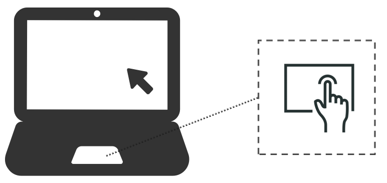
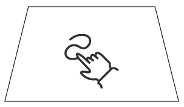
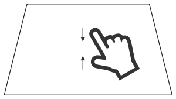

# 支持触控板输入事件
<!--Kit: ArkUI-->
<!--Subsystem: ArkUI-->
<!--Owner: @zhou-chaobo-->
<!--Designer: @piggyguy-->
<!--Tester: @songyanhong-->
<!--Adviser: @Brilliantry_Rui-->



触控板是PC/2in1、Tablet类型设备上常见的输入设备。当用户在触控板上操作时，系统会产生两类事件：触控板原始事件和触控板生成事件。

- **触控板原始事件**：直接上报触控板上触点的原始数据，包括触点在触控板上的百分比位置、触点阶段（按下、移动、抬起、取消）、触控板设备尺寸等信息。该事件独立于触摸、鼠标、轴事件和系统手势事件，不会相互转换或影响，适用于需要直接处理触控板原始触点数据、实现自定义触控板交互的场景。详细接口请参考[触控板原始事件](../reference/apis-arkui/arkui-ts/ts-universal-events-touchpad.md)。

- **触控板生成事件**：系统将触控板上的操作转换为应用已熟悉的事件类型进行上报。例如，单指点触会产生鼠标左键点击事件，单指轻触移动会产生不按键的鼠标移动事件；双指点触会产生鼠标右键点击事件，双指轻触移动会产生轴事件，双指捏合会产生捏合缩放值。

> **说明：**
>
> 需要注意的是，与触屏不同，触控板生成事件中并不会体现多指操作的手指信息，应用无法从生成事件中获取手指信息。如需获取触控板上的触点信息，请使用[触控板原始事件](#触控板原始事件)。

## 触控板原始事件

触控板原始事件由用户在触控板上触摸时触发，可用于获取触控板上触点的百分比位置、触点阶段、触控板设备尺寸等信息。使用触控板原始事件前，需要先使能上报，再在组件上注册监听。

### 使能触控板原始事件

触控板原始事件默认不上报，需通过[UIContext.enableTouchPadEvent](../reference/apis-arkui/arkts-apis-uicontext-uicontext.md#enabletouchpadevent)接口在应用级开启上报，开启后应用才能接收到触控板原始事件。

```ts
import { UIContext } from '@kit.ArkUI';

UIContext.enableTouchPadEvent(true);
```

### 监听触控板原始事件

使能后，可在组件上通过[onTouchPadEvent](../reference/apis-arkui/arkui-ts/ts-universal-events-touchpad.md#ontouchpadevent)接口注册回调，接收[TouchPadEvent](../reference/apis-arkui/arkui-ts/ts-universal-events-touchpad.md#touchpadevent)对象。该对象的关键属性如下：

- **contacts**：当前事件上报的全部触点数组。触点数量取决于硬件能力，使用前需校验是否为空。
- **changedContact**：本次发生变化并触发事件的触点，使用前需校验是否为空。
- **deviceWidth / deviceHeight**：触控板的物理尺寸（单位：mm），可用于坐标换算。

每个触点（[TouchPadEventContact](../reference/apis-arkui/arkui-ts/ts-universal-events-touchpad.md#touchpadeventcontact)）包含以下信息：

| 名称 | 说明 |
| -------- | -------- |
| id | 触点的唯一标识，在触点按下至抬起或取消期间保持不变。 |
| phase | 触点阶段，取值为[TouchPadEventPhase](../reference/apis-arkui/arkui-ts/ts-appendix-enums.md#touchpadeventphase)：BEGIN（开始接触）、MOVE（移动）、END（结束接触）、CANCEL（取消）。 |
| positionX | 触点在触控板X轴的百分比位置，取值范围[0, 1]，0表示最左侧，1表示最右侧。 |
| positionY | 触点在触控板Y轴的百分比位置，取值范围[0, 1]，0表示最上侧，1表示最下侧。 |

触点阶段遵循 **BEGIN → MOVE → END/CANCEL** 的生命周期：手指接触触控板时上报BEGIN，移动时持续上报MOVE，抬起时上报END，事件被打断（如被系统手势接管）时上报CANCEL。通过判断`changedContact.phase`可区分手势的按下、移动、抬起阶段。

如果需要拦截触控板事件的命中测试，可通过[onTouchPadEventIntercept](../reference/apis-arkui/arkui-ts/ts-universal-events-touchpad.md#ontouchpadeventintercept)接口设置自定义拦截回调，返回[HitTestMode](../reference/apis-arkui/arkui-ts/ts-appendix-enums.md#hittestmode9)决定组件在触控板事件链中的命中测试行为。

以下示例演示了使能触控板原始事件上报，并基于双指触点数据实现自定义手势跟随：双指滑动驱动组件平移、双指张开/捏合驱动组件缩放，抬手后动画还原至原位。

<!-- @[touchpad_event](https://gitcode.com/openharmony/applications_app_samples/blob/master/code/DocsSample/ArkUISample/InterAction/entry/src/main/ets/pages/touchpadEvent/TouchPadEventActualApplication.ets) -->

```ts
import { UIContext, display } from '@kit.ArkUI';

/**
 * TouchPadEvent 实际应用页：
 * childStack 基于触控板双指手势实现跟随 ——
 * 双指滑动 -> 平移；双指张开/捏合 -> 缩放；抬手 -> 动画还原。
 * positionX/Y 为触控板归一化坐标 [0,1]（API 26.1.0 d.ts 定义）。
 */
@Entry
@Component
struct TouchPadEventActualApplication {
  @State info: string = '操作提示\n' +
    '1. 点击 Enable 后，触控板双指悬于粉色区域操作\n' +
    '2. 双指滑动：组件跟随平移\n' +
    '3. 双指张开/捏合：组件放大/缩小\n' +
    '4. 抬手：组件动画还原至原位';

  // ===== 双指手势跟随（childStack）=====
  @State moveX: number = 0;
  @State moveY: number = 0;
  @State pinchScale: number = 1;
  // 基线（非渲染数据，不加 @State）
  private lastMidX: number = 0;
  private lastMidY: number = 0;
  private lastDist: number = 0;
  private hasBaseline: boolean = false;
  // 增益：触控板归一化坐标[0,1]位移 -> 屏幕 vp，满幅滑动约移动一个屏幕宽/高
  private gainX: number = 360; // 默认值，aboutToAppear 中按屏幕实际尺寸重算
  private gainY: number = 780;
  // 手势诊断信息
  @State gestureDebug: string = '等待触控板事件…';
  private debugLines: string[] = [];

  aboutToAppear(): void {
    try {
      const d = display.getDefaultDisplaySync();
      const density = d.densityPixels; // px / vp
      if (density > 0) {
        const screenWVp = d.width / density;
        const screenHVp = d.height / density;
        this.gainX = screenWVp;
        this.gainY = screenHVp;
      }
      console.log(`GestureDebug| screen=${d.width}x${d.height}px density=${density} px/vp gain=(${this.gainX.toFixed(1)}, ${this.gainY.toFixed(1)})vp`);
    } catch (e) {
      console.log(`GestureDebug| display获取失败，使用默认增益: ${JSON.stringify(e)}`);
    }
  }

  // 单位归一化：positionX/Y 规范取值范围为[0,1]；
  // 若上报值为百分比(0~100)或毫米坐标(>100)，
  // 通过 deviceWidth/deviceHeight(触控板物理尺寸mm)折算回[0,1]
  static toFraction(v: number, deviceSpanMm: number): number {
    if (v >= 0 && v <= 1) {
      return v; // 规范路径：[0,1]
    }
    if (v <= 100) {
      return v / 100; // 百分比格式(0~100)，除以100转换为[0,1]
    }
    return deviceSpanMm > 0 ? v / deviceSpanMm : v / 100; // 毫米坐标格式(>100)，按设备尺寸折算为[0,1]
  }

  appendGestureDebug(line: string): void {
    this.debugLines.push(line);
    if (this.debugLines.length > 15) {
      this.debugLines.shift();
    }
    this.gestureDebug = this.debugLines.join('\n');
    console.log(`GestureDebug| ${line}`);
  }

  gestureReset(): void {
    this.moveX = 0;
    this.moveY = 0;
    this.pinchScale = 1;
    this.hasBaseline = false;
    this.debugLines = [];
    this.gestureDebug = '已重置，等待触控板事件…';
  }

  // 抬手还原：动画回弹到原始位置与缩放
  restoreOrigin(): void {
    this.hasBaseline = false;
    if (this.moveX === 0 && this.moveY === 0 && this.pinchScale === 1) {
      return;
    }
    this.getUIContext().animateTo({ duration: 300, curve: Curve.EaseOut }, () => {
      this.moveX = 0;
      this.moveY = 0;
      this.pinchScale = 1;
    });
  }

  handleGesture(event: TouchPadEvent): void {
    const ph = event.changedContact.phase;
    const len = event.contacts.length;
    // 抬手（END/CANCEL）：动画还原组件
    if (ph === TouchPadEventPhase.END || ph === TouchPadEventPhase.CANCEL) {
      this.hasBaseline = false;
      this.restoreOrigin();
      this.appendGestureDebug(`phase=${ph} contacts=${len} 抬手 -> 还原原始位置`);
      return;
    }
    // 触点集发生增减（BEGIN/CANCEL）时重建基线，防跳变
    if (ph !== TouchPadEventPhase.MOVE) {
      this.hasBaseline = false;
    }
    if (len < 2) {
      // 少于两指：清基线，等待下次双指重新建立
      this.hasBaseline = false;
      this.appendGestureDebug(`phase=${ph} contacts=${len} (<2, 不做手势) ` +
        `changed[id=${event.changedContact.id} x=${event.changedContact.positionX} y=${event.changedContact.positionY}]`);
      return;
    }
    const a = event.contacts[0];
    const b = event.contacts[1];
    // 统一归一化为触控板[0,1]坐标（通过toFraction兼容百分比和毫米坐标格式）
    const ax = TouchPadEventActualApplication.toFraction(a.positionX, event.deviceWidth);
    const ay = TouchPadEventActualApplication.toFraction(a.positionY, event.deviceHeight);
    const bx = TouchPadEventActualApplication.toFraction(b.positionX, event.deviceWidth);
    const by = TouchPadEventActualApplication.toFraction(b.positionY, event.deviceHeight);
    const midX = (ax + bx) / 2;
    const midY = (ay + by) / 2;
    const dist = Math.sqrt((ax - bx) * (ax - bx) + (ay - by) * (ay - by));
    if (this.hasBaseline && this.lastDist > 0) {
      // 双指滑动：中点位移 -> 平移（[0,1]差值 × 屏幕增益换算为 vp）
      const dx = midX - this.lastMidX;
      const dy = midY - this.lastMidY;
      this.moveX += dx * this.gainX;
      this.moveY += dy * this.gainY;
      // 张开/捏合：间距比例 -> 缩放
      const ratio = dist / this.lastDist;
      let newScale = this.pinchScale * ratio;
      if (newScale < 0.3) {
        newScale = 0.3;
      } else if (newScale > 3.0) {
        newScale = 3.0;
      }
      this.pinchScale = newScale;
      this.appendGestureDebug(`phase=${ph} contacts=${len} ` +
        `a[${a.id}](${(ax * 100).toFixed(1)}%,${(ay * 100).toFixed(1)}%) b[${b.id}](${(bx * 100).toFixed(1)}%,${(by * 100).toFixed(1)}%) ` +
        `midΔ=(${(dx * 100).toFixed(2)},${(dy * 100).toFixed(2)})% dist=${(dist * 100).toFixed(1)}% ratio=${ratio.toFixed(3)} ` +
        `=> move=(${this.moveX.toFixed(1)},${this.moveY.toFixed(1)})vp scale=${this.pinchScale.toFixed(2)}`);
    } else {
      this.appendGestureDebug(`phase=${ph} contacts=${len} 建立基线 ` +
        `a[${a.id}](${(ax * 100).toFixed(1)}%,${(ay * 100).toFixed(1)}%) b[${b.id}](${(bx * 100).toFixed(1)}%,${(by * 100).toFixed(1)}%) ` +
        `dist=${(dist * 100).toFixed(1)}% rawMax=(${Math.max(a.positionX, b.positionX)},${Math.max(a.positionY, b.positionY)})`);
    }
    this.lastMidX = midX;
    this.lastMidY = midY;
    this.lastDist = dist;
    this.hasBaseline = true;
  }

  build() {
    Column() {
      Stack() {
        Stack()
          .id('childStack')
          .width(200)
          .height(200)
          .backgroundColor(Color.Pink)
          .translate({ x: this.moveX, y: this.moveY })
          .scale({ x: this.pinchScale, y: this.pinchScale })
          .onTouchPadEvent((event: TouchPadEvent) => {
            this.handleGesture(event);
          })
      }
      .width(200)
      .height(200)
      .backgroundColor(Color.Pink)
      .margin(5)

      Row() {
        Button('Enable TouchPad Event')
          .margin(5)
          .onClick(() => {
            UIContext.enableTouchPadEvent(true);
          })

        Button('Reset手势')
          .margin(5)
          .onClick(() => {
            this.gestureReset()
          })
      }

      Text(this.info)
        .width(320)
        .padding(10)
        .border({ width: 1, color: Color.Gray, radius: 4 })

      Text(`手势状态: move=(${this.moveX.toFixed(1)}, ${this.moveY.toFixed(1)}) scale=${this.pinchScale.toFixed(2)}\n` +
        `[诊断日志]\n${this.gestureDebug}`)
        .width(320)
        .fontSize(9)
        .fontFamily('monospace')
        .padding(10)
        .margin({ top: 5 })
        .border({ width: 1, color: Color.Blue, radius: 4 })
    }
    .width('100%')
    .height('100%')
  }
}
```

上面的示例中，点击 Enable 按钮调用UIContext.enableTouchPadEvent(true)开启上报，在 childStack 组件上绑定onTouchPadEvent接收事件。回调处理流程如下：

1. 阶段判断：通过`event.changedContact.phase`区分手势阶段。当阶段为END或CANCEL（抬手）时，通过[animateTo](../reference/apis-arkui/arkui-ts/ts-explicit-animation.md)动画将组件还原至原位与初始缩放。
2. 双指识别：通过`event.contacts`获取全部触点，当触点数大于等于2时，取前两个触点计算手势。`positionX/positionY`为触控板归一化坐标[0, 1]，示例中按屏幕实际尺寸换算为vp位移。
3. 平移跟随：计算两指中点相对上一帧的位移（`midX/midY`差值），乘以屏幕增益后累加到组件的`translate`偏移量上，实现双指滑动驱动组件平移。
4. 缩放跟随：计算两指间距相对上一帧的比例（`ratio`），累乘到组件的`scale`上，实现双指张开放大、捏合缩小，并限制缩放范围在[0.3, 3.0]。
5. 防跳变：在触点集发生增减（BEGIN/CANCEL）或触点数少于2时，清除基线并等待下次双指重新建立，避免手势跳变。

## 触控板生成事件

触控板生成事件是系统将触控板上的操作转换为应用已熟悉的事件类型后上报的事件，包括单指操作产生的鼠标事件、双指滑动产生的轴事件以及双指捏合产生的缩放值。

### 单指操作



单指操作触控板与操作鼠标的方式相同。例如，轻触后滑动会产生鼠标移动事件，而重按则会产生鼠标左键按下事件。若需判断鼠标事件是来自触控板还是鼠标设备，可以通过[sourceType](../reference/apis-arkui/arkui-ts/ts-gesture-settings.md#sourcetype枚举说明8)和[sourceTool](../reference/apis-arkui/arkui-ts/ts-gesture-settings.md#sourcetool枚举说明9)信息进行区分。

对该种操作产生的事件的处理，请参考[处理鼠标移动](arkts-interaction-development-guide-mouse.md#处理鼠标移动)章节。


### 双指滑动


与鼠标滚轮不同，触控板上双指滑动产生的轴事件上报的数值单位并非角度，而是位移像素，为了区分该点，在处理轴值之前，可以通过sourceType及sourceTool来区分。

当用户使用双指横滑时，可从[BaseEvent](../reference/apis-arkui/arkui-ts/ts-universal-events-click.md#baseevent8)的`axisHorizontal`属性中获取横向轴值（位移像素），向右滑动时，上报数值为负，向左滑动时，上报数值为正。使用双指竖滑时，可从[BaseEvent](../reference/apis-arkui/arkui-ts/ts-universal-events-click.md#baseevent8)的`axisVertical`属性中获取到纵向轴值（位移像素），向上滑动时，上报数值为正，向下滑动时，上报数值为负。

同滚轮一样，产生的轴事件可以驱动滑动手势的触发。向右滑动时，上报offsetX数值为正，向左滑动时，上报offsetX数值为负。向上滑动时，上报offsetY数值为负，向下滑动时，上报offsetY数值为正。

> **说明：**
>
> 只有在开始滚动操作的那一刻光标所在位置下的组件上的手势会被收集。

### 双指捏合



在触控板上通过双指捏合，可以产生捏合缩放值上报，用于触发[PinchGesture](../reference/apis-arkui/arkui-ts/ts-basic-gestures-pinchgesture.md)手势。该缩放值表示一个相对缩放比例（scale），以双指开始捏合的那一刻为基准（此时scale为1.0）。当双指向外扩张时，scale从1.0逐渐增大；当双指向内合并时，scale从1.0逐渐减小。应用可通过[GestureEvent](../reference/apis-arkui/arkui-ts/ts-gesture-common.md#gestureevent对象说明)的`scale`属性获取该值，用于实现图片、页面内容等对象的缩放交互。
