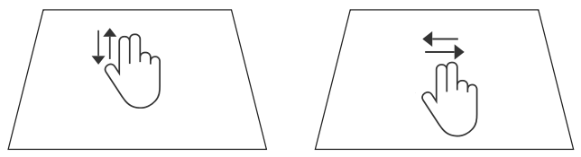

# 支持触控板输入事件
<!--Kit: ArkUI-->
<!--Subsystem: ArkUI-->
<!--Owner: @zhou-chaobo-->
<!--Designer: @piggyguy-->
<!--Tester: @songyanhong-->
<!--Adviser: @Brilliantry_Rui-->


触控板是PC/2in1、Tablet类型设备上常见的输入设备。当用户在触控板上操作时，系统会产生两类事件：触控板原始事件和触控板生成事件。

- **触控板原始事件**：直接上报触控板上触点的原始数据，包括触点在触控板上的百分比位置、触点阶段（按下、移动、抬起、取消）、触控板设备尺寸等信息。该事件独立于触摸、鼠标、轴事件和系统手势事件，不会相互转换或影响，适用于需要直接处理触控板原始触点数据、实现自定义触控板交互的场景。详细接口请参考[触控板原始事件](../reference/apis-arkui/arkui-ts/ts-universal-events-touchpad.md)。

- **触控板生成事件**：系统将触控板上的操作转换为应用已熟悉的事件类型进行上报。例如，单指点触会产生鼠标左键点击事件，单指轻触移动会产生不按键的鼠标移动事件；双指点触会产生鼠标右键点击事件，双指轻触移动会产生轴事件，双指捏合会产生捏合缩放值。

> **说明：**
>
> 需要注意的是，与触屏不同，触控板生成事件中并不会体现多指操作的手指信息，应用无法从生成事件中获取手指信息。如需获取触控板上的触点信息，请使用[触控板原始事件](#触控板原始事件)。

## 触控板原始事件

触控板原始事件由用户在触控板上触摸时触发，可用于获取触控板上触点的百分比位置、触点阶段、触控板设备尺寸等信息。使用触控板原始事件前，需要先使能上报，再在组件上注册监听。

### 使能触控板原始事件

触控板原始事件默认不上报，需通过[UIContext.enableTouchPadEvent](../reference/apis-arkui/arkts-apis-uicontext-uicontext.md#enabletouchpadevent)接口在应用级开启上报，开启后应用才能接收到触控板原始事件。

```ts
import { UIContext } from '@kit.ArkUI';

UIContext.enableTouchPadEvent(true);
```

### 监听触控板原始事件

使能后，可在组件上通过[onTouchPadEvent](../reference/apis-arkui/arkui-ts/ts-universal-events-touchpad.md#ontouchpadevent)接口注册回调，接收[TouchPadEvent](../reference/apis-arkui/arkui-ts/ts-universal-events-touchpad.md#touchpadevent)对象。该对象包含当前事件上报的全部触点（contacts）、本次发生变化的触点（changedContact）、光标坐标、触控板设备尺寸等信息。每个触点（[TouchPadEventContact](../reference/apis-arkui/arkui-ts/ts-universal-events-touchpad.md#touchpadeventcontact)）包含触点唯一标识（id）、触点阶段（phase，取值为BEGIN/MOVE/END/CANCEL）以及在触控板上的百分比位置（positionX/positionY，取值范围[0, 1]）。

如果需要拦截触控板事件的命中测试，可通过[onTouchPadEventIntercept](../reference/apis-arkui/arkui-ts/ts-universal-events-touchpad.md#ontouchpadeventintercept)接口设置自定义拦截回调，返回[HitTestMode](../reference/apis-arkui/arkui-ts/ts-appendix-enums.md#hittestmode9)决定组件在触控板事件链中的命中测试行为。

以下示例演示了使能触控板原始事件上报，并在组件上监听触点信息：

```ts
import { UIContext } from '@kit.ArkUI';

@Entry
@Component
struct TouchPadEventDemo {
  @State info: string = '操作提示\n' +
    '1. 使用触控板将光标移至粉色区域\n' +
    '2. 在粉色区域内进行触控板操作（滑动、点击、双指等）\n' +
    '3. 下方将实时显示 changedContact 信息';

  build() {
    Column() {
      Stack()
        .width(200)
        .height(200)
        .backgroundColor(Color.Pink)
        .margin(5)
        .onTouchPadEvent((event: TouchPadEvent) => {
          if (event.changedContact) {
            this.info = `id: ${event.changedContact.id}\n` +
              `phase: ${event.changedContact.phase}\n` +
              `positionX: ${event.changedContact.positionX}\n` +
              `positionY: ${event.changedContact.positionY}`;
          }
        })

      Button('Enable TouchPad Event')
        .margin(10)
        .onClick(() => {
          UIContext.enableTouchPadEvent(true);
        })

      Text(this.info)
        .width(320)
        .padding(10)
        .border({ width: 1, color: Color.Gray, radius: 4 })
    }
    .width('100%')
    .height('100%')
  }
}
```

## 触控板生成事件

### 单指操作


单指操作触控板与操作鼠标的方式相同。例如，轻触后滑动会产生鼠标移动事件，而重按则会产生鼠标左键按下事件。若需判断鼠标事件是来自触控板还是鼠标设备，可以通过[sourceType](../reference/apis-arkui/arkui-ts/ts-gesture-settings.md#sourcetype枚举说明8)和[sourceTool](../reference/apis-arkui/arkui-ts/ts-gesture-settings.md#sourcetool枚举说明9)信息进行区分。

对该种操作产生的事件的处理，请参考[处理鼠标移动](arkts-interaction-development-guide-mouse.md#处理鼠标移动)章节。


### 双指滑动



与鼠标滚轮不同，触控板上双指滑动产生的轴事件上报的数值单位并非角度，而是位移像素，为了区分该点，在处理轴值之前，可以通过sourceType及sourceTool来区分。

当用户使用双指横滑时，可从[BaseEvent](../reference/apis-arkui/arkui-ts/ts-universal-events-click.md#baseevent8)的`axisHorizontal`属性中获取横向轴值（位移像素），向右滑动时，上报数值为负，向左滑动时，上报数值为正。使用双指竖滑时，可从[BaseEvent](../reference/apis-arkui/arkui-ts/ts-universal-events-click.md#baseevent8)的`axisVertical`属性中获取到纵向轴值（位移像素），向上滑动时，上报数值为正，向下滑动时，上报数值为负。

同滚轮一样，产生的轴事件可以驱动滑动手势的触发。向右滑动时，上报offsetX数值为正，向左滑动时，上报offsetX数值为负。向上滑动时，上报offsetY数值为负，向下滑动时，上报offsetY数值为正。

> **说明：**
>
> 只有在开始滚动操作的那一刻光标所在位置下的组件上的手势会被收集。

### 双指捏合


在触控板上通过双指捏合，可以产生捏合缩放值上报，用于驱动[PinchGesture](../reference/apis-arkui/arkui-ts/ts-basic-gestures-pinchgesture.md)手势的触发。该缩放值表示一个相对缩放比例（scale），以双指开始捏合的那一刻为基准（此时scale为1.0）。当双指向外扩张时，scale从1.0逐渐增大；当双指向内合并时，scale从1.0逐渐减小。应用可通过[GestureEvent](../reference/apis-arkui/arkui-ts/ts-gesture-common.md#gestureevent对象说明)的`scale`属性获取该值，用于实现图片、页面内容等对象的缩放交互。
