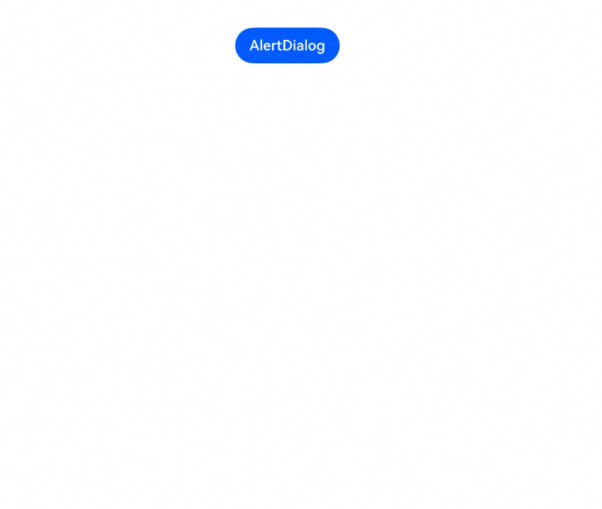
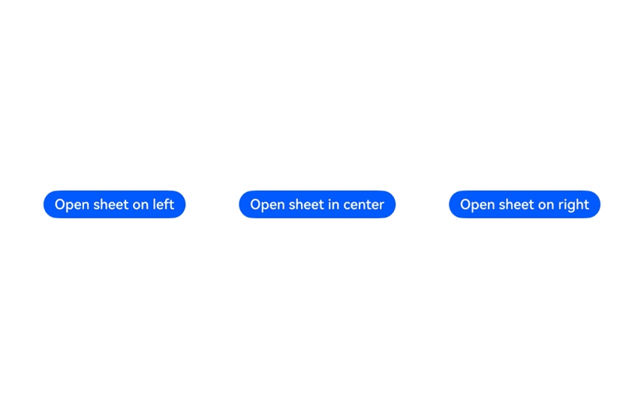

# 弹窗跟手
<!--Kit: ArkUI-->
<!--Subsystem: ArkUI-->
<!--Owner: @fenglinbailu-->
<!--Designer: @fenglinbailu-->
<!--Tester: @l30014443-->
<!--Adviser: @Brilliantry_Rui-->

弹窗跟手是指弹窗类组件和半模态组件适配握持习惯的能力。从API版本26.1.0开始，开发者可以为弹窗设置跟手模式，弹窗弹出时根据跟手模式向指定一侧偏移显示，缩短单手握持设备时拇指的触达路径，提升单手操作场景下的交互效率与舒适度。

跟手模式通过弹窗选项中的adaptToHandedness属性设置，该属性的类型为[HandednessFollowMode](../reference/apis-arkui/js-apis-dialog.md#handednessfollowmode)枚举，支持以下三种模式。

| 模式 | 值 | 说明 |
| -------- | -------- | -------- |
| NONE | 0 | 不跟手，弹窗保持当前布局，为默认模式。 |
| FOLLOW_ANCHOR | 1 | 指向性跟手，弹窗跟随触发它的组件（最近交互的组件）的位置偏移。 |
| FOLLOW_GRIP_HAND | 2 | 智感握姿跟手，弹窗跟随握姿进行偏移（左手握持左手操作弹窗左偏，右手同理。双手握持跟随操作手方向偏移）。 |

## 使用场景

在宽度断点[WidthBreakpoint](../reference/apis-arkui/arkui-ts/ts-appendix-enums.md#widthbreakpoint13)大于等于[WIDTH_SM](../reference/apis-arkui/arkui-ts/ts-appendix-enums.md#widthbreakpoint13)的宽屏设备上，用户常以单手握持设备、拇指操作的姿势使用应用。此时若弹窗默认居中显示，弹窗上的按钮可能超出拇指自然触达范围，用户需要调整握持姿势或双手操作才能完成交互。

交互元素应尽量位于用户拇指舒适区内。开启弹窗跟手后，弹窗向触发组件或握持手一侧偏移，拇指无需大幅移动即可触达弹窗按钮，同时降低手指过度伸展导致的误触风险，并减少视线在屏幕中心与操作区域之间的移动。开发者可根据弹窗与触发场景的关联程度，选择合适的跟手模式。

| 场景特征 | 推荐模式 | 典型示例 |
| -------- | -------- | -------- |
| 弹窗由页面中某个组件触发，且内容与该组件强相关，操作完成后期望用户继续在该组件附近操作。 | 指向性跟手（FOLLOW_ANCHOR） | 列表项上点击“更多”按钮弹出的操作确认弹窗、长按头像弹出的信息修改弹窗。 |
| 弹窗与触发位置无关，属于全局操作，用户可能从页面任意位置触发。 | 智感握姿跟手（FOLLOW_GRIP_HAND） | 设置页中的账号注销确认弹窗、视频播放中的清晰度切换弹窗。 |
| 弹窗内容需要居中展示以强调视觉焦点，或操作本身与位置无关且无需快速触达。 | 不跟手（NONE） | 加载进度弹窗、系统级重要通知弹窗。 |

指向性跟手模式下，弹窗向触发它的组件一侧偏移：



智感握姿跟手模式下，半模态向握持手一侧偏移：



## 实现原理

弹窗跟手能力的业务交互流程如下。

1. 设置跟手模式：通过弹窗选项（如[AlertDialogParam](../reference/apis-arkui/arkui-ts/ts-methods-alert-dialog-box.md#alertdialogparam对象说明)、[SheetOptions](../reference/apis-arkui/arkui-ts/ts-universal-attributes-sheet-transition.md#sheetoptions)）设置adaptToHandedness属性。
2. 确定偏移方向：弹窗弹出时，ArkUI根据adaptToHandedness中设置的跟手模式确定偏移方向：
   - 指向性跟手（FOLLOW_ANCHOR）：根据最近交互记录定位触发组件（锚点），弹窗向锚点所在一侧偏移。
   - 智感握姿跟手（FOLLOW_GRIP_HAND）：向多模态融合感知服务查询握持手状态，左手握持时弹窗向左偏移，右手握持时向右偏移。
   - 不跟手（NONE）：不进行偏移计算，弹窗保持默认布局。
3. 布局与渲染：根据偏移方向与偏移量完成弹窗布局与渲染。

## 约束与限制

### 智感握姿跟手限制

智感握姿跟手依赖多模态融合感知服务的握持手感知能力（智感握姿），存在以下限制，详细约束与限制说明请参考[获取用户动作开发指导](../device/stationary/motion-guidelines.md#约束与限制-1)。

- 此功能当前支持部分机型，若设置菜单中存在“智感握姿”开关（可在“设置-系统”中查看），则表明该设备支持此功能，若无此开关，感知能力不可用。
- 设备屏幕需处于亮屏且解锁状态；如果存在设备保护壳，则厚度不得超过3毫米。
- 需以五指自然握持设备，同时掌心区域接触设备（或拇指外的四指及掌心区域接触）；佩戴手套会显著降低识别准确率。
- 握持时屏幕需朝向握持人，且不得同时接触其他物体（如桌面、其他身体部位等）。

同时，感知服务提供的操作手识别存在以下限制（影响依赖操作手状态的相关能力）：

- 指关节操作不属于使用手操作场景。
- 窗口旋转场景、多指同时操作场景不支持。
- 能力有效范围不包含距离屏幕边缘8mm内区域。

当智感握姿识别失败或握持手状态为未识别时，弹窗保持默认布局。

### 权限要求

使用智感握姿跟手（FOLLOW_GRIP_HAND）模式时，应用需要在module.json5配置文件中声明[ohos.permission.DETECT_GESTURE](../security/AccessToken/permissions-for-all.md#ohospermissiondetect_gesture)权限，该权限允许应用感知用户握持姿态、操作手等相关信息。声明方式请参考[声明权限](../security/AccessToken/declare-permissions.md)。

指向性跟手（FOLLOW_ANCHOR）与不跟手（NONE）模式不依赖感知能力，无需申请权限。

### 支持的组件范围

adaptToHandedness属性支持的组件范围如下。

| 组件 | 所属选项 | 说明 |
| -------- | -------- | -------- |
| [AlertDialog](../reference/apis-arkui/arkui-ts/ts-methods-alert-dialog-box.md) | AlertDialogParam | 当[alignment](../reference/apis-arkui/js-apis-dialog.md#dialogbaseoptions)不为DialogAlignment.Default，或者[offset](../reference/apis-arkui/js-apis-dialog.md#dialogbaseoptions)值不为0时，该接口不生效。 |
| [ActionSheet](../reference/apis-arkui/arkui-ts/ts-methods-action-sheet.md) | ActionSheetOptions | 当[alignment](../reference/apis-arkui/js-apis-dialog.md#dialogbaseoptions)不为DialogAlignment.Default，或者[offset](../reference/apis-arkui/js-apis-dialog.md#dialogbaseoptions)值不为0时，该接口不生效。 |
| [CustomDialog](../reference/apis-arkui/arkui-ts/ts-methods-custom-dialog-box.md) | CustomDialogControllerOptions | 当customStyle为true，或者[alignment](../reference/apis-arkui/js-apis-dialog.md#dialogbaseoptions)不为DialogAlignment.Default，或者[offset](../reference/apis-arkui/js-apis-dialog.md#dialogbaseoptions)值不为0时，该接口不生效。 |
| [DatePickerDialog](../reference/apis-arkui/arkui-ts/ts-methods-datepicker-dialog.md) | DatePickerDialogOptions | 当[alignment](../reference/apis-arkui/js-apis-dialog.md#dialogbaseoptions)不为DialogAlignment.Default，或者[offset](../reference/apis-arkui/js-apis-dialog.md#dialogbaseoptions)值不为0时，该接口不生效。 |
| [TimePickerDialog](../reference/apis-arkui/arkui-ts/ts-methods-timepicker-dialog.md) | TimePickerDialogOptions | 当[alignment](../reference/apis-arkui/js-apis-dialog.md#dialogbaseoptions)不为DialogAlignment.Default，或者[offset](../reference/apis-arkui/js-apis-dialog.md#dialogbaseoptions)值不为0时，该接口不生效。 |
| [TextPickerDialog](../reference/apis-arkui/arkui-ts/ts-methods-textpicker-dialog.md) | TextPickerDialogOptionsExt | 当[alignment](../reference/apis-arkui/js-apis-dialog.md#dialogbaseoptions)不为DialogAlignment.Default，或者[offset](../reference/apis-arkui/js-apis-dialog.md#dialogbaseoptions)值不为0时，该接口不生效。 |
| [CalendarPickerDialog](../reference/apis-arkui/arkui-ts/ts-methods-calendarpicker-dialog.md) | CalendarDialogOptions | - |
| [promptAction](../reference/apis-arkui/js-apis-promptAction.md) | ShowDialogOptions、ActionMenuOptions、BaseDialogOptions | 当[alignment](../reference/apis-arkui/js-apis-dialog.md#dialogbaseoptions)不为DialogAlignment.Default，或者[offset](../reference/apis-arkui/js-apis-dialog.md#dialogbaseoptions)值不为0时，该接口不生效。 |
| [@ohos.arkui.dialog](../reference/apis-arkui/js-apis-dialog.md) | DialogBaseOptions | 当customStyle为true，或者[alignment](../reference/apis-arkui/js-apis-dialog.md#dialogbaseoptions)不为DialogBaseAlignment.DEFAULT，或者[offset](../reference/apis-arkui/js-apis-dialog.md#dialogbaseoptions)值不为0时，该接口不生效。 |
| bindSheet（[半模态转场](../reference/apis-arkui/arkui-ts/ts-universal-attributes-sheet-transition.md)） | SheetOptions | 仅在preferType设置为SheetType.CENTER（居中弹窗）时生效，其他弹窗样式下该属性不生效。 |

### 设备限制

- 智感握姿能力：智感握姿跟手仅在支持智感握姿能力的设备上生效；指向性跟手与不跟手模式不依赖智感握姿能力。
- 断点限制：弹窗跟手仅在宽度断点大于等于WIDTH_SM且高度断点大于等于HEIGHT_MD的设备，或者宽度断点大于WIDTH_MD的设备上生效。其中，宽度断点与高度断点指当前实例所在窗口的断点，可通过[getWindowWidthBreakpoint](../reference/apis-arkui/arkts-apis-uicontext-uicontext.md#getwindowwidthbreakpoint13)与[getWindowHeightBreakpoint](../reference/apis-arkui/arkts-apis-uicontext-uicontext.md#getwindowheightbreakpoint13)获取，断点取值说明分别参考[WidthBreakpoint](../reference/apis-arkui/arkui-ts/ts-appendix-enums.md#widthbreakpoint13)与[HeightBreakpoint](../reference/apis-arkui/arkui-ts/ts-appendix-enums.md#heightbreakpoint13)。

## 与相关Kit的关系

弹窗跟手中的智感握姿跟手能力，使用了多模态融合感知服务（Multimodal Awareness Kit）中[@ohos.multimodalAwareness.motion (动作感知能力)](../reference/apis-multimodalawareness-kit/js-apis-awareness-motion.md)模块提供的动作感知能力。该能力已内置于ArkUI弹窗组件，开发者设置跟手模式后即可直接使用。

- 感知能力的提供方：多模态融合感知服务通过motion模块提供操作手感知（operatingHandChanged，API version 15起）与握持手感知（holdingHandChanged，API version 20起）两类事件，通过传感器数据结合识别算法输出手部状态。
- 感知能力的消费方：智感握姿跟手场景下，ArkUI在弹窗弹出时自动查询握持手状态，应用无需自行订阅感知事件、无需编写偏移计算逻辑，仅声明ohos.permission.DETECT_GESTURE权限并设置adaptToHandedness属性即可。
- 自定义感知场景：若应用需要在弹窗以外的场景使用动作感知能力（如根据握持手调整页面布局、调整工具栏位置等），可自行调用motion模块接口订阅操作手或握持手状态，开发指导请参考[获取用户动作开发指导](../device/stationary/motion-guidelines.md)。

## 开发指导

本节以AlertDialog与bindSheet（居中弹窗样式）为例，分别提供指向性跟手、智感握姿跟手、不跟手三种模式的开发指导。

### 指向性跟手

指向性跟手通过将adaptToHandedness属性设置为HandednessFollowMode.FOLLOW_ANCHOR，弹窗弹出时向触发它的组件（最近交互的组件）一侧偏移。

以下示例与AlertDialog组件中[设置弹窗适配握持习惯](../reference/apis-arkui/arkui-ts/ts-methods-alert-dialog-box.md#示例10设置弹窗适配握持习惯)的示例保持一致，点击按钮弹出AlertDialog，弹窗向触发它的组件一侧偏移。

<!-- @[follow_anchor_import](https://gitcode.com/openharmony/applications_app_samples/blob/master/code/DocsSample/ArkUISample/ArkUIHandedness/entry/src/main/ets/pages/followanchor/FollowAnchorAlertDialog.ets) -->

``` TypeScript
import { HandednessFollowMode } from '@kit.ArkUI';
```

<!-- @[follow_anchor_alert_dialog](https://gitcode.com/openharmony/applications_app_samples/blob/master/code/DocsSample/ArkUISample/ArkUIHandedness/entry/src/main/ets/pages/followanchor/FollowAnchorAlertDialog.ets) -->

``` TypeScript
this.getUIContext().showAlertDialog({
  title: 'AlertDialog Title',
  message: 'AlertDialog Text',
  primaryButton: {
    value: '确定',
    action: () => {
      console.info('primaryButton');
    }
  },
  secondaryButton: {
    value: '取消',
    action: () => {
      console.info('secondaryButton');
    }
  },
  adaptToHandedness: HandednessFollowMode.FOLLOW_ANCHOR
});
```

半模态同样支持指向性跟手。以下示例与bindSheet属性中[示例13（半模态适配握持习惯）](../reference/apis-arkui/arkui-ts/ts-universal-attributes-sheet-transition.md#示例13半模态适配握持习惯)的示例保持一致，在[SheetOptions](../reference/apis-arkui/arkui-ts/ts-universal-attributes-sheet-transition.md#sheetoptions)中设置adaptToHandedness属性，半模态弹出时向触发组件一侧偏移。注意preferType需设置为SheetType.CENTER（居中弹窗），否则该属性不生效。

<!-- @[follow_anchor_sheet_builder](https://gitcode.com/openharmony/applications_app_samples/blob/master/code/DocsSample/ArkUISample/ArkUIHandedness/entry/src/main/ets/pages/followanchor/FollowAnchorSheet.ets) -->

``` TypeScript
@Builder
myBuilder() {
  Column() {
    Text('Sheet Content')
      .margin(20)
      .fontSize(20)
  }
  .justifyContent(FlexAlign.Center)
  .width('100%')
}
```

<!-- @[follow_anchor_sheet](https://gitcode.com/openharmony/applications_app_samples/blob/master/code/DocsSample/ArkUISample/ArkUIHandedness/entry/src/main/ets/pages/followanchor/FollowAnchorSheet.ets) -->

``` TypeScript
.bindSheet($$this.isShow, this.myBuilder(), {
  preferType: SheetType.CENTER,
  width: 400,
  showClose: true,
  title: { title: 'title', subtitle: 'subtitle' },
  adaptToHandedness: HandednessFollowMode.FOLLOW_ANCHOR,
})
```


### 智感握姿跟手

智感握姿跟手通过将adaptToHandedness属性设置为HandednessFollowMode.FOLLOW_GRIP_HAND，弹窗弹出时向握持设备的手一侧偏移。

开发步骤如下。

1. 应用需要使用智感握姿跟手能力前，需申请[ohos.permission.DETECT_GESTURE](../security/AccessToken/permissions-for-all.md#ohospermissiondetect_gesture)权限，申请方式参考[约束与限制](#权限要求)。

2. 在弹窗选项中设置adaptToHandedness属性为HandednessFollowMode.FOLLOW_GRIP_HAND。

以下示例与指向性跟手中的AlertDialog示例结构一致，仅将adaptToHandedness属性设置为HandednessFollowMode.FOLLOW_GRIP_HAND。单手握持设备时弹出AlertDialog，弹窗向握持手一侧偏移；双手握持或识别失败时，弹窗保持默认布局。

<!-- @[follow_grip_hand_import](https://gitcode.com/openharmony/applications_app_samples/blob/master/code/DocsSample/ArkUISample/ArkUIHandedness/entry/src/main/ets/pages/followgriphand/FollowGripHandAlertDialog.ets) -->

``` TypeScript
import { HandednessFollowMode } from '@kit.ArkUI';
```

<!-- @[follow_grip_hand_alert_dialog](https://gitcode.com/openharmony/applications_app_samples/blob/master/code/DocsSample/ArkUISample/ArkUIHandedness/entry/src/main/ets/pages/followgriphand/FollowGripHandAlertDialog.ets) -->

``` TypeScript
this.getUIContext().showAlertDialog({
  title: 'AlertDialog Title',
  message: 'AlertDialog Text',
  primaryButton: {
    value: '确定',
    action: () => {
      console.info('primaryButton');
    }
  },
  secondaryButton: {
    value: '取消',
    action: () => {
      console.info('secondaryButton');
    }
  },
  adaptToHandedness: HandednessFollowMode.FOLLOW_GRIP_HAND
});
```

半模态的智感握姿跟手与指向性跟手类似，在[SheetOptions](../reference/apis-arkui/arkui-ts/ts-universal-attributes-sheet-transition.md#sheetoptions)中设置adaptToHandedness属性即可。

<!-- @[follow_grip_hand_sheet](https://gitcode.com/openharmony/applications_app_samples/blob/master/code/DocsSample/ArkUISample/ArkUIHandedness/entry/src/main/ets/pages/followgriphand/FollowGripHandSheet.ets) -->

``` TypeScript
.bindSheet($$this.isShow, this.myBuilder(), {
  preferType: SheetType.CENTER,
  width: 400,
  showClose: true,
  title: { title: 'title', subtitle: 'subtitle' },
  adaptToHandedness: HandednessFollowMode.FOLLOW_GRIP_HAND,
})
```


### 不跟手

不跟手为adaptToHandedness属性的默认行为，可通过以下两种方式实现。

- 不设置adaptToHandedness属性，弹窗默认不适配握持习惯。
- 显式设置adaptToHandedness属性为HandednessFollowMode.NONE。

<!-- @[no_follow_alert_dialog](https://gitcode.com/openharmony/applications_app_samples/blob/master/code/DocsSample/ArkUISample/ArkUIHandedness/entry/src/main/ets/pages/nofollow/NoFollowAlertDialog.ets) -->

``` TypeScript
this.getUIContext().showAlertDialog({
  title: 'AlertDialog Title',
  message: 'AlertDialog Text',
  primaryButton: {
    value: '确定',
    action: () => {
      console.info('primaryButton');
    }
  },
  secondaryButton: {
    value: '取消',
    action: () => {
      console.info('secondaryButton');
    }
  },
  adaptToHandedness: HandednessFollowMode.NONE
});
```

