# 弹出框迁移指南
<!--Kit: ArkUI-->
<!--Subsystem: ArkUI-->
<!--Owner: @houguobiao-->
<!--Designer: @houguobiao-->
<!--Tester: @lxl007-->
<!--Adviser: @Brilliantry_Rui-->

## 概述

本文档帮助开发者了解[@ohos.arkui.dialog (弹出框)](../reference/apis-arkui/js-apis-dialog.md)新接口与老接口（[CustomDialogController](../reference/apis-arkui/arkui-ts/ts-methods-custom-dialog-box.md#customdialogcontroller)、[showAlertDialog](../reference/apis-arkui/arkts-apis-uicontext-uicontext.md#showalertdialog)、[showActionSheet](../reference/apis-arkui/arkts-apis-uicontext-uicontext.md#showactionsheet)、[showDialog](../reference/apis-arkui/arkts-apis-uicontext-promptaction.md#showdialog)、[showActionMenu](../reference/apis-arkui/arkts-apis-uicontext-promptaction.md#showactionmenu)、[openCustomDialog](../reference/apis-arkui/arkts-apis-uicontext-promptaction.md#opencustomdialog12)、[openCustomDialogWithController](../reference/apis-arkui/arkts-apis-uicontext-promptaction.md#opencustomdialogwithcontroller18)、[presentCustomDialog](../reference/apis-arkui/arkts-apis-uicontext-promptaction.md#presentcustomdialog18)）的能力差异，并按弹出框类别提供从老接口到新接口的迁移映射。

从API版本26.0.1开始，新增[@ohos.arkui.dialog (弹出框)](../reference/apis-arkui/js-apis-dialog.md)，提供统一的Dialog类型声明能力。

## 接口说明

[@ohos.arkui.dialog (弹出框)](../reference/apis-arkui/js-apis-dialog.md)在完全兼容老接口能力的基础上，新增支持返回错误码的能力，关键接口如下表所示。

| 接口名 | 说明 |
|--------|------|
| [DialogTextStyleOptions](../reference/apis-arkui/js-apis-dialog.md#dialogtextstyleoptions) | 在Dialog中定义文本样式属性，可作为消息内容的文字样式。 |
| [DialogButton](../reference/apis-arkui/js-apis-dialog.md#dialogbutton) | 固定样式弹出框的按钮配置。 |
| [DialogSheet](../reference/apis-arkui/js-apis-dialog.md#dialogsheet) | 弹出框列表配置项，用于ActionSheet样式的弹出框。 |
| [DialogBaseOptions](../reference/apis-arkui/js-apis-dialog.md#dialogbaseoptions) | 所有弹出框共享的基本选项，定义弹出框的背景、边框、对齐、蒙层、避让等通用属性。`DialogStyleOptions`与`DialogCustomOptions`均继承自本接口。 |
| [DialogMessage](../reference/apis-arkui/js-apis-dialog.md#dialogmessage) | 弹出框的消息内容与文字样式，继承自`DialogTextStyleOptions`。 |
| [DialogStyleOptions](../reference/apis-arkui/js-apis-dialog.md#dialogstyleoptions) | 固定样式弹出框的选项，继承自`DialogBaseOptions`。 |
| [DialogCustomOptions](../reference/apis-arkui/js-apis-dialog.md#dialogcustomoptions) | 自定义样式弹出框的选项，继承自`DialogBaseOptions`。 |
| [DialogBaseController](../reference/apis-arkui/js-apis-dialog.md#dialogbasecontroller) | 用于控制弹出框的类，可通过`DialogBaseOptions`中的controller属性与弹出框绑定。 |
| [DialogResult](../reference/apis-arkui/js-apis-dialog.md#dialogresult) | 弹出框的响应结果。 |
| [DialogDismissal](../reference/apis-arkui/js-apis-dialog.md#dialogdismissal) | 提供关闭弹出框操作的信息与关闭接口。 |
| [DialogBaseAlignment](../reference/apis-arkui/js-apis-dialog.md#dialogbasealignment) | 弹出框的对齐方式。 |
| [DialogButtonOrientation](../reference/apis-arkui/js-apis-dialog.md#dialogbuttonorientation) | 弹出框中按钮的排列方式。 |
| [DialogState](../reference/apis-arkui/js-apis-dialog.md#dialogstate) | 弹出框状态枚举。 |

## 弹出框新老接口差异

新老接口在属性和使用方式两个维度存在差异，其中：

- **属性差异**：按弹出框类型逐一定义老接口与新接口的属性映射，以及高级动画参数差异。每类弹出框提供属性对照表（含编程模型、内容构建、对齐、偏移、蒙层、边框、阴影、动画回调、键盘避让、悬浮模式、层级模式、系统材质等属性）和迁移前后的代码示例。
- **使用方式差异**：聚焦老接口不支持、仅新接口支持的能力，包括弹出后动态修改弹出框位置（对齐、偏移、蒙层颜色等）而无需关闭重开、自定义弹出框场景支持系统材质，并配有代码示例。

### 属性差异

- CustomDialog（自定义弹出框）

  | 属性 | 老接口（[CustomDialogController](../reference/apis-arkui/arkui-ts/ts-methods-custom-dialog-box.md#customdialogcontroller)） | 新接口（[DialogPresenter.present](../reference/apis-arkui/arkts-apis-uicontext-dialogpresenter.md#present)） |
  |------|------|------|
  | 编程模型 | `@CustomDialog` 装饰器声明自定义组件 + `CustomDialogController` 实例化控制 | `UIContext.getDialogPresenter()` 获取 Presenter，`present(content, options)` 弹出 |
  | 内容构建 | `@CustomDialog` 装饰器包裹 `@Component` | `CustomBuilder` / `CustomBuilderWithId` / `ComponentContent<Object>` 作为 `present` 第一个参数 |
  | 样式控制 | `customStyle: boolean`（CustomDialogControllerOptions） | `DialogCustomOptions.customStyle: boolean` |
  | 打开 | `controller.open()` | `presenter.present(content, options): Promise<DialogResult>` |
  | 关闭 | `controller.close()` | `DialogBaseController.close()` 或 `presenter.dismiss(target)` |
  | 状态查询 | `controller.getState(): PromptActionCommonState` | `DialogBaseController.getState(): DialogState` |
  | 对齐 | `alignment: DialogAlignment` | `alignment: DialogBaseAlignment` |
  | 偏移 | `offset: { dx, dy }` | `offset: Offset` |
  | 自动取消 | `autoCancel: boolean` | `autoCancel: boolean` |
  | 蒙层颜色 | `maskColor: ResourceColor` | `maskColor: ResourceColor` |
  | 蒙层区域 | `maskRect: Rectangle` | `maskRect: Rectangle` |
  | 模态 | `isModal: boolean` | `isModal: boolean` |
  | 子窗口 | `showInSubWindow: boolean` | `showInSubWindow: boolean` |
  | 焦点 | `focusable: boolean`（可配置，默认 true） | `focusable: boolean`（可配置，默认 true） |
  | 打开动画回调 | `onWillAppear` / `onDidAppear` / `onWillDisappear` / `onDidDisappear` | `onWillAppear` / `onDidAppear` / `onWillDisappear` / `onDidDisappear` |
  | 取消回调 | `cancel: () => void` + `onWillDismiss: Callback<DismissDialogAction>` | `onWillDismiss: Callback<DialogDismissal>` |
  | 背景模糊 | `backgroundBlurStyle` + `backgroundBlurStyleOptions` + `backgroundEffect` | `backgroundBlurStyle` + `backgroundBlurStyleOptions` + `backgroundEffect` |
  | 边框 | `cornerRadius` / `borderWidth` / `borderColor` / `borderStyle` | `borderRadius` / `borderWidth` / `borderColor` / `borderStyle`（`cornerRadius` 对应为 `borderRadius`） |
  | 阴影 | `shadow: ShadowOptions \| ShadowStyle` | `shadow: ShadowOptions \| ShadowStyle` |
  | 内容区动画 | `openAnimation` + `closeAnimation`（`AnimateParam`） | `dialogTransition: TransitionEffect` |
  | 蒙层动画 | 无 | `maskTransition: TransitionEffect` |
  | 键盘避让 | `keyboardAvoidMode` + `keyboardAvoidDistance` | `keyboardAvoidMode` + `keyboardAvoidDistance` |
  | 悬浮模式 | `enableHoverMode` + `hoverModeArea` | `enableHoverMode` + `hoverModeArea` |
  | 层级模式 | `levelMode` + `levelUniqueId` + `immersiveMode` + `levelOrder` | `levelMode` + `levelUniqueId` + `immersiveMode` + `levelOrder` |
  | 系统材质 | `systemMaterial: SystemUiMaterial` | `systemMaterial: SystemUiMaterial` |<!--Del-->
  | 系统接口属性 | `distortionMode`、`edgeLightMode` | `distortionMode`、`edgeLightMode` |
  <!--DelEnd-->
  
  **迁移前示例（老接口）：** 使用[CustomDialogController](../reference/apis-arkui/arkui-ts/ts-methods-custom-dialog-box.md#customdialogcontroller)的`open()`和`close()`打开和关闭自定义弹出框。
  
  <!-- @[custom_dialog_before_migrate](https://gitcode.com/openharmony/applications_app_samples/blob/master/code/DocsSample/ArkUISample/ArkuiDialogMigrationSample/entry/src/main/ets/pages/opencustomdialog/CustomDialogBeforeMigrate.ets) -->
  
  ``` TypeScript
  @CustomDialog
  struct CustomDialogExample {
    controller?: CustomDialogController
    build() {
      Column() {
        Text('自定义弹窗内容')
        Button('关闭').onClick(() => { this.controller?.close() })
      }
    }
  }
  
  @Entry
  @Component
  export struct CustomDialogBeforeMigrate {
    dialogController: CustomDialogController = new CustomDialogController({
      builder: CustomDialogExample(),
      alignment: DialogAlignment.Center,
      autoCancel: true,
      maskColor: 0x33000000
    })
    build() {
      NavDestination() {
        Column() {
          Button('打开弹窗').onClick(() => {
            this.dialogController.open()
          })
        }
        .width('100%')
        .height('100%')
        .justifyContent(FlexAlign.Center)
      }
    }
  }
  ```
  
   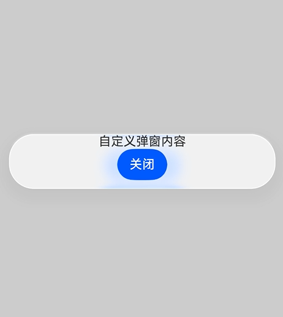
  
  **迁移后示例（新接口）：** 使用[DialogPresenter](../reference/apis-arkui/arkts-apis-uicontext-dialogpresenter.md)的`present()`和`dismiss()`打开和关闭自定义弹出框，并通过Promise获取返回结果。
  
  <!-- @[custom_dialog_after_migrate](https://gitcode.com/openharmony/applications_app_samples/blob/master/code/DocsSample/ArkUISample/ArkuiDialogMigrationSample/entry/src/main/ets/pages/opencustomdialog/CustomDialogAfterMigrate.ets) -->
  
  ``` TypeScript
  import { DialogPresenter, DialogBaseAlignment, DialogResult, ComponentContent } from '@kit.ArkUI';
  import { BusinessError } from '@kit.BasicServicesKit';
  
  // 定义参数类，用于向自定义弹出框内容传递数据
  class Params {
    public text: string = '';
  
    constructor(text: string) {
      this.text = text;
    }
  }
  
  // 自定义弹出框内容的构建器函数
  @Builder
  function buildText(params: Params) {
    Column({ space: 20 }) {
      Text(params.text)
        .fontSize(30)
        .fontWeight(FontWeight.Bold)
        .margin({ bottom: 36 })
      // 关闭弹出框按钮，通过ComponentContent引用关闭弹出框
      Button('关闭弹窗')
        .onClick(() => {
          dialogPresenter?.dismiss(contentNode)
            .then(() => {
              console.info('dismiss success');
            })
            .catch((error: BusinessError) => {
              console.error(`dismiss error code is ${error.code}, message is ${error.message}`);
            })
        })
    }
  }
  
  let contentNode: ComponentContent<Object> | null = null;
  // 全局变量，保存DialogPresenter实例
  let dialogPresenter: DialogPresenter | null = null;
  
  @Entry
  @Component
  export struct CustomDialogAfterMigrate {
    @State result: string = '';
  
    aboutToAppear(): void {
      // 获取DialogPresenter实例
      dialogPresenter = this.getUIContext().getDialogPresenter();
      // 创建ComponentContent，绑定自定义构建器函数和参数
      contentNode = new ComponentContent(this.getUIContext(), wrapBuilder(buildText), new Params('自定义弹窗内容'));
    }
  
    build() {
      NavDestination() {
        Row() {
          Column() {
            Text('CustomDialog 迁移示例')
              .fontSize(18)
              .fontWeight(FontWeight.Bold)
              .margin({ bottom: 20 })
  
            Button('老接口：@CustomDialog + CustomDialogController')
              .width('90%')
              .margin({ bottom: 10 })
              .onClick(() => {
                this.showOldCustomDialog();
              })
  
            Button('新接口：DialogPresenter.present（自定义弹窗）')
              .width('90%')
              .margin({ bottom: 10 })
              .onClick(() => {
                this.showNewCustomDialog();
              })
  
            if (this.result) {
              Text(this.result)
                .fontSize(14)
                .margin({ top: 10 })
            }
          }
          .width('100%')
        }
        .height('100%')
      }
    }
  
    private showOldCustomDialog(): void {
      this.result = '老接口示例请参考 DialogProject 工程';
    }
  
    private showNewCustomDialog(): void {
      dialogPresenter?.present(contentNode, {
        alignment: DialogBaseAlignment.CENTER,
        autoCancel: true,
        maskColor: 0x33000000
      }).then((result: DialogResult) => {
        this.result = 'present success, dialogId: ' + result.dialogId;
      }).catch((error: BusinessError) => {
        this.result = `present error: ${error.code}`;
      });
    }
  }
  ```
  
  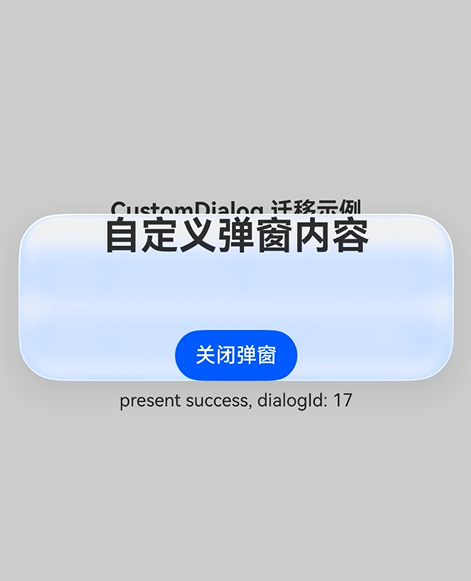

- AlertDialog（告警弹出框）

  | 属性 | 老接口（[UIContext.showAlertDialog](../reference/apis-arkui/arkts-apis-uicontext-uicontext.md#showalertdialog)） | 新接口（[DialogPresenter.present](../reference/apis-arkui/arkts-apis-uicontext-dialogpresenter.md#present)） |
  |------|------|------|
  | 编程模型 | `AlertDialog.show(options)` 命令式调用 | `presenter.present(options): Promise<DialogResult>` |
  | 标题 | `title: ResourceStr` | `title: ResourceStr` |
  | 副标题 | `subtitle: ResourceStr` | `subtitle: ResourceStr` |
  | 消息内容 | `message: ResourceStr` | `message: DialogMessage`（content + wordBreak） |
  | 文本样式 | `textStyle: TextStyle` | `message.wordBreak: WordBreak`（通过 DialogMessage 设置） |
  | 按钮 | `confirm`（单个）/ `primaryButton` + `secondaryButton`（两个）/ `buttons: Array<AlertDialogButtonOptions>`（多个） | `buttons: Array<DialogButton>`（含 value/fontColor/backgroundColor/  enabled/primary/style/action） |
  | 按钮排列 | `buttonDirection: DialogButtonDirection` | `buttonDirection: DialogButtonOrientation` |
  | 操作菜单 | 无 | `sheets: Array<DialogSheet>`（action-sheet 风格） |
  | 网格数 | `gridCount: number` | `gridCount: number` |
  | 确认回调 | `confirm` / `primaryButton.action` / `secondaryButton.action` / `buttons[].action` | `DialogButton.action`（通过 Promise 结果） |
  | 取消回调 | `cancel: VoidCallback` + `onWillDismiss: Callback<DismissDialogAction>` | `onWillDismiss: Callback<DialogDismissal>` |
  | 对齐 | `alignment: DialogAlignment` | `alignment: DialogBaseAlignment` |
  | 偏移 | `offset: Offset` | `offset: Offset` |
  | 自动取消 | `autoCancel: boolean` | `autoCancel: boolean` |
  | 蒙层区域 | `maskRect: Rectangle` | `maskRect: Rectangle` |
  | 模态 | `isModal: boolean` | `isModal: boolean` |
  | 子窗口 | `showInSubWindow: boolean` | `showInSubWindow: boolean` |
  | 背景色 | `backgroundColor` | `backgroundColor` |
  | 背景模糊 | `backgroundBlurStyle` + `backgroundBlurStyleOptions` + `backgroundEffect` | `backgroundBlurStyle` + `backgroundBlurStyleOptions` + `backgroundEffect` |
  | 边框 | `cornerRadius` / `borderWidth` / `borderColor` / `borderStyle` | `borderRadius` / `borderWidth` / `borderColor` / `borderStyle`（`cornerRadius` 更名为 `borderRadius`） |
  | 阴影 | `shadow: ShadowOptions \| ShadowStyle` | `shadow: ShadowOptions \| ShadowStyle` |
  | 尺寸 | `width` / `height` | `width` / `height` |
  | 过渡动画 | `transition: TransitionEffect` | `dialogTransition: TransitionEffect` |
  | 蒙层动画 | 无 | `maskTransition: TransitionEffect` |
  | 打开动画回调 | `onWillAppear` / `onDidAppear` / `onWillDisappear` / `onDidDisappear` | `onWillAppear` / `onDidAppear` / `onWillDisappear` / `onDidDisappear` |
  | 悬浮模式 | `enableHoverMode` + `hoverModeArea` | `enableHoverMode` + `hoverModeArea` |
  | 层级模式 | `levelMode` + `levelUniqueId` + `immersiveMode` + `levelOrder` | `levelMode` + `levelUniqueId` + `immersiveMode` + `levelOrder` |
  | 系统材质 | `systemMaterial: SystemUiMaterial` | `systemMaterial: SystemUiMaterial` |

  **迁移前示例（老接口）：** 使用[showAlertDialog](../reference/apis-arkui/arkts-apis-uicontext-uicontext.md#showalertdialog)弹出告警框，包含标题、消息和按钮。

  <!-- @[alert_dialog_before_migrate](https://gitcode.com/openharmony/applications_app_samples/blob/master/code/DocsSample/ArkUISample/ArkuiDialogMigrationSample/entry/src/main/ets/pages/opencustomdialog/AlertDialogBeforeMigrate.ets) -->
  
  ``` TypeScript
  @Entry
  @Component
  export struct AlertDialogBeforeMigrate {
    @State result: string = '';
  
    build() {
      NavDestination() {
        Column() {
          Button('打开 AlertDialog')
            .onClick(() => {
              this.getUIContext().showAlertDialog({
                title: '提示',
                message: '确认删除？',
                autoCancel: true,
                buttons: [
                  {
                    value: '取消', action: () => {
                    this.result = '取消';
                  }
                  },
                  {
                    value: '确认', action: () => {
                    this.result = '确认';
                  }
                  }
                ],
                cancel: () => {
                  this.result = 'cancel';
                }
              });
            })
  
          if (this.result) {
            Text(this.result)
              .fontSize(14)
              .margin({ top: 10 })
          }
        }
        .width('100%')
        .height('100%')
        .justifyContent(FlexAlign.Center)
      }
    }
  }
  ```
  
  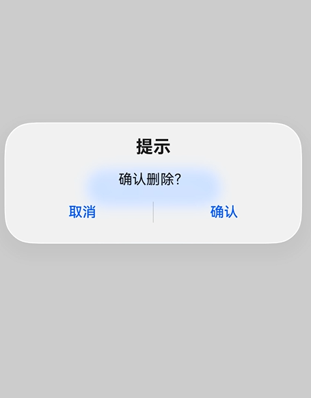
  
  **迁移后示例（新接口）：** 使用[DialogPresenter.present](../reference/apis-arkui/arkts-apis-uicontext-dialogpresenter.md#present)弹出告警框，通过Promise获取按钮点击结果。
  
  <!-- @[alert_dialog_after_migrate](https://gitcode.com/openharmony/applications_app_samples/blob/master/code/DocsSample/ArkUISample/ArkuiDialogMigrationSample/entry/src/main/ets/pages/opencustomdialog/AlertDialogAfterMigrate.ets) -->
  
  ``` TypeScript
  import { DialogBaseAlignment, DialogDismissal, DialogPresenter, DialogResult } from '@kit.ArkUI';
  import { BusinessError } from '@kit.BasicServicesKit';
  
  @Entry
  @Component
  export struct AlertDialogAfterMigrate {
    private presenter: DialogPresenter = this.getUIContext().getDialogPresenter();
    @State result: string = '';
  
    build() {
      NavDestination() {
        Row() {
          Column() {
            Text('AlertDialog 迁移示例')
              .fontSize(18)
              .fontWeight(FontWeight.Bold)
              .margin({ bottom: 20 })
  
            Button('老接口：showAlertDialog')
              .width('90%')
              .margin({ bottom: 10 })
              .onClick(() => {
                this.result = '老接口示例请参考 ts-methods-alert-dialog-box.md';
              })
  
            Button('新接口：DialogPresenter.present（固定样式弹窗）')
              .width('90%')
              .margin({ bottom: 10 })
              .onClick(() => {
                this.showNewAlertDialog();
              })
  
            if (this.result) {
              Text(this.result)
                .fontSize(14)
                .margin({ top: 10 })
            }
          }
          .width('100%')
        }
        .height('100%')
      }
    }
  
    private showNewAlertDialog(): void {
      this.presenter.present({
        title: '提示',
        message: { content: '确认删除？' },
        buttons: [
          {
            value: '取消', action: () => {
            this.result = '用户点击取消';
          }
          },
          {
            value: '确认', action: () => {
            this.result = '用户点击确认';
          }
          }
        ],
        alignment: DialogBaseAlignment.BOTTOM,
        onWillDismiss: (dismissal: DialogDismissal) => {
          this.result = 'onWillDismiss, reason: ' + dismissal.reason;
          dismissal.dismiss();
        }
      }).then((result: DialogResult) => {
        this.result = 'present success, dialogId: ' + result.dialogId;
      }).catch((error: BusinessError) => {
        this.result = `present error: ${error.code}`;
      });
    }
  }
  ```
  
  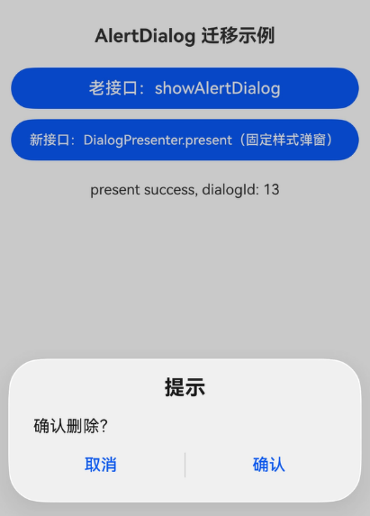

- ActionSheet（列表选择弹出框）

  | 属性 | 老接口（[UIContext.showActionSheet](../reference/apis-arkui/arkts-apis-uicontext-uicontext.md#showactionsheet)） | 新接口（[DialogPresenter.present](../reference/apis-arkui/arkts-apis-uicontext-dialogpresenter.md#present)） |
  |------|------|------|
  | 编程模型 | `ActionSheet.show(options)` 命令式调用 | `presenter.present(options): Promise<DialogResult>` |
  | 标题 | `title: string \| Resource` | `title: ResourceStr` |
  | 副标题 | `subtitle: ResourceStr` | `subtitle: ResourceStr` |
  | 消息内容 | `message: string \| Resource` | `message: DialogMessage`（content + wordBreak） |
  | 按钮 | `confirm: ActionSheetButtonOptions`（单个确认按钮） | `buttons: Array<DialogButton>` |
  | 按钮排列 | 无 | `buttonDirection: DialogButtonOrientation` |
  | 操作菜单 | `sheets: Array<SheetInfo>`（title/icon/action） | `sheets: Array<DialogSheet>`（title/icon/action） |
  | 网格数 | 无 | `gridCount: number` |
  | 确认回调 | `confirm.action: VoidCallback` | `DialogButton.action` |
  | 取消回调 | `cancel: VoidCallback` + `onWillDismiss: Callback<DismissDialogAction>` | `onWillDismiss: Callback<DialogDismissal>` |
  | 对齐 | `alignment: DialogAlignment` | `alignment: DialogBaseAlignment` |
  | 偏移 | `offset: ActionSheetOffset`（含 dx/dy） | `offset: Offset`（含 dx/dy） |
  | 自动取消 | `autoCancel: boolean` | `autoCancel: boolean` |
  | 蒙层区域 | `maskRect: Rectangle` | `maskRect: Rectangle` |
  | 模态 | `isModal: boolean` | `isModal: boolean` |
  | 子窗口 | `showInSubWindow: boolean` | `showInSubWindow: boolean` |
  | 背景色 | `backgroundColor` | `backgroundColor` |
  | 背景模糊 | `backgroundBlurStyle` + `backgroundBlurStyleOptions` + `backgroundEffect` | `backgroundBlurStyle` + `backgroundBlurStyleOptions` + `backgroundEffect` |
  | 边框 | `cornerRadius` / `borderWidth` / `borderColor` / `borderStyle` | `borderRadius` / `borderWidth` / `borderColor` / `borderStyle`（`cornerRadius` 更名为 `borderRadius`） |
  | 阴影 | `shadow: ShadowOptions \| ShadowStyle` | `shadow: ShadowOptions \| ShadowStyle` |
  | 尺寸 | `width` / `height` | `width` / `height` |
  | 过渡动画 | `transition: TransitionEffect` | `dialogTransition: TransitionEffect` |
  | 蒙层动画 | 无 | `maskTransition: TransitionEffect` |
  | 打开动画回调 | `onWillAppear` / `onDidAppear` / `onWillDisappear` / `onDidDisappear` | `onWillAppear` / `onDidAppear` / `onWillDisappear` / `onDidDisappear` |
  | 悬浮模式 | `enableHoverMode` + `hoverModeArea` | `enableHoverMode` + `hoverModeArea` |
  | 层级模式 | `levelMode` + `levelUniqueId` + `immersiveMode` + `levelOrder` | `levelMode` + `levelUniqueId` + `immersiveMode` + `levelOrder` |
  | 系统材质 | `systemMaterial: SystemUiMaterial` | `systemMaterial: SystemUiMaterial` |

  **迁移前示例（老接口）：** 使用[showActionSheet](../reference/apis-arkui/arkts-apis-uicontext-uicontext.md#showactionsheet)弹出列表选择弹出框，包含标题和菜单项。
  
  <!-- @[action_sheet_before_migrate](https://gitcode.com/openharmony/applications_app_samples/blob/master/code/DocsSample/ArkUISample/ArkuiDialogMigrationSample/entry/src/main/ets/pages/opencustomdialog/ActionSheetBeforeMigrate.ets) -->
  
  ``` TypeScript
  @Entry
  @Component
  export struct ActionSheetBeforeMigrate {
    @State result: string = '';
  
    build() {
      NavDestination() {
        Column() {
          Button('打开 ActionSheet')
            .onClick(() => {
              this.getUIContext().showActionSheet({
                title: '选择操作',
                message: '请选择一个操作',
                autoCancel: true,
                sheets: [
                  {
                    title: '复制', action: () => {
                    this.result = '复制';
                  }
                  },
                  {
                    title: '删除', action: () => {
                    this.result = '删除';
                  }
                  }
                ],
                cancel: () => {
                  this.result = '取消';
                }
              });
            })
  
          if (this.result) {
            Text(this.result)
              .fontSize(14)
              .margin({ top: 10 })
          }
        }
        .width('100%')
        .height('100%')
        .justifyContent(FlexAlign.Center)
      }
    }
  }
  ```
  
  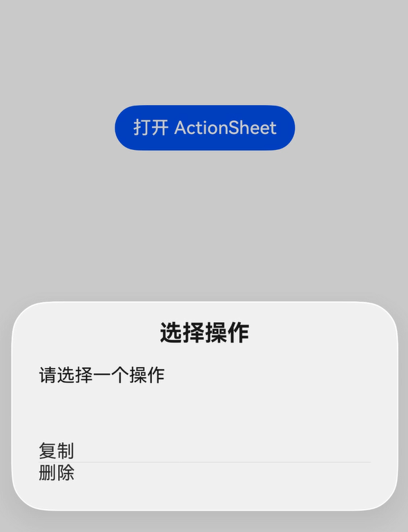
  
  **迁移后示例（新接口）：** 使用[DialogPresenter.present](../reference/apis-arkui/arkts-apis-uicontext-dialogpresenter.md#present)弹出列表选择弹出框，通过Promise获取选择结果。
  
  <!-- @[action_sheet_after_migrate](https://gitcode.com/openharmony/applications_app_samples/blob/master/code/DocsSample/ArkUISample/ArkuiDialogMigrationSample/entry/src/main/ets/pages/opencustomdialog/ActionSheetAfterMigrate.ets) -->
  
  ``` TypeScript
  import { DialogDismissal, DialogPresenter, DialogResult } from '@kit.ArkUI';
  import { BusinessError } from '@kit.BasicServicesKit';
  
  @Entry
  @Component
  export struct ActionSheetAfterMigrate {
    private presenter: DialogPresenter = this.getUIContext().getDialogPresenter();
    @State result: string = '';
  
    build() {
      NavDestination() {
        Row() {
          Column() {
            Text('ActionSheet 迁移示例')
              .fontSize(18)
              .fontWeight(FontWeight.Bold)
              .margin({ bottom: 20 })
  
            Button('老接口：showActionSheet')
              .width('90%')
              .margin({ bottom: 10 })
              .onClick(() => {
                this.result = '老接口示例请参考 ts-methods-action-sheet.md';
              })
  
            Button('新接口：DialogPresenter.present（列表选择弹窗）')
              .width('90%')
              .margin({ bottom: 10 })
              .onClick(() => {
                this.showNewActionSheet();
              })
  
            if (this.result) {
              Text(this.result)
                .fontSize(14)
                .margin({ top: 10 })
            }
          }
          .width('100%')
        }
        .height('100%')
      }
    }
  
    private showNewActionSheet(): void {
      this.presenter.present({
        title: '选择操作',
        message: { content: '请选择一个操作' },
        autoCancel: true,
        sheets: [
          { title: '复制', action: () => { this.result = '复制'; } },
          { title: '删除', action: () => { this.result = '删除'; } }
        ],
        onWillDismiss: (dismissal: DialogDismissal) => {
          this.result = '取消';
          dismissal.dismiss();
        }
      }).then((result: DialogResult) => {
        this.result = 'present success, dialogId: ' + result.dialogId;
      }).catch((error: BusinessError) => {
        this.result = `present error: ${error.code}`;
      });
    }
  }
  ```
  
  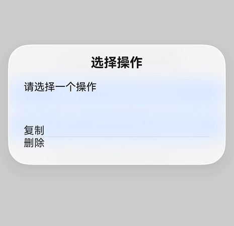

- promptAction.showDialog（对话框）

  | 属性 | 老接口（[promptAction.showDialog](../reference/apis-arkui/arkts-apis-uicontext-promptaction.md#showdialog)） | 新接口（[DialogPresenter.present](../reference/apis-arkui/arkts-apis-uicontext-dialogpresenter.md#present)） |
  |------|------|------|
  | 编程模型 | `promptAction.showDialog(options): Promise<ShowDialogSuccessResponse>` | `presenter.present(options): Promise<DialogResult>` |
  | 标题 | `title: string \| Resource` | `title: ResourceStr` |
  | 副标题 | 无 | `subtitle: ResourceStr` |
  | 消息内容 | `message: string \| Resource` | `message: DialogMessage`（content + wordBreak） |
  | 按钮 | `buttons: Array<Button>`（仅 text + color + primary） | `buttons: Array<DialogButton>`（含 value/fontColor/backgroundColor/enabled/primary/style/action） |
  | 按钮排列 | 无 | `buttonDirection: DialogButtonOrientation` |
  | 操作菜单 | 无 | `sheets: Array<DialogSheet>` |
  | 网格数 | 无 | `gridCount: number` |
  | 确认回调 | 通过 `ShowDialogSuccessResponse.index` 获取按钮索引 | `DialogButton.action` + Promise 结果 |
  | 取消回调 | 无 | `onWillDismiss: Callback<DialogDismissal>` |
  | 对齐 | `alignment: DialogAlignment` | `alignment: DialogBaseAlignment` |
  | 偏移 | `offset: Offset` | `offset: Offset` |
  | 自动取消 | 无 | `autoCancel: boolean` |
  | 蒙层颜色 | 无 | `maskColor: ResourceColor` |
  | 蒙层区域 | `maskRect: Rectangle` | `maskRect: Rectangle` |
  | 模态 | `isModal: boolean` | `isModal: boolean` |
  | 子窗口 | `showInSubWindow: boolean` | `showInSubWindow: boolean` |
  | 背景色 | `backgroundColor` | `backgroundColor` |
  | 背景模糊 | `backgroundBlurStyle` + `backgroundBlurStyleOptions` + `backgroundEffect` | `backgroundBlurStyle` + `backgroundBlurStyleOptions` + `backgroundEffect` |
  | 边框 | 无 | `borderRadius` / `borderWidth` / `borderColor` / `borderStyle` |
  | 阴影 | `shadow: ShadowOptions \| ShadowStyle` | `shadow: ShadowOptions \| ShadowStyle` |
  | 尺寸 | 无 | `width` / `height` |
  | 过渡动画 | 无 | `dialogTransition: TransitionEffect` |
  | 蒙层动画 | 无 | `maskTransition: TransitionEffect` |
  | 打开动画回调 | `onWillAppear` / `onDidAppear` / `onWillDisappear` / `onDidDisappear` | `onWillAppear` / `onDidAppear` / `onWillDisappear` / `onDidDisappear` |
  | 悬浮模式 | `enableHoverMode` + `hoverModeArea` | `enableHoverMode` + `hoverModeArea` |
  | 层级模式 | `levelMode` + `levelUniqueId` + `immersiveMode` + `levelOrder` | `levelMode` + `levelUniqueId` + `immersiveMode` + `levelOrder` |
  | 系统材质 | `systemMaterial: SystemUiMaterial` | `systemMaterial: SystemUiMaterial` |

  **迁移前示例（老接口）：** 使用[showDialog](../reference/apis-arkui/arkts-apis-uicontext-promptaction.md#showdialog)弹出对话框，包含标题、消息和按钮。
  
  <!-- @[show_dialog_before_migrate](https://gitcode.com/openharmony/applications_app_samples/blob/master/code/DocsSample/ArkUISample/ArkuiDialogMigrationSample/entry/src/main/ets/pages/opencustomdialog/ShowDialogBeforeMigrate.ets) -->
  
  ``` TypeScript
  import { BusinessError } from '@kit.BasicServicesKit';
  
  @Entry
  @Component
  export struct ShowDialogBeforeMigrate {
    @State result: string = '';
  
    build() {
      NavDestination() {
        Column() {
          Button('打开 showDialog')
            .onClick(() => {
              this.getUIContext()
                .getPromptAction()
                .showDialog({
                  title: '提示',
                  message: '确认删除？',
                  buttons: [
                    { text: '取消', color: '#666666' },
                    { text: '确认', color: '#0000FF' }
                  ]
                })
                .then((data) => {
                  this.result = 'click button index: ' + data.index;
                })
                .catch((error: BusinessError) => {
                  this.result = `showDialog error: ${error.code}`;
                });
            })
  
          if (this.result) {
            Text(this.result)
              .fontSize(14)
              .margin({ top: 10 })
          }
        }
        .width('100%')
        .height('100%')
        .justifyContent(FlexAlign.Center)
      }
    }
  }
  ```
  
  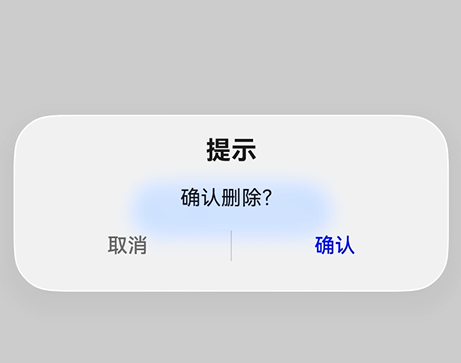
  
  **迁移后示例（新接口）：** 使用[DialogPresenter.present](../reference/apis-arkui/arkts-apis-uicontext-dialogpresenter.md#present)弹出对话框，通过Promise获取按钮点击结果。
  
  <!-- @[show_dialog_after_migrate](https://gitcode.com/openharmony/applications_app_samples/blob/master/code/DocsSample/ArkUISample/ArkuiDialogMigrationSample/entry/src/main/ets/pages/opencustomdialog/ShowDialogAfterMigrate.ets) -->
  
  ``` TypeScript
  import { DialogPresenter, DialogResult } from '@kit.ArkUI';
  import { BusinessError } from '@kit.BasicServicesKit';
  
  @Entry
  @Component
  export struct ShowDialogAfterMigrate {
    private presenter: DialogPresenter = this.getUIContext().getDialogPresenter();
    @State result: string = '';
  
    build() {
      NavDestination() {
        Row() {
          Column() {
            Text('showDialog 迁移示例')
              .fontSize(18)
              .fontWeight(FontWeight.Bold)
              .margin({ bottom: 20 })
  
            Button('老接口：promptAction.showDialog')
              .width('90%')
              .margin({ bottom: 10 })
              .onClick(() => {
                this.result = '老接口示例请参考 js-apis-promptAction.md';
              })
  
            Button('新接口：DialogPresenter.present（对话框）')
              .width('90%')
              .margin({ bottom: 10 })
              .onClick(() => {
                this.showNewDialog();
              })
  
            if (this.result) {
              Text(this.result)
                .fontSize(14)
                .margin({ top: 10 })
            }
          }
          .width('100%')
        }
        .height('100%')
      }
    }
  
    private showNewDialog(): void {
      this.presenter.present({
        title: '提示',
        message: { content: '确认删除？' },
        buttons: [
          { value: '取消', action: () => { this.result = '取消'; } },
          { value: '确认', action: () => { this.result = '确认'; } }
        ]
      }).then((result: DialogResult) => {
        this.result = 'present success, dialogId: ' + result.dialogId;
      }).catch((error: BusinessError) => {
        this.result = `present error: ${error.code}`;
      });
    }
  }
  ```
  
  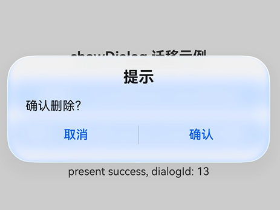

- promptAction.showActionMenu（操作菜单）

  | 属性 | 老接口（[promptAction.showActionMenu](../reference/apis-arkui/arkts-apis-uicontext-promptaction.md#showactionmenu)） | 新接口（[DialogPresenter.present](../reference/apis-arkui/arkts-apis-uicontext-dialogpresenter.md#present)） |
  |------|------|------|
  | 编程模型 | `promptAction.showActionMenu(options): Promise<ActionMenuSuccessResponse>` | `presenter.present(options): Promise<DialogResult>` |
  | 标题 | `title: string \| Resource` | `title: ResourceStr` |
  | 副标题 | 无 | `subtitle: ResourceStr` |
  | 消息内容 | 无 | `message: DialogMessage` |
  | 按钮 | `buttons: [Button, ...]`（支持1-6个按钮，结构为仅text + color + primary） | `buttons: Array<DialogButton>`（无数量限制，结构含value/fontColor/backgroundColor/enabled/primary/style/action） |
  | 按钮排列 | 无 | `buttonDirection: DialogButtonOrientation` |
  | 操作菜单 | 无 | `sheets: Array<DialogSheet>` |
  | 网格数 | 无 | `gridCount: number` |
  | 确认回调 | 通过 `ActionMenuSuccessResponse.index` 获取按钮索引 | `DialogButton.action` + Promise 结果 |
  | 取消回调 | 无 | `onWillDismiss: Callback<DialogDismissal>` |
  | 对齐 | 无 | `alignment: DialogBaseAlignment` |
  | 偏移 | 无 | `offset: Offset` |
  | 自动取消 | 无 | `autoCancel: boolean` |
  | 蒙层颜色 | 无 | `maskColor: ResourceColor` |
  | 蒙层区域 | 无 | `maskRect: Rectangle` |
  | 模态 | `isModal: boolean` | `isModal: boolean` |
  | 子窗口 | `showInSubWindow: boolean` | `showInSubWindow: boolean` |
  | 背景色 | 无 | `backgroundColor` |
  | 背景模糊 | 无 | `backgroundBlurStyle` + `backgroundBlurStyleOptions` + `backgroundEffect` |
  | 边框 | 无 | `borderRadius` / `borderWidth` / `borderColor` / `borderStyle` |
  | 阴影 | 无 | `shadow: ShadowOptions \| ShadowStyle` |
  | 尺寸 | 无 | `width` / `height` |
  | 过渡动画 | 无 | `dialogTransition: TransitionEffect` |
  | 蒙层动画 | 无 | `maskTransition: TransitionEffect` |
  | 打开动画回调 | `onWillAppear` / `onDidAppear` / `onWillDisappear` / `onDidDisappear` | `onWillAppear` / `onDidAppear` / `onWillDisappear` / `onDidDisappear` |
  | 悬浮模式 | 无 | `enableHoverMode` + `hoverModeArea` |
  | 层级模式 | `levelMode` + `levelUniqueId` + `immersiveMode` | `levelMode` + `levelUniqueId` + `immersiveMode` + `levelOrder` |
  | 系统材质 | `systemMaterial: SystemUiMaterial` | `systemMaterial: SystemUiMaterial` |

  **迁移前示例（老接口）：** 使用[showActionMenu](../reference/apis-arkui/arkts-apis-uicontext-promptaction.md#showactionmenu)弹出操作菜单，包含标题和菜单项。
  
  <!-- @[action_menu_before_migrate](https://gitcode.com/openharmony/applications_app_samples/blob/master/code/DocsSample/ArkUISample/ArkuiDialogMigrationSample/entry/src/main/ets/pages/opencustomdialog/ActionMenuBeforeMigrate.ets) -->
  
  ``` TypeScript
  import { BusinessError } from '@kit.BasicServicesKit';
  
  @Entry
  @Component
  export struct ActionMenuBeforeMigrate {
    @State result: string = '';
  
    build() {
      NavDestination() {
        Column() {
          Button('打开 showActionMenu')
            .onClick(() => {
              this.getUIContext()
                .getPromptAction()
                .showActionMenu({
                  title: '选择操作',
                  buttons: [
                    { text: '保存', color: '#0000FF' },
                    { text: '分享', color: '#0000FF' },
                    { text: '删除', color: '#FF0000' }
                  ]
                })
                .then((data) => {
                  this.result = 'click button index: ' + data.index;
                })
                .catch((error: BusinessError) => {
                  this.result = `showActionMenu error: ${error.code}`;
                });
            })
  
          if (this.result) {
            Text(this.result)
              .fontSize(14)
              .margin({ top: 10 })
          }
        }
        .width('100%')
        .height('100%')
        .justifyContent(FlexAlign.Center)
      }
    }
  }
  ```
  
  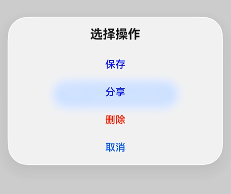
  
  **迁移后示例（新接口）：** 使用[DialogPresenter.present](../reference/apis-arkui/arkts-apis-uicontext-dialogpresenter.md#present)弹出操作菜单，通过Promise获取选择结果。
  
  <!-- @[action_menu_after_migrate](https://gitcode.com/openharmony/applications_app_samples/blob/master/code/DocsSample/ArkUISample/ArkuiDialogMigrationSample/entry/src/main/ets/pages/opencustomdialog/ActionMenuAfterMigrate.ets) -->
  
  ``` TypeScript
  import { DialogPresenter, DialogResult } from '@kit.ArkUI';
  import { BusinessError } from '@kit.BasicServicesKit';
  
  @Entry
  @Component
  export struct ActionMenuAfterMigrate {
    private presenter: DialogPresenter = this.getUIContext().getDialogPresenter();
    @State result: string = '';
  
    build() {
      NavDestination() {
        Row() {
          Column() {
            Text('showActionMenu 迁移示例')
              .fontSize(18)
              .fontWeight(FontWeight.Bold)
              .margin({ bottom: 20 })
  
            Button('老接口：promptAction.showActionMenu')
              .width('90%')
              .margin({ bottom: 10 })
              .onClick(() => {
                this.result = '老接口示例请参考 js-apis-promptAction.md';
              })
  
            Button('新接口：DialogPresenter.present（操作菜单）')
              .width('90%')
              .margin({ bottom: 10 })
              .onClick(() => {
                this.showNewActionMenu();
              })
  
            if (this.result) {
              Text(this.result)
                .fontSize(14)
                .margin({ top: 10 })
            }
          }
          .width('100%')
        }
        .height('100%')
      }
    }
  
    private showNewActionMenu(): void {
      this.presenter.present({
        title: '选择操作',
        buttons: [
          { value: '保存', action: () => { this.result = '保存'; } },
          { value: '分享', action: () => { this.result = '分享'; } },
          { value: '删除', action: () => { this.result = '删除'; } }
        ]
      }).then((result: DialogResult) => {
        this.result = 'present success, dialogId: ' + result.dialogId;
      }).catch((error: BusinessError) => {
        this.result = `present error: ${error.code}`;
      });
    }
  }
  ```
  
  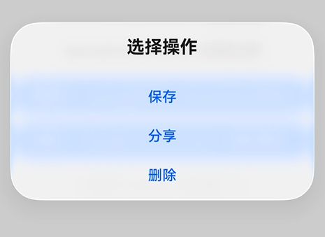

- promptAction.presentCustomDialog（自定义弹出框）

  | 属性 | 老接口（[promptAction.presentCustomDialog](../reference/apis-arkui/arkts-apis-uicontext-promptaction.md#presentcustomdialog18)） | 新接口（[DialogPresenter.present](../reference/apis-arkui/arkts-apis-uicontext-dialogpresenter.md#present)） |
  |------|------|------|
  | 编程模型 | `promptAction.presentCustomDialog(builder, controller?, options?): Promise<number>` | `presenter.present(content, options?: DialogCustomOptions): Promise<DialogResult>` |
  | 内容构建 | `CustomBuilder` / `CustomBuilderWithId` | `CustomBuilder` / `CustomBuilderWithId` / `ComponentContent<Object>` |
  | 控制器 | `promptAction.DialogController` | `DialogBaseController` |
  | 选项类型 | `DialogOptions`（继承 `BaseDialogOptions`） | `DialogCustomOptions`（继承 `DialogBaseOptions`） |
  | 样式控制 | 无 `customStyle` 属性（内容样式完全由 builder 决定） | `customStyle: boolean` |
  | 对齐 | `alignment: DialogAlignment` | `alignment: DialogBaseAlignment` |
  | 偏移 | `offset: Offset` | `offset: Offset` |
  | 自动取消 | `autoCancel: boolean` | `autoCancel: boolean` |
  | 蒙层颜色 | `maskColor: ResourceColor` | `maskColor: ResourceColor` |
  | 蒙层区域 | `maskRect: Rectangle` | `maskRect: Rectangle` |
  | 模态 | `isModal: boolean` | `isModal: boolean` |
  | 子窗口 | `showInSubWindow: boolean` | `showInSubWindow: boolean` |
  | 背景色 | `backgroundColor`（`DialogOptions`） | `backgroundColor` |
  | 背景模糊 | `backgroundBlurStyle`（`DialogOptions`） + `backgroundBlurStyleOptions` + `backgroundEffect` | `backgroundBlurStyle` + `backgroundBlurStyleOptions` + `backgroundEffect` |
  | 边框 | `cornerRadius` / `borderWidth` / `borderColor` / `borderStyle`（`DialogOptions`） | `borderRadius` / `borderWidth` / `borderColor` / `borderStyle`（`cornerRadius` 更名为   `borderRadius`） |
  | 阴影 | `shadow`（`DialogOptions`） | `shadow: ShadowOptions \| ShadowStyle` |
  | 尺寸 | `width` / `height`（`DialogOptions`） | `width` / `height` |
  | 过渡动画 | `transition: TransitionEffect` / `dialogTransition` | `dialogTransition: TransitionEffect` |
  | 蒙层动画 | `maskTransition: TransitionEffect` | `maskTransition: TransitionEffect` |
  | 焦点 | `focusable: boolean` | `focusable: boolean` |
  | 打开动画回调 | `onWillAppear` / `onDidAppear` / `onWillDisappear` / `onDidDisappear` | `onWillAppear` / `onDidAppear` / `onWillDisappear` / `onDidDisappear` |
  | 取消回调 | `onWillDismiss: Callback<DismissDialogAction>` | `onWillDismiss: Callback<DialogDismissal>` |
  | 键盘避让 | `keyboardAvoidMode` + `keyboardAvoidDistance`  | `keyboardAvoidMode` + `keyboardAvoidDistance` |
  | 悬浮模式 | `enableHoverMode`  + `hoverModeArea`  | `enableHoverMode` + `hoverModeArea` |
  | 层级模式 | `levelMode`  + `levelUniqueId`  + `immersiveMode`  + `levelOrder`  | `levelMode` + `levelUniqueId` + `immersiveMode` + `levelOrder` |
  | 系统材质 | `systemMaterial: SystemUiMaterial`  | `systemMaterial: SystemUiMaterial` |

  **迁移前示例（老接口）：** 使用[presentCustomDialog](../reference/apis-arkui/arkts-apis-uicontext-promptaction.md#presentcustomdialog18)弹出自定义弹出框。
  
  <!-- @[present_custom_dialog_before_migrate](https://gitcode.com/openharmony/applications_app_samples/blob/master/code/DocsSample/ArkUISample/ArkuiDialogMigrationSample/entry/src/main/ets/pages/opencustomdialog/PresentCustomDialogBeforeMigrate.ets) -->
  
  ``` TypeScript
  import { promptAction } from '@kit.ArkUI';
  import { BusinessError } from '@kit.BasicServicesKit';
  
  @Entry
  @Component
  export struct PresentCustomDialogBeforeMigrate {
    private dialogController: promptAction.DialogController = new promptAction.DialogController();
    @State result: string = '';
  
    @Builder customDialogComponent() {
      Column() {
        Text('自定义弹窗内容')
          .fontSize(16)
          .margin({ bottom: 10 })
        Button('关闭弹窗')
          .onClick(() => {
            this.dialogController.close();
          })
      }
      .padding(20)
    }
  
    build() {
      NavDestination() {
        Column() {
          Button('打开 presentCustomDialog')
            .onClick(() => {
              this.getUIContext()
                .getPromptAction()
                .presentCustomDialog(() => {
                  this.customDialogComponent()
                }, this.dialogController, { autoCancel: true })
                .then((dialogId: number) => {
                  this.result = 'present success, dialogId: ' + dialogId;
                })
                .catch((error: BusinessError) => {
                  this.result = `present error: ${error.code}`;
                });
            })
  
          if (this.result) {
            Text(this.result)
              .fontSize(14)
              .margin({ top: 10 })
          }
        }
        .width('100%')
        .height('100%')
        .justifyContent(FlexAlign.Center)
      }
    }
  }
  ```
  
  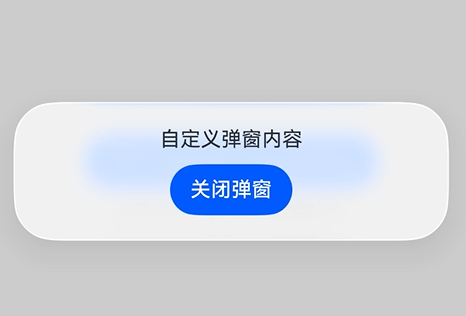
  
  **迁移后示例（新接口）：** 使用[DialogPresenter.present](../reference/apis-arkui/arkts-apis-uicontext-dialogpresenter.md#present)弹出自定义弹出框，通过Promise获取返回结果。
  
  <!-- @[present_custom_dialog_after_migrate](https://gitcode.com/openharmony/applications_app_samples/blob/master/code/DocsSample/ArkUISample/ArkuiDialogMigrationSample/entry/src/main/ets/pages/opencustomdialog/PresentCustomDialogAfterMigrate.ets) -->
  
  ``` TypeScript
  import { DialogBaseController, DialogPresenter, DialogResult } from '@kit.ArkUI';
  import { BusinessError } from '@kit.BasicServicesKit';
  
  @Entry
  @Component
  export struct PresentCustomDialogAfterMigrate {
    private presenter: DialogPresenter = this.getUIContext().getDialogPresenter();
    private controller: DialogBaseController = new DialogBaseController();
    @State result: string = '';
  
    build() {
      NavDestination() {
        Row() {
          Column() {
            Text('presentCustomDialog 迁移示例')
              .fontSize(18)
              .fontWeight(FontWeight.Bold)
              .margin({ bottom: 20 })
  
            Button('老接口：promptAction.presentCustomDialog')
              .width('90%')
              .margin({ bottom: 10 })
              .onClick(() => {
                this.result = '老接口示例请参考 arkts-apis-uicontext-promptaction.md';
              })
  
            Button('新接口：DialogPresenter.present（自定义弹窗）')
              .width('90%')
              .margin({ bottom: 10 })
              .onClick(() => {
                this.showNewCustomDialog();
              })
  
            if (this.result) {
              Text(this.result)
                .fontSize(14)
                .margin({ top: 10 })
            }
          }
          .width('100%')
        }
        .height('100%')
      }
    }
  
    @Builder
    CustomComponentContent() {
      Column() {
        Text('自定义弹窗内容')
          .fontSize(16)
          .margin({ bottom: 10 })
        Button('关闭弹窗')
          .onClick(() => {
            this.controller.close();
          })
      }
      .padding(20)
    }
  
    private showNewCustomDialog(): void {
      this.presenter.present(() => {
        this.CustomComponentContent()
      }, {
        controller: this.controller,
        autoCancel: true
      }).then((result: DialogResult) => {
        this.result = 'present success, dialogId: ' + result.dialogId;
      }).catch((error: BusinessError) => {
        this.result = `present error: ${error.code}`;
      });
    }
  }
  ```
  
  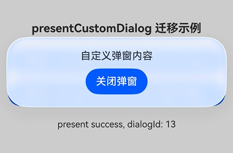

- promptAction.openCustomDialogWithController（带控制器的自定义弹出框）

  | 属性 | 老接口（[promptAction.openCustomDialogWithController](../reference/apis-arkui/arkts-apis-uicontext-promptaction.md#opencustomdialogwithcontroller18)） | 新接口（[DialogPresenter.present](../reference/apis-arkui/arkts-apis-uicontext-dialogpresenter.md#present)） |
  |------|------|------|
  | 编程模型 | `promptAction.openCustomDialogWithController(content, controller, options?): Promise<void>` | `presenter.present(content, options?: DialogCustomOptions): Promise<DialogResult>` |
  | 内容构建 | `ComponentContent<Object>` | `CustomBuilder` / `CustomBuilderWithId` / `ComponentContent<Object>` |
  | 控制器 | `promptAction.DialogController`  | `DialogBaseController` |
  | 选项类型 | `BaseDialogOptions` | `DialogCustomOptions`（继承 `DialogBaseOptions`） |
  | 样式控制 | 无 `customStyle` 属性（内容样式完全由 ComponentContent 决定） | `customStyle: boolean` |
  | 对齐 | `alignment: DialogAlignment` | `alignment: DialogBaseAlignment` |
  | 偏移 | `offset: Offset` | `offset: Offset` |
  | 自动取消 | `autoCancel: boolean`  | `autoCancel: boolean` |
  | 蒙层颜色 | `maskColor: ResourceColor`  | `maskColor: ResourceColor` |
  | 蒙层区域 | `maskRect: Rectangle` | `maskRect: Rectangle` |
  | 模态 | `isModal: boolean` | `isModal: boolean` |
  | 子窗口 | `showInSubWindow: boolean` | `showInSubWindow: boolean` |
  | 背景色 | 无（`BaseDialogOptions` 不含 `backgroundColor`） | `backgroundColor` |
  | 背景模糊 | `backgroundBlurStyleOptions`  + `backgroundEffect`  | `backgroundBlurStyle` + `backgroundBlurStyleOptions` + `backgroundEffect` |
  | 边框 | 无（`BaseDialogOptions` 不含边框属性） | `borderRadius` / `borderWidth` / `borderColor` / `borderStyle` |
  | 阴影 | 无（`BaseDialogOptions` 不含 `shadow`） | `shadow: ShadowOptions \| ShadowStyle` |
  | 尺寸 | 无（`BaseDialogOptions` 不含 `width` / `height`） | `width` / `height` |
  | 过渡动画 | `transition: TransitionEffect`  / `dialogTransition`  | `dialogTransition: TransitionEffect` |
  | 蒙层动画 | `maskTransition: TransitionEffect`  | `maskTransition: TransitionEffect` |
  | 焦点 | `focusable: boolean`  | `focusable: boolean` |
  | 打开动画回调 | `onWillAppear` / `onDidAppear` / `onWillDisappear` / `onDidDisappear`  | `onWillAppear` / `onDidAppear` / `onWillDisappear` / `onDidDisappear` |
  | 取消回调 | `onWillDismiss: Callback<DismissDialogAction>`  | `onWillDismiss: Callback<DialogDismissal>` |
  | 键盘避让 | `keyboardAvoidMode`  + `keyboardAvoidDistance`  | `keyboardAvoidMode` + `keyboardAvoidDistance` |
  | 悬浮模式 | `enableHoverMode`  + `hoverModeArea`  | `enableHoverMode` + `hoverModeArea` |
  | 层级模式 | `levelMode`  + `levelUniqueId`  + `immersiveMode`  + `levelOrder`  | `levelMode` + `levelUniqueId` + `immersiveMode` + `levelOrder` |
  | 系统材质 | `systemMaterial: SystemUiMaterial`  | `systemMaterial: SystemUiMaterial` |

  **迁移前示例（老接口）：** 使用[openCustomDialogWithController](../reference/apis-arkui/arkts-apis-uicontext-promptaction.md#opencustomdialogwithcontroller18)弹出带控制器的自定义弹出框。
  
  <!-- @[open_custom_dialog_with_controller_before_migrate](https://gitcode.com/openharmony/applications_app_samples/blob/master/code/DocsSample/ArkUISample/ArkuiDialogMigrationSample/entry/src/main/ets/pages/opencustomdialog/OpenCustomDialogWithControllerBeforeMigrate.ets) -->
  
  ``` TypeScript
  import { ComponentContent, promptAction } from '@kit.ArkUI';
  import { BusinessError } from '@kit.BasicServicesKit';
  
  class Params {
    public text: string = '';
  
    constructor(text: string) {
      this.text = text;
    }
  }
  
  @Builder
  function buildText(params: Params) {
    Column() {
      Text(params.text)
        .fontSize(16)
        .margin({ bottom: 10 })
    }
    .padding(20)
  }
  
  @Entry
  @Component
  export struct OpenCustomDialogWithControllerBeforeMigrate {
    private dialogController: promptAction.DialogController = new promptAction.DialogController();
    @State result: string = '';
  
    build() {
      NavDestination() {
        Column() {
          Button('打开 openCustomDialogWithController')
            .onClick(() => {
              let contentNode = new ComponentContent(this.getUIContext(), wrapBuilder(buildText),
                new Params('自定义弹窗内容'));
              this.getUIContext()
                .getPromptAction()
                .openCustomDialogWithController(contentNode,
                  this.dialogController, {
                    autoCancel: true,
                    alignment: DialogAlignment.Center
                  })
                .then(() => {
                  this.result = 'opened';
                })
                .catch((error: BusinessError) => {
                  this.result = `open error: ${error.code}`;
                });
            })
  
          if (this.result) {
            Text(this.result)
              .fontSize(14)
              .margin({ top: 10 })
          }
        }
        .width('100%')
        .height('100%')
        .justifyContent(FlexAlign.Center)
      }
    }
  }
  ```
  
  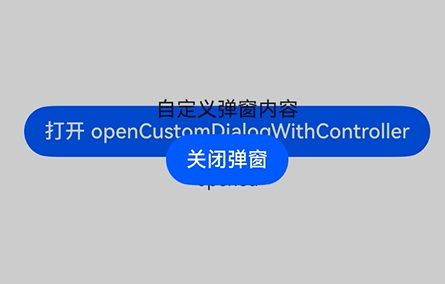
  
  **迁移后示例（新接口）：** 使用[DialogPresenter.present](../reference/apis-arkui/arkts-apis-uicontext-dialogpresenter.md#present)弹出带控制器的自定义弹出框，通过Promise获取返回结果。
  
  <!-- @[open_custom_dialog_with_controller_after_migrate](https://gitcode.com/openharmony/applications_app_samples/blob/master/code/DocsSample/ArkUISample/ArkuiDialogMigrationSample/entry/src/main/ets/pages/opencustomdialog/OpenCustomDialogWithControllerAfterMigrate.ets) -->
  
  ``` TypeScript
  import { DialogBaseAlignment, DialogBaseController, DialogPresenter, DialogResult } from '@kit.ArkUI';
  import { BusinessError } from '@kit.BasicServicesKit';
  
  @Entry
  @Component
  export struct OpenCustomDialogWithControllerAfterMigrate {
    private presenter: DialogPresenter = this.getUIContext().getDialogPresenter();
    private controller: DialogBaseController = new DialogBaseController();
    @State result: string = '';
  
    build() {
      NavDestination() {
        Row() {
          Column() {
            Text('openCustomDialogWithController 迁移示例')
              .fontSize(18)
              .fontWeight(FontWeight.Bold)
              .margin({ bottom: 20 })
  
            Button('老接口：promptAction.openCustomDialogWithController')
              .width('90%')
              .margin({ bottom: 10 })
              .onClick(() => {
                this.result = '老接口示例请参考 arkts-apis-uicontext-promptaction.md';
              })
  
            Button('新接口：DialogPresenter.present（自定义弹窗）')
              .width('90%')
              .margin({ bottom: 10 })
              .onClick(() => {
                this.showNewCustomDialog();
              })
  
            if (this.result) {
              Text(this.result)
                .fontSize(14)
                .margin({ top: 10 })
            }
          }
          .width('100%')
        }
        .height('100%')
      }
    }
  
    @Builder
    CustomContent() {
      Column() {
        Text('自定义弹窗内容')
          .fontSize(16)
          .margin({ bottom: 10 })
        Button('关闭弹窗')
          .onClick(() => {
            this.controller.close();
          })
      }
      .padding(20)
    }
  
    private showNewCustomDialog(): void {
      this.presenter.present(() => {
        this.CustomContent()
      }, {
        controller: this.controller,
        autoCancel: true,
        alignment: DialogBaseAlignment.CENTER
      }).then((result: DialogResult) => {
        this.result = 'present success, dialogId: ' + result.dialogId;
      }).catch((error: BusinessError) => {
        this.result = `present error: ${error.code}`;
      });
    }
  }
  ```
  
  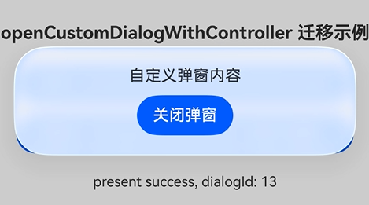

- 高级动画参数差异

  老接口使用 `customStyle: boolean` 控制是否使用自定义样式，`openAnimation` / `closeAnimation`（`AnimateParam`）控制打开和关闭动画。新接口使用 `dialogTransition: TransitionEffect` 控制内容区动画，`maskTransition: TransitionEffect` 控制蒙层动画。两者参数类型不同，**不存在等效映射**，迁移时需按新接口 `TransitionEffect` 重写动画参数。

### 使用方式差异

新老接口在以下两种使用方式上存在差异：

- **弹出后动态修改弹出框位置**：老接口不支持弹出后动态修改弹出框位置（对齐、偏移、蒙层颜色等），需要先关闭再重新打开；新接口支持弹出后直接更新，无需关闭重开。
- **自定义弹出框场景的系统材质**：老接口在自定义弹出框场景不支持系统材质；新接口支持。

下面以自定义弹出框为例，对比老接口与新接口的实现方式。

老接口示例：使用 `promptAction.openCustomDialog` 弹出自定义弹出框，当需要更新弹出框样式（如颜色模式变化）时，必须先调用 `closeCustomDialog` 关闭再重新打开，且不支持系统材质。

<!-- @[custom_dialog_old_interface](https://gitcode.com/openharmony/applications_app_samples/blob/master/code/DocsSample/ArkUISample/ArkuiDialogMigrationSample/entry/src/main/ets/pages/opencustomdialog/CustomDialogOldInterface.ets) -->

``` TypeScript
import { ComponentContent } from '@kit.ArkUI';
import { AbilityConstant, Configuration, EnvironmentCallback, ConfigurationConstant } from '@kit.AbilityKit';
import { BusinessError } from '@kit.BasicServicesKit';
import { resourceManager } from '@kit.LocalizationKit';

class Params {
  public text: string = '';
  public colorMode: resourceManager.ColorMode = resourceManager.ColorMode.LIGHT

  constructor(text: string, colorMode: resourceManager.ColorMode) {
    this.text = text
    this.colorMode = colorMode
  }
}

@Builder
function builderDialog(params: Params) {
  Column() {
    Text(params.text)
      .fontSize(50)
      .fontWeight(FontWeight.Bold)
      .margin({ bottom: 36 })
  }.backgroundColor(params.colorMode == resourceManager.ColorMode.LIGHT ? '#D5D5D5' : '#004AAF')
}

@Entry
@Component
export struct CustomDialogOldInterface {
  @State message: string = 'hello';
  contentNode: ComponentContent<Params> | null = null;
  callbackId: number | undefined = 0;

  aboutToAppear(): void {
    let environmentCallback: EnvironmentCallback = {
      onMemoryLevel: (level: AbilityConstant.MemoryLevel): void => {
      },
      onConfigurationUpdated: (config: Configuration): void => {
        console.info(`onConfigurationUpdated ${config}`);
        this.getUIContext().getHostContext()?.getApplicationContext().resourceManager.getConfiguration((err,
          config) => {
          // 调用ComponentContent的update更新colorMode信息
          this.contentNode?.update(new Params(this.message, config.colorMode))
          setTimeout(() => {
            // 调用ComponentContent的updateConfiguration，触发节点的全量更新
            this.contentNode?.updateConfiguration()
          })
        })
      }
    }
    // 注册监听系统环境变化监听器
    this.callbackId =
      this.getUIContext().getHostContext()?.getApplicationContext().on('environment', environmentCallback)
    // 设置应用深浅色跟随系统
    this.getUIContext()
      .getHostContext()?.getApplicationContext().setColorMode(ConfigurationConstant.ColorMode.COLOR_MODE_NOT_SET)
  }

  aboutToDisappear() {
    // 解注册监听系统环境变化的回调
    this.getUIContext().getHostContext()?.getApplicationContext().off('environment', this.callbackId)
    this.contentNode?.dispose()
  }

  build() {
    NavDestination() {
      Row() {
        Column() {
          Button('click me')
            .onClick(() => {
              let uiContext = this.getUIContext();
              let promptAction = uiContext.getPromptAction();
              if (this.contentNode == null && uiContext.getHostContext() != undefined) {
                this.contentNode = new ComponentContent(uiContext, wrapBuilder(builderDialog), new Params(this.message,
                  uiContext.getHostContext()!!.getApplicationContext()
                    .resourceManager
                    .getConfigurationSync()
                    .colorMode))
              }
              if (this.contentNode == null) {
                return
              }
              promptAction.closeCustomDialog(this.contentNode)
              // 先关闭已存在的弹窗，再重新打开
              promptAction.openCustomDialog(this.contentNode).then(() => {
                console.info('succeeded')
              }).catch((error: BusinessError) => {
                console.error(`OpenCustomDialog args error code is ${error.code}, message is ${error.message}`);
              })
            })
        }
        .width('100%')
        .height('100%')
        .justifyContent(FlexAlign.Center)
      }
      .height('100%')
    }
  }
}
```

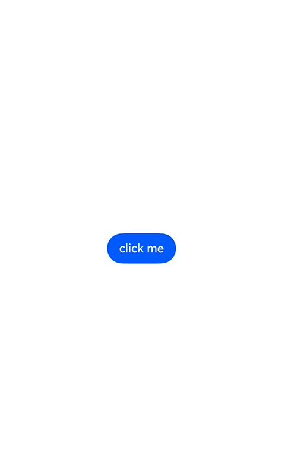

新接口示例：使用 `DialogPresenter.present` 弹出自定义弹出框并设置系统材质，通过 `DialogPresenter.update` 在弹出后动态修改弹出框偏移量，无需关闭重开。

<!-- @[custom_dialog_new_interface](https://gitcode.com/openharmony/applications_app_samples/blob/master/code/DocsSample/ArkUISample/ArkuiDialogMigrationSample/entry/src/main/ets/pages/opencustomdialog/CustomDialogNewInterface.ets) -->

``` TypeScript
// Index.ets
import {
  ComponentContent,
  DialogPresenter,
  DialogResult,
  uiMaterial
} from '@kit.ArkUI';
import { BusinessError } from '@kit.BasicServicesKit';

// 定义参数类，用于向自定义弹出框内容传递数据
class Params {
  public text: string = '';

  constructor(text: string) {
    this.text = text;
  }
}

// 自定义弹出框内容的构建器函数
@Builder
function buildText(params: Params) {
  Column({ space: 20 }) {
    Text(params.text)
      .fontSize(30)
      .fontWeight(FontWeight.Bold)
      .margin({ bottom: 36 })
    // 更新弹出框样式按钮，动态修改蒙层颜色、对齐方式和偏移量
    Button('Update dialog')
      .onClick(() => {
        dialogPresenter?.update(contentNode, {
          offset: { dx: 0, dy: 30 }
        })
          .then(() => {
            console.info('update success');
          })
          .catch((error: BusinessError) => {
            console.error(`update error code is ${error.code}, message is ${error.message}`);
          })
      })
    // 关闭弹出框按钮，通过ComponentContent引用关闭弹出框
    Button('Dismiss dialog')
      .onClick(() => {
        dialogPresenter?.dismiss(contentNode)
          .then(() => {
            console.info('dismiss success');
          })
          .catch((error: BusinessError) => {
            console.error(`dismiss error code is ${error.code}, message is ${error.message}`);
          })
      })
  }
}

// 全局变量，保存DialogPresenter实例
let dialogPresenter: DialogPresenter | null = null;
// 全局变量，保存自定义弹出框的ComponentContent实例
let contentNode: ComponentContent<Object> | null = null;

@Entry
@Component
export struct CustomDialogNewInterface {
  @State message: string = 'custom dialog';

  aboutToAppear(): void {
    // 获取DialogPresenter实例
    dialogPresenter = this.getUIContext().getDialogPresenter();
    // 创建ComponentContent，绑定自定义构建器函数和参数
    contentNode = new ComponentContent(this.getUIContext(), wrapBuilder(buildText), new Params(this.message));
  }

  build() {
    NavDestination() {
      Row() {
        Column({ space: 10 }) {
          Button('Present custom dialog')
            .id('PresentDialog')
            .onClick(() => {
              // 弹出自定义样式弹出框，传入ComponentContent和配置选项
              dialogPresenter?.present(contentNode, {
                systemMaterial: new uiMaterial.ImmersiveMaterial({ style: uiMaterial.ImmersiveStyle.REGULAR })
              })
              // 弹出成功，获取弹出框ID
                .then((result: DialogResult) => {
                  console.info('present success, dialogId: ' + result.dialogId);
                })
                .catch((error: BusinessError) => {
                  console.error(`present error code is ${error.code}, message is ${error.message}`);
                })
            })
        }.width('100%').height('100%').justifyContent(FlexAlign.Center)
      }
      .height('100%')
    }
  }
}
```

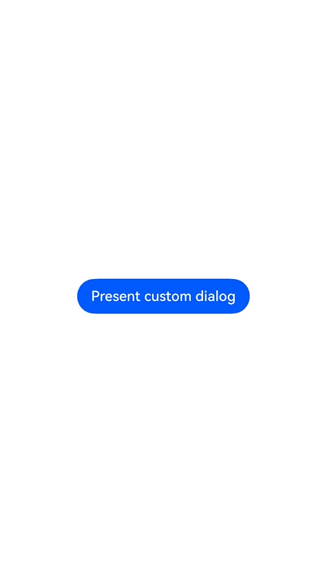

## 典型场景迁移指导

### 全局自定义弹出框迁移

本示例将全局自定义弹出框从老接口迁移到新接口，封装 `DialogPresenterClassNew` 工具类统一管理弹出框的打开、关闭和更新操作，并在页面中调用该工具类实现弹出框的弹出与动态更新（修改对齐方式和偏移量）。

**迁移前示例（老接口）：**

[完整示例](arkts-uicontext-custom-dialog.md#完整示例)

**迁移后示例（新接口）：**

<!-- @[dialog_presenter_class_new](https://gitcode.com/openharmony/applications_app_samples/blob/master/code/DocsSample/ArkUISample/ArkuiDialogMigrationSample/entry/src/main/ets/common/DialogPresenterClassNew.ts) -->

``` TypeScript
// DialogPresenterClassNew.ets
import { BusinessError } from '@kit.BasicServicesKit';
import { ComponentContent, dialog, DialogResult, UIContext } from '@kit.ArkUI';
import { hilog } from '@kit.PerformanceAnalysisKit';

const DOMAIN = 0x0000;

export class DialogPresenterClassNew {
  static ctx: UIContext;
  static contentNode: ComponentContent<Object>;
  static options: dialog.DialogBaseOptions;

  static setContext(context: UIContext) {
    DialogPresenterClassNew.ctx = context;
  }

  static setContentNode(node: ComponentContent<Object>) {
    DialogPresenterClassNew.contentNode = node;
  }

  static setOptions(options: dialog.DialogBaseOptions) {
    DialogPresenterClassNew.options = options;
  }

  // 打开弹窗
  static openDialog() {
    if (DialogPresenterClassNew.contentNode !== null) {
      DialogPresenterClassNew.ctx.getDialogPresenter()?.present(this.contentNode, DialogPresenterClassNew.options)
        .then((result: DialogResult) => {
          hilog.info(DOMAIN, 'testTag', 'testTag', 'OpenCustomDialog complete.');
        }).catch((error: BusinessError) => {
        let message = (error as BusinessError).message;
        let code = (error as BusinessError).code;
        hilog.error(DOMAIN, 'testTag', 'testTag', `OpenCustomDialog args error code is ${code}, message is ${message}`);
      });
    }
  }

  // 关闭弹窗
  static closeDialog() {
    if (DialogPresenterClassNew.contentNode !== null) {
      DialogPresenterClassNew.ctx.getDialogPresenter()?.dismiss(this.contentNode)
        .then(() => {
          hilog.info(DOMAIN, 'testTag', 'testTag', 'CloseCustomDialog complete.');
        })
        .catch((error: BusinessError) => {
          let message = (error as BusinessError).message;
          let code = (error as BusinessError).code;
          hilog.error(DOMAIN, 'testTag', 'testTag', `CloseCustomDialog args error code is ${code}, message is ${message}`);
        });
    }
  }

  // 更新弹窗
  static updateDialog(options: dialog.DialogBaseOptions) {
    if (DialogPresenterClassNew.contentNode !== null) {
      DialogPresenterClassNew.ctx.getDialogPresenter()?.update(this.contentNode, options)
        .then(() => {
          hilog.info(DOMAIN, 'testTag', 'testTag', 'UpdateCustomDialog complete.');
        })
        .catch((error: BusinessError) => {
          let message = (error as BusinessError).message;
          let code = (error as BusinessError).code;
          hilog.error(DOMAIN, 'testTag', 'testTag', `UpdateCustomDialog args error code is ${code}, message is ${message}`);
        });
    }
  }
}
```

上述代码封装了 `DialogPresenterClassNew` 工具类，提供弹出框的打开（`openDialog`）、关闭（`closeDialog`）和更新（`updateDialog`）方法。下方页面示例调用该工具类，演示弹出框弹出后动态更新对齐方式、偏移量以及内容的效果。

<!-- @[open_dialog_and_update](https://gitcode.com/openharmony/applications_app_samples/blob/master/code/DocsSample/ArkUISample/ArkuiDialogMigrationSample/entry/src/main/ets/pages/opencustomdialog/OpenDialogAndUpdate.ets) -->

``` TypeScript
// Index.ets
import { ComponentContent, DialogBaseAlignment } from '@kit.ArkUI';
import { DialogPresenterClassNew } from '../../common/DialogPresenterClassNew';

class Params {
  public text: string = '';

  constructor(text: string) {
    this.text = text;
  }
}

@Builder
function buildText(params: Params) {
  Column() {
    Text(params.text)
      .fontSize(50)
      .fontWeight(FontWeight.Bold)
      .margin({ bottom: 36 })
    Button('Close')
      .onClick(() => {
        DialogPresenterClassNew.closeDialog();
      })
  }.backgroundColor('#FFF0F0F0')
}

@Entry
@Component
export struct OpenDialogAndUpdate {
  @State message: string = 'hello';
  private ctx: UIContext = this.getUIContext();
  private contentNode: ComponentContent<Object> =
    new ComponentContent(this.ctx, wrapBuilder(buildText), new Params(this.message));
  aboutToAppear(): void {
    DialogPresenterClassNew.setContext(this.ctx);
    DialogPresenterClassNew.setContentNode(this.contentNode);
    DialogPresenterClassNew.setOptions({ alignment: DialogBaseAlignment.TOP, offset: { dx: 0, dy: 50 } });
  }

  build() {
    NavDestination() {
      Row() {
        Column() {
          Button('open dialog and update options')
            .margin({ top: 50 })
            .onClick(() => {
              DialogPresenterClassNew.openDialog();

              setTimeout(() => {
                DialogPresenterClassNew.updateDialog({
                  alignment: DialogBaseAlignment.BOTTOM,
                  offset: { dx: 0, dy: -50 }
                });
              }, 1500)
            })
          Button('open dialog and update content')
            .margin({ top: 50 })
            .onClick(() => {
              DialogPresenterClassNew.openDialog();

              setTimeout(() => {
                this.contentNode.update(new Params('update'));
              }, 1500)
            })
        }
        .width('100%')
        .height('100%')
      }
      .height('100%')
    }
  }
}
```

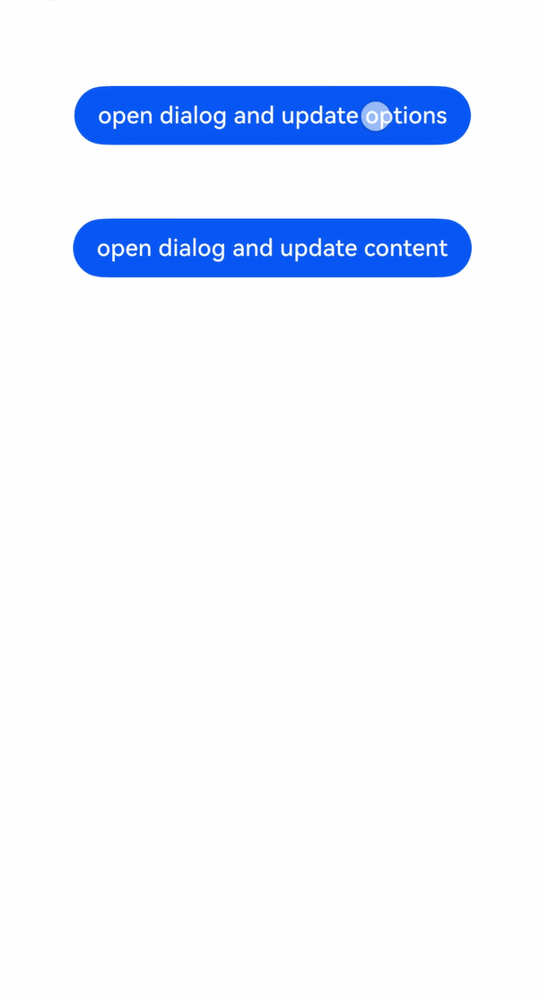


### 页面级弹出框迁移

本示例将页面级弹出框从老接口迁移到新接口，分别给出基于 Router 路由模式和 Navigation 导航模式两种场景下的实现。页面级弹出框跟随所在页面的生命周期，弹窗内可进行路由跳转。

**迁移前示例（老接口）：**

[完整示例](arkts-embedded-dialog.md#完整示例)

**迁移后示例（新接口）：**

- 基于Router路由模式下的页面级弹出框：

  <!-- @[page_level_dialog](https://gitcode.com/openharmony/applications_app_samples/blob/master/code/DocsSample/ArkUISample/ArkuiDialogMigrationSample/entry/src/main/ets/pages/customdialog/pageleveldialogbox/PageLevelDialogBox.ets) -->
  
  ``` TypeScript
  import { LevelMode, ImmersiveMode, DialogResult } from '@kit.ArkUI';
  
  let customDialogId: number = 0;
  
  @Builder
  function customDialogBuilder(uiContext: UIContext) {
    Column() {
      Text('Custom dialog Message').fontSize(20).height(100)
      Row() {
        Button('Next').onClick(() => {
          // 在弹窗内部进行路由跳转。
          uiContext.getRouter().pushUrl({ url: 'pages/customdialog/pageleveldialogbox/Next' });
        })
        Blank().width(50)
        Button('Close').onClick(() => {
          uiContext.getDialogPresenter()?.dismiss(customDialogId);
        })
      }
    }.padding(20)
  }
  
  @Entry
  @Component
  export struct PageLevelDialogBox {
    @State message: string = 'Hello World';
  
    @Builder
    customDialogComponent() {
      customDialogBuilder(this.getUIContext());
    }
  
    build() {
      NavDestination() {
        Row() {
          Column() {
            Text(this.message).id('test_text')
              .fontSize(50)
              .fontWeight(FontWeight.Bold)
              .onClick(() => {
                const node: FrameNode | null = this.getUIContext().getFrameNodeById('test_text') || null;
                this.getUIContext().getDialogPresenter()?.present(() => this.customDialogComponent(), {
                  levelMode: LevelMode.EMBEDDED, // 启用页面级弹出框
                  levelUniqueId: node?.getUniqueId(), // 设置页面级弹出框所在页面的任意节点ID
                  immersiveMode: ImmersiveMode.EXTEND, // 设置页面级弹出框蒙层的显示模式
                })
                  .then((result: DialogResult) => {
                    customDialogId = result.dialogId;
                  });
              })
          }
          .width('100%')
        }
        .height('100%')
      }
    }
  }
  ```
  
  下方 `Next.ets` 为弹窗内点击"Next"按钮路由跳转的目标页面，点击"Back"按钮返回上一页。
  
  <!-- @[next](https://gitcode.com/openharmony/applications_app_samples/blob/master/code/DocsSample/ArkUISample/ArkuiDialogMigrationSample/entry/src/main/ets/pages/customdialog/pageleveldialogbox/Next.ets) -->
  
  ``` TypeScript
  // Next.ets
  @Entry
  @Component
  struct Next {
    @State message: string = 'Back';
  
    build() {
      Row() {
        Column() {
          Button(this.message)
            .fontSize(20)
            .fontWeight(FontWeight.Bold)
            .onClick(() => {
              this.getUIContext().getRouter().back();
            })
        }
        .width('100%')
      }
      .height('100%')
    }
  }
  ```
  
  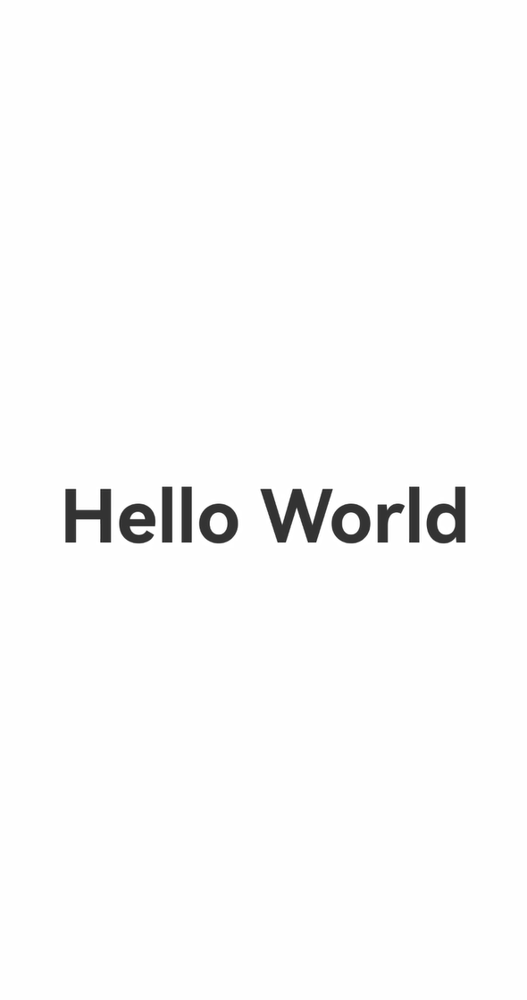

- 基于Navigation导航模式下的页面级弹出框。使用本示例前需要参考[Navigation使用NavDestination作为导航页](../reference/apis-arkui/arkui-ts/ts-basic-components-navigation.md#示例16navigation使用navdestination作为导航页)文档完成Index首页和router_map.json的创建与配置。并使用下述示例代码中的PageLevelDialogInNavigation和PageLevelDialogInNavigationTestTwo组件替换Navigation参考文档中的PageHome和PageOne组件。

  <!-- @[page_level_dialog](https://gitcode.com/openharmony/applications_app_samples/blob/master/code/DocsSample/ArkUISample/ArkuiDialogMigrationSample/entry/src/main/ets/pages/customdialog/pageleveldialogbox/PageLevelDialogInNavigation.ets) -->
  
  ``` TypeScript
  import { LevelMode, ImmersiveMode, DialogResult } from '@kit.ArkUI';
  
  let customDialogId: number = 0;
  
  @Builder
  function customDialogBuilder(uiContext: UIContext, stack: NavPathStack | undefined) {
    Column() {
      Text('Custom dialog Message').fontSize(20).height(100)
      Row() {
        Button('Next').onClick(() => {
          // 在弹窗内部进行路由跳转。
          if (stack) {
            stack.pushPath({ name: 'Custom_ROUTE_PREFIX/PageLevelDialogInNavigationPageTwo'})
          }
        })
        Blank().width(50)
        Button('Close').onClick(() => {
          uiContext.getDialogPresenter()?.dismiss(customDialogId);
        })
      }
    }.padding(20)
  }
  
  @Component
  export struct PageLevelDialogInNavigation {
    private stack: NavPathStack | undefined = undefined;
    private uiContext: UIContext = this.getUIContext();
    @State message: string = 'Hello World';
  
    @Builder
    customDialogComponent() {
      customDialogBuilder(this.uiContext, this.stack);
    }
  
    build() {
      NavDestination() {
        Stack({alignContent: Alignment.Center}) {
          Column() {
            Text(this.message).id('test_text')
              .fontSize(50)
              .fontWeight(FontWeight.Bold)
              .onClick(() => {
                const node: FrameNode | null = this.getUIContext().getFrameNodeById('test_text') || null;
                this.uiContext.getDialogPresenter()?.present(() => this.customDialogComponent(), {
                  levelMode: LevelMode.EMBEDDED, // 启用页面级弹出框
                  levelUniqueId: node?.getUniqueId(), // 设置页面级弹出框所在页面的任意节点ID
                  immersiveMode: ImmersiveMode.EXTEND, // 设置页面级弹出框蒙层的显示模式
                }).then((result: DialogResult) => {
                  customDialogId = result.dialogId;
                })
              })
          }
          .width('100%')
        }.width('100%').height('100%')
      }
      .width('100%').height('100%')
      .title('PageOne')
      .onReady((ctx: NavDestinationContext) => {
        this.stack = ctx.pathStack;
      })
    }
  }
  
  @Component
  export struct PageLevelDialogInNavigationTestTwo {
    @State message: string = 'Back';
    private stack: NavPathStack | undefined = undefined;
  
    build() {
      NavDestination() {
        Stack({alignContent: Alignment.Center}) {
          Column() {
            Button(this.message)
              .fontSize(20)
              .fontWeight(FontWeight.Bold)
              .onClick(() => {
                if (this.stack) {
                  this.stack.pop()
                }
              })
          }
          .width('100%')
        }.width('100%').height('100%')
      }
      .width('100%').height('100%')
      .title('PageTwo')
      .onReady((ctx: NavDestinationContext) => {
        this.stack = ctx.pathStack;
      })
    }
  }
  ```
  
  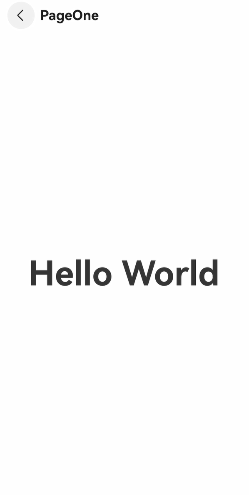