# 弹出框迁移指导
<!--Kit: ArkUI-->
<!--Subsystem: ArkUI-->
<!--Owner: @houguobiao-->
<!--Designer: @houguobiao-->
<!--Tester: @lxl007-->
<!--Adviser: @Brilliantry_Rui-->

## 概述

本文档帮助开发者了解[@ohos.arkui.dialog (弹出框)](../reference/apis-arkui/js-apis-dialog.md)新接口与旧接口（[CustomDialogController](../reference/apis-arkui/arkui-ts/ts-methods-custom-dialog-box.md#customdialogcontroller)、[showAlertDialog](../reference/apis-arkui/arkts-apis-uicontext-uicontext.md#showalertdialog)、[showActionSheet](../reference/apis-arkui/arkts-apis-uicontext-uicontext.md#showactionsheet)、[showDialog](../reference/apis-arkui/arkts-apis-uicontext-promptaction.md#showdialog)、[showActionMenu](../reference/apis-arkui/arkts-apis-uicontext-promptaction.md#showactionmenu)、[openCustomDialog](../reference/apis-arkui/arkts-apis-uicontext-promptaction.md#opencustomdialog12)、[openCustomDialogWithController](../reference/apis-arkui/arkts-apis-uicontext-promptaction.md#opencustomdialogwithcontroller18)、[presentCustomDialog](../reference/apis-arkui/arkts-apis-uicontext-promptaction.md#presentcustomdialog18)）的能力差异，并按弹出框类别提供从旧接口到新接口的迁移映射。

从API版本26.0.1开始，新增[@ohos.arkui.dialog (弹出框)](../reference/apis-arkui/js-apis-dialog.md)，提供统一的Dialog类型声明能力。

## 接口说明

[@ohos.arkui.dialog (弹出框)](../reference/apis-arkui/js-apis-dialog.md)在完全兼容旧接口的基础上，将原本多个独立的弹出框接口（如[showAlertDialog](../reference/apis-arkui/arkts-apis-uicontext-uicontext.md#showalertdialog)、[showActionSheet](../reference/apis-arkui/arkts-apis-uicontext-uicontext.md#showactionsheet)、[showDialog](../reference/apis-arkui/arkts-apis-uicontext-promptaction.md#showdialog)等）统一为一套接口，关键接口如下所示。

| 接口名 | 说明 |
|--------|------|
| [DialogPresenter.present](../reference/apis-arkui/arkts-apis-uicontext-dialogpresenter.md#present) | 弹出固定样式的弹出框（标题、消息、按钮、菜单项等均由系统统一样式呈现），替换[showAlertDialog](../reference/apis-arkui/arkts-apis-uicontext-uicontext.md#showalertdialog)、[showActionSheet](../reference/apis-arkui/arkts-apis-uicontext-uicontext.md#showactionsheet)、[showDialog](../reference/apis-arkui/arkts-apis-uicontext-promptaction.md#showdialog)、[showActionMenu](../reference/apis-arkui/arkts-apis-uicontext-promptaction.md#showactionmenu)旧接口。 |
| [DialogPresenter.present](../reference/apis-arkui/arkts-apis-uicontext-dialogpresenter.md#present-1) | 弹出自定义样式的弹出框（内容由[CustomBuilder](../reference/apis-arkui/arkui-ts/ts-types.md#custombuilder8)或[ComponentContent](../reference/apis-arkui/js-apis-arkui-ComponentContent.md)提供），替换[CustomDialogController.open()](../reference/apis-arkui/arkui-ts/ts-methods-custom-dialog-box.md#open)、[openCustomDialog](../reference/apis-arkui/arkts-apis-uicontext-promptaction.md#opencustomdialog12)、[openCustomDialogWithController](../reference/apis-arkui/arkts-apis-uicontext-promptaction.md#opencustomdialogwithcontroller18)、[presentCustomDialog](../reference/apis-arkui/arkts-apis-uicontext-promptaction.md#presentcustomdialog18)旧接口。 |
| [DialogPresenter.update](../reference/apis-arkui/arkts-apis-uicontext-dialogpresenter.md#update) | 更新已弹出的自定义弹出框的样式与位置，替换[updateCustomDialog](../reference/apis-arkui/arkts-apis-uicontext-promptaction.md#updatecustomdialog12)旧接口。适用于弹出框已弹出后需要动态更新其对齐方式、偏移量、蒙层颜色等属性的交互场景。 |
| [DialogPresenter.dismiss](../reference/apis-arkui/arkts-apis-uicontext-dialogpresenter.md#dismiss) | 关闭已弹出的弹出框，替换[CustomDialogController.close()](../reference/apis-arkui/arkui-ts/ts-methods-custom-dialog-box.md#close)、[closeCustomDialog](../reference/apis-arkui/arkts-apis-uicontext-promptaction.md#closecustomdialog12)旧接口。支持通过弹出框ID或ComponentContent引用指定关闭目标。 |

## 弹出框新旧接口差异

新旧接口在属性和使用方式两个维度存在差异，其中：

- **属性差异**：按弹出框类型逐一定义旧接口与新接口的属性映射，以及高级动画参数差异。每类弹出框提供属性对照表（含编程模型、内容构建、对齐、偏移、蒙层、边框、阴影、动画回调、键盘避让、悬浮模式、层级模式、系统材质等属性）和迁移前后的代码示例。
- **使用方式差异**：聚焦旧接口不支持、仅新接口支持的能力，包括弹出后动态修改弹出框位置（对齐、偏移、蒙层颜色等）而无需关闭重开、自定义弹出框场景支持系统材质，并配有代码示例。

### 属性差异

下面提供[自定义弹窗 (CustomDialog)](../reference/apis-arkui/arkui-ts/ts-methods-custom-dialog-box.md)、[警告弹窗 (AlertDialog)](../reference/apis-arkui/arkui-ts/ts-methods-alert-dialog-box.md)、[列表选择弹窗 (ActionSheet)](../reference/apis-arkui/arkui-ts/ts-methods-action-sheet.md)、[showDialog（对话框）](../reference/apis-arkui/arkts-apis-uicontext-promptaction.md#showdialog)、[showActionMenu（操作菜单）](../reference/apis-arkui/arkts-apis-uicontext-promptaction.md#showactionmenu)、[presentCustomDialog（自定义弹出框）](../reference/apis-arkui/arkts-apis-uicontext-promptaction.md#presentcustomdialog18)、[openCustomDialogWithController（带控制器的自定义弹出框）](../reference/apis-arkui/arkts-apis-uicontext-promptaction.md#opencustomdialogwithcontroller18)新旧接口的差异，并提供示例。

- CustomDialog（自定义弹出框）

  | 属性 | 旧接口（[CustomDialogController](../reference/apis-arkui/arkui-ts/ts-methods-custom-dialog-box.md#customdialogcontroller)） | 新接口（[DialogPresenter.present](../reference/apis-arkui/arkts-apis-uicontext-dialogpresenter.md#present)） |
  |------|------|------|
  | 编程模型 | @CustomDialog装饰器声明自定义组件 + [CustomDialogController](../reference/apis-arkui/arkui-ts/ts-methods-custom-dialog-box.md#customdialogcontroller)实例化控制 | [UIContext.getDialogPresenter()](../reference/apis-arkui/arkts-apis-uicontext-uicontext.md#getdialogpresenter)获取Presenter，[present(content, options)](../reference/apis-arkui/arkts-apis-uicontext-dialogpresenter.md#present-1)弹出 |
  | 内容构建 | @CustomDialog装饰器包裹@Component | [CustomBuilder](../reference/apis-arkui/arkui-ts/ts-types.md#custombuilder8) / [CustomBuilderWithId](../reference/apis-arkui/arkts-apis-uicontext-t.md#custombuilderwithid18) / [ComponentContent](../reference/apis-arkui/js-apis-arkui-ComponentContent.md)\<Object\>作为[present](../reference/apis-arkui/arkts-apis-uicontext-dialogpresenter.md#present-1)第一个参数 |
  | 样式控制 | [customStyle](../reference/apis-arkui/arkui-ts/ts-methods-custom-dialog-box.md#customdialogcontrolleroptions对象说明) | [customStyle](../reference/apis-arkui/js-apis-dialog.md#dialogcustomoptions) |
  | 打开 | [controller.open()](../reference/apis-arkui/arkui-ts/ts-methods-custom-dialog-box.md#open) | [presenter.present(content, options)](../reference/apis-arkui/arkts-apis-uicontext-dialogpresenter.md#present-1) |
  | 关闭 | [controller.close()](../reference/apis-arkui/arkui-ts/ts-methods-custom-dialog-box.md#close) | [close](../reference/apis-arkui/js-apis-dialog.md#close)或[dismiss(target)](../reference/apis-arkui/arkts-apis-uicontext-dialogpresenter.md#dismiss) |
  | 状态查询 | [controller.getState()](../reference/apis-arkui/arkui-ts/ts-methods-custom-dialog-box.md#getstate20) | [DialogBaseController.getState()](../reference/apis-arkui/js-apis-dialog.md#getstate) |
  | 对齐 | [alignment](../reference/apis-arkui/arkui-ts/ts-methods-custom-dialog-box.md#customdialogcontrolleroptions对象说明) | [alignment](../reference/apis-arkui/js-apis-dialog.md#dialogbaseoptions) |
  | 偏移 | [offset](../reference/apis-arkui/arkui-ts/ts-methods-custom-dialog-box.md#customdialogcontrolleroptions对象说明) | [offset](../reference/apis-arkui/js-apis-dialog.md#dialogbaseoptions) |
  | 自动取消 | [autoCancel](../reference/apis-arkui/arkui-ts/ts-methods-custom-dialog-box.md#customdialogcontrolleroptions对象说明) | [autoCancel](../reference/apis-arkui/js-apis-dialog.md#dialogbaseoptions) |
  | 蒙层颜色 | [maskColor](../reference/apis-arkui/arkui-ts/ts-methods-custom-dialog-box.md#customdialogcontrolleroptions对象说明) | [maskColor](../reference/apis-arkui/js-apis-dialog.md#dialogbaseoptions) |
  | 蒙层区域 | [maskRect](../reference/apis-arkui/arkui-ts/ts-methods-custom-dialog-box.md#customdialogcontrolleroptions对象说明) | [maskRect](../reference/apis-arkui/js-apis-dialog.md#dialogbaseoptions) |
  | 模态 | [isModal](../reference/apis-arkui/arkui-ts/ts-methods-custom-dialog-box.md#customdialogcontrolleroptions对象说明) | [isModal](../reference/apis-arkui/js-apis-dialog.md#dialogbaseoptions) |
  | 子窗口 | [showInSubWindow](../reference/apis-arkui/arkui-ts/ts-methods-custom-dialog-box.md#customdialogcontrolleroptions对象说明) | [showInSubWindow](../reference/apis-arkui/js-apis-dialog.md#dialogbaseoptions) |
  | 焦点 | [focusable](../reference/apis-arkui/arkui-ts/ts-methods-custom-dialog-box.md#customdialogcontrolleroptions对象说明)（可配置，默认true） | [focusable](../reference/apis-arkui/js-apis-dialog.md#dialogbaseoptions)（可配置，默认true） |
  | 打开动画回调 | [onWillAppear](../reference/apis-arkui/arkui-ts/ts-methods-custom-dialog-box.md#customdialogcontrolleroptions对象说明) / [onDidAppear](../reference/apis-arkui/arkui-ts/ts-methods-custom-dialog-box.md#customdialogcontrolleroptions对象说明) / [onWillDisappear](../reference/apis-arkui/arkui-ts/ts-methods-custom-dialog-box.md#customdialogcontrolleroptions对象说明) / [onDidDisappear](../reference/apis-arkui/arkui-ts/ts-methods-custom-dialog-box.md#customdialogcontrolleroptions对象说明) | [onWillAppear](../reference/apis-arkui/js-apis-dialog.md#dialogbaseoptions) / [onDidAppear](../reference/apis-arkui/js-apis-dialog.md#dialogbaseoptions) / [onWillDisappear](../reference/apis-arkui/js-apis-dialog.md#dialogbaseoptions) / [onDidDisappear](../reference/apis-arkui/js-apis-dialog.md#dialogbaseoptions) |
  | 取消回调 | [cancel](../reference/apis-arkui/arkui-ts/ts-methods-custom-dialog-box.md#customdialogcontrolleroptions对象说明) + [onWillDismiss](../reference/apis-arkui/arkui-ts/ts-methods-custom-dialog-box.md#customdialogcontrolleroptions对象说明) | [onWillDismiss](../reference/apis-arkui/js-apis-dialog.md#dialogbaseoptions) |
  | 背景模糊 | [backgroundBlurStyle](../reference/apis-arkui/arkui-ts/ts-methods-custom-dialog-box.md#customdialogcontrolleroptions对象说明) + [backgroundBlurStyleOptions](../reference/apis-arkui/arkui-ts/ts-methods-custom-dialog-box.md#customdialogcontrolleroptions对象说明) + [backgroundEffect](../reference/apis-arkui/arkui-ts/ts-methods-custom-dialog-box.md#customdialogcontrolleroptions对象说明) | [backgroundBlurStyle](../reference/apis-arkui/js-apis-dialog.md#dialogbaseoptions) + [backgroundBlurStyleOptions](../reference/apis-arkui/js-apis-dialog.md#dialogbaseoptions) + [backgroundEffect](../reference/apis-arkui/js-apis-dialog.md#dialogbaseoptions) |
  | 边框 | [cornerRadius](../reference/apis-arkui/arkui-ts/ts-methods-custom-dialog-box.md#customdialogcontrolleroptions对象说明) / [borderWidth](../reference/apis-arkui/arkui-ts/ts-methods-custom-dialog-box.md#customdialogcontrolleroptions对象说明) / [borderColor](../reference/apis-arkui/arkui-ts/ts-methods-custom-dialog-box.md#customdialogcontrolleroptions对象说明) / [borderStyle](../reference/apis-arkui/arkui-ts/ts-methods-custom-dialog-box.md#customdialogcontrolleroptions对象说明) | [borderRadius](../reference/apis-arkui/js-apis-dialog.md#dialogbaseoptions) / [borderWidth](../reference/apis-arkui/js-apis-dialog.md#dialogbaseoptions) / [borderColor](../reference/apis-arkui/js-apis-dialog.md#dialogbaseoptions) / [borderStyle](../reference/apis-arkui/js-apis-dialog.md#dialogbaseoptions)（老版本[cornerRadius](../reference/apis-arkui/arkui-ts/ts-methods-custom-dialog-box.md#customdialogcontrolleroptions对象说明)对应新版本[borderRadius](../reference/apis-arkui/js-apis-dialog.md#dialogbaseoptions)） |
  | 阴影 | [shadow](../reference/apis-arkui/arkui-ts/ts-methods-custom-dialog-box.md#customdialogcontrolleroptions对象说明) | [shadow](../reference/apis-arkui/js-apis-dialog.md#dialogbaseoptions): [ShadowOptions](../reference/apis-arkui/arkui-ts/ts-universal-attributes-image-effect.md#shadowoptions对象说明) \| [ShadowStyle](../reference/apis-arkui/arkui-ts/ts-universal-attributes-image-effect.md#shadowstyle10枚举说明) |
  | 内容区动画 | [openAnimation](../reference/apis-arkui/arkui-ts/ts-methods-custom-dialog-box.md#customdialogcontrolleroptions对象说明) + [closeAnimation](../reference/apis-arkui/arkui-ts/ts-methods-custom-dialog-box.md#customdialogcontrolleroptions对象说明) | [dialogTransition](../reference/apis-arkui/js-apis-dialog.md#dialogbaseoptions): [TransitionEffect](../reference/apis-arkui/arkui-ts/ts-transition-animation-component.md#transitioneffect10对象说明) |
  | 蒙层动画 | 无 | [maskTransition](../reference/apis-arkui/js-apis-dialog.md#dialogbaseoptions): [TransitionEffect](../reference/apis-arkui/arkui-ts/ts-transition-animation-component.md#transitioneffect10对象说明) |
  | 键盘避让 | [keyboardAvoidMode](../reference/apis-arkui/arkui-ts/ts-methods-custom-dialog-box.md#customdialogcontrolleroptions对象说明) + [keyboardAvoidDistance](../reference/apis-arkui/arkui-ts/ts-methods-custom-dialog-box.md#customdialogcontrolleroptions对象说明) | [keyboardAvoidMode](../reference/apis-arkui/js-apis-dialog.md#dialogbaseoptions) + [keyboardAvoidDistance](../reference/apis-arkui/js-apis-dialog.md#dialogbaseoptions) |
  | 悬浮模式 | [enableHoverMode](../reference/apis-arkui/arkui-ts/ts-methods-custom-dialog-box.md#customdialogcontrolleroptions对象说明) + [hoverModeArea](../reference/apis-arkui/arkui-ts/ts-methods-custom-dialog-box.md#customdialogcontrolleroptions对象说明) | [enableHoverMode](../reference/apis-arkui/js-apis-dialog.md#dialogbaseoptions) + [hoverModeArea](../reference/apis-arkui/js-apis-dialog.md#dialogbaseoptions) |
  | 层级模式 | [levelMode](../reference/apis-arkui/arkui-ts/ts-methods-custom-dialog-box.md#customdialogcontrolleroptions对象说明) + [levelUniqueId](../reference/apis-arkui/arkui-ts/ts-methods-custom-dialog-box.md#customdialogcontrolleroptions对象说明) + [immersiveMode](../reference/apis-arkui/arkui-ts/ts-methods-custom-dialog-box.md#customdialogcontrolleroptions对象说明) + [levelOrder](../reference/apis-arkui/arkui-ts/ts-methods-custom-dialog-box.md#customdialogcontrolleroptions对象说明) | [levelMode](../reference/apis-arkui/js-apis-dialog.md#dialogbaseoptions) + [levelUniqueId](../reference/apis-arkui/js-apis-dialog.md#dialogbaseoptions) + [immersiveMode](../reference/apis-arkui/js-apis-dialog.md#dialogbaseoptions) + [levelOrder](../reference/apis-arkui/js-apis-dialog.md#dialogbaseoptions) |
  | 系统材质 | [systemMaterial](../reference/apis-arkui/arkui-ts/ts-methods-custom-dialog-box.md#customdialogcontrolleroptions对象说明) | [systemMaterial](../reference/apis-arkui/js-apis-dialog.md#dialogbaseoptions): [SystemUiMaterial](../reference/apis-arkui/arkui-ts/ts-universal-attributes-image-effect.md#systemuimaterial) |<!--Del-->
  | 系统接口属性 | [distortionMode](../reference/apis-arkui/arkui-ts/ts-methods-custom-dialog-box-sys.md#customdialogcontrolleroptions)、[edgeLightMode](../reference/apis-arkui/arkui-ts/ts-methods-custom-dialog-box-sys.md#customdialogcontrolleroptions) | [distortionMode](../reference/apis-arkui/js-apis-dialog-sys.md#dialogbaseoptions)、[edgeLightMode](../reference/apis-arkui/js-apis-dialog-sys.md#dialogbaseoptions) |
  <!--DelEnd-->
  
  **迁移前示例（旧接口）：** 使用[CustomDialogController](../reference/apis-arkui/arkui-ts/ts-methods-custom-dialog-box.md#customdialogcontroller)的open()和close()打开和关闭自定义弹出框。
  
  <!-- @[custom_dialog_before_migrate](https://gitcode.com/openharmony/applications_app_samples/blob/master/code/DocsSample/ArkUISample/ArkuiDialogMigrationSample/entry/src/main/ets/pages/opencustomdialog/CustomDialogBeforeMigrate.ets) -->
  
  ``` TypeScript
  @CustomDialog
  struct CustomDialogExample {
    controller?: CustomDialogController
    build() {
      Column() {
        Text('自定义弹窗内容')
        Button('关闭').onClick(() => { this.controller?.close() })
      }
    }
  }
  
  @Entry
  @Component
  export struct CustomDialogBeforeMigrate {
    dialogController: CustomDialogController = new CustomDialogController({
      builder: CustomDialogExample(),
      alignment: DialogAlignment.Center,
      autoCancel: true,
      maskColor: 0x33000000
    })
    build() {
      NavDestination() {
        Column() {
          Button('打开弹窗').onClick(() => {
            this.dialogController.open()
          })
        }
        .width('100%')
        .height('100%')
        .justifyContent(FlexAlign.Center)
      }
    }
  }
  ```
  
   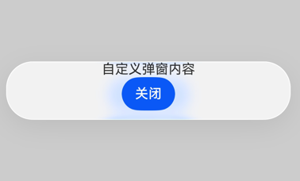
  
  **迁移后示例（新接口）：** 使用[DialogPresenter](../reference/apis-arkui/arkts-apis-uicontext-dialogpresenter.md)的present()和dismiss()打开和关闭自定义弹出框，并通过[Promise](../arkts-utils/async-concurrency-overview.md#promise)获取返回结果。
  
  <!-- @[custom_dialog_after_migrate](https://gitcode.com/openharmony/applications_app_samples/blob/master/code/DocsSample/ArkUISample/ArkuiDialogMigrationSample/entry/src/main/ets/pages/opencustomdialog/CustomDialogAfterMigrate.ets) -->
  
  ``` TypeScript
  import { DialogPresenter, DialogBaseAlignment, DialogResult, ComponentContent } from '@kit.ArkUI';
  import { BusinessError } from '@kit.BasicServicesKit';
  
  // 定义参数类，用于向自定义弹出框内容传递数据
  class Params {
    public text: string = '';
  
    constructor(text: string) {
      this.text = text;
    }
  }
  
  // 自定义弹出框内容的构建器函数
  @Builder
  function buildText(params: Params) {
    Column({ space: 20 }) {
      Text(params.text)
        .fontSize(30)
        .fontWeight(FontWeight.Bold)
        .margin({ bottom: 36 })
      // 关闭弹出框按钮，通过ComponentContent引用关闭弹出框
      Button('关闭弹窗')
        .onClick(() => {
          dialogPresenter?.dismiss(contentNode)
            .then(() => {
              console.info('dismiss success');
            })
            .catch((error: BusinessError) => {
              console.error(`dismiss error code is ${error.code}, message is ${error.message}`);
            })
        })
    }
  }
  
  let contentNode: ComponentContent<Object> | null = null;
  // 全局变量，保存DialogPresenter实例
  let dialogPresenter: DialogPresenter | null = null;
  
  @Entry
  @Component
  export struct CustomDialogAfterMigrate {
    @State result: string = '';
  
    aboutToAppear(): void {
      // 获取DialogPresenter实例
      dialogPresenter = this.getUIContext().getDialogPresenter();
      // 创建ComponentContent，绑定自定义构建器函数和参数
      contentNode = new ComponentContent(this.getUIContext(), wrapBuilder(buildText), new Params('自定义弹窗内容'));
    }
  
    build() {
      NavDestination() {
        Row() {
          Column() {
            Text('CustomDialog 迁移示例')
              .fontSize(18)
              .fontWeight(FontWeight.Bold)
              .margin({ bottom: 20 })
  
            Button('新接口：DialogPresenter.present（自定义弹窗）')
              .width('90%')
              .margin({ bottom: 10 })
              .onClick(() => {
                this.showNewCustomDialog();
              })
  
            if (this.result) {
              Text(this.result)
                .fontSize(14)
                .margin({ top: 10 })
            }
          }
          .width('100%')
        }
        .height('100%')
      }
    }
  
    private showNewCustomDialog(): void {
      dialogPresenter?.present(contentNode, {
        alignment: DialogBaseAlignment.CENTER,
        autoCancel: true,
        maskColor: 0x33000000
      }).then((result: DialogResult) => {
        this.result = 'present success, dialogId: ' + result.dialogId;
      }).catch((error: BusinessError) => {
        this.result = `present error: ${error.code}`;
      });
    }
  }
  ```
  
  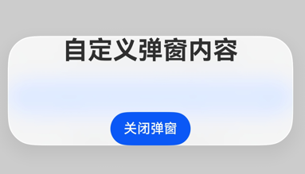

- AlertDialog（告警弹出框）

  | 属性 | 旧接口（[UIContext.showAlertDialog](../reference/apis-arkui/arkts-apis-uicontext-uicontext.md#showalertdialog)） | 新接口（[DialogPresenter.present](../reference/apis-arkui/arkts-apis-uicontext-dialogpresenter.md#present)） |
  |------|------|------|
  | 编程模型 | [UIContext.showAlertDialog(options)](../reference/apis-arkui/arkts-apis-uicontext-uicontext.md#showalertdialog)命令式调用 | [presenter.present(options)](../reference/apis-arkui/arkts-apis-uicontext-dialogpresenter.md#present) |
  | 标题 | [title](../reference/apis-arkui/arkui-ts/ts-methods-alert-dialog-box.md#alertdialogparam对象说明): [ResourceStr](../reference/apis-arkui/arkui-ts/ts-types.md#resourcestr) | [title](../reference/apis-arkui/js-apis-dialog.md#dialogstyleoptions): [ResourceStr](../reference/apis-arkui/arkui-ts/ts-types.md#resourcestr) |
  | 副标题 | [subtitle](../reference/apis-arkui/arkui-ts/ts-methods-alert-dialog-box.md#alertdialogparam对象说明): [ResourceStr](../reference/apis-arkui/arkui-ts/ts-types.md#resourcestr) | [subtitle](../reference/apis-arkui/js-apis-dialog.md#dialogstyleoptions): [ResourceStr](../reference/apis-arkui/arkui-ts/ts-types.md#resourcestr) |
  | 消息内容 | [message](../reference/apis-arkui/arkui-ts/ts-methods-alert-dialog-box.md#alertdialogparam对象说明): [ResourceStr](../reference/apis-arkui/arkui-ts/ts-types.md#resourcestr) | [message](../reference/apis-arkui/js-apis-dialog.md#dialogstyleoptions): [DialogMessage](../reference/apis-arkui/js-apis-dialog.md#dialogmessage)（[content](../reference/apis-arkui/js-apis-dialog.md#dialogmessage) + [wordBreak](../reference/apis-arkui/js-apis-dialog.md#dialogtextstyleoptions)） |
  | 文本样式 | [textStyle](../reference/apis-arkui/arkui-ts/ts-methods-alert-dialog-box.md#alertdialogparam对象说明): [TextStyle](../reference/apis-arkui/arkui-ts/ts-universal-styled-string.md#textstyle) | [message](../reference/apis-arkui/js-apis-dialog.md#dialogstyleoptions).[wordBreak](../reference/apis-arkui/js-apis-dialog.md#dialogtextstyleoptions): [WordBreak](../reference/apis-arkui/arkui-ts/ts-appendix-enums.md#wordbreak11)（通过[DialogMessage](../reference/apis-arkui/js-apis-dialog.md#dialogmessage)设置） |
  | 按钮 | [confirm](../reference/apis-arkui/arkui-ts/ts-methods-alert-dialog-box.md#alertdialogparamwithconfirm对象说明)（单个）/ [primaryButton](../reference/apis-arkui/arkui-ts/ts-methods-alert-dialog-box.md#alertdialogparamwithbuttons对象说明) + [secondaryButton](../reference/apis-arkui/arkui-ts/ts-methods-alert-dialog-box.md#alertdialogparamwithbuttons对象说明)（两个）/ [buttons](../reference/apis-arkui/arkui-ts/ts-methods-alert-dialog-box.md#alertdialogparamwithoptions10对象说明): [Array](../reference/apis-arkts/arkts-apis-arkts-collections-Array.md)\<[AlertDialogButtonOptions](../reference/apis-arkui/arkui-ts/ts-methods-alert-dialog-box.md#alertdialogbuttonoptions10对象说明)\>（多个） | [buttons](../reference/apis-arkui/js-apis-dialog.md#dialogstyleoptions): [Array](../reference/apis-arkts/arkts-apis-arkts-collections-Array.md)\<[DialogButton](../reference/apis-arkui/js-apis-dialog.md#dialogbutton)\>（含[value](../reference/apis-arkui/js-apis-dialog.md#dialogbutton)/[fontColor](../reference/apis-arkui/js-apis-dialog.md#dialogbutton)/[backgroundColor](../reference/apis-arkui/js-apis-dialog.md#dialogbutton)/[enabled](../reference/apis-arkui/js-apis-dialog.md#dialogbutton)/[primary](../reference/apis-arkui/js-apis-dialog.md#dialogbutton)/[style](../reference/apis-arkui/js-apis-dialog.md#dialogbutton)/[action](../reference/apis-arkui/js-apis-dialog.md#dialogbutton)） |
  | 按钮排列 | [buttonDirection](../reference/apis-arkui/arkui-ts/ts-methods-alert-dialog-box.md#alertdialogparamwithoptions10对象说明): [DialogButtonDirection](../reference/apis-arkui/arkui-ts/ts-methods-alert-dialog-box.md#dialogbuttondirection10枚举说明) | [buttonDirection](../reference/apis-arkui/js-apis-dialog.md#dialogstyleoptions): [DialogButtonOrientation](../reference/apis-arkui/js-apis-dialog.md#dialogbuttonorientation) |
  | 操作菜单 | 无 | [sheets](../reference/apis-arkui/js-apis-dialog.md#dialogstyleoptions): [Array](../reference/apis-arkts/arkts-apis-arkts-collections-Array.md)\<[DialogSheet](../reference/apis-arkui/js-apis-dialog.md#dialogsheet)\>（action-sheet风格） |
  | 网格数 | [gridCount](../reference/apis-arkui/arkui-ts/ts-methods-alert-dialog-box.md#alertdialogparam对象说明): number | [gridCount](../reference/apis-arkui/js-apis-dialog.md#dialogstyleoptions): number |
  | 确认回调 | [confirm](../reference/apis-arkui/arkui-ts/ts-methods-alert-dialog-box.md#alertdialogparamwithconfirm对象说明) / [primaryButton](../reference/apis-arkui/arkui-ts/ts-methods-alert-dialog-box.md#alertdialogparamwithbuttons对象说明).action / [secondaryButton](../reference/apis-arkui/arkui-ts/ts-methods-alert-dialog-box.md#alertdialogparamwithbuttons对象说明).action / [buttons](../reference/apis-arkui/arkui-ts/ts-methods-alert-dialog-box.md#alertdialogparamwithoptions10对象说明)[].action | [DialogButton](../reference/apis-arkui/js-apis-dialog.md#dialogbutton).[action](../reference/apis-arkui/js-apis-dialog.md#dialogbutton)（通过[Promise](../arkts-utils/async-concurrency-overview.md#promise)结果） |
  | 取消回调 | [cancel](../reference/apis-arkui/arkui-ts/ts-methods-alert-dialog-box.md#alertdialogparam对象说明): [VoidCallback](../reference/apis-arkui/arkui-ts/ts-types.md#voidcallback12) + [onWillDismiss](../reference/apis-arkui/arkui-ts/ts-methods-alert-dialog-box.md#alertdialogparam对象说明): [Callback](../reference/apis-arkui/arkui-ts/ts-types.md#callback12)\<[DismissDialogAction](../reference/apis-arkui/arkui-ts/ts-methods-custom-dialog-box.md#dismissdialogaction12)\> | [onWillDismiss](../reference/apis-arkui/js-apis-dialog.md#dialogbaseoptions): [Callback](../reference/apis-arkui/arkui-ts/ts-types.md#callback12)\<[DialogDismissal](../reference/apis-arkui/js-apis-dialog.md#dialogdismissal)\> |
  | 对齐 | [alignment](../reference/apis-arkui/arkui-ts/ts-methods-alert-dialog-box.md#alertdialogparam对象说明): [DialogAlignment](../reference/apis-arkui/arkui-ts/ts-methods-alert-dialog-box.md#dialogalignment枚举说明) | [alignment](../reference/apis-arkui/js-apis-dialog.md#dialogbaseoptions): [DialogBaseAlignment](../reference/apis-arkui/js-apis-dialog.md#dialogbasealignment) |
  | 偏移 | [offset](../reference/apis-arkui/arkui-ts/ts-methods-alert-dialog-box.md#alertdialogparam对象说明): [Offset](../reference/apis-arkui/arkui-ts/ts-types.md#offset) | [offset](../reference/apis-arkui/js-apis-dialog.md#dialogbaseoptions): [Offset](../reference/apis-arkui/arkui-ts/ts-types.md#offset) |
  | 自动取消 | [autoCancel](../reference/apis-arkui/arkui-ts/ts-methods-alert-dialog-box.md#alertdialogparam对象说明): boolean | [autoCancel](../reference/apis-arkui/js-apis-dialog.md#dialogbaseoptions): boolean |
  | 蒙层区域 | [maskRect](../reference/apis-arkui/arkui-ts/ts-methods-alert-dialog-box.md#alertdialogparam对象说明): [Rectangle](../reference/apis-arkui/arkui-ts/ts-methods-alert-dialog-box.md#rectangle8类型说明) | [maskRect](../reference/apis-arkui/js-apis-dialog.md#dialogbaseoptions): [Rectangle](../reference/apis-arkui/arkui-ts/ts-methods-alert-dialog-box.md#rectangle8类型说明) |
  | 模态 | [isModal](../reference/apis-arkui/arkui-ts/ts-methods-alert-dialog-box.md#alertdialogparam对象说明): boolean | [isModal](../reference/apis-arkui/js-apis-dialog.md#dialogbaseoptions): boolean |
  | 子窗口 | [showInSubWindow](../reference/apis-arkui/arkui-ts/ts-methods-alert-dialog-box.md#alertdialogparam对象说明): boolean | [showInSubWindow](../reference/apis-arkui/js-apis-dialog.md#dialogbaseoptions): boolean |
  | 背景色 | [backgroundColor](../reference/apis-arkui/arkui-ts/ts-methods-alert-dialog-box.md#alertdialogparam对象说明) | [backgroundColor](../reference/apis-arkui/js-apis-dialog.md#dialogbaseoptions) |
  | 背景模糊 | [backgroundBlurStyle](../reference/apis-arkui/arkui-ts/ts-methods-alert-dialog-box.md#alertdialogparam对象说明) + [backgroundBlurStyleOptions](../reference/apis-arkui/arkui-ts/ts-methods-alert-dialog-box.md#alertdialogparam对象说明) + [backgroundEffect](../reference/apis-arkui/arkui-ts/ts-methods-alert-dialog-box.md#alertdialogparam对象说明) | [backgroundBlurStyle](../reference/apis-arkui/js-apis-dialog.md#dialogbaseoptions) + [backgroundBlurStyleOptions](../reference/apis-arkui/js-apis-dialog.md#dialogbaseoptions) + [backgroundEffect](../reference/apis-arkui/js-apis-dialog.md#dialogbaseoptions) |
  | 边框 | [cornerRadius](../reference/apis-arkui/arkui-ts/ts-methods-alert-dialog-box.md#alertdialogparam对象说明) / [borderWidth](../reference/apis-arkui/arkui-ts/ts-methods-alert-dialog-box.md#alertdialogparam对象说明) / [borderColor](../reference/apis-arkui/arkui-ts/ts-methods-alert-dialog-box.md#alertdialogparam对象说明) / [borderStyle](../reference/apis-arkui/arkui-ts/ts-methods-alert-dialog-box.md#alertdialogparam对象说明) | [borderRadius](../reference/apis-arkui/js-apis-dialog.md#dialogbaseoptions) / [borderWidth](../reference/apis-arkui/js-apis-dialog.md#dialogbaseoptions) / [borderColor](../reference/apis-arkui/js-apis-dialog.md#dialogbaseoptions) / [borderStyle](../reference/apis-arkui/js-apis-dialog.md#dialogbaseoptions)（老版本[cornerRadius](../reference/apis-arkui/arkui-ts/ts-methods-alert-dialog-box.md#alertdialogparam对象说明)对应新版本[borderRadius](../reference/apis-arkui/js-apis-dialog.md#dialogbaseoptions)） |
  | 阴影 | [shadow](../reference/apis-arkui/arkui-ts/ts-methods-alert-dialog-box.md#alertdialogparam对象说明): [ShadowOptions](../reference/apis-arkui/arkui-ts/ts-universal-attributes-image-effect.md#shadowoptions对象说明) \| [ShadowStyle](../reference/apis-arkui/arkui-ts/ts-universal-attributes-image-effect.md#shadowstyle10枚举说明) | [shadow](../reference/apis-arkui/js-apis-dialog.md#dialogbaseoptions): [ShadowOptions](../reference/apis-arkui/arkui-ts/ts-universal-attributes-image-effect.md#shadowoptions对象说明) \| [ShadowStyle](../reference/apis-arkui/arkui-ts/ts-universal-attributes-image-effect.md#shadowstyle10枚举说明) |
  | 尺寸 | [width](../reference/apis-arkui/arkui-ts/ts-methods-alert-dialog-box.md#alertdialogparam对象说明) / [height](../reference/apis-arkui/arkui-ts/ts-methods-alert-dialog-box.md#alertdialogparam对象说明) | [width](../reference/apis-arkui/js-apis-dialog.md#dialogbaseoptions) / [height](../reference/apis-arkui/js-apis-dialog.md#dialogbaseoptions) |
  | 过渡动画 | [transition](../reference/apis-arkui/arkui-ts/ts-methods-alert-dialog-box.md#alertdialogparam对象说明): [TransitionEffect](../reference/apis-arkui/arkui-ts/ts-transition-animation-component.md#transitioneffect10对象说明) | [dialogTransition](../reference/apis-arkui/js-apis-dialog.md#dialogbaseoptions): [TransitionEffect](../reference/apis-arkui/arkui-ts/ts-transition-animation-component.md#transitioneffect10对象说明) |
  | 蒙层动画 | 无 | [maskTransition](../reference/apis-arkui/js-apis-dialog.md#dialogbaseoptions): [TransitionEffect](../reference/apis-arkui/arkui-ts/ts-transition-animation-component.md#transitioneffect10对象说明) |
  | 打开动画回调 | [onWillAppear](../reference/apis-arkui/arkui-ts/ts-methods-alert-dialog-box.md#alertdialogparam对象说明) / [onDidAppear](../reference/apis-arkui/arkui-ts/ts-methods-alert-dialog-box.md#alertdialogparam对象说明) / [onWillDisappear](../reference/apis-arkui/arkui-ts/ts-methods-alert-dialog-box.md#alertdialogparam对象说明) / [onDidDisappear](../reference/apis-arkui/arkui-ts/ts-methods-alert-dialog-box.md#alertdialogparam对象说明) | [onWillAppear](../reference/apis-arkui/js-apis-dialog.md#dialogbaseoptions) / [onDidAppear](../reference/apis-arkui/js-apis-dialog.md#dialogbaseoptions) / [onWillDisappear](../reference/apis-arkui/js-apis-dialog.md#dialogbaseoptions) / [onDidDisappear](../reference/apis-arkui/js-apis-dialog.md#dialogbaseoptions) |
  | 悬浮模式 | [enableHoverMode](../reference/apis-arkui/arkui-ts/ts-methods-alert-dialog-box.md#alertdialogparam对象说明) + [hoverModeArea](../reference/apis-arkui/arkui-ts/ts-methods-alert-dialog-box.md#alertdialogparam对象说明) | [enableHoverMode](../reference/apis-arkui/js-apis-dialog.md#dialogbaseoptions) + [hoverModeArea](../reference/apis-arkui/js-apis-dialog.md#dialogbaseoptions) |
  | 层级模式 | [levelMode](../reference/apis-arkui/arkui-ts/ts-methods-alert-dialog-box.md#alertdialogparam对象说明) + [levelUniqueId](../reference/apis-arkui/arkui-ts/ts-methods-alert-dialog-box.md#alertdialogparam对象说明) + [immersiveMode](../reference/apis-arkui/arkui-ts/ts-methods-alert-dialog-box.md#alertdialogparam对象说明) + [levelOrder](../reference/apis-arkui/arkui-ts/ts-methods-alert-dialog-box.md#alertdialogparam对象说明) | [levelMode](../reference/apis-arkui/js-apis-dialog.md#dialogbaseoptions) + [levelUniqueId](../reference/apis-arkui/js-apis-dialog.md#dialogbaseoptions) + [immersiveMode](../reference/apis-arkui/js-apis-dialog.md#dialogbaseoptions) + [levelOrder](../reference/apis-arkui/js-apis-dialog.md#dialogbaseoptions) |
  | 系统材质 | [systemMaterial](../reference/apis-arkui/arkui-ts/ts-methods-alert-dialog-box.md#alertdialogparam对象说明): [SystemUiMaterial](../reference/apis-arkui/arkui-ts/ts-universal-attributes-image-effect.md#systemuimaterial) | [systemMaterial](../reference/apis-arkui/js-apis-dialog.md#dialogbaseoptions): [SystemUiMaterial](../reference/apis-arkui/arkui-ts/ts-universal-attributes-image-effect.md#systemuimaterial) |

  **迁移前示例（旧接口）：** 使用[showAlertDialog](../reference/apis-arkui/arkts-apis-uicontext-uicontext.md#showalertdialog)弹出告警框，包含标题、消息和按钮。

  <!-- @[alert_dialog_before_migrate](https://gitcode.com/openharmony/applications_app_samples/blob/master/code/DocsSample/ArkUISample/ArkuiDialogMigrationSample/entry/src/main/ets/pages/opencustomdialog/AlertDialogBeforeMigrate.ets) -->
  
  ``` TypeScript
  @Entry
  @Component
  export struct AlertDialogBeforeMigrate {
    @State result: string = '';
  
    build() {
      NavDestination() {
        Column() {
          Button('打开 AlertDialog')
            .onClick(() => {
              this.getUIContext().showAlertDialog({
                title: '提示',
                message: '确认删除？',
                autoCancel: true,
                buttons: [
                  {
                    value: '取消', action: () => {
                    this.result = '取消';
                  }
                  },
                  {
                    value: '确认', action: () => {
                    this.result = '确认';
                  }
                  }
                ],
                cancel: () => {
                  this.result = 'cancel';
                }
              });
            })
  
          if (this.result) {
            Text(this.result)
              .fontSize(14)
              .margin({ top: 10 })
          }
        }
        .width('100%')
        .height('100%')
        .justifyContent(FlexAlign.Center)
      }
    }
  }
  ```
  
  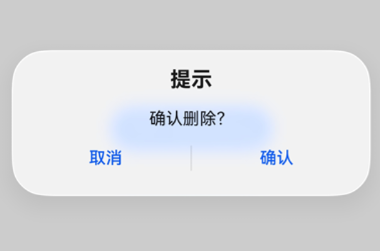
  
  **迁移后示例（新接口）：** 使用[DialogPresenter.present](../reference/apis-arkui/arkts-apis-uicontext-dialogpresenter.md#present)弹出告警框，通过[Promise](../arkts-utils/async-concurrency-overview.md#promise)获取按钮点击结果。
  
  <!-- @[alert_dialog_after_migrate](https://gitcode.com/openharmony/applications_app_samples/blob/master/code/DocsSample/ArkUISample/ArkuiDialogMigrationSample/entry/src/main/ets/pages/opencustomdialog/AlertDialogAfterMigrate.ets) -->
  
  ``` TypeScript
  import { DialogBaseAlignment, DialogDismissal, DialogPresenter, DialogResult } from '@kit.ArkUI';
  import { BusinessError } from '@kit.BasicServicesKit';
  import resource from '../../common/resource';
  
  @Entry
  @Component
  export struct AlertDialogAfterMigrate {
    private presenter: DialogPresenter = this.getUIContext().getDialogPresenter();
    @State result: ResourceStr = '';
  
    build() {
      NavDestination() {
        Row() {
          Column() {
            Text('AlertDialog' + resource.resourceToString($r('app.string.migrate_sample_zh')))
              .fontSize(18)
              .fontWeight(FontWeight.Bold)
              .margin({ bottom: 20 })
  
            Button(resource.resourceToString($r('app.string.old_interface_zh')) + '：showAlertDialog')
              .width('90%')
              .margin({ bottom: 10 })
              .onClick(() => {
                this.result = $r('app.string.OldInterfaceAlertDialogOnClick');
              })
  
            Button(resource.resourceToString($r('app.string.new_interface_zh')) + '：DialogPresenter.present')
              .width('90%')
              .margin({ bottom: 10 })
              .onClick(() => {
                this.showNewAlertDialog();
              })
  
            if (this.result) {
              Text(this.result)
                .fontSize(14)
                .margin({ top: 10 })
            }
          }
          .width('100%')
        }
        .height('100%')
      }
    }
  
    private showNewAlertDialog(): void {
      this.presenter.present({
        title: '提示',
        message: { content: '确认删除？' },
        buttons: [
          {
            value: '取消', action: () => {
            this.result = '用户点击取消';
          }
          },
          {
            value: '确认', action: () => {
            this.result = '用户点击确认';
          }
          }
        ],
        alignment: DialogBaseAlignment.BOTTOM,
        onWillDismiss: (dismissal: DialogDismissal) => {
          this.result = 'onWillDismiss, reason: ' + dismissal.reason;
          dismissal.dismiss();
        }
      }).then((result: DialogResult) => {
        this.result = 'present success, dialogId: ' + result.dialogId;
      }).catch((error: BusinessError) => {
        this.result = `present error: ${error.code}`;
      });
    }
  }
  ```
  
  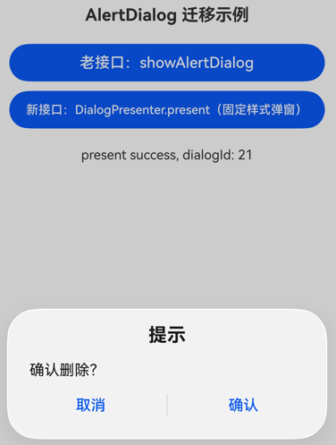

- ActionSheet（列表选择弹出框）

  | 属性 | 旧接口（[UIContext.showActionSheet(options)](../reference/apis-arkui/arkts-apis-uicontext-uicontext.md#showactionsheet)） | 新接口（[DialogPresenter.present](../reference/apis-arkui/arkts-apis-uicontext-dialogpresenter.md#present)） |
  |------|------|------|
  | 编程模型 |[UIContext.showActionSheet](../reference/apis-arkui/arkts-apis-uicontext-uicontext.md#showactionsheet)命令式调用 | [presenter.present(options)](../reference/apis-arkui/arkts-apis-uicontext-dialogpresenter.md#present) |
  | 标题 | [title](../reference/apis-arkui/arkui-ts/ts-methods-action-sheet.md#actionsheetoptions对象说明): string \| [Resource](../reference/apis-arkui/arkui-ts/ts-types.md#resource) | [title](../reference/apis-arkui/js-apis-dialog.md#dialogstyleoptions): [ResourceStr](../reference/apis-arkui/arkui-ts/ts-types.md#resourcestr) |
  | 副标题 | [subtitle](../reference/apis-arkui/arkui-ts/ts-methods-action-sheet.md#actionsheetoptions对象说明): [ResourceStr](../reference/apis-arkui/arkui-ts/ts-types.md#resourcestr) | [subtitle](../reference/apis-arkui/js-apis-dialog.md#dialogstyleoptions): [ResourceStr](../reference/apis-arkui/arkui-ts/ts-types.md#resourcestr) |
  | 消息内容 | [message](../reference/apis-arkui/arkui-ts/ts-methods-action-sheet.md#actionsheetoptions对象说明): string \| [Resource](../reference/apis-arkui/arkui-ts/ts-types.md#resource) | [message](../reference/apis-arkui/js-apis-dialog.md#dialogstyleoptions): [DialogMessage](../reference/apis-arkui/js-apis-dialog.md#dialogmessage)（[content](../reference/apis-arkui/js-apis-dialog.md#dialogmessage) + [wordBreak](../reference/apis-arkui/js-apis-dialog.md#dialogtextstyleoptions)） |
  | 按钮 | [confirm](../reference/apis-arkui/arkui-ts/ts-methods-action-sheet.md#actionsheetoptions对象说明): [ActionSheetButtonOptions](../reference/apis-arkui/arkui-ts/ts-methods-action-sheet.md#actionsheetbuttonoptions18对象说明)（单个确认按钮） | [buttons](../reference/apis-arkui/js-apis-dialog.md#dialogstyleoptions): [Array](../reference/apis-arkts/arkts-apis-arkts-collections-Array.md)\<[DialogButton](../reference/apis-arkui/js-apis-dialog.md#dialogbutton)\> |
  | 按钮排列 | 无 | [buttonDirection](../reference/apis-arkui/js-apis-dialog.md#dialogstyleoptions): [DialogButtonOrientation](../reference/apis-arkui/js-apis-dialog.md#dialogbuttonorientation) |
  | 操作菜单 | [sheets](../reference/apis-arkui/arkui-ts/ts-methods-action-sheet.md#actionsheetoptions对象说明): [Array](../reference/apis-arkts/arkts-apis-arkts-collections-Array.md)\<[SheetInfo](../reference/apis-arkui/arkui-ts/ts-methods-action-sheet.md#sheetinfo对象说明)\>（[title](../reference/apis-arkui/arkui-ts/ts-methods-action-sheet.md#actionsheetoptions对象说明)/[icon](../reference/apis-arkui/arkui-ts/ts-methods-action-sheet.md#sheetinfo对象说明)/action） | [sheets](../reference/apis-arkui/js-apis-dialog.md#dialogstyleoptions): [Array](../reference/apis-arkts/arkts-apis-arkts-collections-Array.md)\<[DialogSheet](../reference/apis-arkui/js-apis-dialog.md#dialogsheet)\>（[title](../reference/apis-arkui/js-apis-dialog.md#dialogstyleoptions)/[icon](../reference/apis-arkui/js-apis-dialog.md#dialogsheet)/[action](../reference/apis-arkui/js-apis-dialog.md#dialogsheet)） |
  | 网格数 | 无 | [gridCount](../reference/apis-arkui/js-apis-dialog.md#dialogstyleoptions): number |
  | 确认回调 | [confirm](../reference/apis-arkui/arkui-ts/ts-methods-action-sheet.md#actionsheetoptions对象说明).action: [VoidCallback](../reference/apis-arkui/arkui-ts/ts-types.md#voidcallback12) | [DialogButton](../reference/apis-arkui/js-apis-dialog.md#dialogbutton).[action](../reference/apis-arkui/js-apis-dialog.md#dialogbutton) |
  | 取消回调 | [cancel](../reference/apis-arkui/arkui-ts/ts-methods-action-sheet.md#actionsheetoptions对象说明): [VoidCallback](../reference/apis-arkui/arkui-ts/ts-types.md#voidcallback12) + [onWillDismiss](../reference/apis-arkui/arkui-ts/ts-methods-action-sheet.md#actionsheetoptions对象说明): [Callback](../reference/apis-arkui/arkui-ts/ts-types.md#callback12)\<[DismissDialogAction](../reference/apis-arkui/arkui-ts/ts-methods-custom-dialog-box.md#dismissdialogaction12)\> | [onWillDismiss](../reference/apis-arkui/js-apis-dialog.md#dialogbaseoptions): [Callback](../reference/apis-arkui/arkui-ts/ts-types.md#callback12)\<[DialogDismissal](../reference/apis-arkui/js-apis-dialog.md#dialogdismissal)\> |
  | 对齐 | [alignment](../reference/apis-arkui/arkui-ts/ts-methods-action-sheet.md#actionsheetoptions对象说明): [DialogAlignment](../reference/apis-arkui/arkui-ts/ts-methods-alert-dialog-box.md#dialogalignment枚举说明) | [alignment](../reference/apis-arkui/js-apis-dialog.md#dialogbaseoptions): [DialogBaseAlignment](../reference/apis-arkui/js-apis-dialog.md#dialogbasealignment) |
  | 偏移 | [offset](../reference/apis-arkui/arkui-ts/ts-methods-action-sheet.md#actionsheetoptions对象说明): [ActionSheetOffset](../reference/apis-arkui/arkui-ts/ts-methods-action-sheet.md#actionsheetoffset18对象说明)（含dx/dy） | [offset](../reference/apis-arkui/js-apis-dialog.md#dialogbaseoptions): [Offset](../reference/apis-arkui/arkui-ts/ts-types.md#offset)（含dx/dy） |
  | 自动取消 | [autoCancel](../reference/apis-arkui/arkui-ts/ts-methods-action-sheet.md#actionsheetoptions对象说明): boolean | [autoCancel](../reference/apis-arkui/js-apis-dialog.md#dialogbaseoptions): boolean |
  | 蒙层区域 | [maskRect](../reference/apis-arkui/arkui-ts/ts-methods-action-sheet.md#actionsheetoptions对象说明): [Rectangle](../reference/apis-arkui/arkui-ts/ts-methods-alert-dialog-box.md#rectangle8类型说明) | [maskRect](../reference/apis-arkui/js-apis-dialog.md#dialogbaseoptions): [Rectangle](../reference/apis-arkui/arkui-ts/ts-methods-alert-dialog-box.md#rectangle8类型说明) |
  | 模态 | [isModal](../reference/apis-arkui/arkui-ts/ts-methods-action-sheet.md#actionsheetoptions对象说明): boolean | [isModal](../reference/apis-arkui/js-apis-dialog.md#dialogbaseoptions): boolean |
  | 子窗口 | [showInSubWindow](../reference/apis-arkui/arkui-ts/ts-methods-action-sheet.md#actionsheetoptions对象说明): boolean | [showInSubWindow](../reference/apis-arkui/js-apis-dialog.md#dialogbaseoptions): boolean |
  | 背景色 | [backgroundColor](../reference/apis-arkui/arkui-ts/ts-methods-action-sheet.md#actionsheetoptions对象说明) | [backgroundColor](../reference/apis-arkui/js-apis-dialog.md#dialogbaseoptions) |
  | 背景模糊 | [backgroundBlurStyle](../reference/apis-arkui/arkui-ts/ts-methods-action-sheet.md#actionsheetoptions对象说明) + [backgroundBlurStyleOptions](../reference/apis-arkui/arkui-ts/ts-methods-action-sheet.md#actionsheetoptions对象说明) + [backgroundEffect](../reference/apis-arkui/arkui-ts/ts-methods-action-sheet.md#actionsheetoptions对象说明) | [backgroundBlurStyle](../reference/apis-arkui/js-apis-dialog.md#dialogbaseoptions) + [backgroundBlurStyleOptions](../reference/apis-arkui/js-apis-dialog.md#dialogbaseoptions) + [backgroundEffect](../reference/apis-arkui/js-apis-dialog.md#dialogbaseoptions) |
  | 边框 | [cornerRadius](../reference/apis-arkui/arkui-ts/ts-methods-action-sheet.md#actionsheetoptions对象说明) / [borderWidth](../reference/apis-arkui/arkui-ts/ts-methods-action-sheet.md#actionsheetoptions对象说明) / [borderColor](../reference/apis-arkui/arkui-ts/ts-methods-action-sheet.md#actionsheetoptions对象说明) / [borderStyle](../reference/apis-arkui/arkui-ts/ts-methods-action-sheet.md#actionsheetoptions对象说明) | [borderRadius](../reference/apis-arkui/js-apis-dialog.md#dialogbaseoptions) / [borderWidth](../reference/apis-arkui/js-apis-dialog.md#dialogbaseoptions) / [borderColor](../reference/apis-arkui/js-apis-dialog.md#dialogbaseoptions) / [borderStyle](../reference/apis-arkui/js-apis-dialog.md#dialogbaseoptions)（老版本[cornerRadius](../reference/apis-arkui/arkui-ts/ts-methods-action-sheet.md#actionsheetoptions对象说明)对应新版本[borderRadius](../reference/apis-arkui/js-apis-dialog.md#dialogbaseoptions)） |
  | 阴影 | [shadow](../reference/apis-arkui/arkui-ts/ts-methods-action-sheet.md#actionsheetoptions对象说明): [ShadowOptions](../reference/apis-arkui/arkui-ts/ts-universal-attributes-image-effect.md#shadowoptions对象说明) \| [ShadowStyle](../reference/apis-arkui/arkui-ts/ts-universal-attributes-image-effect.md#shadowstyle10枚举说明) | [shadow](../reference/apis-arkui/js-apis-dialog.md#dialogbaseoptions): [ShadowOptions](../reference/apis-arkui/arkui-ts/ts-universal-attributes-image-effect.md#shadowoptions对象说明) \| [ShadowStyle](../reference/apis-arkui/arkui-ts/ts-universal-attributes-image-effect.md#shadowstyle10枚举说明) |
  | 尺寸 | [width](../reference/apis-arkui/arkui-ts/ts-methods-action-sheet.md#actionsheetoptions对象说明) / [height](../reference/apis-arkui/arkui-ts/ts-methods-action-sheet.md#actionsheetoptions对象说明) | [width](../reference/apis-arkui/js-apis-dialog.md#dialogbaseoptions) / [height](../reference/apis-arkui/js-apis-dialog.md#dialogbaseoptions) |
  | 过渡动画 | [transition](../reference/apis-arkui/arkui-ts/ts-methods-action-sheet.md#actionsheetoptions对象说明): [TransitionEffect](../reference/apis-arkui/arkui-ts/ts-transition-animation-component.md#transitioneffect10对象说明) | [dialogTransition](../reference/apis-arkui/js-apis-dialog.md#dialogbaseoptions): [TransitionEffect](../reference/apis-arkui/arkui-ts/ts-transition-animation-component.md#transitioneffect10对象说明) |
  | 蒙层动画 | 无 | [maskTransition](../reference/apis-arkui/js-apis-dialog.md#dialogbaseoptions): [TransitionEffect](../reference/apis-arkui/arkui-ts/ts-transition-animation-component.md#transitioneffect10对象说明) |
  | 打开动画回调 | [onWillAppear](../reference/apis-arkui/arkui-ts/ts-methods-action-sheet.md#actionsheetoptions对象说明) / [onDidAppear](../reference/apis-arkui/arkui-ts/ts-methods-action-sheet.md#actionsheetoptions对象说明) / [onWillDisappear](../reference/apis-arkui/arkui-ts/ts-methods-action-sheet.md#actionsheetoptions对象说明) / [onDidDisappear](../reference/apis-arkui/arkui-ts/ts-methods-action-sheet.md#actionsheetoptions对象说明) | [onWillAppear](../reference/apis-arkui/js-apis-dialog.md#dialogbaseoptions) / [onDidAppear](../reference/apis-arkui/js-apis-dialog.md#dialogbaseoptions) / [onWillDisappear](../reference/apis-arkui/js-apis-dialog.md#dialogbaseoptions) / [onDidDisappear](../reference/apis-arkui/js-apis-dialog.md#dialogbaseoptions) |
  | 悬浮模式 | [enableHoverMode](../reference/apis-arkui/arkui-ts/ts-methods-action-sheet.md#actionsheetoptions对象说明) + [hoverModeArea](../reference/apis-arkui/arkui-ts/ts-methods-action-sheet.md#actionsheetoptions对象说明) | [enableHoverMode](../reference/apis-arkui/js-apis-dialog.md#dialogbaseoptions) + [hoverModeArea](../reference/apis-arkui/js-apis-dialog.md#dialogbaseoptions) |
  | 层级模式 | [levelMode](../reference/apis-arkui/arkui-ts/ts-methods-action-sheet.md#actionsheetoptions对象说明) + [levelUniqueId](../reference/apis-arkui/arkui-ts/ts-methods-action-sheet.md#actionsheetoptions对象说明) + [immersiveMode](../reference/apis-arkui/arkui-ts/ts-methods-action-sheet.md#actionsheetoptions对象说明) + [levelOrder](../reference/apis-arkui/arkui-ts/ts-methods-action-sheet.md#actionsheetoptions对象说明) | [levelMode](../reference/apis-arkui/js-apis-dialog.md#dialogbaseoptions) + [levelUniqueId](../reference/apis-arkui/js-apis-dialog.md#dialogbaseoptions) + [immersiveMode](../reference/apis-arkui/js-apis-dialog.md#dialogbaseoptions) + [levelOrder](../reference/apis-arkui/js-apis-dialog.md#dialogbaseoptions) |
  | 系统材质 | [systemMaterial](../reference/apis-arkui/arkui-ts/ts-methods-action-sheet.md#actionsheetoptions对象说明): [SystemUiMaterial](../reference/apis-arkui/arkui-ts/ts-universal-attributes-image-effect.md#systemuimaterial) | [systemMaterial](../reference/apis-arkui/js-apis-dialog.md#dialogbaseoptions): [SystemUiMaterial](../reference/apis-arkui/arkui-ts/ts-universal-attributes-image-effect.md#systemuimaterial) |

  **迁移前示例（旧接口）：** 使用[showActionSheet](../reference/apis-arkui/arkts-apis-uicontext-uicontext.md#showactionsheet)弹出列表选择弹出框，包含标题和菜单项。
  
  <!-- @[action_sheet_before_migrate](https://gitcode.com/openharmony/applications_app_samples/blob/master/code/DocsSample/ArkUISample/ArkuiDialogMigrationSample/entry/src/main/ets/pages/opencustomdialog/ActionSheetBeforeMigrate.ets) -->
  
  ``` TypeScript
  @Entry
  @Component
  export struct ActionSheetBeforeMigrate {
    @State result: string = '';
  
    build() {
      NavDestination() {
        Column() {
          Button('打开 ActionSheet')
            .onClick(() => {
              this.getUIContext().showActionSheet({
                title: '选择操作',
                message: '请选择一个操作',
                autoCancel: true,
                sheets: [
                  {
                    title: '复制', action: () => {
                    this.result = '复制';
                  }
                  },
                  {
                    title: '删除', action: () => {
                    this.result = '删除';
                  }
                  }
                ],
                cancel: () => {
                  this.result = '取消';
                }
              });
            })
  
          if (this.result) {
            Text(this.result)
              .fontSize(14)
              .margin({ top: 10 })
          }
        }
        .width('100%')
        .height('100%')
        .justifyContent(FlexAlign.Center)
      }
    }
  }
  ```
  
  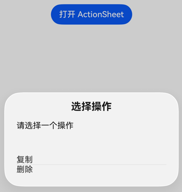
  
  **迁移后示例（新接口）：** 使用[DialogPresenter.present](../reference/apis-arkui/arkts-apis-uicontext-dialogpresenter.md#present)弹出列表选择弹出框，通过[Promise](../arkts-utils/async-concurrency-overview.md#promise)获取选择结果。
  
  <!-- @[action_sheet_after_migrate](https://gitcode.com/openharmony/applications_app_samples/blob/master/code/DocsSample/ArkUISample/ArkuiDialogMigrationSample/entry/src/main/ets/pages/opencustomdialog/ActionSheetAfterMigrate.ets) --> 
  
  ``` TypeScript
  import { DialogDismissal, DialogPresenter, DialogResult } from '@kit.ArkUI';
  import { BusinessError } from '@kit.BasicServicesKit';
  import resource from '../../common/resource';
  
  @Entry
  @Component
  export struct ActionSheetAfterMigrate {
    private presenter: DialogPresenter = this.getUIContext().getDialogPresenter();
    @State result: ResourceStr = '';
  
    build() {
      NavDestination() {
        Row() {
          Column() {
            Text('ActionSheet' + resource.resourceToString($r('app.string.migrate_sample_zh')))
              .fontSize(18)
              .fontWeight(FontWeight.Bold)
              .margin({ bottom: 20 })
  
            Button(resource.resourceToString($r('app.string.old_interface_zh')) + '：showActionSheet')
              .width('90%')
              .margin({ bottom: 10 })
              .onClick(() => {
                this.result = $r('app.string.OldInterfaceActionSheetOnClick');
              })
  
            Button(resource.resourceToString($r('app.string.new_interface_zh')) + '：DialogPresenter.present')
              .width('90%')
              .margin({ bottom: 10 })
              .onClick(() => {
                this.showNewActionSheet();
              })
  
            if (this.result) {
              Text(this.result)
                .fontSize(14)
                .margin({ top: 10 })
            }
          }
          .width('100%')
        }
        .height('100%')
      }
    }
  
    private showNewActionSheet(): void {
      this.presenter.present({
        title: '选择操作',
        message: { content: '请选择一个操作' },
        autoCancel: true,
        sheets: [
          { title: '复制', action: () => { this.result = '复制'; } },
          { title: '删除', action: () => { this.result = '删除'; } }
        ],
        onWillDismiss: (dismissal: DialogDismissal) => {
          this.result = '取消';
          dismissal.dismiss();
        }
      }).then((result: DialogResult) => {
        this.result = 'present success, dialogId: ' + result.dialogId;
      }).catch((error: BusinessError) => {
        this.result = `present error: ${error.code}`;
      });
    }
  }
  ```
  
  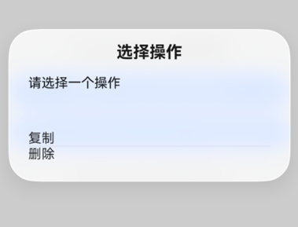

- promptAction.showDialog（对话框）

  | 属性 | 旧接口（[promptAction.showDialog](../reference/apis-arkui/arkts-apis-uicontext-promptaction.md#showdialog)） | 新接口（[DialogPresenter.present](../reference/apis-arkui/arkts-apis-uicontext-dialogpresenter.md#present)） |
  |------|------|------|
  | 编程模型 | [promptAction.showDialog(options)](../reference/apis-arkui/arkts-apis-uicontext-promptaction.md#showdialog) | [presenter.present(options)](../reference/apis-arkui/arkts-apis-uicontext-dialogpresenter.md#present) |
  | 标题 | [title](../reference/apis-arkui/js-apis-promptAction.md#showdialogoptions): string \| [Resource](../reference/apis-arkui/arkui-ts/ts-types.md#resource) | [title](../reference/apis-arkui/js-apis-dialog.md#dialogstyleoptions): [ResourceStr](../reference/apis-arkui/arkui-ts/ts-types.md#resourcestr) |
  | 副标题 | 无 | [subtitle](../reference/apis-arkui/js-apis-dialog.md#dialogstyleoptions): [ResourceStr](../reference/apis-arkui/arkui-ts/ts-types.md#resourcestr) |
  | 消息内容 | [message](../reference/apis-arkui/js-apis-promptAction.md#showdialogoptions): string \| [Resource](../reference/apis-arkui/arkui-ts/ts-types.md#resource) | [message](../reference/apis-arkui/js-apis-dialog.md#dialogstyleoptions): [DialogMessage](../reference/apis-arkui/js-apis-dialog.md#dialogmessage)（[content](../reference/apis-arkui/js-apis-dialog.md#dialogmessage) + [wordBreak](../reference/apis-arkui/js-apis-dialog.md#dialogtextstyleoptions)） |
  | 按钮 | [buttons](../reference/apis-arkui/js-apis-promptAction.md#showdialogoptions): [Array](../reference/apis-arkts/arkts-apis-arkts-collections-Array.md)\<[Button](../reference/apis-arkui/js-apis-promptAction.md#button)\>（仅[text](../reference/apis-arkui/js-apis-promptAction.md#button) + [color](../reference/apis-arkui/js-apis-promptAction.md#button) + [primary](../reference/apis-arkui/js-apis-promptAction.md#button)） | [buttons](../reference/apis-arkui/js-apis-dialog.md#dialogstyleoptions): [Array](../reference/apis-arkts/arkts-apis-arkts-collections-Array.md)\<[DialogButton](../reference/apis-arkui/js-apis-dialog.md#dialogbutton)\>（含[value](../reference/apis-arkui/js-apis-dialog.md#dialogbutton)/[fontColor](../reference/apis-arkui/js-apis-dialog.md#dialogbutton)/[backgroundColor](../reference/apis-arkui/js-apis-dialog.md#dialogbutton)/[enabled](../reference/apis-arkui/js-apis-dialog.md#dialogbutton)/[primary](../reference/apis-arkui/js-apis-dialog.md#dialogbutton)/[style](../reference/apis-arkui/js-apis-dialog.md#dialogbutton)/[action](../reference/apis-arkui/js-apis-dialog.md#dialogbutton)） |
  | 按钮排列 | 无 | [buttonDirection](../reference/apis-arkui/js-apis-dialog.md#dialogstyleoptions): [DialogButtonOrientation](../reference/apis-arkui/js-apis-dialog.md#dialogbuttonorientation) |
  | 操作菜单 | 无 | [sheets](../reference/apis-arkui/js-apis-dialog.md#dialogstyleoptions): [Array](../reference/apis-arkts/arkts-apis-arkts-collections-Array.md)\<[DialogSheet](../reference/apis-arkui/js-apis-dialog.md#dialogsheet)\> |
  | 网格数 | 无 | [gridCount](../reference/apis-arkui/js-apis-dialog.md#dialogstyleoptions): number |
  | 确认回调 | 通过[ShowDialogSuccessResponse.index](../reference/apis-arkui/js-apis-promptAction.md#showdialogsuccessresponse)获取按钮索引 | [DialogButton](../reference/apis-arkui/js-apis-dialog.md#dialogbutton).[action](../reference/apis-arkui/js-apis-dialog.md#dialogbutton) + [Promise](../arkts-utils/async-concurrency-overview.md#promise)结果 |
  | 取消回调 | 无 | [onWillDismiss](../reference/apis-arkui/js-apis-dialog.md#dialogbaseoptions): [Callback](../reference/apis-arkui/arkui-ts/ts-types.md#callback12)\<[DialogDismissal](../reference/apis-arkui/js-apis-dialog.md#dialogdismissal)\> |
  | 对齐 | [alignment](../reference/apis-arkui/js-apis-promptAction.md#showdialogoptions): [DialogAlignment](../reference/apis-arkui/arkui-ts/ts-methods-alert-dialog-box.md#dialogalignment枚举说明) | [alignment](../reference/apis-arkui/js-apis-dialog.md#dialogbaseoptions): [DialogBaseAlignment](../reference/apis-arkui/js-apis-dialog.md#dialogbasealignment) |
  | 偏移 | [offset](../reference/apis-arkui/js-apis-promptAction.md#showdialogoptions): [Offset](../reference/apis-arkui/arkui-ts/ts-types.md#offset) | [offset](../reference/apis-arkui/js-apis-dialog.md#dialogbaseoptions): [Offset](../reference/apis-arkui/arkui-ts/ts-types.md#offset) |
  | 自动取消 | 无 | [autoCancel](../reference/apis-arkui/js-apis-dialog.md#dialogbaseoptions): boolean |
  | 蒙层颜色 | 无 | [maskColor](../reference/apis-arkui/js-apis-dialog.md#dialogbaseoptions): [ResourceColor](../reference/apis-arkui/arkui-ts/ts-types.md#resourcecolor) |
  | 蒙层区域 | [maskRect](../reference/apis-arkui/js-apis-promptAction.md#showdialogoptions): [Rectangle](../reference/apis-arkui/arkui-ts/ts-methods-alert-dialog-box.md#rectangle8类型说明) | [maskRect](../reference/apis-arkui/js-apis-dialog.md#dialogbaseoptions): [Rectangle](../reference/apis-arkui/arkui-ts/ts-methods-alert-dialog-box.md#rectangle8类型说明) |
  | 模态 | [isModal](../reference/apis-arkui/js-apis-promptAction.md#showdialogoptions): boolean | [isModal](../reference/apis-arkui/js-apis-dialog.md#dialogbaseoptions): boolean |
  | 子窗口 | [showInSubWindow](../reference/apis-arkui/js-apis-promptAction.md#showdialogoptions): boolean | [showInSubWindow](../reference/apis-arkui/js-apis-dialog.md#dialogbaseoptions): boolean |
  | 背景色 | [backgroundColor](../reference/apis-arkui/js-apis-promptAction.md#showdialogoptions) | [backgroundColor](../reference/apis-arkui/js-apis-dialog.md#dialogbaseoptions) |
  | 背景模糊 | [backgroundBlurStyle](../reference/apis-arkui/js-apis-promptAction.md#showdialogoptions) + [backgroundBlurStyleOptions](../reference/apis-arkui/js-apis-promptAction.md#showdialogoptions) + [backgroundEffect](../reference/apis-arkui/js-apis-promptAction.md#showdialogoptions) | [backgroundBlurStyle](../reference/apis-arkui/js-apis-dialog.md#dialogbaseoptions) + [backgroundBlurStyleOptions](../reference/apis-arkui/js-apis-dialog.md#dialogbaseoptions) + [backgroundEffect](../reference/apis-arkui/js-apis-dialog.md#dialogbaseoptions) |
  | 边框 | 无 | [borderRadius](../reference/apis-arkui/js-apis-dialog.md#dialogbaseoptions) / [borderWidth](../reference/apis-arkui/js-apis-dialog.md#dialogbaseoptions) / [borderColor](../reference/apis-arkui/js-apis-dialog.md#dialogbaseoptions) / [borderStyle](../reference/apis-arkui/js-apis-dialog.md#dialogbaseoptions) |
  | 阴影 | [shadow](../reference/apis-arkui/js-apis-promptAction.md#showdialogoptions): [ShadowOptions](../reference/apis-arkui/arkui-ts/ts-universal-attributes-image-effect.md#shadowoptions对象说明) \| [ShadowStyle](../reference/apis-arkui/arkui-ts/ts-universal-attributes-image-effect.md#shadowstyle10枚举说明) | [shadow](../reference/apis-arkui/js-apis-dialog.md#dialogbaseoptions): [ShadowOptions](../reference/apis-arkui/arkui-ts/ts-universal-attributes-image-effect.md#shadowoptions对象说明) \| [ShadowStyle](../reference/apis-arkui/arkui-ts/ts-universal-attributes-image-effect.md#shadowstyle10枚举说明) |
  | 尺寸 | 无 | [width](../reference/apis-arkui/js-apis-dialog.md#dialogbaseoptions) / [height](../reference/apis-arkui/js-apis-dialog.md#dialogbaseoptions) |
  | 过渡动画 | 无 | [dialogTransition](../reference/apis-arkui/js-apis-dialog.md#dialogbaseoptions): [TransitionEffect](../reference/apis-arkui/arkui-ts/ts-transition-animation-component.md#transitioneffect10对象说明) |
  | 蒙层动画 | 无 | [maskTransition](../reference/apis-arkui/js-apis-dialog.md#dialogbaseoptions): [TransitionEffect](../reference/apis-arkui/arkui-ts/ts-transition-animation-component.md#transitioneffect10对象说明) |
  | 打开动画回调 | [onWillAppear](../reference/apis-arkui/js-apis-promptAction.md#showdialogoptions) / [onDidAppear](../reference/apis-arkui/js-apis-promptAction.md#showdialogoptions) / [onWillDisappear](../reference/apis-arkui/js-apis-promptAction.md#showdialogoptions) / [onDidDisappear](../reference/apis-arkui/js-apis-promptAction.md#showdialogoptions) | [onWillAppear](../reference/apis-arkui/js-apis-dialog.md#dialogbaseoptions) / [onDidAppear](../reference/apis-arkui/js-apis-dialog.md#dialogbaseoptions) / [onWillDisappear](../reference/apis-arkui/js-apis-dialog.md#dialogbaseoptions) / [onDidDisappear](../reference/apis-arkui/js-apis-dialog.md#dialogbaseoptions) |
  | 悬浮模式 | [enableHoverMode](../reference/apis-arkui/js-apis-promptAction.md#showdialogoptions) + [hoverModeArea](../reference/apis-arkui/js-apis-promptAction.md#showdialogoptions) | [enableHoverMode](../reference/apis-arkui/js-apis-dialog.md#dialogbaseoptions) + [hoverModeArea](../reference/apis-arkui/js-apis-dialog.md#dialogbaseoptions) |
  | 层级模式 | [levelMode](../reference/apis-arkui/js-apis-promptAction.md#showdialogoptions) + [levelUniqueId](../reference/apis-arkui/js-apis-promptAction.md#showdialogoptions) + [immersiveMode](../reference/apis-arkui/js-apis-promptAction.md#showdialogoptions) + [levelOrder](../reference/apis-arkui/js-apis-promptAction.md#showdialogoptions) | [levelMode](../reference/apis-arkui/js-apis-dialog.md#dialogbaseoptions) + [levelUniqueId](../reference/apis-arkui/js-apis-dialog.md#dialogbaseoptions) + [immersiveMode](../reference/apis-arkui/js-apis-dialog.md#dialogbaseoptions) + [levelOrder](../reference/apis-arkui/js-apis-dialog.md#dialogbaseoptions) |
  | 系统材质 | [systemMaterial](../reference/apis-arkui/js-apis-promptAction.md#showdialogoptions): [SystemUiMaterial](../reference/apis-arkui/arkui-ts/ts-universal-attributes-image-effect.md#systemuimaterial) | [systemMaterial](../reference/apis-arkui/js-apis-dialog.md#dialogbaseoptions): [SystemUiMaterial](../reference/apis-arkui/arkui-ts/ts-universal-attributes-image-effect.md#systemuimaterial) |

  **迁移前示例（旧接口）：** 使用[showDialog](../reference/apis-arkui/arkts-apis-uicontext-promptaction.md#showdialog)弹出对话框，包含标题、消息和按钮。
  
  <!-- @[show_dialog_before_migrate](https://gitcode.com/openharmony/applications_app_samples/blob/master/code/DocsSample/ArkUISample/ArkuiDialogMigrationSample/entry/src/main/ets/pages/opencustomdialog/ShowDialogBeforeMigrate.ets) -->
  
  ``` TypeScript
  import { BusinessError } from '@kit.BasicServicesKit';
  
  @Entry
  @Component
  export struct ShowDialogBeforeMigrate {
    @State result: string = '';
  
    build() {
      NavDestination() {
        Column() {
          Button('打开 showDialog')
            .onClick(() => {
              this.getUIContext()
                .getPromptAction()
                .showDialog({
                  title: '提示',
                  message: '确认删除？',
                  buttons: [
                    { text: '取消', color: '#666666' },
                    { text: '确认', color: '#0000FF' }
                  ]
                })
                .then((data) => {
                  this.result = 'click button index: ' + data.index;
                })
                .catch((error: BusinessError) => {
                  this.result = `showDialog error: ${error.code}`;
                });
            })
  
          if (this.result) {
            Text(this.result)
              .fontSize(14)
              .margin({ top: 10 })
          }
        }
        .width('100%')
        .height('100%')
        .justifyContent(FlexAlign.Center)
      }
    }
  }
  ```
  
  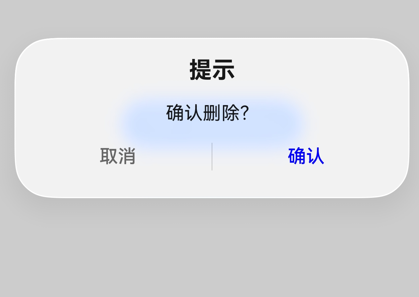
  
  **迁移后示例（新接口）：** 使用[DialogPresenter.present](../reference/apis-arkui/arkts-apis-uicontext-dialogpresenter.md#present)弹出对话框，通过[Promise](../arkts-utils/async-concurrency-overview.md#promise)获取按钮点击结果。
  
  <!-- @[show_dialog_after_migrate](https://gitcode.com/openharmony/applications_app_samples/blob/master/code/DocsSample/ArkUISample/ArkuiDialogMigrationSample/entry/src/main/ets/pages/opencustomdialog/ShowDialogAfterMigrate.ets) -->
  
  ``` TypeScript
  import { DialogPresenter, DialogResult } from '@kit.ArkUI';
  import { BusinessError } from '@kit.BasicServicesKit';
  import resource from '../../common/resource';
  
  @Entry
  @Component
  export struct ShowDialogAfterMigrate {
    private presenter: DialogPresenter = this.getUIContext().getDialogPresenter();
    @State result: ResourceStr = '';
  
    build() {
      NavDestination() {
        Row() {
          Column() {
            Text('showDialog' + resource.resourceToString($r('app.string.migrate_sample_zh')))
              .fontSize(18)
              .fontWeight(FontWeight.Bold)
              .margin({ bottom: 20 })
  
            Button(resource.resourceToString($r('app.string.old_interface_zh')) + '：promptAction.showDialog')
              .width('90%')
              .margin({ bottom: 10 })
              .onClick(() => {
                this.result = $r('app.string.OldInterfaceShowDialogOnClick');
              })
  
            Button(resource.resourceToString($r('app.string.new_interface_zh')) + '：DialogPresenter.present')
              .width('90%')
              .margin({ bottom: 10 })
              .onClick(() => {
                this.showNewDialog();
              })
  
            if (this.result) {
              Text(this.result)
                .fontSize(14)
                .margin({ top: 10 })
            }
          }
          .width('100%')
        }
        .height('100%')
      }
    }
  
    private showNewDialog(): void {
      this.presenter.present({
        title: '提示',
        message: { content: '确认删除？' },
        buttons: [
          { value: '取消', action: () => { this.result = '取消'; } },
          { value: '确认', action: () => { this.result = '确认'; } }
        ]
      }).then((result: DialogResult) => {
        this.result = 'present success, dialogId: ' + result.dialogId;
      }).catch((error: BusinessError) => {
        this.result = `present error: ${error.code}`;
      });
    }
  }
  ```
  
  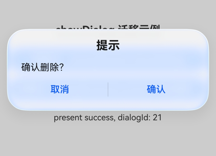

- promptAction.showActionMenu（操作菜单）

  | 属性 | 旧接口（[promptAction.showActionMenu](../reference/apis-arkui/arkts-apis-uicontext-promptaction.md#showactionmenu)） | 新接口（[DialogPresenter.present](../reference/apis-arkui/arkts-apis-uicontext-dialogpresenter.md#present)） |
  |------|------|------|
  | 编程模型 | [promptAction.showActionMenu(options)](../reference/apis-arkui/arkts-apis-uicontext-promptaction.md#showactionmenu) | [presenter.present(options)](../reference/apis-arkui/arkts-apis-uicontext-dialogpresenter.md#present) |
  | 标题 | [title](../reference/apis-arkui/js-apis-promptAction.md#actionmenuoptions): string \| [Resource](../reference/apis-arkui/arkui-ts/ts-types.md#resource) | [title](../reference/apis-arkui/js-apis-dialog.md#dialogstyleoptions): [ResourceStr](../reference/apis-arkui/arkui-ts/ts-types.md#resourcestr) |
  | 副标题 | 无 | [subtitle](../reference/apis-arkui/js-apis-dialog.md#dialogstyleoptions): [ResourceStr](../reference/apis-arkui/arkui-ts/ts-types.md#resourcestr) |
  | 消息内容 | 无 | [message](../reference/apis-arkui/js-apis-dialog.md#dialogstyleoptions): [DialogMessage](../reference/apis-arkui/js-apis-dialog.md#dialogmessage) |
  | 按钮 | [buttons](../reference/apis-arkui/js-apis-promptAction.md#actionmenuoptions): [[Button](../reference/apis-arkui/js-apis-promptAction.md#button), ...]（支持1-6个按钮，结构为仅[text](../reference/apis-arkui/js-apis-promptAction.md#button) + [color](../reference/apis-arkui/js-apis-promptAction.md#button) + [primary](../reference/apis-arkui/js-apis-promptAction.md#button)） | [buttons](../reference/apis-arkui/js-apis-dialog.md#dialogstyleoptions): [Array](../reference/apis-arkts/arkts-apis-arkts-collections-Array.md)\<[DialogButton](../reference/apis-arkui/js-apis-dialog.md#dialogbutton)\>（无数量限制，结构含[value](../reference/apis-arkui/js-apis-dialog.md#dialogbutton)/[fontColor](../reference/apis-arkui/js-apis-dialog.md#dialogbutton)/[backgroundColor](../reference/apis-arkui/js-apis-dialog.md#dialogbutton)/[enabled](../reference/apis-arkui/js-apis-dialog.md#dialogbutton)/[primary](../reference/apis-arkui/js-apis-dialog.md#dialogbutton)/[style](../reference/apis-arkui/js-apis-dialog.md#dialogbutton)/[action](../reference/apis-arkui/js-apis-dialog.md#dialogbutton)） |
  | 按钮排列 | 无 | [buttonDirection](../reference/apis-arkui/js-apis-dialog.md#dialogstyleoptions): [DialogButtonOrientation](../reference/apis-arkui/js-apis-dialog.md#dialogbuttonorientation) |
  | 操作菜单 | 无 | [sheets](../reference/apis-arkui/js-apis-dialog.md#dialogstyleoptions): [Array](../reference/apis-arkts/arkts-apis-arkts-collections-Array.md)\<[DialogSheet](../reference/apis-arkui/js-apis-dialog.md#dialogsheet)\> |
  | 网格数 | 无 | [gridCount](../reference/apis-arkui/js-apis-dialog.md#dialogstyleoptions): number |
  | 确认回调 | 通过[ActionMenuSuccessResponse.index](../reference/apis-arkui/js-apis-promptAction.md#actionmenusuccessresponse)获取按钮索引 | [DialogButton](../reference/apis-arkui/js-apis-dialog.md#dialogbutton).[action](../reference/apis-arkui/js-apis-dialog.md#dialogbutton) + [Promise](../arkts-utils/async-concurrency-overview.md#promise)结果 |
  | 取消回调 | 无 | [onWillDismiss](../reference/apis-arkui/js-apis-dialog.md#dialogbaseoptions): [Callback](../reference/apis-arkui/arkui-ts/ts-types.md#callback12)\<[DialogDismissal](../reference/apis-arkui/js-apis-dialog.md#dialogdismissal)\> |
  | 对齐 | 无 | [alignment](../reference/apis-arkui/js-apis-dialog.md#dialogbaseoptions): [DialogBaseAlignment](../reference/apis-arkui/js-apis-dialog.md#dialogbasealignment) |
  | 偏移 | 无 | [offset](../reference/apis-arkui/js-apis-dialog.md#dialogbaseoptions): [Offset](../reference/apis-arkui/arkui-ts/ts-types.md#offset) |
  | 自动取消 | 无 | [autoCancel](../reference/apis-arkui/js-apis-dialog.md#dialogbaseoptions): boolean |
  | 蒙层颜色 | 无 | [maskColor](../reference/apis-arkui/js-apis-dialog.md#dialogbaseoptions): [ResourceColor](../reference/apis-arkui/arkui-ts/ts-types.md#resourcecolor) |
  | 蒙层区域 | 无 | [maskRect](../reference/apis-arkui/js-apis-dialog.md#dialogbaseoptions): [Rectangle](../reference/apis-arkui/arkui-ts/ts-methods-alert-dialog-box.md#rectangle8类型说明) |
  | 模态 | [isModal](../reference/apis-arkui/js-apis-promptAction.md#actionmenuoptions): boolean | [isModal](../reference/apis-arkui/js-apis-dialog.md#dialogbaseoptions): boolean |
  | 子窗口 | [showInSubWindow](../reference/apis-arkui/js-apis-promptAction.md#actionmenuoptions): boolean | [showInSubWindow](../reference/apis-arkui/js-apis-dialog.md#dialogbaseoptions): boolean |
  | 背景色 | 无 | [backgroundColor](../reference/apis-arkui/js-apis-dialog.md#dialogbaseoptions) |
  | 背景模糊 | 无 | [backgroundBlurStyle](../reference/apis-arkui/js-apis-dialog.md#dialogbaseoptions) + [backgroundBlurStyleOptions](../reference/apis-arkui/js-apis-dialog.md#dialogbaseoptions) + [backgroundEffect](../reference/apis-arkui/js-apis-dialog.md#dialogbaseoptions) |
  | 边框 | 无 | [borderRadius](../reference/apis-arkui/js-apis-dialog.md#dialogbaseoptions) / [borderWidth](../reference/apis-arkui/js-apis-dialog.md#dialogbaseoptions) / [borderColor](../reference/apis-arkui/js-apis-dialog.md#dialogbaseoptions) / [borderStyle](../reference/apis-arkui/js-apis-dialog.md#dialogbaseoptions) |
  | 阴影 | 无 | [shadow](../reference/apis-arkui/js-apis-dialog.md#dialogbaseoptions): [ShadowOptions](../reference/apis-arkui/arkui-ts/ts-universal-attributes-image-effect.md#shadowoptions对象说明) \| [ShadowStyle](../reference/apis-arkui/arkui-ts/ts-universal-attributes-image-effect.md#shadowstyle10枚举说明) |
  | 尺寸 | 无 | [width](../reference/apis-arkui/js-apis-dialog.md#dialogbaseoptions) / [height](../reference/apis-arkui/js-apis-dialog.md#dialogbaseoptions) |
  | 过渡动画 | 无 | [dialogTransition](../reference/apis-arkui/js-apis-dialog.md#dialogbaseoptions): [TransitionEffect](../reference/apis-arkui/arkui-ts/ts-transition-animation-component.md#transitioneffect10对象说明) |
  | 蒙层动画 | 无 | [maskTransition](../reference/apis-arkui/js-apis-dialog.md#dialogbaseoptions): [TransitionEffect](../reference/apis-arkui/arkui-ts/ts-transition-animation-component.md#transitioneffect10对象说明) |
  | 打开动画回调 | [onWillAppear](../reference/apis-arkui/js-apis-promptAction.md#actionmenuoptions) / [onDidAppear](../reference/apis-arkui/js-apis-promptAction.md#actionmenuoptions) / [onWillDisappear](../reference/apis-arkui/js-apis-promptAction.md#actionmenuoptions) / [onDidDisappear](../reference/apis-arkui/js-apis-promptAction.md#actionmenuoptions) | [onWillAppear](../reference/apis-arkui/js-apis-dialog.md#dialogbaseoptions) / [onDidAppear](../reference/apis-arkui/js-apis-dialog.md#dialogbaseoptions) / [onWillDisappear](../reference/apis-arkui/js-apis-dialog.md#dialogbaseoptions) / [onDidDisappear](../reference/apis-arkui/js-apis-dialog.md#dialogbaseoptions) |
  | 悬浮模式 | 无 | [enableHoverMode](../reference/apis-arkui/js-apis-dialog.md#dialogbaseoptions) + [hoverModeArea](../reference/apis-arkui/js-apis-dialog.md#dialogbaseoptions) |
  | 层级模式 | [levelMode](../reference/apis-arkui/js-apis-promptAction.md#actionmenuoptions) + [levelUniqueId](../reference/apis-arkui/js-apis-promptAction.md#actionmenuoptions) + [immersiveMode](../reference/apis-arkui/js-apis-promptAction.md#actionmenuoptions) | [levelMode](../reference/apis-arkui/js-apis-dialog.md#dialogbaseoptions) + [levelUniqueId](../reference/apis-arkui/js-apis-dialog.md#dialogbaseoptions) + [immersiveMode](../reference/apis-arkui/js-apis-dialog.md#dialogbaseoptions) + [levelOrder](../reference/apis-arkui/js-apis-dialog.md#dialogbaseoptions) |
  | 系统材质 | [systemMaterial](../reference/apis-arkui/js-apis-promptAction.md#actionmenuoptions): [SystemUiMaterial](../reference/apis-arkui/arkui-ts/ts-universal-attributes-image-effect.md#systemuimaterial) | [systemMaterial](../reference/apis-arkui/js-apis-dialog.md#dialogbaseoptions): [SystemUiMaterial](../reference/apis-arkui/arkui-ts/ts-universal-attributes-image-effect.md#systemuimaterial) |

  **迁移前示例（旧接口）：** 使用[showActionMenu](../reference/apis-arkui/arkts-apis-uicontext-promptaction.md#showactionmenu)弹出操作菜单，包含标题和菜单项。
  
  <!-- @[action_menu_before_migrate](https://gitcode.com/openharmony/applications_app_samples/blob/master/code/DocsSample/ArkUISample/ArkuiDialogMigrationSample/entry/src/main/ets/pages/opencustomdialog/ActionMenuBeforeMigrate.ets) -->
  
  ``` TypeScript
  import { BusinessError } from '@kit.BasicServicesKit';
  
  @Entry
  @Component
  export struct ActionMenuBeforeMigrate {
    @State result: string = '';
  
    build() {
      NavDestination() {
        Column() {
          Button('打开 showActionMenu')
            .onClick(() => {
              this.getUIContext()
                .getPromptAction()
                .showActionMenu({
                  title: '选择操作',
                  buttons: [
                    { text: '保存', color: '#0000FF' },
                    { text: '分享', color: '#0000FF' },
                    { text: '删除', color: '#FF0000' }
                  ]
                })
                .then((data) => {
                  this.result = 'click button index: ' + data.index;
                })
                .catch((error: BusinessError) => {
                  this.result = `showActionMenu error: ${error.code}`;
                });
            })
  
          if (this.result) {
            Text(this.result)
              .fontSize(14)
              .margin({ top: 10 })
          }
        }
        .width('100%')
        .height('100%')
        .justifyContent(FlexAlign.Center)
      }
    }
  }
  ```
  
  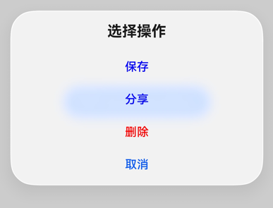
  
  **迁移后示例（新接口）：** 使用[DialogPresenter.present](../reference/apis-arkui/arkts-apis-uicontext-dialogpresenter.md#present)弹出操作菜单，通过[Promise](../arkts-utils/async-concurrency-overview.md#promise)获取选择结果。
  
  <!-- @[action_menu_after_migrate](https://gitcode.com/openharmony/applications_app_samples/blob/master/code/DocsSample/ArkUISample/ArkuiDialogMigrationSample/entry/src/main/ets/pages/opencustomdialog/ActionMenuAfterMigrate.ets) --> 
  
  ``` TypeScript
  import { DialogPresenter, DialogResult } from '@kit.ArkUI';
  import { BusinessError } from '@kit.BasicServicesKit';
  import resource from '../../common/resource';
  
  @Entry
  @Component
  export struct ActionMenuAfterMigrate {
    private presenter: DialogPresenter = this.getUIContext().getDialogPresenter();
    @State result: ResourceStr = '';
  
    build() {
      NavDestination() {
        Row() {
          Column() {
            Text('showActionMenu' + resource.resourceToString($r('app.string.migrate_sample_zh')))
              .fontSize(18)
              .fontWeight(FontWeight.Bold)
              .margin({ bottom: 20 })
  
            Button(resource.resourceToString($r('app.string.old_interface_zh')) + '：promptAction.showActionMenu')
              .width('90%')
              .margin({ bottom: 10 })
              .onClick(() => {
                this.result = $r('app.string.OldInterfacePromptActionShowActionMenuOnClick');
              })
  
            Button(resource.resourceToString($r('app.string.new_interface_zh')) + '：DialogPresenter.present')
              .width('90%')
              .margin({ bottom: 10 })
              .onClick(() => {
                this.showNewActionMenu();
              })
  
            if (this.result) {
              Text(this.result)
                .fontSize(14)
                .margin({ top: 10 })
            }
          }
          .width('100%')
        }
        .height('100%')
      }
    }
  
    private showNewActionMenu(): void {
      this.presenter.present({
        title: '选择操作',
        buttons: [
          { value: '保存', action: () => { this.result = '保存'; } },
          { value: '分享', action: () => { this.result = '分享'; } },
          { value: '删除', action: () => { this.result = '删除'; } }
        ]
      }).then((result: DialogResult) => {
        this.result = 'present success, dialogId: ' + result.dialogId;
      }).catch((error: BusinessError) => {
        this.result = `present error: ${error.code}`;
      });
    }
  }
  ```
  
  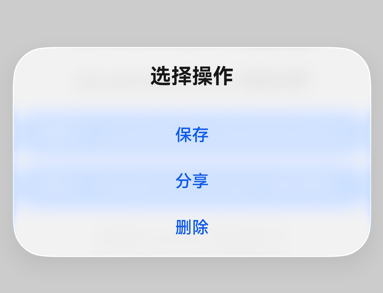

- promptAction.presentCustomDialog（自定义弹出框）

  | 属性 | 旧接口（[promptAction.presentCustomDialog](../reference/apis-arkui/arkts-apis-uicontext-promptaction.md#presentcustomdialog18)） | 新接口（[DialogPresenter.present](../reference/apis-arkui/arkts-apis-uicontext-dialogpresenter.md#present)） |
  |------|------|------|
  | 编程模型 | [promptAction.presentCustomDialog](../reference/apis-arkui/arkts-apis-uicontext-promptaction.md#presentcustomdialog18) | [presenter.present](../reference/apis-arkui/arkts-apis-uicontext-dialogpresenter.md#present) |
  | 内容构建 | [CustomBuilder](../reference/apis-arkui/arkui-ts/ts-types.md#custombuilder8) / [CustomBuilderWithId](../reference/apis-arkui/arkts-apis-uicontext-t.md#custombuilderwithid18) | [CustomBuilder](../reference/apis-arkui/arkui-ts/ts-types.md#custombuilder8) / [CustomBuilderWithId](../reference/apis-arkui/arkts-apis-uicontext-t.md#custombuilderwithid18) / [ComponentContent](../reference/apis-arkui/js-apis-arkui-ComponentContent.md)\<Object\> |
  | 控制器 | promptAction.[DialogController](../reference/apis-arkui/js-apis-promptAction.md#dialogcontroller18) | [DialogBaseController](../reference/apis-arkui/js-apis-dialog.md#dialogbasecontroller) |
  | 选项类型 | [DialogOptions](../reference/apis-arkui/js-apis-promptAction.md#dialogoptions18)（继承[BaseDialogOptions](../reference/apis-arkui/js-apis-promptAction.md#basedialogoptions11)） | [DialogCustomOptions](../reference/apis-arkui/js-apis-dialog.md#dialogcustomoptions)（继承[DialogBaseOptions](../reference/apis-arkui/js-apis-dialog.md#dialogbaseoptions)） |
  | 样式控制 | 无customStyle属性（内容样式完全由builder决定） | [customStyle](../reference/apis-arkui/js-apis-dialog.md#dialogcustomoptions): boolean |
  | 对齐 | [alignment](../reference/apis-arkui/js-apis-promptAction.md#basedialogoptions11): [DialogAlignment](../reference/apis-arkui/arkui-ts/ts-methods-alert-dialog-box.md#dialogalignment枚举说明) | [alignment](../reference/apis-arkui/js-apis-dialog.md#dialogbaseoptions): [DialogBaseAlignment](../reference/apis-arkui/js-apis-dialog.md#dialogbasealignment) |
  | 偏移 | [offset](../reference/apis-arkui/js-apis-promptAction.md#basedialogoptions11): [Offset](../reference/apis-arkui/arkui-ts/ts-types.md#offset) | [offset](../reference/apis-arkui/js-apis-dialog.md#dialogbaseoptions): [Offset](../reference/apis-arkui/arkui-ts/ts-types.md#offset) |
  | 自动取消 | [autoCancel](../reference/apis-arkui/js-apis-promptAction.md#basedialogoptions11): boolean | [autoCancel](../reference/apis-arkui/js-apis-dialog.md#dialogbaseoptions): boolean |
  | 蒙层颜色 | [maskColor](../reference/apis-arkui/js-apis-promptAction.md#basedialogoptions11): [ResourceColor](../reference/apis-arkui/arkui-ts/ts-types.md#resourcecolor) | [maskColor](../reference/apis-arkui/js-apis-dialog.md#dialogbaseoptions): [ResourceColor](../reference/apis-arkui/arkui-ts/ts-types.md#resourcecolor) |
  | 蒙层区域 | [maskRect](../reference/apis-arkui/js-apis-promptAction.md#basedialogoptions11): [Rectangle](../reference/apis-arkui/arkui-ts/ts-methods-alert-dialog-box.md#rectangle8类型说明) | [maskRect](../reference/apis-arkui/js-apis-dialog.md#dialogbaseoptions): [Rectangle](../reference/apis-arkui/arkui-ts/ts-methods-alert-dialog-box.md#rectangle8类型说明) |
  | 模态 | [isModal](../reference/apis-arkui/js-apis-promptAction.md#basedialogoptions11): boolean | [isModal](../reference/apis-arkui/js-apis-dialog.md#dialogbaseoptions): boolean |
  | 子窗口 | [showInSubWindow](../reference/apis-arkui/js-apis-promptAction.md#basedialogoptions11): boolean | [showInSubWindow](../reference/apis-arkui/js-apis-dialog.md#dialogbaseoptions): boolean |
  | 背景色 | [backgroundColor](../reference/apis-arkui/js-apis-promptAction.md#dialogoptions18) | [backgroundColor](../reference/apis-arkui/js-apis-dialog.md#dialogbaseoptions) |
  | 背景模糊 | [backgroundBlurStyle](../reference/apis-arkui/js-apis-promptAction.md#dialogoptions18) + [backgroundBlurStyleOptions](../reference/apis-arkui/js-apis-promptAction.md#basedialogoptions11) + [backgroundEffect](../reference/apis-arkui/js-apis-promptAction.md#basedialogoptions11) | [backgroundBlurStyle](../reference/apis-arkui/js-apis-dialog.md#dialogbaseoptions) + [backgroundBlurStyleOptions](../reference/apis-arkui/js-apis-dialog.md#dialogbaseoptions) + [backgroundEffect](../reference/apis-arkui/js-apis-dialog.md#dialogbaseoptions) |
  | 边框 | [cornerRadius](../reference/apis-arkui/js-apis-promptAction.md#dialogoptions18) / [borderWidth](../reference/apis-arkui/js-apis-promptAction.md#dialogoptions18) / [borderColor](../reference/apis-arkui/js-apis-promptAction.md#dialogoptions18) / [borderStyle](../reference/apis-arkui/js-apis-promptAction.md#dialogoptions18) | [borderRadius](../reference/apis-arkui/js-apis-dialog.md#dialogbaseoptions) / [borderWidth](../reference/apis-arkui/js-apis-dialog.md#dialogbaseoptions) / [borderColor](../reference/apis-arkui/js-apis-dialog.md#dialogbaseoptions) / [borderStyle](../reference/apis-arkui/js-apis-dialog.md#dialogbaseoptions)（老版本[cornerRadius](../reference/apis-arkui/js-apis-promptAction.md#dialogoptions18)对应新版本[borderRadius](../reference/apis-arkui/js-apis-dialog.md#dialogbaseoptions)） |
  | 阴影 | [shadow](../reference/apis-arkui/js-apis-promptAction.md#dialogoptions18) | [shadow](../reference/apis-arkui/js-apis-dialog.md#dialogbaseoptions): [ShadowOptions](../reference/apis-arkui/arkui-ts/ts-universal-attributes-image-effect.md#shadowoptions对象说明) \| [ShadowStyle](../reference/apis-arkui/arkui-ts/ts-universal-attributes-image-effect.md#shadowstyle10枚举说明) |
  | 尺寸 | [width](../reference/apis-arkui/js-apis-promptAction.md#dialogoptions18) / [height](../reference/apis-arkui/js-apis-promptAction.md#dialogoptions18) | [width](../reference/apis-arkui/js-apis-dialog.md#dialogbaseoptions) / [height](../reference/apis-arkui/js-apis-dialog.md#dialogbaseoptions) |
  | 过渡动画 | [transition](../reference/apis-arkui/js-apis-promptAction.md#basedialogoptions11): [TransitionEffect](../reference/apis-arkui/arkui-ts/ts-transition-animation-component.md#transitioneffect10对象说明) / [dialogTransition](../reference/apis-arkui/js-apis-promptAction.md#basedialogoptions11) | [dialogTransition](../reference/apis-arkui/js-apis-dialog.md#dialogbaseoptions): [TransitionEffect](../reference/apis-arkui/arkui-ts/ts-transition-animation-component.md#transitioneffect10对象说明) |
  | 蒙层动画 | [maskTransition](../reference/apis-arkui/js-apis-promptAction.md#basedialogoptions11): [TransitionEffect](../reference/apis-arkui/arkui-ts/ts-transition-animation-component.md#transitioneffect10对象说明) | [maskTransition](../reference/apis-arkui/js-apis-dialog.md#dialogbaseoptions): [TransitionEffect](../reference/apis-arkui/arkui-ts/ts-transition-animation-component.md#transitioneffect10对象说明) |
  | 焦点 | [focusable](../reference/apis-arkui/js-apis-promptAction.md#basedialogoptions11): boolean | [focusable](../reference/apis-arkui/js-apis-dialog.md#dialogbaseoptions): boolean |
  | 打开动画回调 | [onWillAppear](../reference/apis-arkui/js-apis-promptAction.md#basedialogoptions11) / [onDidAppear](../reference/apis-arkui/js-apis-promptAction.md#basedialogoptions11) / [onWillDisappear](../reference/apis-arkui/js-apis-promptAction.md#basedialogoptions11) / [onDidDisappear](../reference/apis-arkui/js-apis-promptAction.md#basedialogoptions11) | [onWillAppear](../reference/apis-arkui/js-apis-dialog.md#dialogbaseoptions) / [onDidAppear](../reference/apis-arkui/js-apis-dialog.md#dialogbaseoptions) / [onWillDisappear](../reference/apis-arkui/js-apis-dialog.md#dialogbaseoptions) / [onDidDisappear](../reference/apis-arkui/js-apis-dialog.md#dialogbaseoptions) |
  | 取消回调 | [onWillDismiss](../reference/apis-arkui/js-apis-promptAction.md#basedialogoptions11): [Callback](../reference/apis-arkui/arkui-ts/ts-types.md#callback12)\<[DismissDialogAction](../reference/apis-arkui/arkui-ts/ts-methods-custom-dialog-box.md#dismissdialogaction12)\> | [onWillDismiss](../reference/apis-arkui/js-apis-dialog.md#dialogbaseoptions): [Callback](../reference/apis-arkui/arkui-ts/ts-types.md#callback12)\<[DialogDismissal](../reference/apis-arkui/js-apis-dialog.md#dialogdismissal)\> |
  | 键盘避让 | [keyboardAvoidMode](../reference/apis-arkui/js-apis-promptAction.md#basedialogoptions11) + [keyboardAvoidDistance](../reference/apis-arkui/js-apis-promptAction.md#basedialogoptions11) | [keyboardAvoidMode](../reference/apis-arkui/js-apis-dialog.md#dialogbaseoptions) + [keyboardAvoidDistance](../reference/apis-arkui/js-apis-dialog.md#dialogbaseoptions) |
  | 悬浮模式 | [enableHoverMode](../reference/apis-arkui/js-apis-promptAction.md#basedialogoptions11) + [hoverModeArea](../reference/apis-arkui/js-apis-promptAction.md#basedialogoptions11) | [enableHoverMode](../reference/apis-arkui/js-apis-dialog.md#dialogbaseoptions) + [hoverModeArea](../reference/apis-arkui/js-apis-dialog.md#dialogbaseoptions) |
  | 层级模式 | [levelMode](../reference/apis-arkui/js-apis-promptAction.md#basedialogoptions11) + [levelUniqueId](../reference/apis-arkui/js-apis-promptAction.md#basedialogoptions11) + [immersiveMode](../reference/apis-arkui/js-apis-promptAction.md#basedialogoptions11) + [levelOrder](../reference/apis-arkui/js-apis-promptAction.md#basedialogoptions11) | [levelMode](../reference/apis-arkui/js-apis-dialog.md#dialogbaseoptions) + [levelUniqueId](../reference/apis-arkui/js-apis-dialog.md#dialogbaseoptions) + [immersiveMode](../reference/apis-arkui/js-apis-dialog.md#dialogbaseoptions) + [levelOrder](../reference/apis-arkui/js-apis-dialog.md#dialogbaseoptions) |
  | 系统材质 | [systemMaterial](../reference/apis-arkui/js-apis-promptAction.md#basedialogoptions11): [SystemUiMaterial](../reference/apis-arkui/arkui-ts/ts-universal-attributes-image-effect.md#systemuimaterial) | [systemMaterial](../reference/apis-arkui/js-apis-dialog.md#dialogbaseoptions): [SystemUiMaterial](../reference/apis-arkui/arkui-ts/ts-universal-attributes-image-effect.md#systemuimaterial) |

  **迁移前示例（旧接口）：** 使用[presentCustomDialog](../reference/apis-arkui/arkts-apis-uicontext-promptaction.md#presentcustomdialog18)弹出自定义弹出框。
  
  <!-- @[present_custom_dialog_before_migrate](https://gitcode.com/openharmony/applications_app_samples/blob/master/code/DocsSample/ArkUISample/ArkuiDialogMigrationSample/entry/src/main/ets/pages/opencustomdialog/PresentCustomDialogBeforeMigrate.ets) -->
  
  ``` TypeScript
  import { promptAction } from '@kit.ArkUI';
  import { BusinessError } from '@kit.BasicServicesKit';
  
  @Entry
  @Component
  export struct PresentCustomDialogBeforeMigrate {
    private dialogController: promptAction.DialogController = new promptAction.DialogController();
    @State result: string = '';
  
    @Builder customDialogComponent() {
      Column() {
        Text('自定义弹窗内容')
          .fontSize(16)
          .margin({ bottom: 10 })
        Button('关闭弹窗')
          .onClick(() => {
            this.dialogController.close();
          })
      }
      .padding(20)
    }
  
    build() {
      NavDestination() {
        Column() {
          Button('打开 presentCustomDialog')
            .onClick(() => {
              this.getUIContext()
                .getPromptAction()
                .presentCustomDialog(() => {
                  this.customDialogComponent()
                }, this.dialogController, { autoCancel: true })
                .then((dialogId: number) => {
                  this.result = 'present success, dialogId: ' + dialogId;
                })
                .catch((error: BusinessError) => {
                  this.result = `present error: ${error.code}`;
                });
            })
  
          if (this.result) {
            Text(this.result)
              .fontSize(14)
              .margin({ top: 10 })
          }
        }
        .width('100%')
        .height('100%')
        .justifyContent(FlexAlign.Center)
      }
    }
  }
  ```
  
  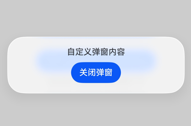
  
  **迁移后示例（新接口）：** 使用[DialogPresenter.present](../reference/apis-arkui/arkts-apis-uicontext-dialogpresenter.md#present)弹出自定义弹出框，通过[Promise](../arkts-utils/async-concurrency-overview.md#promise)获取返回结果。
  
  <!-- @[present_custom_dialog_after_migrate](https://gitcode.com/openharmony/applications_app_samples/blob/master/code/DocsSample/ArkUISample/ArkuiDialogMigrationSample/entry/src/main/ets/pages/opencustomdialog/PresentCustomDialogAfterMigrate.ets) -->
  
  ``` TypeScript
  import { DialogBaseController, DialogPresenter, DialogResult } from '@kit.ArkUI';
  import { BusinessError } from '@kit.BasicServicesKit';
  import resource from '../../common/resource';
  
  @Entry
  @Component
  export struct PresentCustomDialogAfterMigrate {
    private presenter: DialogPresenter = this.getUIContext().getDialogPresenter();
    private controller: DialogBaseController = new DialogBaseController();
    @State result: ResourceStr = '';
  
    build() {
      NavDestination() {
        Row() {
          Column() {
            Text('presentCustomDialog' + resource.resourceToString($r('app.string.migrate_sample_zh')))
              .fontSize(18)
              .fontWeight(FontWeight.Bold)
              .margin({ bottom: 20 })
  
            Button(resource.resourceToString($r('app.string.old_interface_zh')) + '：promptAction.presentCustomDialog')
              .width('90%')
              .margin({ bottom: 10 })
              .onClick(() => {
                this.result = $r('app.string.OldInterfacePresentCustomDialogOnClick');
              })
  
            Button(resource.resourceToString($r('app.string.new_interface_zh')) + '：DialogPresenter.present')
              .width('90%')
              .margin({ bottom: 10 })
              .onClick(() => {
                this.showNewCustomDialog();
              })
  
            if (this.result) {
              Text(this.result)
                .fontSize(14)
                .margin({ top: 10 })
            }
          }
          .width('100%')
        }
        .height('100%')
      }
    }
  
    @Builder
    CustomComponentContent() {
      Column() {
        Text('自定义弹窗内容')
          .fontSize(16)
          .margin({ bottom: 10 })
        Button('关闭弹窗')
          .onClick(() => {
            this.controller.close();
          })
      }
      .padding(20)
    }
  
    private showNewCustomDialog(): void {
      this.presenter.present(() => {
        this.CustomComponentContent()
      }, {
        controller: this.controller,
        autoCancel: true
      }).then((result: DialogResult) => {
        this.result = 'present success, dialogId: ' + result.dialogId;
      }).catch((error: BusinessError) => {
        this.result = `present error: ${error.code}`;
      });
    }
  }
  ```
  
  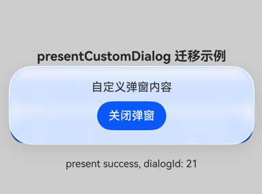

- promptAction.openCustomDialogWithController（带控制器的自定义弹出框）

  | 属性 | 旧接口（[promptAction.openCustomDialogWithController](../reference/apis-arkui/arkts-apis-uicontext-promptaction.md#opencustomdialogwithcontroller18)） | 新接口（[DialogPresenter.present](../reference/apis-arkui/arkts-apis-uicontext-dialogpresenter.md#present)） |
  |------|------|------|
  | 编程模型 | [promptAction.openCustomDialogWithController](../reference/apis-arkui/arkts-apis-uicontext-promptaction.md#opencustomdialogwithcontroller18) | [presenter.present](../reference/apis-arkui/arkts-apis-uicontext-dialogpresenter.md#present) |
  | 内容构建 | [ComponentContent](../reference/apis-arkui/js-apis-arkui-ComponentContent.md)\<Object\> | [CustomBuilder](../reference/apis-arkui/arkui-ts/ts-types.md#custombuilder8) / [CustomBuilderWithId](../reference/apis-arkui/arkts-apis-uicontext-t.md#custombuilderwithid18) / [ComponentContent](../reference/apis-arkui/js-apis-arkui-ComponentContent.md)\<Object\> |
  | 控制器 | [promptAction.DialogController](../reference/apis-arkui/js-apis-promptAction.md#dialogcontroller18) | [DialogBaseController](../reference/apis-arkui/js-apis-dialog.md#dialogbasecontroller) |
  | 选项类型 | [BaseDialogOptions](../reference/apis-arkui/js-apis-promptAction.md#basedialogoptions11) | [DialogCustomOptions](../reference/apis-arkui/js-apis-dialog.md#dialogcustomoptions)（继承[DialogBaseOptions](../reference/apis-arkui/js-apis-dialog.md#dialogbaseoptions)） |
  | 样式控制 | 无customStyle属性（内容样式完全由ComponentContent决定） | [customStyle](../reference/apis-arkui/js-apis-dialog.md#dialogcustomoptions): boolean |
  | 对齐 | [alignment](../reference/apis-arkui/js-apis-promptAction.md#basedialogoptions11): [DialogAlignment](../reference/apis-arkui/arkui-ts/ts-methods-alert-dialog-box.md#dialogalignment枚举说明) | [alignment](../reference/apis-arkui/js-apis-dialog.md#dialogbaseoptions): [DialogBaseAlignment](../reference/apis-arkui/js-apis-dialog.md#dialogbasealignment) |
  | 偏移 | [offset](../reference/apis-arkui/js-apis-promptAction.md#basedialogoptions11): [Offset](../reference/apis-arkui/arkui-ts/ts-types.md#offset) | [offset](../reference/apis-arkui/js-apis-dialog.md#dialogbaseoptions): [Offset](../reference/apis-arkui/arkui-ts/ts-types.md#offset) |
  | 自动取消 | [autoCancel](../reference/apis-arkui/js-apis-promptAction.md#basedialogoptions11): boolean | [autoCancel](../reference/apis-arkui/js-apis-dialog.md#dialogbaseoptions): boolean |
  | 蒙层颜色 | [maskColor](../reference/apis-arkui/js-apis-promptAction.md#basedialogoptions11): [ResourceColor](../reference/apis-arkui/arkui-ts/ts-types.md#resourcecolor) | [maskColor](../reference/apis-arkui/js-apis-dialog.md#dialogbaseoptions): [ResourceColor](../reference/apis-arkui/arkui-ts/ts-types.md#resourcecolor) |
  | 蒙层区域 | [maskRect](../reference/apis-arkui/js-apis-promptAction.md#basedialogoptions11): [Rectangle](../reference/apis-arkui/arkui-ts/ts-methods-alert-dialog-box.md#rectangle8类型说明) | [maskRect](../reference/apis-arkui/js-apis-dialog.md#dialogbaseoptions): [Rectangle](../reference/apis-arkui/arkui-ts/ts-methods-alert-dialog-box.md#rectangle8类型说明) |
  | 模态 | [isModal](../reference/apis-arkui/js-apis-promptAction.md#basedialogoptions11): boolean | [isModal](../reference/apis-arkui/js-apis-dialog.md#dialogbaseoptions): boolean |
  | 子窗口 | [showInSubWindow](../reference/apis-arkui/js-apis-promptAction.md#basedialogoptions11): boolean | [showInSubWindow](../reference/apis-arkui/js-apis-dialog.md#dialogbaseoptions): boolean |
  | 背景色 | 无（[BaseDialogOptions](../reference/apis-arkui/js-apis-promptAction.md#basedialogoptions11)不含backgroundColor） | [backgroundColor](../reference/apis-arkui/js-apis-dialog.md#dialogbaseoptions) |
  | 背景模糊 | [backgroundBlurStyleOptions](../reference/apis-arkui/js-apis-promptAction.md#basedialogoptions11) + [backgroundEffect](../reference/apis-arkui/js-apis-promptAction.md#basedialogoptions11) | [backgroundBlurStyle](../reference/apis-arkui/js-apis-dialog.md#dialogbaseoptions) + [backgroundBlurStyleOptions](../reference/apis-arkui/js-apis-dialog.md#dialogbaseoptions) + [backgroundEffect](../reference/apis-arkui/js-apis-dialog.md#dialogbaseoptions) |
  | 边框 | 无（[BaseDialogOptions](../reference/apis-arkui/js-apis-promptAction.md#basedialogoptions11)不含边框属性） | [borderRadius](../reference/apis-arkui/js-apis-dialog.md#dialogbaseoptions) / [borderWidth](../reference/apis-arkui/js-apis-dialog.md#dialogbaseoptions) / [borderColor](../reference/apis-arkui/js-apis-dialog.md#dialogbaseoptions) / [borderStyle](../reference/apis-arkui/js-apis-dialog.md#dialogbaseoptions) |
  | 阴影 | 无（[BaseDialogOptions](../reference/apis-arkui/js-apis-promptAction.md#basedialogoptions11)不含shadow） | [shadow](../reference/apis-arkui/js-apis-dialog.md#dialogbaseoptions): [ShadowOptions](../reference/apis-arkui/arkui-ts/ts-universal-attributes-image-effect.md#shadowoptions对象说明) \| [ShadowStyle](../reference/apis-arkui/arkui-ts/ts-universal-attributes-image-effect.md#shadowstyle10枚举说明) |
  | 尺寸 | 无（[BaseDialogOptions](../reference/apis-arkui/js-apis-promptAction.md#basedialogoptions11)不含width / height） | [width](../reference/apis-arkui/js-apis-dialog.md#dialogbaseoptions) / [height](../reference/apis-arkui/js-apis-dialog.md#dialogbaseoptions) |
  | 过渡动画 | [transition](../reference/apis-arkui/js-apis-promptAction.md#basedialogoptions11): [TransitionEffect](../reference/apis-arkui/arkui-ts/ts-transition-animation-component.md#transitioneffect10对象说明) / [dialogTransition](../reference/apis-arkui/js-apis-promptAction.md#basedialogoptions11) | [dialogTransition](../reference/apis-arkui/js-apis-dialog.md#dialogbaseoptions): [TransitionEffect](../reference/apis-arkui/arkui-ts/ts-transition-animation-component.md#transitioneffect10对象说明) |
  | 蒙层动画 | [maskTransition](../reference/apis-arkui/js-apis-promptAction.md#basedialogoptions11): [TransitionEffect](../reference/apis-arkui/arkui-ts/ts-transition-animation-component.md#transitioneffect10对象说明) | [maskTransition](../reference/apis-arkui/js-apis-dialog.md#dialogbaseoptions): [TransitionEffect](../reference/apis-arkui/arkui-ts/ts-transition-animation-component.md#transitioneffect10对象说明) |
  | 焦点 | [focusable](../reference/apis-arkui/js-apis-promptAction.md#basedialogoptions11): boolean | [focusable](../reference/apis-arkui/js-apis-dialog.md#dialogbaseoptions): boolean |
  | 打开动画回调 | [onWillAppear](../reference/apis-arkui/js-apis-promptAction.md#basedialogoptions11) / [onDidAppear](../reference/apis-arkui/js-apis-promptAction.md#basedialogoptions11) / [onWillDisappear](../reference/apis-arkui/js-apis-promptAction.md#basedialogoptions11) / [onDidDisappear](../reference/apis-arkui/js-apis-promptAction.md#basedialogoptions11) | [onWillAppear](../reference/apis-arkui/js-apis-dialog.md#dialogbaseoptions) / [onDidAppear](../reference/apis-arkui/js-apis-dialog.md#dialogbaseoptions) / [onWillDisappear](../reference/apis-arkui/js-apis-dialog.md#dialogbaseoptions) / [onDidDisappear](../reference/apis-arkui/js-apis-dialog.md#dialogbaseoptions) |
  | 取消回调 | [onWillDismiss](../reference/apis-arkui/js-apis-promptAction.md#basedialogoptions11): [Callback](../reference/apis-arkui/arkui-ts/ts-types.md#callback12)\<[DismissDialogAction](../reference/apis-arkui/arkui-ts/ts-methods-custom-dialog-box.md#dismissdialogaction12)\> | [onWillDismiss](../reference/apis-arkui/js-apis-dialog.md#dialogbaseoptions): [Callback](../reference/apis-arkui/arkui-ts/ts-types.md#callback12)\<[DialogDismissal](../reference/apis-arkui/js-apis-dialog.md#dialogdismissal)\> |
  | 键盘避让 | [keyboardAvoidMode](../reference/apis-arkui/js-apis-promptAction.md#basedialogoptions11) + [keyboardAvoidDistance](../reference/apis-arkui/js-apis-promptAction.md#basedialogoptions11) | [keyboardAvoidMode](../reference/apis-arkui/js-apis-dialog.md#dialogbaseoptions) + [keyboardAvoidDistance](../reference/apis-arkui/js-apis-dialog.md#dialogbaseoptions) |
  | 悬浮模式 | [enableHoverMode](../reference/apis-arkui/js-apis-promptAction.md#basedialogoptions11) + [hoverModeArea](../reference/apis-arkui/js-apis-promptAction.md#basedialogoptions11) | [enableHoverMode](../reference/apis-arkui/js-apis-dialog.md#dialogbaseoptions) + [hoverModeArea](../reference/apis-arkui/js-apis-dialog.md#dialogbaseoptions) |
  | 层级模式 | [levelMode](../reference/apis-arkui/js-apis-promptAction.md#basedialogoptions11) + [levelUniqueId](../reference/apis-arkui/js-apis-promptAction.md#basedialogoptions11) + [immersiveMode](../reference/apis-arkui/js-apis-promptAction.md#basedialogoptions11) + [levelOrder](../reference/apis-arkui/js-apis-promptAction.md#basedialogoptions11) | [levelMode](../reference/apis-arkui/js-apis-dialog.md#dialogbaseoptions) + [levelUniqueId](../reference/apis-arkui/js-apis-dialog.md#dialogbaseoptions) + [immersiveMode](../reference/apis-arkui/js-apis-dialog.md#dialogbaseoptions) + [levelOrder](../reference/apis-arkui/js-apis-dialog.md#dialogbaseoptions) |
  | 系统材质 | [systemMaterial](../reference/apis-arkui/js-apis-promptAction.md#basedialogoptions11): [SystemUiMaterial](../reference/apis-arkui/arkui-ts/ts-universal-attributes-image-effect.md#systemuimaterial) | [systemMaterial](../reference/apis-arkui/js-apis-dialog.md#dialogbaseoptions): [SystemUiMaterial](../reference/apis-arkui/arkui-ts/ts-universal-attributes-image-effect.md#systemuimaterial) |

  **迁移前示例（旧接口）：** 使用[openCustomDialogWithController](../reference/apis-arkui/arkts-apis-uicontext-promptaction.md#opencustomdialogwithcontroller18)弹出带控制器的自定义弹出框。
  
  <!-- @[open_custom_dialog_with_controller_before_migrate](https://gitcode.com/openharmony/applications_app_samples/blob/master/code/DocsSample/ArkUISample/ArkuiDialogMigrationSample/entry/src/main/ets/pages/opencustomdialog/OpenCustomDialogWithControllerBeforeMigrate.ets) -->
  
  ``` TypeScript
  import { ComponentContent, promptAction } from '@kit.ArkUI';
  import { BusinessError } from '@kit.BasicServicesKit';
  
  class Params {
    public text: string = '';
  
    constructor(text: string) {
      this.text = text;
    }
  }
  
  @Builder
  function buildText(params: Params) {
    Column() {
      Text(params.text)
        .fontSize(16)
        .margin({ bottom: 10 })
    }
    .padding(20)
    .borderRadius(10)
    .backgroundColor(Color.Gray)
  }
  
  @Entry
  @Component
  export struct OpenCustomDialogWithControllerBeforeMigrate {
    private dialogController: promptAction.DialogController = new promptAction.DialogController();
    @State result: string = '';
  
    build() {
      NavDestination() {
        Column() {
          Button('打开 openCustomDialogWithController')
            .onClick(() => {
              let contentNode = new ComponentContent(this.getUIContext(), wrapBuilder(buildText),
                new Params('自定义弹窗内容'));
              this.getUIContext()
                .getPromptAction()
                .openCustomDialogWithController(contentNode,
                  this.dialogController, {
                    autoCancel: true,
                    alignment: DialogAlignment.Center
                  })
                .then(() => {
                  this.result = 'opened';
                })
                .catch((error: BusinessError) => {
                  this.result = `open error: ${error.code}`;
                });
            })
  
          if (this.result) {
            Text(this.result)
              .fontSize(14)
              .margin({ top: 10 })
          }
        }
        .width('100%')
        .height('100%')
        .justifyContent(FlexAlign.Center)
      }
    }
  }
  ```
  
  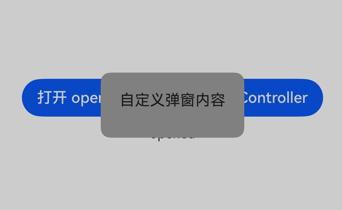
  
  **迁移后示例（新接口）：** 使用[DialogPresenter.present](../reference/apis-arkui/arkts-apis-uicontext-dialogpresenter.md#present)弹出带控制器的自定义弹出框，通过[Promise](../arkts-utils/async-concurrency-overview.md#promise)获取返回结果。
  
  <!-- @[open_custom_dialog_with_controller_after_migrate](https://gitcode.com/openharmony/applications_app_samples/blob/master/code/DocsSample/ArkUISample/ArkuiDialogMigrationSample/entry/src/main/ets/pages/opencustomdialog/OpenCustomDialogWithControllerAfterMigrate.ets) -->
  
  ``` TypeScript
  import { DialogBaseAlignment, DialogBaseController, DialogPresenter, DialogResult } from '@kit.ArkUI';
  import { BusinessError } from '@kit.BasicServicesKit';
  import resource from '../../common/resource';
  
  @Entry
  @Component
  export struct OpenCustomDialogWithControllerAfterMigrate {
    private presenter: DialogPresenter = this.getUIContext().getDialogPresenter();
    private controller: DialogBaseController = new DialogBaseController();
    @State result: ResourceStr = '';
  
    build() {
      NavDestination() {
        Row() {
          Column() {
            Text('openCustomDialogWithController' + resource.resourceToString($r('app.string.migrate_sample_zh')))
              .fontSize(18)
              .fontWeight(FontWeight.Bold)
              .margin({ bottom: 20 })
  
            Button(resource.resourceToString($r('app.string.old_interface_zh')) + '：promptAction.openCustomDialogWithController')
              .width('90%')
              .margin({ bottom: 10 })
              .onClick(() => {
                this.result = $r('app.string.OldInterfaceOpenCustomDialogWithControllerOnClick');
              })
  
            Button(resource.resourceToString($r('app.string.new_interface_zh')) + '：DialogPresenter.present')
              .width('90%')
              .margin({ bottom: 10 })
              .onClick(() => {
                this.showNewCustomDialog();
              })
  
            if (this.result) {
              Text(this.result)
                .fontSize(14)
                .margin({ top: 10 })
            }
          }
          .width('100%')
        }
        .height('100%')
      }
    }
  
    @Builder
    CustomContent() {
      Column() {
        Text('自定义弹窗内容')
          .fontSize(16)
          .margin({ bottom: 10 })
        Button('关闭弹窗')
          .onClick(() => {
            this.controller.close();
          })
      }
      .padding(20)
    }
  
    private showNewCustomDialog(): void {
      this.presenter.present(() => {
        this.CustomContent()
      }, {
        controller: this.controller,
        autoCancel: true,
        alignment: DialogBaseAlignment.CENTER
      }).then((result: DialogResult) => {
        this.result = 'present success, dialogId: ' + result.dialogId;
      }).catch((error: BusinessError) => {
        this.result = `present error: ${error.code}`;
      });
    }
  }
  ```
  
  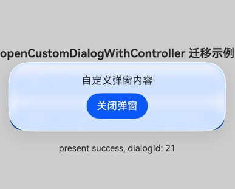

- 高级动画参数差异

  旧接口使用customStyle: boolean控制是否使用自定义样式，openAnimation / closeAnimation（[AnimateParam](../reference/apis-arkui/arkui-ts/ts-explicit-animation.md#animateparam对象说明)）控制打开和关闭动画。新接口使用dialogTransition: TransitionEffect控制内容区动画，maskTransition: TransitionEffect控制蒙层动画。两者参数类型不同，**不存在等效映射**，迁移时需按新接口TransitionEffect重写动画参数。

### 使用方式差异

新旧接口在以下两种使用方式上存在差异：

- **弹出后动态修改弹出框位置**：旧接口不支持弹出后动态修改弹出框位置（对齐、偏移、蒙层颜色等），需要先关闭再重新打开；新接口支持弹出后直接更新，无需关闭重开。
- **自定义弹出框场景的系统材质**：旧接口在自定义弹出框场景不支持系统材质；新接口支持。

下面以自定义弹出框为例，对比旧接口与新接口的实现方式。

旧接口示例：使用promptAction.openCustomDialog弹出自定义弹出框，当需要更新弹出框样式（如颜色模式变化）时，必须先调用closeCustomDialog关闭再重新打开，且不支持系统材质。

<!-- @[custom_dialog_old_interface](https://gitcode.com/openharmony/applications_app_samples/blob/master/code/DocsSample/ArkUISample/ArkuiDialogMigrationSample/entry/src/main/ets/pages/opencustomdialog/CustomDialogOldInterface.ets) -->

``` TypeScript
import { ComponentContent } from '@kit.ArkUI';
import { AbilityConstant, Configuration, EnvironmentCallback, ConfigurationConstant } from '@kit.AbilityKit';
import { BusinessError } from '@kit.BasicServicesKit';
import { resourceManager } from '@kit.LocalizationKit';

class Params {
  public text: string = '';
  public colorMode: resourceManager.ColorMode = resourceManager.ColorMode.LIGHT

  constructor(text: string, colorMode: resourceManager.ColorMode) {
    this.text = text
    this.colorMode = colorMode
  }
}

@Builder
function builderDialog(params: Params) {
  Column() {
    Text(params.text)
      .fontSize(50)
      .fontWeight(FontWeight.Bold)
      .margin({ bottom: 36 })
  }.backgroundColor(params.colorMode == resourceManager.ColorMode.LIGHT ? '#D5D5D5' : '#004AAF')
}

@Entry
@Component
export struct CustomDialogOldInterface {
  @State message: string = 'hello';
  contentNode: ComponentContent<Params> | null = null;
  callbackId: number | undefined = 0;

  aboutToAppear(): void {
    let environmentCallback: EnvironmentCallback = {
      onMemoryLevel: (level: AbilityConstant.MemoryLevel): void => {
      },
      onConfigurationUpdated: (config: Configuration): void => {
        console.info(`onConfigurationUpdated ${config}`);
        this.getUIContext().getHostContext()?.getApplicationContext().resourceManager.getConfiguration((err,
          config) => {
          // 调用ComponentContent的update更新colorMode信息
          this.contentNode?.update(new Params(this.message, config.colorMode))
          setTimeout(() => {
            // 调用ComponentContent的updateConfiguration，触发节点的全量更新
            this.contentNode?.updateConfiguration()
          })
        })
      }
    }
    // 注册监听系统环境变化监听器
    this.callbackId =
      this.getUIContext().getHostContext()?.getApplicationContext().on('environment', environmentCallback)
    // 设置应用深浅色跟随系统
    this.getUIContext()
      .getHostContext()?.getApplicationContext().setColorMode(ConfigurationConstant.ColorMode.COLOR_MODE_NOT_SET)
  }

  aboutToDisappear() {
    // 解注册监听系统环境变化的回调
    this.getUIContext().getHostContext()?.getApplicationContext().off('environment', this.callbackId)
    this.contentNode?.dispose()
  }

  build() {
    NavDestination() {
      Row() {
        Column() {
          Button('click me')
            .onClick(() => {
              let uiContext = this.getUIContext();
              let promptAction = uiContext.getPromptAction();
              if (this.contentNode == null && uiContext.getHostContext() != undefined) {
                this.contentNode = new ComponentContent(uiContext, wrapBuilder(builderDialog), new Params(this.message,
                  uiContext.getHostContext()!!.getApplicationContext()
                    .resourceManager
                    .getConfigurationSync()
                    .colorMode))
              }
              if (this.contentNode == null) {
                return
              }
              promptAction.closeCustomDialog(this.contentNode)
              // 先关闭已存在的弹窗，再重新打开
              promptAction.openCustomDialog(this.contentNode).then(() => {
                console.info('succeeded')
              }).catch((error: BusinessError) => {
                console.error(`OpenCustomDialog args error code is ${error.code}, message is ${error.message}`);
              })
            })
        }
        .width('100%')
        .height('100%')
        .justifyContent(FlexAlign.Center)
      }
      .height('100%')
    }
  }
}
```

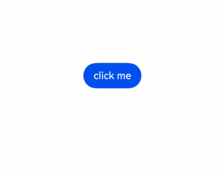

新接口示例：使用DialogPresenter.present弹出自定义弹出框并设置系统材质，通过DialogPresenter.update在弹出后动态修改弹出框偏移量，无需关闭重开。

<!-- @[custom_dialog_new_interface](https://gitcode.com/openharmony/applications_app_samples/blob/master/code/DocsSample/ArkUISample/ArkuiDialogMigrationSample/entry/src/main/ets/pages/opencustomdialog/CustomDialogNewInterface.ets) -->

``` TypeScript
// Index.ets
import {
  ComponentContent,
  DialogPresenter,
  DialogResult,
  uiMaterial
} from '@kit.ArkUI';
import { BusinessError } from '@kit.BasicServicesKit';

// 定义参数类，用于向自定义弹出框内容传递数据
class Params {
  public text: string = '';

  constructor(text: string) {
    this.text = text;
  }
}

// 自定义弹出框内容的构建器函数
@Builder
function buildText(params: Params) {
  Column({ space: 20 }) {
    Text(params.text)
      .fontSize(30)
      .fontWeight(FontWeight.Bold)
      .margin({ bottom: 36 })
    // 更新弹出框样式按钮，动态修改蒙层颜色、对齐方式和偏移量
    Button('Update dialog')
      .onClick(() => {
        dialogPresenter?.update(contentNode, {
          offset: { dx: 0, dy: 30 }
        })
          .then(() => {
            console.info('update success');
          })
          .catch((error: BusinessError) => {
            console.error(`update error code is ${error.code}, message is ${error.message}`);
          })
      })
    // 关闭弹出框按钮，通过ComponentContent引用关闭弹出框
    Button('Dismiss dialog')
      .onClick(() => {
        dialogPresenter?.dismiss(contentNode)
          .then(() => {
            console.info('dismiss success');
          })
          .catch((error: BusinessError) => {
            console.error(`dismiss error code is ${error.code}, message is ${error.message}`);
          })
      })
  }
}

// 全局变量，保存DialogPresenter实例
let dialogPresenter: DialogPresenter | null = null;
// 全局变量，保存自定义弹出框的ComponentContent实例
let contentNode: ComponentContent<Object> | null = null;

@Entry
@Component
export struct CustomDialogNewInterface {
  @State message: string = 'custom dialog';

  aboutToAppear(): void {
    // 获取DialogPresenter实例
    dialogPresenter = this.getUIContext().getDialogPresenter();
    // 创建ComponentContent，绑定自定义构建器函数和参数
    contentNode = new ComponentContent(this.getUIContext(), wrapBuilder(buildText), new Params(this.message));
  }

  build() {
    NavDestination() {
      Row() {
        Column({ space: 10 }) {
          Button('Present custom dialog')
            .id('PresentDialog')
            .onClick(() => {
              // 弹出自定义样式弹出框，传入ComponentContent和配置选项
              dialogPresenter?.present(contentNode, {
                systemMaterial: new uiMaterial.ImmersiveMaterial({ style: uiMaterial.ImmersiveStyle.REGULAR })
              })
              // 弹出成功，获取弹出框ID
                .then((result: DialogResult) => {
                  console.info('present success, dialogId: ' + result.dialogId);
                })
                .catch((error: BusinessError) => {
                  console.error(`present error code is ${error.code}, message is ${error.message}`);
                })
            })
        }.width('100%').height('100%').justifyContent(FlexAlign.Center)
      }
      .height('100%')
    }
  }
}
```

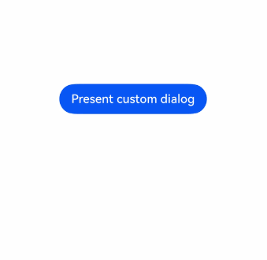

## 典型场景迁移指导

### 全局自定义弹出框迁移

本示例将全局自定义弹出框从旧接口迁移到新接口，封装DialogPresenterClassNew工具类统一管理弹出框的打开、关闭和更新操作，并在页面中调用该工具类实现弹出框的弹出与动态更新（修改对齐方式和偏移量）。

**迁移前示例（旧接口）：**

[完整示例](arkts-uicontext-custom-dialog.md#完整示例)

**迁移后示例（新接口）：**

<!-- @[dialog_presenter_class_new](https://gitcode.com/openharmony/applications_app_samples/blob/master/code/DocsSample/ArkUISample/ArkuiDialogMigrationSample/entry/src/main/ets/common/DialogPresenterClassNew.ts) -->

``` TypeScript
// DialogPresenterClassNew.ets
import { BusinessError } from '@kit.BasicServicesKit';
import { ComponentContent, dialog, DialogResult, UIContext } from '@kit.ArkUI';
import { hilog } from '@kit.PerformanceAnalysisKit';

const DOMAIN = 0x0000;

export class DialogPresenterClassNew {
  static ctx: UIContext;
  static contentNode: ComponentContent<Object>;
  static options: dialog.DialogBaseOptions;

  static setContext(context: UIContext) {
    DialogPresenterClassNew.ctx = context;
  }

  static setContentNode(node: ComponentContent<Object>) {
    DialogPresenterClassNew.contentNode = node;
  }

  static setOptions(options: dialog.DialogBaseOptions) {
    DialogPresenterClassNew.options = options;
  }

  // 打开弹窗
  static openDialog() {
    if (DialogPresenterClassNew.contentNode !== null) {
      DialogPresenterClassNew.ctx.getDialogPresenter()?.present(this.contentNode, DialogPresenterClassNew.options)
        .then((result: DialogResult) => {
          hilog.info(DOMAIN, 'testTag', 'testTag', 'OpenCustomDialog complete.');
        }).catch((error: BusinessError) => {
        let message = (error as BusinessError).message;
        let code = (error as BusinessError).code;
        hilog.error(DOMAIN, 'testTag', 'testTag', `OpenCustomDialog args error code is ${code}, message is ${message}`);
      });
    }
  }

  // 关闭弹窗
  static closeDialog() {
    if (DialogPresenterClassNew.contentNode !== null) {
      DialogPresenterClassNew.ctx.getDialogPresenter()?.dismiss(this.contentNode)
        .then(() => {
          hilog.info(DOMAIN, 'testTag', 'testTag', 'CloseCustomDialog complete.');
        })
        .catch((error: BusinessError) => {
          let message = (error as BusinessError).message;
          let code = (error as BusinessError).code;
          hilog.error(DOMAIN, 'testTag', 'testTag', `CloseCustomDialog args error code is ${code}, message is ${message}`);
        });
    }
  }

  // 更新弹窗
  static updateDialog(options: dialog.DialogBaseOptions) {
    if (DialogPresenterClassNew.contentNode !== null) {
      DialogPresenterClassNew.ctx.getDialogPresenter()?.update(this.contentNode, options)
        .then(() => {
          hilog.info(DOMAIN, 'testTag', 'testTag', 'UpdateCustomDialog complete.');
        })
        .catch((error: BusinessError) => {
          let message = (error as BusinessError).message;
          let code = (error as BusinessError).code;
          hilog.error(DOMAIN, 'testTag', 'testTag', `UpdateCustomDialog args error code is ${code}, message is ${message}`);
        });
    }
  }
}
```

上述代码封装了DialogPresenterClassNew工具类，提供弹出框的打开（openDialog）、关闭（closeDialog）和更新（updateDialog）方法。下方页面示例调用该工具类，演示弹出框弹出后动态更新对齐方式、偏移量以及内容的效果。

<!-- @[open_dialog_and_update](https://gitcode.com/openharmony/applications_app_samples/blob/master/code/DocsSample/ArkUISample/ArkuiDialogMigrationSample/entry/src/main/ets/pages/opencustomdialog/OpenDialogAndUpdate.ets) -->

``` TypeScript
// Index.ets
import { ComponentContent, DialogBaseAlignment } from '@kit.ArkUI';
import { DialogPresenterClassNew } from '../../common/DialogPresenterClassNew';

class Params {
  public text: string = '';

  constructor(text: string) {
    this.text = text;
  }
}

@Builder
function buildText(params: Params) {
  Column() {
    Text(params.text)
      .fontSize(50)
      .fontWeight(FontWeight.Bold)
      .margin({ bottom: 36 })
    Button('Close')
      .onClick(() => {
        DialogPresenterClassNew.closeDialog();
      })
  }.backgroundColor('#FFF0F0F0')
}

@Entry
@Component
export struct OpenDialogAndUpdate {
  @State message: string = 'hello';
  private ctx: UIContext = this.getUIContext();
  private contentNode: ComponentContent<Object> =
    new ComponentContent(this.ctx, wrapBuilder(buildText), new Params(this.message));
  aboutToAppear(): void {
    DialogPresenterClassNew.setContext(this.ctx);
    DialogPresenterClassNew.setContentNode(this.contentNode);
    DialogPresenterClassNew.setOptions({ alignment: DialogBaseAlignment.TOP, offset: { dx: 0, dy: 50 } });
  }

  build() {
    NavDestination() {
      Row() {
        Column() {
          Button('open dialog and update options')
            .margin({ top: 50 })
            .onClick(() => {
              DialogPresenterClassNew.openDialog();

              setTimeout(() => {
                DialogPresenterClassNew.updateDialog({
                  alignment: DialogBaseAlignment.BOTTOM,
                  offset: { dx: 0, dy: -50 }
                });
              }, 1500)
            })
          Button('open dialog and update content')
            .margin({ top: 50 })
            .onClick(() => {
              DialogPresenterClassNew.openDialog();

              setTimeout(() => {
                this.contentNode.update(new Params('update'));
              }, 1500)
            })
        }
        .width('100%')
        .height('100%')
      }
      .height('100%')
    }
  }
}
```

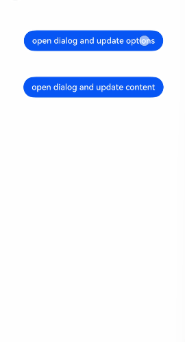


### 页面级弹出框迁移

本示例将页面级弹出框从旧接口迁移到新接口，分别给出基于Router路由模式和Navigation导航模式两种场景下的实现。页面级弹出框跟随所在页面的生命周期，弹窗内可进行路由跳转。

**迁移前示例（旧接口）：**

[完整示例](arkts-embedded-dialog.md#完整示例)

**迁移后示例（新接口）：**

- 基于Router路由模式下的页面级弹出框：

  <!-- @[page_level_dialog](https://gitcode.com/openharmony/applications_app_samples/blob/master/code/DocsSample/ArkUISample/ArkuiDialogMigrationSample/entry/src/main/ets/pages/customdialog/pageleveldialogbox/PageLevelDialogBox.ets) -->
  
  ``` TypeScript
  import { LevelMode, ImmersiveMode, DialogResult } from '@kit.ArkUI';
  
  let customDialogId: number = 0;
  
  @Builder
  function customDialogBuilder(uiContext: UIContext) {
    Column() {
      Text('Custom dialog Message').fontSize(20).height(100)
      Row() {
        Button('Next').onClick(() => {
          // 在弹窗内部进行路由跳转。
          uiContext.getRouter().pushUrl({ url: 'pages/customdialog/pageleveldialogbox/Next' });
        })
        Blank().width(50)
        Button('Close').onClick(() => {
          uiContext.getDialogPresenter()?.dismiss(customDialogId);
        })
      }
    }.padding(20)
  }
  
  @Entry
  @Component
  export struct PageLevelDialogBox {
    @State message: string = 'Hello World';
  
    @Builder
    customDialogComponent() {
      customDialogBuilder(this.getUIContext());
    }
  
    build() {
      NavDestination() {
        Row() {
          Column() {
            Text(this.message).id('test_text')
              .fontSize(50)
              .fontWeight(FontWeight.Bold)
              .onClick(() => {
                const node: FrameNode | null = this.getUIContext().getFrameNodeById('test_text') || null;
                this.getUIContext().getDialogPresenter()?.present(() => this.customDialogComponent(), {
                  levelMode: LevelMode.EMBEDDED, // 启用页面级弹出框
                  levelUniqueId: node?.getUniqueId(), // 设置页面级弹出框所在页面的任意节点ID
                  immersiveMode: ImmersiveMode.EXTEND, // 设置页面级弹出框蒙层的显示模式
                })
                  .then((result: DialogResult) => {
                    customDialogId = result.dialogId;
                  });
              })
          }
          .width('100%')
        }
        .height('100%')
      }
    }
  }
  ```
  
  下方Next.ets为弹窗内点击"Next"按钮路由跳转的目标页面，点击"Back"按钮返回上一页。
  
  <!-- @[next](https://gitcode.com/openharmony/applications_app_samples/blob/master/code/DocsSample/ArkUISample/ArkuiDialogMigrationSample/entry/src/main/ets/pages/customdialog/pageleveldialogbox/Next.ets) -->
  
  ``` TypeScript
  // Next.ets
  @Entry
  @Component
  struct Next {
    @State message: string = 'Back';
  
    build() {
      Row() {
        Column() {
          Button(this.message)
            .fontSize(20)
            .fontWeight(FontWeight.Bold)
            .onClick(() => {
              this.getUIContext().getRouter().back();
            })
        }
        .width('100%')
      }
      .height('100%')
    }
  }
  ```
  
  

- 基于Navigation导航模式下的页面级弹出框。使用本示例前需要参考[Navigation使用NavDestination作为导航页](../reference/apis-arkui/arkui-ts/ts-basic-components-navigation.md#示例16navigation使用navdestination作为导航页)文档完成Index首页和router_map.json的创建与配置。并使用下述示例代码中的PageLevelDialogInNavigation和PageLevelDialogInNavigationTestTwo组件替换Navigation参考文档中的PageHome和PageOne组件。

  <!-- @[page_level_dialog](https://gitcode.com/openharmony/applications_app_samples/blob/master/code/DocsSample/ArkUISample/ArkuiDialogMigrationSample/entry/src/main/ets/pages/customdialog/pageleveldialogbox/PageLevelDialogInNavigation.ets) -->
  
  ``` TypeScript
  import { LevelMode, ImmersiveMode, DialogResult } from '@kit.ArkUI';
  
  let customDialogId: number = 0;
  
  @Builder
  function customDialogBuilder(uiContext: UIContext, stack: NavPathStack | undefined) {
    Column() {
      Text('Custom dialog Message').fontSize(20).height(100)
      Row() {
        Button('Next').onClick(() => {
          // 在弹窗内部进行路由跳转。
          if (stack) {
            stack.pushPath({ name: 'Custom_ROUTE_PREFIX/PageLevelDialogInNavigationPageTwo'})
          }
        })
        Blank().width(50)
        Button('Close').onClick(() => {
          uiContext.getDialogPresenter()?.dismiss(customDialogId);
        })
      }
    }.padding(20)
  }
  
  @Component
  export struct PageLevelDialogInNavigation {
    private stack: NavPathStack | undefined = undefined;
    private uiContext: UIContext = this.getUIContext();
    @State message: string = 'Hello World';
  
    @Builder
    customDialogComponent() {
      customDialogBuilder(this.uiContext, this.stack);
    }
  
    build() {
      NavDestination() {
        Stack({alignContent: Alignment.Center}) {
          Column() {
            Text(this.message).id('test_text')
              .fontSize(50)
              .fontWeight(FontWeight.Bold)
              .onClick(() => {
                const node: FrameNode | null = this.getUIContext().getFrameNodeById('test_text') || null;
                this.uiContext.getDialogPresenter()?.present(() => this.customDialogComponent(), {
                  levelMode: LevelMode.EMBEDDED, // 启用页面级弹出框
                  levelUniqueId: node?.getUniqueId(), // 设置页面级弹出框所在页面的任意节点ID
                  immersiveMode: ImmersiveMode.EXTEND, // 设置页面级弹出框蒙层的显示模式
                }).then((result: DialogResult) => {
                  customDialogId = result.dialogId;
                })
              })
          }
          .width('100%')
        }.width('100%').height('100%')
      }
      .width('100%').height('100%')
      .title('PageOne')
      .onReady((ctx: NavDestinationContext) => {
        this.stack = ctx.pathStack;
      })
    }
  }
  
  @Component
  export struct PageLevelDialogInNavigationTestTwo {
    @State message: string = 'Back';
    private stack: NavPathStack | undefined = undefined;
  
    build() {
      NavDestination() {
        Stack({alignContent: Alignment.Center}) {
          Column() {
            Button(this.message)
              .fontSize(20)
              .fontWeight(FontWeight.Bold)
              .onClick(() => {
                if (this.stack) {
                  this.stack.pop()
                }
              })
          }
          .width('100%')
        }.width('100%').height('100%')
      }
      .width('100%').height('100%')
      .title('PageTwo')
      .onReady((ctx: NavDestinationContext) => {
        this.stack = ctx.pathStack;
      })
    }
  }
  ```
  
  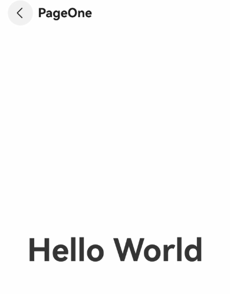