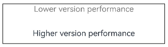
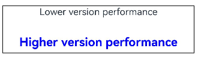

# \@Extend装饰器：定义扩展组件样式
<!--Kit: ArkUI-->
<!--Subsystem: ArkUI-->
<!--Owner: @BlYynNe-->
<!--Designer: @BlYynNe-->
<!--Tester: @TerryTsao-->
<!--Adviser: @zhang_yixin13-->

在前文的示例中，可以使用[\@Styles](arkts-style.md)复用样式。在\@Styles的基础上，ArkUI提供了[\@Extend](../../reference/apis-arkui/arkui-ts/ts-custom-component-decorator-extend.md#extend)，用于扩展组件样式。

\@Extend同样支持通过版本条件参数（VersionCondition）声明扩展样式的生效系统版本区间，详见[版本条件参数（VersionCondition）](#版本条件参数versioncondition)。

> **说明：**
>
> 从API version 9开始支持。
>
> 从API version 9开始，该装饰器支持在ArkTS卡片中使用。
>
> 从API version 11开始，该装饰器支持在原子化服务中使用。
>
> 从API版本26.1.0开始，该装饰器支持传入可选的版本条件参数（VersionCondition）作为第二个参数。

## 装饰器使用说明


### 语法


```ts
@Extend(UIComponentName) function functionName() { ... }
@Extend(UIComponentName, VersionCondition) function functionName() { ... }
```


### 使用规则

- 和\@Styles不同，\@Extend支持封装指定组件的私有属性、私有事件和自身定义的全局方法。
  <!-- @[Extend_Global_Function_Extension_one](https://gitcode.com/openharmony/applications_app_samples/blob/master/code/DocsSample/ArkUISample/ParadigmStateManagement/entry/src/main/ets/pages/extend/GlobalFunctionExtension.ets) -->
  
  ``` TypeScript
  // @Extend(Text)可以支持Text的私有属性fontColor
  @Extend(Text)
  function fancy() {
    .fontColor(Color.Red)
  }
  
  // superFancyText可以调用预定义的fancy
  @Extend(Text)
  function superFancyText(size: number) {
    .fontSize(size)
    .fancy()
  }
  ```

- 使用\@Extend封装指定组件的私有属性、私有事件和自身定义的全局方法时，不支持和\@Styles混用。
  ``` TypeScript
  @Styles
  function fancy() {
    .backgroundColor(Color.Red)
  }

  // superFancyText不可以调用预定义的fancy
  @Extend(Text)
  function superFancyText(size: number) {
    .fontSize(size)
    .fancy()
  }
  ```

- 和\@Styles不同，\@Extend装饰的方法支持传入参数，调用遵循TS方法传值调用。
  <!-- @[Extend_private_property_fancy_two](https://gitcode.com/openharmony/applications_app_samples/blob/master/code/DocsSample/ArkUISample/ParadigmStateManagement/entry/src/main/ets/pages/extend/ExtendParameterUsage.ets) -->
  
  ``` TypeScript
  // xxx.ets
  @Extend(Text)
  function fancy(fontSize: number) {
    .fontColor(Color.Red)
    .fontSize(fontSize)
  }
  
  @Entry
  @Component
  struct FancyUse {
    build() {
      Row({ space: 10 }) {
        Text('Fancy')
          .fancy(16)
        Text('Fancy')
          .fancy(24)
      }
    }
  }
  ```

- \@Extend装饰的方法的参数可以为function，作为Event事件的句柄。
  <!-- @[Extend_Function_handle_three](https://gitcode.com/openharmony/applications_app_samples/blob/master/code/DocsSample/ArkUISample/ParadigmStateManagement/entry/src/main/ets/pages/extend/ExtendFunctionHandle.ets) --> 
  
  ``` TypeScript
  // @Extend装饰的方法支持function参数
  @Extend(Text)
  function makeMeClick(onClick: () => void) {
    .backgroundColor(Color.Blue)
    .onClick(onClick)
  }
  
  @Entry
  @Component
  struct FancyUse {
    @State label: string = 'Hello World';
  
    onClickHandler() {
      this.label = 'Hello ArkUI';
    }
  
    build() {
      Row({ space: 10 }) {
        Text(`${this.label}`)
          .makeMeClick(() => {
            this.onClickHandler();
          })
      }
    }
  }
  ```

- \@Extend的参数可以为[状态变量](arkts-state-management-overview.md)，当状态变量改变时，UI可以正常刷新渲染。
  <!-- @[Extend_Refresh_rendering_four](https://gitcode.com/openharmony/applications_app_samples/blob/master/code/DocsSample/ArkUISample/ParadigmStateManagement/entry/src/main/ets/pages/extend/ExtendUIStateVariable.ets) --> 
  
  ``` TypeScript
  // 将状态变量作为@Extend参数，状态变化驱动Text样式刷新
  @Extend(Text)
  function fancy(fontSize: number) {
    .fontColor(Color.Blue)
    .fontSize(fontSize)
  }
  
  @Entry
  @Component
  struct FancyUse {
    @State fontSizeValue: number = 20;
  
    build() {
      Column({ space: 10 }) {
        Text('Fancy')
          .fancy(this.fontSizeValue)
          .onClick(() => {
            this.fontSizeValue = 30;
          })
      }
      .width('100%')
    }
  }
  ```
  
  

### 版本条件参数（VersionCondition）

\@Extend装饰器支持传入可选的版本条件参数[VersionCondition](../../reference/apis-arkui/arkui-ts/ts-custom-component-decorator-styles.md#versioncondition)作为第二个参数，用于声明扩展样式的生效系统版本区间。携带版本条件时，扩展样式的属性语句仅在设备系统版本位于声明区间内时生效。

``` TypeScript
// 该扩展样式仅在API版本大于等于26.0.0时生效
@Extend(Text, { minApiVersion: '26.0.0' })
function fancy() {
  .fontColor(Color.Red)
}
```

版本条件的参数说明、取值形态与取值范围与\@Styles一致，请参见[版本条件参数（VersionCondition）](arkts-style.md#版本条件参数versioncondition)。

> **说明：**
>
> 携带版本条件的扩展样式在生效区间外的系统版本上调用时，样式属性不生效，函数参数仍正常传递。

## 限制条件

- 和\@Styles不同，\@Extend仅支持在全局定义，不支持在组件内部定义。

  > **说明：**
  >
  > 仅限在当前文件内使用，不支持导出。
  >
  > 如果要实现export功能，推荐使用[AttributeModifier](../arkts-user-defined-extension-attributeModifier.md)。
  
  【反例】
  
  ```ts
  @Entry
  @Component
  struct FancyUse {
    // 错误写法，@Extend仅支持在全局定义，不支持在组件内部定义。
    @Extend(Text) function fancy (fontSize: number) {
      .fontSize(fontSize)
    }
  
    build() {
      Row({ space: 10 }) {
        Text('Fancy')
          .fancy(16)
      }
    }
  }
  ```
  
  【正例】
  <!-- @[Extend_Positive_Example_five](https://gitcode.com/openharmony/applications_app_samples/blob/master/code/DocsSample/ArkUISample/ParadigmStateManagement/entry/src/main/ets/pages/extend/ExtendPositiveExample.ets) --> 
  
  ``` TypeScript
  // 正确写法
  @Extend(Text)
  function fancy(fontSize: number) {
    .fontSize(fontSize)
  }
  
  @Entry
  @Component
  struct FancyUse {
    build() {
      Row({ space: 10 }) {
        Text('Fancy')
          .fancy(16)
      }
    }
  }
  ```

- @Extend装饰的函数仅限当前文件使用，不支持导出，不支持在其他文件调用。

  【反例】

  ``` TypeScript
    // 错误写法 不要在pageTwo当中使用在其他文件比如pageOne中定义的@Extend函数。
    // pageOne.ets
    @Extend(Button)
    function ButtonUse() {
      .width(100)
      .buttonStyle(ButtonStyleMode.NORMAL)
    }

    @Entry
    @Component
    struct extendUseOne {
      build() {
        Row() {
          Button()
            .ButtonUse()
            .height(200)
        }
      }
    }
  ```

  ``` TypeScript
    // pageTwo.ets
    @Entry
    @Component
    struct TextUse {
      build() {
        Row() {
          Text('this is TextUse')

          Button()
            .ButtonUse()  // 会有编译告警提示: Property 'ButtonUse' does not exist on type 'ButtonAttribute'.
            .height(50)
        }
      }
    }
  ```

  【正例】

  ``` TypeScript
    // 正确写法 在pageTwo文件当中可以定义与pageOne文件中的@Extend函数不重名的@Extend函数。
    // pageOne.ets
    @Extend(Button)
    function ButtonUse() {
      .width(100)
      .buttonStyle(ButtonStyleMode.NORMAL)
    }

    @Entry
    @Component
    struct extendUseOne {
      build() {
        Row() {
          Button()
            .ButtonUse()
            .height(200)
        }
      }
    }
  ```

  ``` TypeScript
    // pageTwo.ets
    @Extend(Button)
    function ButtonUse2() {
      .width(200)
      .buttonStyle(ButtonStyleMode.EMPHASIZED)
    }

    @Entry
    @Component
    struct TextUse {
      build() {
        Row() {
          Text('this is TextUse')

          Button()
            .ButtonUse2()
            .height(50)
        }
      }
    }
  ```

## 使用场景

以下示例声明了3个Text组件，每个Text组件均设置了[fontStyle](../../reference/apis-arkui/arkui-ts/ts-basic-components-text.md#fontstyle)、[fontWeight](../../reference/apis-arkui/arkui-ts/ts-basic-components-text.md#fontweight) 和[backgroundColor](../../reference/apis-arkui/arkui-ts/ts-universal-attributes-background.md#backgroundcolor)样式。
<!-- @[Extend_Usage_Scenario_one](https://gitcode.com/openharmony/applications_app_samples/blob/master/code/DocsSample/ArkUISample/ParadigmStateManagement/entry/src/main/ets/pages/extend/ExtendUsageScenario.ets) --> 

``` TypeScript
@Entry
@Component
struct FancyUse {
  @State label: string = 'Hello World';

  build() {
    Row({ space: 10 }) {
      // Text组件重复设置样式
      Text(`${this.label}`)
        .fontStyle(FontStyle.Italic)
        .fontWeight(500)
        .backgroundColor(Color.Yellow)
      Text(`${this.label}`)
        .fontStyle(FontStyle.Italic)
        .fontWeight(600)
        .backgroundColor(Color.Pink)
      Text(`${this.label}`)
        .fontStyle(FontStyle.Italic)
        .fontWeight(700)
        .backgroundColor(Color.Orange)
    }.margin('20%')
  }
}
```


使用@Extend将样式组合复用，示例如下。
<!-- @[Extend_Usage_Scenario_two](https://gitcode.com/openharmony/applications_app_samples/blob/master/code/DocsSample/ArkUISample/ParadigmStateManagement/entry/src/main/ets/pages/extend/ExtendUsageScenariotwo.ets) --> 

``` TypeScript
// 使用@Extend封装Text样式组合，便于复用
@Extend(Text)
function fancyText(weightValue: number, color: Color) {
  .fontStyle(FontStyle.Italic)
  .fontWeight(weightValue)
  .backgroundColor(color)
}
```

使用\@Extend组合样式后，代码更加简洁，可读性更强。
<!-- @[Extend_Usage_Scenario_three](https://gitcode.com/openharmony/applications_app_samples/blob/master/code/DocsSample/ArkUISample/ParadigmStateManagement/entry/src/main/ets/pages/extend/ExtendUsageScenariotwo.ets) --> 

``` TypeScript
@Entry
@Component
struct FancyUse {
  @State label: string = 'Hello World';

  build() {
    Row({ space: 10 }) {
      // 调用@Extend封装的fancyText复用样式
      Text(`${this.label}`)
        .fancyText(100, Color.Blue)
      Text(`${this.label}`)
        .fancyText(200, Color.Pink)
      Text(`${this.label}`)
        .fancyText(300, Color.Orange)
    }.margin('20%')
  }
}
```

当扩展样式需要限定在特定系统版本区间内生效时（如新样式仅面向高版本系统启用、需要对低版本系统做差异化适配），可以通过版本条件参数声明生效区间，无需在每个调用点手写版本判断。

在组件中调用后，设备系统版本位于生效区间内时样式正常生效，位于区间外时该扩展样式不产生任何效果：
<!-- @[Extend_Version_Condition](https://gitcode.com/openharmony/applications_app_samples/blob/master/code/DocsSample/ArkUISample/ParadigmStateManagement/entry/src/main/ets/pages/extend/ExtendVersionCondition.ets) -->

``` TypeScript
const lowVersionExtendText: string = 'Lower version performance';
const hightVersionExtendText: string = 'Higher version performance';

// 低版本适配样式：仅在系统版本大于等于12且小于26.0.0时生效
@Extend(Text, { minApiVersion: 12, maxApiVersion: '26.0.0' })
function lowVersionText(color: Color) {
  .fontColor(color)
  .fontSize(16)
}

// 高版本适配样式：仅在系统版本大于等于26.0.0时生效
@Extend(Text, { minApiVersion: '26.0.0' })
function highVersionText(color: Color) {
  .fontColor(color)
  .fontSize(20)
  .fontWeight(700)
}

@Entry
@Component
struct VersionConditionUseDemo {
  build() {
    Column({ space: 30 }) {
      Text(lowVersionExtendText)
        .lowVersionText(Color.Gray)
      Text(hightVersionExtendText)
        .highVersionText(Color.Blue)
    }
    .width('90%')
    .height(80)
    .margin(20)
    .borderWidth(1)
  }
}
```

**在系统版本小于API版本26.0.0的设备上表现如：**



**在系统版本大于等于API版本26.0.0的设备上表现如：**

