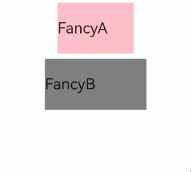
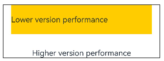
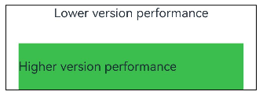

# \@Styles装饰器：定义组件重用样式
<!--Kit: ArkUI-->
<!--Subsystem: ArkUI-->
<!--Owner: @BlYynNe-->
<!--Designer: @VictorS67-->
<!--Tester: @TerryTsao-->
<!--Adviser: @BIYynNe-->

如果每个组件的样式都需要单独设置，开发过程中会产生大量重复的样式设置代码。虽然可以复制粘贴，但为了保持代码简洁、便于后续维护，ArkUI提供了可以提炼公共样式进行复用的装饰器[\@Styles](../../reference/apis-arkui/arkui-ts/ts-custom-component-decorator-styles.md#styles)。

\@Styles装饰器可以将多条样式设置提炼成一个方法，直接在组件声明的位置调用。通过\@Styles装饰器可以快速定义并复用自定义样式。

\@Styles还支持通过版本条件参数（VersionCondition）声明样式的生效系统版本区间，实现样式按系统版本的隔离，详见[版本条件参数（VersionCondition）](#版本条件参数versioncondition)。

> **说明：**
>
> 从API version 9开始支持。
>
> 从API version 9开始，该装饰器支持在ArkTS卡片中使用。
>
> 从API version 11开始，该装饰器支持在原子化服务中使用。
>
> 从API版本26.1.0开始，\@Styles装饰器支持以调用形式`@Styles({...})`传入可选的版本条件参数（VersionCondition），用于声明样式的生效系统版本区间。

## 装饰器使用说明

- 当前\@Styles仅支持[通用属性](../../reference/apis-arkui/arkui-ts/ts-component-general-attributes.md)和[通用事件](../../reference/apis-arkui/arkui-ts/ts-component-general-events.md)。

- \@Styles可以定义在组件内或全局，在全局定义时需在方法名前面添加function关键字，组件内定义时则不需要添加function关键字。请参考用例[组件内\@Styles和全局\@Styles的用法](#组件内styles和全局styles的用法)。

- 组件内\@Styles的优先级高于全局\@Styles。框架会优先查找当前组件内的\@Styles，如果未找到，则会在全局范围内查找。

> **说明：**
>
> 只能在当前文件内使用\@Styles，不支持export。
>
> 若需要实现样式导出，推荐使用[AttributeModifier](../../ui/arkts-user-defined-extension-attributeModifier.md)。


定义在组件内的\@Styles可以通过this访问组件的常量和状态变量，并可以在\@Styles中通过事件改变状态变量的值，示例如下：

<!-- @[inner_style](https://gitcode.com/openharmony/applications_app_samples/blob/master/code/DocsSample/ArkUISample/ComponentExtension/entry/src/main/ets/pages/StylesDecorator/StylesDecorator2.ets) --> 

``` TypeScript
@Entry
@Component
struct FancyUse {
  @State heightValue: number = 50;

  @Styles
  fancy() {
    .height(this.heightValue)
    .backgroundColor(Color.Blue)
    .onClick(() => {
      this.heightValue = 100;
    })
  }

  build() {
    Column() {
      // 通过fancy给Button提供样式设置
      Button('change height')
        .fancy()
    }
    .height('100%')
    .width('100%')
  }
}
```


### 版本条件参数（VersionCondition）

\@Styles支持两种使用形式：裸装饰器形式与调用形式（传入版本条件参数[VersionCondition](../../reference/apis-arkui/arkui-ts/ts-custom-component-decorator-styles.md#versioncondition)，声明样式的生效系统版本区间）。

**语法：**

```ts
@Styles function functionName() { ... }
@Styles({...}) function functionName() { ... }
```

**参数：**

| 参数名 | 类型 | 必填 | 说明 |
|--------|------|------|------|
| minApiVersion | number \| string | 否 | 样式生效的系统版本区间下界，包含该版本。与maxApiVersion至少需要传入其中一个。 |
| maxApiVersion | number \| string | 否 | 样式生效的系统版本区间上界，不包含该版本。与minApiVersion至少需要传入其中一个。 |

版本区间的语义为左闭右开区间`[minApiVersion, maxApiVersion)`：仅传入minApiVersion时，生效区间为大于等于minApiVersion对应的系统版本；仅传入maxApiVersion时，生效区间为小于maxApiVersion对应的系统版本。

minApiVersion与maxApiVersion支持以下两种取值形态：

- API版本号：数字或字符串形式，如`12`、`'18'`；
- 系统版本号字符串：如`'5.0.0'`、`'6.0.0'`，不支持带括号形态（如`'5.0.0(12)'`）。

合法取值范围参考[VersionCondition](../../reference/apis-arkui/arkui-ts/ts-custom-component-decorator-styles.md#versioncondition)。

## 限制条件

- 版本条件参数必须为对象字面量（不支持传入变量、函数调用、数组等），且需满足以下约束，违反约束会产生编译错误：
  - 版本条件参数至少包含minApiVersion和maxApiVersion其中一个，不支持空对象`{}`。
  - 属性必须以“属性名: 属性值”的形式传入，不支持属性简写。
  - 属性值必须为数字字面量或字符串字面量，不支持变量、表达式等。
  - 属性取值必须在版本映射表范围内，不支持括号形态（如`'5.0.0(12)'`）。
  - minApiVersion对应的系统版本必须小于maxApiVersion对应的系统版本。

  【反例】

  ``` TypeScript
  // 错误写法：空版本条件参数，至少需要包含minApiVersion或maxApiVersion其中一个
  @Styles({})
  function fancy1() {
    .width(100)
  }

  // 错误写法：minApiVersion对应的系统版本不低于maxApiVersion，应该低于maxApiVersion
  @Styles({ minApiVersion: 20, maxApiVersion: 12 })
  function fancy2() {
    .width(100)
  }

  // 错误写法：取值不在版本映射表范围内（括号形态、表外取值均不支持）
  @Styles({ minApiVersion: '5.0.0(12)' })
  function fancy3() {
    .width(100)
  }
  ```

  【正例】

  ``` TypeScript
  // 正确写法
  @Styles({ minApiVersion: 12, maxApiVersion: 20 })
  function fancy() {
    .width(100)
  }
  ```

- \@Styles传参时，必须有且仅有一个参数，且该参数必须为对象字面量；传入多个参数会产生编译错误，不传参数调用（如`@Styles()`）同样会产生编译错误。

  【反例】

  ``` TypeScript
  // 错误写法：调用时不传参数
  @Styles()
  function globalFancy() {
    .width(100)
  }

  // 错误写法：传入多个参数
  @Styles({ minApiVersion: 12 }, { maxApiVersion: 18 })
  function globalFancy2() {
    .width(100)
  }
  ```

  【正例】

  ``` TypeScript
  // 正确写法：调用形式传入一个版本条件对象
  @Styles({ minApiVersion: 12 })
  function globalFancy() {
    .width(100)
  }
  ```

- \@Styles方法不支持传入参数，编译期会报错。

``` TypeScript
  // 错误写法： @Styles不支持参数，编译期报错
  @Styles
  function globalFancy (value: number) {
    .width(value)
  }

```

<!-- @[style_not_parameter](https://gitcode.com/openharmony/applications_app_samples/blob/master/code/DocsSample/ArkUISample/ComponentExtension/entry/src/main/ets/pages/StylesDecorator/StylesDecorator2.ets) --> 

``` TypeScript
// 正确写法
  @Styles
  function globalFancy() {
    .width(100)
  }
```

- 不支持在\@Styles方法内使用条件渲染语句，条件渲染语句内的属性不生效。

``` TypeScript
  // 错误写法
  @Styles
  function backgroundColorStyle() {
    if (true) {
      .backgroundColor(Color.Red)
    }
  }

```

<!-- @[style_not_if](https://gitcode.com/openharmony/applications_app_samples/blob/master/code/DocsSample/ArkUISample/ComponentExtension/entry/src/main/ets/pages/StylesDecorator/StylesDecorator2.ets) -->

``` TypeScript
// 正确写法
  @Styles
  function backgroundColorStyle() {
    .backgroundColor(Color.Red)
  }
```

## 使用场景

### 组件内\@Styles和全局\@Styles的用法

<!-- @[global_style](https://gitcode.com/openharmony/applications_app_samples/blob/master/code/DocsSample/ArkUISample/ComponentExtension/entry/src/main/ets/pages/StylesDecorator/StylesDecorator1.ets) -->

``` TypeScript
// 定义在全局的@Styles封装的样式
@Styles
function globalFancy1() {
  .width(150)
  .height(100)
  .backgroundColor(Color.Pink)
}

@Entry
@Component
struct GlobalFancy {
  @State heightValue: number = 100;

  // 定义在组件内的@Styles封装的样式
  @Styles
  fancy() {
    .width(200)
    .height(this.heightValue)
    .backgroundColor(Color.Gray)
    .onClick(() => {
      this.heightValue = 200;
    })
  }

  build() {
    Column({ space: 10 }) {
      // 使用全局的@Styles封装的样式
      Text('FancyA')
        .globalFancy1()
        .fontSize(30)
      // 使用组件内的@Styles封装的样式
      Text('FancyB')
        .fancy()
        .fontSize(30)
    }
    .width('100%')
  }
}
```


### 使用版本条件隔离样式

当样式需要限定在特定系统版本区间内生效时（如新样式仅面向高版本系统启用、需要对低版本系统做差异化适配），可以通过版本条件参数声明生效区间，无需在每个调用点手写版本判断。

在组件中调用后，设备系统版本位于生效区间内时样式正常生效，位于区间外时该样式不产生任何效果：
<!-- @[Styles_Version_Condition](https://gitcode.com/openharmony/applications_app_samples/blob/master/code/DocsSample/ArkUISample/ComponentExtension/entry/src/main/ets/pages/StylesDecorator/StylesVersionCondition.ets) -->

``` TypeScript
const lowVersionStyleText: string = 'Lower version performance';
const hightVersionStylesText: string = 'Higher version performance';

// 低版本适配样式：仅在系统版本大于等于Api Version 12且小于Api Version 18时生效
// '5.0.0'与12、'12'写法等价，均表示系统版本5.0.0
@Styles({ minApiVersion: '5.0.0', maxApiVersion: '26.0.0' })
function lowVersionStyle() {
  .backgroundColor('#f7ce00')
  .width('90%')
  .height(60)
}

// 高版本样式：仅在系统版本大于等于Api Version 26.0.0时生效
@Styles({ minApiVersion: '26.0.0' })
function highVersionStyle() {
  .backgroundColor('#64bb5c')
  .width('90%')
  .height(60)
}

@Entry
@Component
struct VersionConditionUseDemo {
  build() {
    Column({ space: 30 }) {
      Text(lowVersionStyleText)
        .lowVersionStyle()
      Text(hightVersionStylesText)
        .highVersionStyle()
    }
    .width('90%')
    .margin(20)
    .borderWidth(1)
  }
}
```
**在系统版本小于API Version 26.0.0的设备上表现如：**



**在系统版本大于等于API Version 26.0.0的设备上表现如：**

