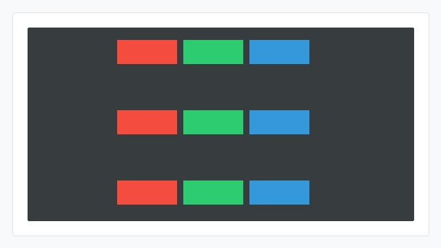
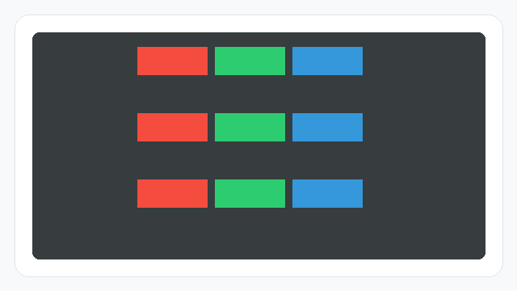

# align-content CSS能力开发指南

## 概述

align-content用于设置多行flex容器中各行在**交叉轴方向**上的分布方式。它控制的是“多行整体怎么摆”，不是单个子项在当前行内怎么对齐。

## 能力范围

### 支持的值（CSS）

| 值 | 含义 |
| --- | --- |
| flex-start | 多行靠交叉轴起点排列 |
| flex-end | 多行靠交叉轴终点排列 |
| center | 多行整体在交叉轴方向居中 |
| space-between | 首尾两行贴边，中间行平分剩余间距 |
| stretch | 多行拉伸填满交叉轴剩余空间 |

> **说明：**
>
> stretch拉伸的只是 **flex行的交叉轴尺寸**（flex-direction: row时即行高），与**子项自身的高度无关**；子项是否被拉伸填满所在行，由交叉轴上的子项对齐方式控制——容器级用align-items: stretch，单个子项用align-self: stretch（仅当子项未显式设置交叉轴尺寸时生效）。

### 默认行为

不设置align-content时，默认值为stretch（引擎层FlexLayout默认ALIGN_CONTENT_STRETCH）：交叉轴存在剩余空间时，剩余空间被均分到各行，各行交叉轴尺寸被拉伸以共同填满容器；交叉轴没有剩余空间时不拉伸，各行从交叉轴起点排列，此时显示效果与flex-start相同。

> **说明：**
>
> 只要设置flex-wrap: wrap，align-content就会参与多行分布计算——即使换行后只有一行，stretch也会把该行交叉轴尺寸拉伸到容器交叉轴尺寸，center / flex-end也会偏移该行位置，进而影响行内子项的定位基准；flex-wrap: nowrap时不生效。

### Native接口

JS应用的align-content CSS属性，在引擎层对应ui_lite的FlexLayout。Native（C++）开发可直接使用以下接口控制多行交叉轴分布：

| 接口 | 参数 | 返回值 | 说明 |
| --- | --- | --- | --- |
| FlexLayout::SetAlignContent | const AlignContentType& align：对齐常量 | 无（void） | 设置多行交叉轴分布方式。值发生变化时会更新对齐标记并自动调用Invalidate()标脏，需再调用LayoutChildren()触发重新布局后生效 |

AlignContentType取值常量（`layout/layout.h`，类型为uint8_t）：

| 常量 | 数值 | 含义 |
| --- | --- | --- |
| ALIGN_CONTENT_START | 0 | 多行靠交叉轴起点排列（对应CSS flex-start） |
| ALIGN_CONTENT_END | 2 | 多行靠交叉轴终点排列（对应CSS flex-end） |
| ALIGN_CONTENT_CENTER | 1 | 多行整体居中（对应CSS center） |
| ALIGN_CONTENT_STRETCH | 3 | 多行拉伸（对应CSS stretch） |
| ALIGN_CONTENT_BETWEEN | 4 | 多行两端对齐（对应CSS space-between） |

涉及的头文件：

```cpp
#include "layout/flex_layout.h"   // OHOS::FlexLayout
#include "layout/layout.h"        // OHOS::AlignContentType / ALIGN_CONTENT_START 等
#include "gfx_utils/color.h"      // OHOS::Color（设置背景色用）
```

### 与其他flex属性的关系

- align-content始终作用于**交叉轴**：flex-direction: row时控制垂直方向，flex-direction: column时控制水平方向；
- 需要配合flex-wrap: wrap使用，未换行时不产生多行分布效果；
- 单个子项在行内的交叉轴对齐请使用align-items或align-self；
- align-content: stretch只拉伸flex行的交叉轴尺寸，不改变子项尺寸；子项的交叉轴拉伸由align-items / align-self: stretch控制。

## 使用示例

### JS使用示例

#### 多行居中

```html
<!-- index.hml -->
<div class="container">
    <div class="item item-red"></div>
    <div class="item item-green"></div>
    <div class="item item-blue"></div>
    <div class="item item-red"></div>
    <div class="item item-green"></div>
    <div class="item item-blue"></div>
    <div class="item item-red"></div>
    <div class="item item-green"></div>
    <div class="item item-blue"></div>
</div>
```

```css
/* index.css */
.container {
    flex-direction: row;
    flex-wrap: wrap;
    align-content: center;
    width: 300px;
    height: 300px;
}

.item {
    width: 100px;
    height: 50px;
}

.item-red {
    background-color: #e74c3c;
}

.item-green {
    background-color: #2ecc71;
}

.item-blue {
    background-color: #3498db;
}
```

预期效果：子项换成多行后，多行整体在容器垂直方向居中。


#### 多行起点 / 终点对齐

```css
.container {
    flex-direction: row;
    flex-wrap: wrap;
    align-content: flex-start; /* 顶部对齐，改为 flex-end 则底部对齐 */
    width: 300px;
    height: 300px;
}
```

预期效果：多行内容靠交叉轴起点排列；改为flex-end时靠交叉轴终点排列。

flex-start效果：


flex-end效果：


#### 多行两端对齐

```css
.container {
    flex-direction: row;
    flex-wrap: wrap;
    align-content: space-between;
    width: 300px;
    height: 300px;
}
```

预期效果：第一行贴近交叉轴起点，最后一行贴近交叉轴终点，中间剩余空间平均分布到各行之间。



#### 多行拉伸

```css
.container {
    flex-direction: row;
    flex-wrap: wrap;
    align-content: stretch;
    width: 300px;
    height: 300px;
}
```

预期效果：多行在交叉轴方向拉伸，各行共同填满容器交叉轴空间。由于示例中子项已固定height: 50px，所以子项自身高度不变，仅flex行的交叉轴尺寸被拉伸。



### Native接口使用示例

#### 多行居中（ALIGN_CONTENT_CENTER）

```cpp
#include "layout/flex_layout.h"
#include "layout/layout.h"
#include "gfx_utils/color.h"

OHOS::FlexLayout* layout = new OHOS::FlexLayout();
layout->SetPosition(0, 0, 300, 300);
layout->SetLayoutDirection(OHOS::LAYOUT_HOR);
layout->SetFlexWrap(OHOS::FlexLayout::WRAP);
layout->SetAlignContent(OHOS::ALIGN_CONTENT_CENTER);

OHOS::UIView views[9];
for (uint8_t i = 0; i < 9; i++) {
    views[i].Resize(100, 50);
    if (i % 3 == 0) {
        views[i].SetStyle(STYLE_BACKGROUND_COLOR, OHOS::Color::Red().full);
    } else if (i % 3 == 1) {
        views[i].SetStyle(STYLE_BACKGROUND_COLOR, OHOS::Color::Green().full);
    } else {
        views[i].SetStyle(STYLE_BACKGROUND_COLOR, OHOS::Color::Blue().full);
    }
    layout->Add(&views[i]);
}

layout->LayoutChildren();
layout->Invalidate();
```

预期效果：多行色块整体在容器交叉轴方向居中。


#### 多行两端对齐（ALIGN_CONTENT_BETWEEN）

```cpp
layout->SetAlignContent(OHOS::ALIGN_CONTENT_BETWEEN);
layout->LayoutChildren();
layout->Invalidate();
```

预期效果：第一行贴近交叉轴起点，最后一行贴近交叉轴终点。


## 约束

### CSS取值约束

JS页面（HML/CSS）中align-content支持flex-start / flex-end / center / space-between / stretch五个值，**不支持** space-around。

### 生效约束

- 该能力需打开ui_lite_enable_flex_layout_config和ace_engine_lite_enable_flex_layout_config两个特性开关后编译生效；
- 只有开启flex-wrap: wrap时才生效（不要求实际产生多行）；
- space-between至少需要两行才能产生行间距，且交叉轴剩余空间为负时退化为flex-start效果；
- stretch需要交叉轴存在剩余空间时才会拉伸行高度或列宽。

### 与其他flex属性的依赖关系

#### 必须配合flex-wrap: wrap使用

align-content只在flex-wrap: wrap时参与多行分布计算。flex-wrap: nowrap模式下，容器只有单行，align-content不生效。

| flex-wrap | align-content行为 |
| --- | --- |
| nowrap（默认值） | 不生效 |
| wrap | 生效，控制多行在交叉轴的分布 |

#### space-between对单行的退化

即使设置了flex-wrap: wrap，如果所有子项只排成一行，align-content: space-between无法产生行间距，会退化为flex-start效果。

#### 与align-items / align-self的职责划分

- align-content控制的是**多行整体**在交叉轴方向上的分布；
- align-items / align-self控制的是**单行内子项**在交叉轴方向上的对齐；
- 两者同时设置时不会互相覆盖，分别作用于不同层级。
