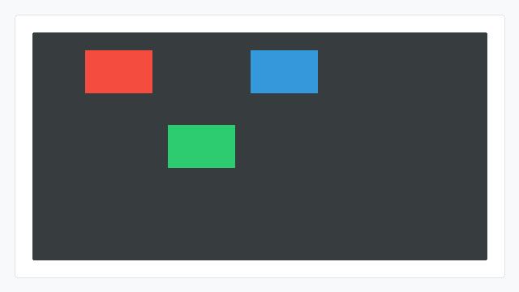
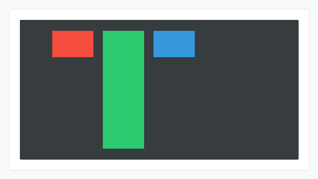

# align-self CSS能力开发指南

## 概述

align-self用于设置单个flex子项在**交叉轴方向**上的独立对齐方式。它可以覆盖父容器的align-items设置，只影响当前子项。

## 能力范围

### 支持的值（CSS）

| 值 | 含义 |
| --- | --- |
| flex-start | 子项靠交叉轴起点对齐 |
| flex-end | 子项靠交叉轴终点对齐 |
| center | 子项在交叉轴方向居中 |
| stretch | 交叉轴方向未设置尺寸的子项被拉伸至所在行的交叉轴尺寸；已显式设置尺寸的子项保持原尺寸 |

### 默认行为

不设置align-self时，子项跟随父容器的align-items，等同于CSS auto的显示效果。

### Native接口

JS应用的align-self CSS属性，在引擎层对应ui_lite的UIView。Native（C++）开发可直接使用以下接口控制单个子项的交叉轴对齐：

| 接口 | 参数 | 返回值 | 说明 |
| --- | --- | --- | --- |
| UIView::SetAlignSelf | uint8_t alignSelf：对齐常量 | 无（void） | 设置子项独立对齐方式。仅更新子项对齐标记，需父容器重新布局后生效 |

常用取值：

| 常量 | 数值 | 含义 |
| --- | --- | --- |
| UIView::ALIGN_SELF_AUTO | 255 | 跟随父容器对齐方式 |
| ALIGN_START | 0 | 子项靠交叉轴起点对齐（对应CSS flex-start） |
| ALIGN_END | 1 | 子项靠交叉轴终点对齐（对应CSS flex-end） |
| ALIGN_CENTER | 2 | 子项在交叉轴方向居中（对应CSS center） |
| UIView::ALIGN_SELF_STRETCH | 254 | 子项在交叉轴方向拉伸（对应CSS stretch） |

涉及的头文件：

```cpp
#include "components/ui_view.h"   // OHOS::UIView
#include "layout/flex_layout.h"   // OHOS::FlexLayout
#include "layout/layout.h"        // OHOS::ALIGN_START 等
#include "gfx_utils/color.h"      // OHOS::Color（设置背景色用）
```

### 与父容器align-items的关系

- 父容器的align-items是默认规则，align-self是单个子项自己的规则；
- 子项设置了align-self后，以子项自己的配置为准；
- 子项未设置align-self时，才跟随父容器的align-items；
- stretch只对交叉轴方向未显式设置尺寸的子项生效，显式设置尺寸的子项保持原尺寸。

## 使用示例

### JS使用示例

#### 子项独立居中

```html
<!-- index.hml -->
<div class="container">
    <div class="item item-red"></div>
    <div class="item item-green special"></div>
    <div class="item item-blue"></div>
</div>
```

```css
/* index.css */
.container {
    flex-direction: row;
    align-items: flex-start;
    width: 300px;
    height: 200px;
}

.item {
    width: 80px;
    height: 50px;
}

.item-red {
    background-color: #e74c3c;
}

.item-green {
    background-color: #2ecc71;
}

.item-blue {
    background-color: #3498db;
}

.special {
    align-self: center;
}
```

预期效果：红色、蓝色子项按父容器规则靠上显示，绿色子项使用自己的align-self: center在垂直方向居中。



#### 子项独立拉伸

```html
<!-- index.hml -->
<div class="container">
    <div class="item item-red fixed-item"></div>
    <div class="item item-green auto-item"></div>
    <div class="item item-blue fixed-item"></div>
</div>
```

```css
/* index.css */
.container {
    flex-direction: row;
    align-items: flex-start;
    width: 300px;
    height: 200px;
}

.item {
    width: 80px;
}

.item-red {
    background-color: #e74c3c;
}

.item-green {
    background-color: #2ecc71;
}

.item-blue {
    background-color: #3498db;
}

.auto-item {
    align-self: stretch;
}

.fixed-item {
    height: 50px;
    align-self: stretch;
}
```

预期效果：未设置高度的.auto-item（绿色）被拉伸到所在行高度，显式设置高度的.fixed-item（红色、蓝色）保持原高度。



### Native接口使用示例

#### 子项独立居中（ALIGN_CENTER）

```cpp
#include "components/ui_view.h"
#include "layout/flex_layout.h"
#include "layout/layout.h"
#include "gfx_utils/color.h"

// 创建 flex 容器，父容器默认按交叉轴起点对齐。
OHOS::FlexLayout* layout = new OHOS::FlexLayout();
layout->SetPosition(0, 0, 300, 200);
layout->SetLayoutDirection(OHOS::LAYOUT_HOR);
layout->SetSecondaryAxisAlign(OHOS::ALIGN_START);

// 红色子视图不设置 align-self，跟随父容器靠交叉轴起点对齐。
OHOS::UIView* viewA = new OHOS::UIView();
viewA->Resize(80, 50);
viewA->SetStyle(STYLE_BACKGROUND_COLOR, OHOS::Color::Red().full);
layout->Add(viewA);

// 绿色子视图设置 align-self: center，覆盖父容器对齐方式。
OHOS::UIView* viewB = new OHOS::UIView();
viewB->Resize(80, 50);
viewB->SetStyle(STYLE_BACKGROUND_COLOR, OHOS::Color::Green().full);
viewB->SetAlignSelf(OHOS::ALIGN_CENTER);
layout->Add(viewB);

// 蓝色子视图不设置 align-self，跟随父容器靠交叉轴起点对齐。
OHOS::UIView* viewC = new OHOS::UIView();
viewC->Resize(80, 50);
viewC->SetStyle(STYLE_BACKGROUND_COLOR, OHOS::Color::Blue().full);
layout->Add(viewC);

layout->LayoutChildren();
layout->Invalidate();
```

预期效果：红色、蓝色子视图跟随父容器靠交叉轴起点对齐，绿色子视图覆盖父容器对齐规则，在交叉轴方向居中。


## 约束

### CSS取值约束

JS页面（HML/CSS）中align-self支持flex-start / flex-end / center / stretch四个值，auto与baseline当前引擎未实现。需要跟随父容器时不设置该属性即可。

### stretch生效约束

- 该能力需打开ui_lite_enable_flex_layout_config和ace_engine_lite_enable_flex_layout_config两个特性开关后编译生效；
- stretch只会拉伸交叉轴尺寸未显式指定的子项；
- 子项已显式设置交叉轴尺寸时，stretch不覆盖该尺寸。

### 与其他flex属性的优先级

#### align-self覆盖父容器的align-items

子项设置align-self后，以子项自身配置为准；未设置时，才跟随父容器的align-items。

| 子项状态 | 生效的对齐方式 |
| --- | --- |
| 未设置align-self | 父容器align-items |
| 设置align-self | 子项align-self |

#### stretch与显式尺寸/约束的优先级

与align-items: stretch一致，align-self: stretch也不会覆盖子项交叉轴的显式尺寸，同时受min-* / max-*约束限制。

| 子项状态 | align-self: stretch行为 |
| --- | --- |
| 未显式设置交叉轴尺寸 | 拉伸到所在行交叉轴尺寸 |
| 显式设置交叉轴尺寸 | 保持原尺寸 |
| 拉伸结果超出max-* | 被max-*截断 |
| 拉伸结果低于min-* | 被min-*截断 |
