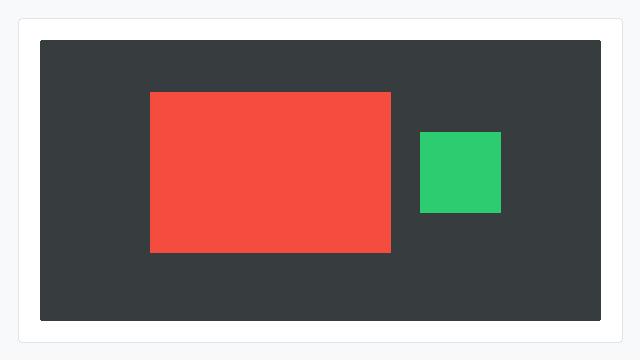

# aspect-ratio CSS能力开发指南

## 概述

aspect-ratio用于设置flex子项的**宽高比**。布局阶段会根据已知的一边尺寸计算另一边尺寸，用于保持子项显示比例。

## 能力范围

### 支持的值（CSS）

| 值 | 含义 |
| --- | --- |
| 数字 | 表示宽高比，例如2表示宽:高 = 2:1 |
| 浮点数 | 表示宽高比，例如1.5表示宽:高 = 1.5:1 |

比值必须大于0。内部按ratio * 100保存，保存后的值范围为1 ~ 65535，因此有效宽高比最大约为655.35。

> **说明：**
>
> JS/CSS解析侧当前不支持%单位，也不支持width/height比值字符串。输入150%时会取前导数字150，等同于宽:高 = 150:1；输入16/9时会取前导数字16，等同于宽:高 = 16:1。

### 默认行为

不设置aspect-ratio时，默认不启用宽高比计算。

### Native接口

JS应用的aspect-ratio CSS属性，在引擎层对应ui_lite的UIView flex子项属性。Native（C++）开发可直接使用以下接口设置子项宽高比：

| 接口 | 参数 | 返回值 | 说明 |
| --- | --- | --- | --- |
| UIView::SetAspectRatio | uint16_t ratio：宽高比倍率 | 无（void） | 设置宽高比，内部按百分比倍率保存，需父容器重新布局后生效 |

Native侧ratio使用百分比倍率表示：

| 配置比例 | Native取值 |
| --- | --- |
| 1 | 100 |
| 1.5 | 150 |

涉及的头文件：

```cpp
#include "components/ui_view.h"   // OHOS::UIView
#include "layout/flex_layout.h"   // OHOS::FlexLayout
#include "layout/layout.h"        // OHOS::LAYOUT_HOR 等
#include "gfx_utils/color.h"      // OHOS::Color（设置背景色用）
```

### 与宽高设置的关系

| 已有尺寸 | 计算方式 |
| --- | --- |
| 已设置宽度，未设置高度 | 根据宽度和宽高比计算高度 |
| 已设置高度，未设置宽度 | 根据高度和宽高比计算宽度 |
| 宽度和高度都已显式设置 | 保留显式宽高，不再用宽高比覆盖 |

## 使用示例

### JS使用示例

#### 按宽度计算高度

```html
<!-- index.hml -->
<div class="container">
    <div class="item item-red"></div>
    <div class="item item-green"></div>
</div>
```

```css
/* index.css */
.container {
    flex-direction: row;
    width: 500px;
    height: 300px;
}

.item-red {
    width: 300px;
    aspect-ratio: 1.5;
    background-color: #e74c3c;
}

.item-green {
    width: 100px;
    aspect-ratio: 1;
    background-color: #2ecc71;
}
```

预期效果：红色子项宽度为300px，根据1.5的宽高比计算出高度为200px；绿色子项宽度为100px，根据1的宽高比计算出高度为100px。



#### 非标准写法的解析结果

```css
.image-box {
    width: 320px;
    aspect-ratio: 16/9;
}
```

预期效果：当前JS/CSS解析侧会取前导数字16，不会按16:9比例显示。需要16:9效果时，可换算为浮点数后配置aspect-ratio: 1.777。

### Native接口使用示例

#### 按宽度计算高度

```cpp
#include "components/ui_view.h"
#include "layout/flex_layout.h"
#include "layout/layout.h"
#include "gfx_utils/color.h"

OHOS::FlexLayout* layout = new OHOS::FlexLayout();
layout->SetPosition(0, 0, 500, 300);
layout->SetLayoutDirection(OHOS::LAYOUT_HOR);

OHOS::UIView* viewA = new OHOS::UIView();
viewA->Resize(300, 0);
viewA->SetStyle(STYLE_BACKGROUND_COLOR, OHOS::Color::Red().full);
viewA->SetHasExplicitWidth(true);
viewA->SetAspectRatio(150);
layout->Add(viewA);

OHOS::UIView* viewB = new OHOS::UIView();
viewB->Resize(100, 0);
viewB->SetStyle(STYLE_BACKGROUND_COLOR, OHOS::Color::Green().full);
viewB->SetHasExplicitWidth(true);
viewB->SetAspectRatio(100);
layout->Add(viewB);

layout->LayoutChildren();
layout->Invalidate();
```

预期效果：红色子视图的宽度为300，高度按300 * 100 / 150计算为200；绿色子视图的宽度为100，高度按100 * 100 / 100计算为100。


## 约束

### CSS取值约束

以下为 **CSS属性侧**的取值约束：JS页面（HML/CSS）中aspect-ratio当前支持正数和浮点数。百分比和width/height比值字符串不按W3C语义解析：150%会取前导数字150，16/9会取前导数字16。解析失败、结果小于等于0或ratio * 100超过UINT16_MAX时，属性不生效。

### 生效约束

- 该能力需打开ui_lite_enable_flex_layout_config和ace_engine_lite_enable_flex_layout_config两个特性开关后编译生效；
- 如需配置类似16:9的比例，需要自行换算为浮点数；
- 宽度和高度都已显式设置时，保留显式宽高，不再用宽高比覆盖。

### 与width / height的优先级

aspect-ratio只有在"已知一边、另一边未设置"时才会参与计算。当width和height同时显式设置时，aspect-ratio完全不生效。

| 已设置尺寸 | aspect-ratio是否生效 | 说明 |
| --- | --- | --- |
| 只设置width | 生效，按宽度计算高度 | 高度未显式设置 |
| 只设置height | 生效，按高度计算宽度 | 宽度未显式设置 |
| width和height都设置 | 不生效，保留显式宽高 | 宽高比可能不被保持 |
