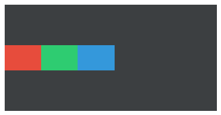

# flex-direction CSS能力开发指南

## 概述

flex-direction用于设置flex容器的**主轴方向**，决定子元素的排列方向（水平排列还是垂直排列）。

## 能力范围

### 支持的值（CSS）

| 值 | 含义 | 主轴方向 | 交叉轴方向 |
| --- | --- | --- | --- |
| row（默认值） | 子元素水平排列，从左到右 | 水平 | 垂直 |
| column | 子元素垂直排列，从上到下 | 垂直 | 水平 |

不设置flex-direction时，容器按默认值row排列。CSS取值约束（不支持的值）见第4章。

### Native接口

JS应用的flex-direction CSS属性，在引擎层对应ui_lite的FlexLayout（div / list-item的底层布局实现）。Native（C++）开发可直接使用以下接口控制主轴方向：

| 接口 | 参数 | 返回值 | 说明 |
| --- | --- | --- | --- |
| FlexLayout::SetLayoutDirection | const DirectionType& direction：方向常量，LAYOUT_HOR（默认）/ LAYOUT_VER | 无（void） | 设置主轴方向。仅更新方向标记，需再调用LayoutChildren()重新布局、Invalidate()刷新显示 |

DirectionType取值常量（`layout/layout.h`，类型为uint8_t）：

| 常量 | 数值 | 含义 |
| --- | --- | --- |
| LAYOUT_HOR | 0 | 水平排列，从左到右（对应CSS row） |
| LAYOUT_VER | 2 | 垂直排列，从上到下（对应CSS column） |

涉及的头文件：

```cpp
#include "layout/flex_layout.h"   // OHOS::FlexLayout
#include "layout/layout.h"        // OHOS::DirectionType / LAYOUT_HOR / LAYOUT_VER
```

### 与其他flex属性的关系

flex-direction决定主轴与交叉轴的指向，以下属性的作用轴向会随之旋转：

| 属性 | 作用轴 | row时 | column时 |
| --- | --- | --- | --- |
| justify-content | 主轴 | 控制水平方向对齐 | 控制垂直方向对齐 |
| align-items | 交叉轴 | 控制垂直方向对齐 | 控制水平方向对齐 |
| flex-wrap | 主轴溢出时换行 | 水平排满后向下换行 | 垂直排满后向右换列 |

修改flex-direction后，原有justify-content / align-items的作用方向会互换，这属于正常行为，不是布局异常。

## 使用示例

### JS使用示例

#### row水平排列（默认）

```html
<!-- index.hml -->
<div class="container">
    <div class="item item-red"></div>
    <div class="item item-green"></div>
    <div class="item item-blue"></div>
</div>
```

```css
/* index.css */
.container {
    flex-direction: row; /* 默认值，可不写 */
}

.item {
    width: 100px;
    height: 60px;
}

.item-red {
    background-color: #e74c3c;
}

.item-green {
    background-color: #2ecc71;
}

.item-blue {
    background-color: #3498db;
}
```

预期效果：红、绿、蓝三个色块在容器内从左到右水平依次排列。


#### column垂直排列

```css
.container {
    flex-direction: column;
}
```

预期效果：红、绿、蓝三个色块在容器内从上到下垂直依次排列。


#### 内容居中（常用组合）

垂直方向堆叠、整体水平居中，常用于表单类页面：

```css
.container {
    flex-direction: column;   /* 主轴：垂直 */
    align-items: center;      /* 交叉轴（水平）居中 */
}
```


水平排列、整体垂直居中，常用于工具栏：

```css
.container {
    flex-direction: row;      /* 主轴：水平 */
    align-items: center;      /* 交叉轴（垂直）居中 */
}
```



### Native接口使用示例

JS应用的flex-direction CSS属性，在引擎层对应ui_lite的FlexLayout::SetLayoutDirection接口。Native（C++）开发时可直接使用该接口控制主轴方向：

| CSS属性值 | Native接口调用 | 说明 |
| --- | --- | --- |
| row（默认值） | SetLayoutDirection(LAYOUT_HOR) | 子元素水平排列，从左到右 |
| column | SetLayoutDirection(LAYOUT_VER) | 子元素垂直排列，从上到下 |

涉及的头文件与取值常量：

```cpp
#include "layout/flex_layout.h"   // OHOS::FlexLayout
#include "layout/layout.h"        // OHOS::LAYOUT_HOR / OHOS::LAYOUT_VER
#include "gfx_utils/color.h"      // OHOS::Color（设置背景色用）
```

#### 水平排列（LAYOUT_HOR，默认）

```cpp
// 创建 flex 容器（FlexLayout 本身即容器视图，直接挂载子视图）
OHOS::FlexLayout* layout = new OHOS::FlexLayout();
layout->SetPosition(0, 0, 300, 100);          // 容器位置和大小：x, y, width, height
layout->SetLayoutDirection(OHOS::LAYOUT_HOR); // LAYOUT_HOR 为默认值，可不写

// 添加三个子元素（分别设置红、绿、蓝背景色）
OHOS::UIView* viewA = new OHOS::UIView();
viewA->Resize(100, 60);
viewA->SetStyle(STYLE_BACKGROUND_COLOR, OHOS::Color::Red().full);
OHOS::UIView* viewB = new OHOS::UIView();
viewB->Resize(100, 60);
viewB->SetStyle(STYLE_BACKGROUND_COLOR, OHOS::Color::Green().full);
OHOS::UIView* viewC = new OHOS::UIView();
viewC->Resize(100, 60);
viewC->SetStyle(STYLE_BACKGROUND_COLOR, OHOS::Color::Blue().full);

layout->Add(viewA);
layout->Add(viewB);
layout->Add(viewC);

layout->LayoutChildren(); // 触发布局
layout->Invalidate();     // 触发重绘
```

预期效果：红、绿、蓝三个子视图在容器内从左到右水平依次排列。


#### 垂直排列（LAYOUT_VER）

```cpp
layout->SetLayoutDirection(OHOS::LAYOUT_VER); // 主轴切换为垂直方向
layout->LayoutChildren();
layout->Invalidate();
```

预期效果：红、绿、蓝三个子视图在容器内从上到下垂直依次排列。


#### 与对齐接口组合（内容居中）

垂直堆叠、整体水平居中：

```cpp
layout->SetLayoutDirection(OHOS::LAYOUT_VER);        // 主轴：垂直
layout->SetSecondaryAxisAlign(OHOS::ALIGN_CENTER);   // 交叉轴（水平）居中
layout->LayoutChildren();
layout->Invalidate();
```


水平排列、整体垂直居中：

```cpp
layout->SetLayoutDirection(OHOS::LAYOUT_HOR);        // 主轴：水平
layout->SetSecondaryAxisAlign(OHOS::ALIGN_CENTER);   // 交叉轴（垂直）居中
layout->LayoutChildren();
layout->Invalidate();
```


> **说明：**
>
> 与CSS侧的规律一致，切换主轴方向后，SetMajorAxisAlign（对应justify-content）与SetSecondaryAxisAlign（对应align-items）的作用轴向随之互换。

## 约束

### CSS取值约束

以下为 **CSS属性侧**的取值约束：JS页面（HML/CSS）中flex-direction仅支持row / column两个值，**不支持**以下W3C标准值：

| 不支持的值 | 说明 |
| --- | --- |
| row-reverse | 水平反向排列（从右到左） |
| column-reverse | 垂直反向排列（从下到上） |

> **注意：**
>
> row-reverse / column-reverse当前不支持。

如需"反向排列"的视觉效果，请使用row / column，并调整HML中子元素的书写顺序来实现。

### 与margin-left的生效关系

margin-left: auto只在flex-direction: row时吸收主轴剩余空间；当flex-direction: column时，margin-left: auto不会生效，元素保持默认左侧外边距0px。

| flex-direction | margin-left: auto行为 |
| --- | --- |
| row（默认值） | 生效，吸收主轴水平剩余空间，把元素推向右侧 |
| column | 不生效，元素左侧外边距保持0px |

如需在垂直方向上实现类似"把元素推到底部"的效果，当前版本请通过调整HML子元素顺序或使用其他布局方式实现。
