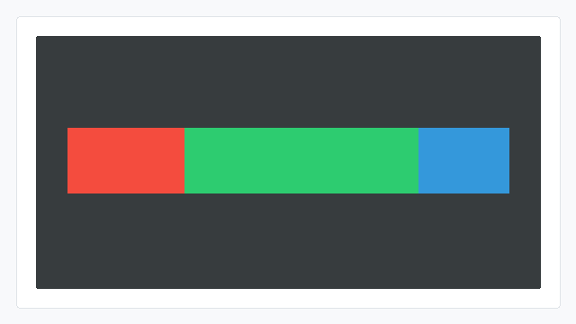

# flex-grow CSS能力开发指南

## 概述

flex-grow用于设置flex子项在**主轴剩余空间**中的拉伸比例。当父容器还有空余空间时，设置了flex-grow的子项会按比例分配这部分空间。

## 能力范围

### 支持的值（CSS）

| 值 | 含义 |
| --- | --- |
| 非负整数 | 拉伸比例，数值越大，分到的剩余空间越多 |
| 0 | 不参与拉伸 |

取值范围：0 ~ 65535。

### 默认行为

不设置flex-grow时，默认值为0，子项不参与主轴剩余空间分配。

### Native接口

JS应用的flex-grow CSS属性，在引擎层对应ui_lite的UIView flex子项属性。Native（C++）开发可直接使用以下接口控制子项主轴拉伸比例：

| 接口 | 参数 | 返回值 | 说明 |
| --- | --- | --- | --- |
| UIView::SetFlexGrow | uint16_t grow：拉伸比例 | 无（void） | 设置子项主轴拉伸比例，需父容器重新布局后生效 |

涉及的头文件：

```cpp
#include "components/ui_view.h"   // OHOS::UIView
#include "layout/flex_layout.h"   // OHOS::FlexLayout
#include "layout/layout.h"        // OHOS::LAYOUT_HOR 等
#include "gfx_utils/color.h"      // OHOS::Color（设置背景色用）
```

### 与尺寸约束的关系

- flex-grow只在父容器主轴存在剩余空间时生效；
- 拉伸计算会先按flex-grow比例分配空间，再受min-width / max-width / min-height / max-height约束影响；
- 某个子项达到最大尺寸后会被冻结，剩余空间继续分配给其他可拉伸子项。

## 使用示例

### JS使用示例

#### 按比例拉伸

```html
<!-- index.hml -->
<div class="container">
    <div class="item item-red grow1"></div>
    <div class="item item-green grow2"></div>
    <div class="item item-blue grow1"></div>
</div>
```

```css
/* index.css */
.container {
    flex-direction: row;
    width: 600px;
    height: 100px;
}

.item {
    width: 100px;
    height: 80px;
}

.grow1 {
    flex-grow: 1;
}

.grow2 {
    flex-grow: 2;
}

.item-red {
    background-color: #e74c3c;
}

.item-green {
    background-color: #2ecc71;
}

.item-blue {
    background-color: #3498db;
}
```

预期效果：容器主轴剩余空间按1:2:1分配给红、绿、蓝三个子项。



### Native接口使用示例

#### 按比例拉伸

```cpp
#include "components/ui_view.h"
#include "layout/flex_layout.h"
#include "layout/layout.h"
#include "gfx_utils/color.h"

OHOS::FlexLayout* layout = new OHOS::FlexLayout();
layout->SetPosition(0, 0, 600, 100);
layout->SetLayoutDirection(OHOS::LAYOUT_HOR);

OHOS::UIView* viewA = new OHOS::UIView();
OHOS::UIView* viewB = new OHOS::UIView();
OHOS::UIView* viewC = new OHOS::UIView();
viewA->Resize(100, 80);
viewA->SetStyle(STYLE_BACKGROUND_COLOR, OHOS::Color::Red().full);
viewB->Resize(100, 80);
viewB->SetStyle(STYLE_BACKGROUND_COLOR, OHOS::Color::Green().full);
viewC->Resize(100, 80);
viewC->SetStyle(STYLE_BACKGROUND_COLOR, OHOS::Color::Blue().full);

viewA->SetFlexGrow(1);
viewB->SetFlexGrow(2);
viewC->SetFlexGrow(1);

layout->Add(viewA);
layout->Add(viewB);
layout->Add(viewC);
layout->LayoutChildren();
layout->Invalidate();
```

预期效果：红、绿、蓝三个子视图按1:2:1分配主轴剩余空间。


## 约束

### CSS取值约束

以下为 **CSS属性侧**的取值约束：JS页面（HML/CSS）中flex-grow仅支持0 ~ 65535范围内的非负整数。

### 生效约束

- 该能力需打开ui_lite_enable_flex_layout_config和ace_engine_lite_enable_flex_layout_config两个特性开关后编译生效；
- 负数不支持；
- 父容器主轴没有剩余空间时，flex-grow不产生拉伸效果。

### 与尺寸约束的优先级

flex-grow分配的是主轴剩余空间，但子项最终尺寸仍受min-width / max-width / min-height / max-height约束。当flex-grow计算结果超出上限时，会被max-*截断。

| 约束 | 对flex-grow结果的影响 |
| --- | --- |
| 无max-*约束 | 按flex-grow比例分配 |
| 达到max-width / max-height | 该子项被冻结在max-*值，剩余空间继续分配给其他子项 |

> **注意：**
>
> 主轴方向上min-*约束对flex-grow通常不影响（flex-grow是拉伸变大），但max-*会限制拉伸上限。
