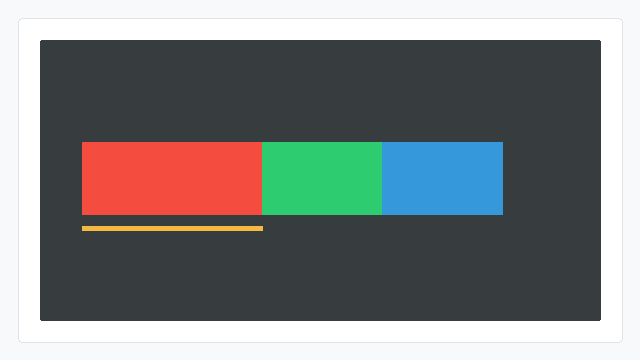

# max-width CSS能力开发指南

## 概述

max-width用于设置flex子项的**最大宽度**。布局计算过程中，如果子项宽度大于该约束，最终宽度会被限制到max-width。

## 能力范围

### 支持的值（CSS）

| 值 | 含义 |
| --- | --- |
| 像素值 | 最大宽度，例如180px |
| 数字值 | 按像素值处理，例如180 |

取值范围：0 ~ 32767。

### 默认行为

不设置max-width时，默认没有最大宽度约束。

### Native接口

JS应用的max-width CSS属性，在引擎层对应ui_lite的UIView尺寸约束属性。Native（C++）开发可直接使用以下接口设置子项最大宽度：

| 接口 | 参数 | 返回值 | 说明 |
| --- | --- | --- | --- |
| UIView::SetMaxWidth | int16_t width：最大宽度 | 无（void） | 设置子项最大宽度，需父容器重新布局后生效 |

涉及的头文件：

```cpp
#include "components/ui_view.h"   // OHOS::UIView
#include "layout/flex_layout.h"   // OHOS::FlexLayout
#include "layout/layout.h"        // OHOS::LAYOUT_HOR 等
#include "gfx_utils/color.h"      // OHOS::Color（设置背景色用）
```

### 与flex布局的关系

- max-width是宽度上限，会参与普通尺寸计算；
- 主轴方向上，它会约束flex-grow或flex-shrink后得到的结果；
- 交叉轴方向上，它会约束align-items: stretch或align-self: stretch后得到的结果。

## 使用示例

### JS使用示例

#### 最大宽度约束

```html
<!-- index.hml -->
<div class="container">
    <div class="item item-red max"></div>
    <div class="item item-green"></div>
    <div class="item item-blue"></div>
</div>
```

```css
/* index.css */
.container {
    flex-direction: column;
    align-items: flex-start;
    width: 300px;
    height: 200px;
}

.item {
    height: 40px;
}

.item-red {
    background-color: #e74c3c;
}

.item-green {
    width: 120px;
    background-color: #2ecc71;
}

.item-blue {
    width: 80px;
    background-color: #3498db;
}

.max {
    width: 250px;
    max-width: 180px;
}
```

预期效果：红色子项宽度被max-width限制为180px，绿色、蓝色子项按各自宽度显示。效果图中红色子项下方的黄色横线为示意标注，表示max-width限制边界（代码本身不会渲染该黄线）。



### Native接口使用示例

#### 最大宽度约束

```cpp
#include "components/ui_view.h"
#include "layout/flex_layout.h"
#include "layout/layout.h"
#include "gfx_utils/color.h"

OHOS::FlexLayout* layout = new OHOS::FlexLayout();
layout->SetPosition(0, 0, 300, 200);
layout->SetLayoutDirection(OHOS::LAYOUT_VER);

OHOS::UIView* viewA = new OHOS::UIView();
viewA->Resize(250, 40);
viewA->SetStyle(STYLE_BACKGROUND_COLOR, OHOS::Color::Red().full);
viewA->SetMaxWidth(180);
layout->Add(viewA);

OHOS::UIView* viewB = new OHOS::UIView();
viewB->Resize(120, 40);
viewB->SetStyle(STYLE_BACKGROUND_COLOR, OHOS::Color::Green().full);
layout->Add(viewB);

OHOS::UIView* viewC = new OHOS::UIView();
viewC->Resize(80, 40);
viewC->SetStyle(STYLE_BACKGROUND_COLOR, OHOS::Color::Blue().full);
layout->Add(viewC);

layout->LayoutChildren();
layout->Invalidate();
```

预期效果：红色子视图宽度被max-width限制为180，绿色、蓝色子视图按各自宽度显示。


## 约束

### CSS取值约束

以下为 **CSS属性侧**的取值约束：JS页面（HML/CSS）中max-width当前仅支持0 ~ 32767范围内的像素值或数字值，**不支持**百分比、auto等其他取值。

### 生效约束

- 该能力需打开ui_lite_enable_flex_layout_config和ace_engine_lite_enable_flex_layout_config两个特性开关后编译生效；
- 负数或超出INT16_MAX的值不支持；
- 约束只限制最终布局尺寸，不改变CSS中原始配置值。

### 取值冲突

同一元素上若同时设置min-width和max-width，应保证min-width <= max-width。
