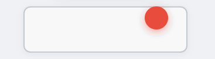
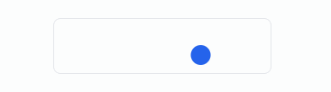
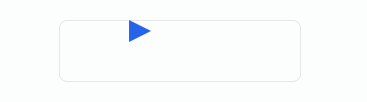
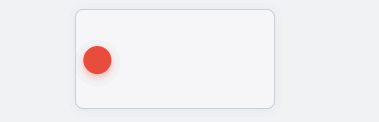
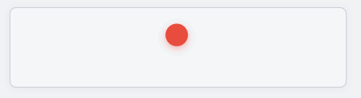
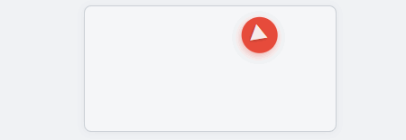
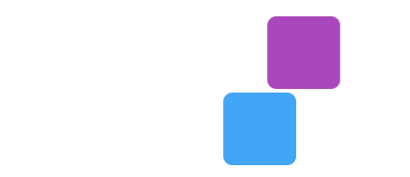

# 轻图形-动画开发指导

## 特性开关约束

轻图形动画能力由ui_lite与ace_engine_lite两个子系统的编译总开关共同控制。使用前需在对应产物配置中同时开启两侧总开关，否则会出现JS/CSS侧接口可用但绘制侧不生效、或编译产物缺少对应实现的情况。

| 能力 | JS/解析侧总开关 | 绘制侧总开关 | 说明 |
| --- | --- | --- | --- |
| 路径动画 | ace_engine_lite_enable_animation_capability | ui_lite_enable_animation_capability | 路径动画与属性动画共用同一总开关 |
| 属性动画 | ace_engine_lite_enable_animation_capability | ui_lite_enable_animation_capability | 路径动画与属性动画共用同一总开关 |
| 元素转场 | ace_engine_lite_enable_element_transition_capability | ui_lite_enable_element_transition_capability | 单独总开关 |


## 路径动画

### 功能概述

本模块面向应用开发，提供**页面元素路径动画**能力：开发者可以指定目标UIView沿预设路径运动，支持**指定路径移动**与**贝塞尔曲线路径动画**两类场景，并可配置持续时间、延迟、重复播放与缓动曲线。

| 维度     | 路径动画（本模块）                                 |
| -------- | -------------------------------------------------- |
| 作用对象 | 单个UIView的位置                             |
| 典型场景 | 图标沿轨迹飞入、按钮沿曲线移动、提示气泡绕路径出现 |
| 核心类   | PathAnimatorCallback                           |

本模块在此基础上提供轻量、可验证的路径运动API，覆盖 **2种能力**：

1. 指定路径移动动画
2. 贝塞尔曲线路径动画

### 功能接口

PathAnimatorCallback是路径动画的核心类，提供路径配置、旋转控制和时间驱动能力。

| 接口                                                                            | 参数                                                 | 返回值   | 说明                                                                                                                                             |
| ------------------------------------------------------------------------------- | ---------------------------------------------------- | -------- | ------------------------------------------------------------------------------------------------------------------------------------------------ |
| SetDuration(uint32_t duration)                                              | duration：动画时长（毫秒）                       | 无       | 设置动画时长，作为自驱动模式下Callback推进的时间周期。0表示动画永不推进                                                                 |
| SetEasingFunc(EasingFunc easing)                                            | easing：缓动函数                                 | 无       | 设置缓动函数，默认LinearEaseNone。nullptr回落到默认                                                                                    |
| SetPath(const Vector2* points, uint8_t count)                               | points：点数组；count：点数                  | bool | 设置折线路径（相对视图原位的偏移，px）。至少2个点，超出PathPolyline::MAX_POINTS=32截断。适用于已知路径点的场景                                         |
| SetPath(const PathPolyline& polyline)                                       | polyline：PathPolyline对象                      | bool | 设置折线路径（如OffsetPathParser::ParseToPolyline的输出）。适用于已解析折线的复用场景                                                      |
| SetBezier(const Vector2& start, const Vector2& control, const Vector2& end) | start：起点；control：控制点；end：终点  | bool | 设置二次贝塞尔曲线路径，运行时按公式求值。适用于二次贝塞尔曲线场景                                                                               |
| SetPathString(const char* pathStr)                                          | pathStr：SVG path字符串                         | bool | 设置SVG path字符串路径，支持M/L/Q/C/Z命令，贝塞尔按每段8点采样折线化。适用于标准SVG路径场景                                              |
| SetFixedRotate(int16_t deg)                                                 | deg：固定角度（度，顺时针）                      | 无       | 设置固定旋转角度（PATH_ROTATE_FIXED）。0重置为不旋转（PATH_ROTATE_NONE）                                                                |
| SetAutoRotate(int16_t offsetDeg)                                            | offsetDeg：附加偏移角（度）                      | 无       | 设置跟随路径切线方向旋转（PATH_ROTATE_AUTO）。SetAutoRotate(0) 等同CSS offset-rotate: auto；SetAutoRotate(180) 等同reverse |
| Callback(UIView* view)                                                      | view：目标视图                                   | 无       | 回调函数，由Animator驱动，内部基于HALTick时间戳推进进度。**框架调用，应用代码不要直接调用**                                        |
| ApplyFrame(UIView* view, uint16_t distPermille)                             | view：目标视图；distPermille：进度（0~1000） | 无       | 应用单帧路径效果。自包含模式由Callback调用；外部进度模式由外部动画系统直接调用                                                             |
| CalculatePoint(uint16_t dist, int16_t& outX, int16_t& outY, float* outTangentDeg = nullptr) | dist：进度（0~1000）；outX/outY：输出坐标；outTangentDeg：输出切线角度 | bool | 根据当前进度计算路径上的点坐标与切线角度。通常由框架内部调用 |

### 功能示例

#### JS接口示例

JS侧通过CSS的offset-path字段和animation字段实现路径动画。

**motion-path字段（3个）**：

| CSS字段            | 语法                                    | 取值范围                                  | 说明                                                             |
| ------------------- | --------------------------------------- | ----------------------------------------- | ---------------------------------------------------------------- |
| offset-path     | path("")                            | SVG path字符串（M/L/Q/C/Z）              | 定义动画路径                                                     |
| offset-distance | 百分比                                  | 0% ~ 100%                         | 定义路径进度起止（在 @keyframes中使用）                     |
| offset-rotate   | auto / reverse / auto  /  |  支持deg/turn/rad/grad | 定义旋转方式：auto=跟随路径切线；reverse=auto 180deg |

**animation字段（6个）**：

| CSS字段                      | 取值范围                                                  | 说明                                                       |
| ----------------------------- | --------------------------------------------------------- | ---------------------------------------------------------- |
| animation-name            | @keyframes规则名                                     | 绑定包含offset-distance起止的keyframes              |
| animation-duration        | ms / s                                            | 单周期时长                                                 |
| animation-timing-function | ease-in / ease-out / ease-in-out / linear | 缓动曲线                                                   |
| animation-iteration-count | 0~127 / infinite                              | 循环次数，0表示不播放，infinite无限循环            |
| animation-fill-mode       | forwards / 其他                                       | forwards=结束保持终态；其他值按none（结束回原位） |
| animation-delay           | ms / s                                            | 启动延迟                                                   |

**直线路径移动**：



```css
/* 关键帧：路径进度从 0% 到 100% */
@keyframes moveLine {
  from { offset-distance: 0%; }
  to   { offset-distance: 100%; }
}

/* 动画元素：沿水平直线匀速移动 */
.a-line {
  offset-path: path('M 0 0 L 205 0');  /* 直线路径：从 (0,0) 到 (205,0) */
  offset-rotate: 0deg;                  /* 不旋转 */
  animation-name: moveLine;
  animation-duration: 2000ms;           /* 时长 2000ms */
  animation-timing-function: linear;    /* 匀速 */
  animation-fill-mode: forwards;        /* 结束停在终点 */
}
```

**折线路径移动**：



```css
@keyframes movePoly {
  from { offset-distance: 0%; }
  to   { offset-distance: 100%; }
}

.a-poly {
  offset-path: path('M 0 0 L 205 0 L 205 30 L 0 30 Z');  /* 折线路径：右→下→左→闭合 */
  offset-rotate: 0deg;                                    /* 不旋转 */
  animation-name: movePoly;
  animation-duration: 3000ms;
  animation-timing-function: linear;
  animation-iteration-count: infinite;                    /* 无限循环 */
}
```

**沿路径自动旋转**：



```css
.a-rotate {
  offset-path: path('M 0 0 L 205 0 L 205 30 L 0 30 Z');
  offset-rotate: auto;  /* 跟随路径切线方向自动旋转 */
  animation-name: movePoly;
  animation-duration: 3000ms;
  animation-timing-function: linear;
  animation-fill-mode: forwards;
}
```

**二次贝塞尔曲线路径**：



```css
@keyframes moveQuad {
  from { offset-distance: 0%; }
  to   { offset-distance: 100%; }
}

.a-quad {
  offset-path: path('M 0 0 Q 105 -60 210 0');  /* 二次贝塞尔：起点 (0,0)，控制点 (105,-60)，终点 (210,0) */
  offset-rotate: 0deg;
  animation-name: moveQuad;
  animation-duration: 2000ms;
  animation-timing-function: linear;
  animation-fill-mode: forwards;
}
```

**三次贝塞尔曲线路径**：



```css
@keyframes moveCubic {
  from { offset-distance: 0%; }
  to   { offset-distance: 100%; }
}

.a-cubic {
  offset-path: path('M 0 0 C 50 -35 160 35 210 0');  /* 三次贝塞尔：两个控制点 */
  offset-rotate: 0deg;
  animation-name: moveCubic;
  animation-duration: 2000ms;
  animation-timing-function: linear;
  animation-fill-mode: forwards;
}
```

**贝塞尔曲线+自动旋转**：



```css
.a-bezier-auto {
  offset-path: path('M 0 0 Q 105 -60 210 0');
  offset-rotate: auto;  /* 跟随路径切线方向自动旋转 */
  animation-name: moveBezierAuto;
  animation-duration: 2000ms;
  animation-timing-function: linear;
  animation-fill-mode: forwards;
}
```

#### Native接口示例

Native侧通过PathAnimatorCallback类实现路径动画，配合Animator时间轴驱动。

**直线路径移动**：

```cpp
#include "animator/path_animator_callback.h"

void StartLineAnim()
{
    UIView* lineTarget_ = new UIView();
    lineTarget_->SetPosition(TARGET_START_X, TARGET_START_Y, TARGET_SIZE, TARGET_SIZE);
    lineTarget_->SetStyle(STYLE_BACKGROUND_COLOR, Color::Red().full);
    // 配置路径动画
    PathAnimatorCallback lineCallback_;
    lineCallback_.SetDuration(2000);                           // 时长 2000ms
    lineCallback_.SetEasingFunc(EasingEquation::LinearEaseNone); // 匀速
    lineCallback_.SetPathString("path(\"M 0 0 L 240 0\")");     // 直线路径

    // 创建并启动 Animator（注入 callback 和 view）
    Animator* lineAnimator_ = new Animator(&lineCallback_, lineTarget_, 2000, false);
    lineAnimator_->Start();
}
```

**矩形折线路径循环**：

```cpp
#include "animator/path_animator_callback.h"

void StartRectAnim()
{
    UIView* rectTarget_ = new UIView();
    rectTarget_->SetPosition(TARGET_START_X, TARGET_START_Y + POSTION_100, TARGET_SIZE, TARGET_SIZE);
    rectTarget_->SetStyle(STYLE_BACKGROUND_COLOR, Color::Green().full);

    PathAnimatorCallback rectCallback_;
    rectCallback_.SetDuration(3000);
    rectCallback_.SetEasingFunc(EasingEquation::LinearEaseNone);
    rectCallback_.SetPathString("path(\"M 0 0 L 240 0 L 240 30 L 0 30 Z\")");  // 矩形闭合路径

    Animator* rectAnimator_ = new Animator(&rectCallback_, rectTarget_, 3000, true);  // repeat=true 循环
    rectAnimator_->Start();
}
```

**贝塞尔曲线路径**：

```cpp
#include "animator/path_animator_callback.h"

void StartBezierAnim()
{
    UIView* bezierTarget_ = new UIView();
    bezierTarget_->SetPosition(TARGET_START_X, TARGET_START_Y + POSTION_200, TARGET_SIZE, TARGET_SIZE);
    bezierTarget_->SetStyle(STYLE_BACKGROUND_COLOR, Color::Blue().full);

    PathAnimatorCallback bezierCallback_;
    bezierCallback_.SetDuration(2000);
    bezierCallback_.SetEasingFunc(EasingEquation::LinearEaseNone);
    bezierCallback_.SetPathString("path(\"M 0 0 Q 120 -40 240 0\")");  // 二次贝塞尔路径

    Animator* bezierAnimator_ = new Animator(&bezierCallback_, bezierTarget_, 2000, true);
    bezierAnimator_->Start();
}
```

**跟随路径自动旋转**：

```cpp
#include "animator/path_animator_callback.h"

void StartAutoRotateAnim()
{
    UIView* autoRotateTarget_ = new UIView();
    autoRotateTarget_->SetPosition(TARGET_START_X, TARGET_START_Y + POSTION_300, TARGET_SIZE, TARGET_SIZE);
    autoRotateTarget_->SetStyle(STYLE_BACKGROUND_COLOR, Color::Yellow().full);

    PathAnimatorCallback autoRotateCallback_;
    autoRotateCallback_.SetDuration(2000);
    autoRotateCallback_.SetEasingFunc(EasingEquation::LinearEaseNone);
    autoRotateCallback_.SetPathString("path(\"M 0 0 Q 120 -40 240 0\")");
    autoRotateCallback_.SetAutoRotate(0);  // 跟随路径切线方向（等同 CSS offset-rotate: auto）

    Animator* autoRotateAnimator_ = new Animator(&autoRotateCallback_, autoRotateTarget_, 2000, true);
    autoRotateAnimator_->Start();
}
```

## 转场动画

### 功能概述

本模块面向应用开发，提供**页面元素级转场动画**能力：开发者可通过JS startTransition() 触发容器内子元素的平滑切换，支持**双视图转场**与**共享元素转场**两类场景，并可配置转场效果、持续时间、延迟与缓动曲线。

| 维度     | 转场动画（本模块）                                  |
| -------- | --------------------------------------------------- |
| 作用对象 | 容器内两个子视图（outgoing / incoming）以及共享元素 |
| 典型场景 | 页面面板切换、卡片淡入淡出、共享元素平滑移动        |
| 核心类   | ViewTransition                                  |

本模块提供轻量、可验证的元素级转场API，覆盖 **2种能力**：

1. 双视图转场：fade、slide-left、slide-right、slide-up、slide-down、scale
2. 共享元素转场：shared-element

> JS侧布局依赖：双视图转场要求stage容器声明position: relative、子面板声明position: absolute; left:0; top:0; 以保证重叠布局。该能力依赖Flex定位CSS适配。

### 功能接口

ViewTransition是元素级转场的核心类，提供转场类型、视图、时长、延迟与缓动配置能力。

#### JS接口

| 接口                                 | 参数                                                                                                                                                                                 | 返回值 | 说明             |
| ------------------------------------ | ------------------------------------------------------------------------------------------------------------------------------------------------------------------------------------ | ------ | ---------------- |
| startTransition(incomingElement) | incomingElement：待进入视图的JS引用                                                                                                                                            | 无     | 触发双视图转场   |
| startTransition(options)         | options.incoming：待进入视图的JS引用；options.sharedElement：共享元素JS引用；options.sharedStartRect / options.sharedEndRect：共享元素起止矩形（父容器局部坐标） | 无     | 触发共享元素转场 |

#### CSS属性

| CSS字段                       | 语法                                                                                                         | 取值范围 | 说明                                                         |
| ------------------------------ | ------------------------------------------------------------------------------------------------------------ | -------- | ------------------------------------------------------------ |
| transition-effect          | fade / slide-left / slide-right / slide-up / slide-down / scale / shared-element | 枚举值   | 定义转场效果，非法值按fade处理                         |
| transition-duration        | number                                                                                                       | 0~10000  | 动画时长，单位ms，负数按0处理，缺省0表示立即切换        |
| transition-delay           | number                                                                                                       | 0~10000  | 延迟时长，单位ms，负数按0处理                             |
| transition-timing-function | linear / ease-in / ease-out / ease-in-out                                                    | 枚举值   | 缓动曲线，非法值、ease、nullptr均按linear处理 |

#### Native接口

| 接口                               | 参数                      | 返回值 | 说明                                            |
| ---------------------------------- | ------------------------- | ------ | ----------------------------------------------- |
| SetType(ViewTransition::Type)  | type：转场类型枚举    | 无     | 设置转场类型，与CSS transition-effect对应 |
| SetOutgoingView(UIView*)       | view：退出视图指针    | 无     | 设置退出视图，不拥有所有权                      |
| SetIncomingView(UIView*)       | view：进入视图指针    | 无     | 设置进入视图，不拥有所有权                      |
| SetDuration(int32_t)           | ms：时长（毫秒）      | 无     | 负值按0处理，上限10000ms                     |
| SetDelay(int32_t)              | ms：延迟（毫秒）      | 无     | 负值按0处理，上限10000ms                     |
| SetEasingFunc(EasingFunc)      | func：缓动函数指针    | 无     | nullptr降级为LinearEaseNone           |
| SetSharedElement(UIView*)      | element：共享元素指针 | 无     | 设置共享元素视图，不拥有所有权                  |
| SetSharedStartRect(int16_t x, int16_t y, int16_t w, int16_t h) | x/y/w/h：起始矩形参数 | 无       | 设置共享元素起始矩形，父容器局部坐标            |
| SetSharedEndRect(int16_t x, int16_t y, int16_t w, int16_t h)   | x/y/w/h：结束矩形参数 | 无       | 设置共享元素结束矩形，父容器局部坐标            |
| Start()                        | 无                        | 无     | 启动转场                                        |
| Stop() / Cancel()          | 无                        | 无     | 取消转场并恢复视图快照                          |
| InvalidateTargets()            | 无                        | 无     | 取消转场、恢复快照并清空所有视图引用            |

### 功能示例

#### JS接口示例

JS侧通过CSS的transition-* 字段和JS startTransition() 接口实现元素转场。

**transition字段（4个）**：

| CSS字段                       | 语法                                                                                                         | 取值范围 | 说明              |
| ------------------------------ | ------------------------------------------------------------------------------------------------------------ | -------- | ----------------- |
| transition-effect          | fade / slide-left / slide-right / slide-up / slide-down / scale / shared-element | 枚举值   | 定义转场效果      |
| transition-duration        | number                                                                                                          | 0~10000  | 动画时长，单位ms |
| transition-delay           | number                                                                                                          | 0~10000  | 延迟时长，单位ms |
| transition-timing-function | linear / ease-in / ease-out / ease-in-out                                                    | 枚举值   | 缓动曲线          |

**CSS声明转场样式**：

```css
.stage {
    position: relative;
    transition-effect: fade;
    transition-duration: 500;
    transition-delay: 100;
    transition-timing-function: ease-in-out;
}

.panel {
    position: absolute;
    left: 0;
    top: 0;
}
```

**双视图转场**：

```javascript
var next = (this.currentShow === 'a') ? 'b' : 'a';
var incomingRef = (next === 'a') ? 'panelA' : 'panelB';
var incoming = this.$refs[incomingRef];
this.$refs.stage.startTransition(incoming);
this.currentShow = next;
```

> 约定：必须先调用startTransition，成功后再更新状态变量；面板可见性由转场引擎统一落地，JS状态仅作记录，不驱动视图。

**共享元素转场**：

```javascript
this.$refs.stage.startTransition({
    incoming: this.$refs.panelB,
    sharedElement: this.$refs.star,
    sharedStartRect: { x: 30, y: 30, w: 40, h: 40 },
    sharedEndRect: { x: 130, y: 20, w: 80, h: 80 }
});
```

**淡入淡出**：


```css
.stage {
    position: relative;
    transition-effect: fade;
    transition-duration: 500;
    transition-timing-function: ease-in-out;
}

.panel {
    position: absolute;
    left: 0;
    top: 0;
    width: 300px;
    height: 170px;
}
```

**左滑**：


```css
.stage {
    position: relative;
    transition-effect: slide-left;
    transition-duration: 500;
    transition-timing-function: ease-in-out;
}

.panel {
    position: absolute;
    left: 0;
    top: 0;
    width: 300px;
    height: 170px;
}
```

**右滑**：


```css
.stage {
    position: relative;
    transition-effect: slide-right;
    transition-duration: 500;
    transition-timing-function: ease-in-out;
}

.panel {
    position: absolute;
    left: 0;
    top: 0;
    width: 300px;
    height: 170px;
}
```

**上滑**：


```css
.stage {
    position: relative;
    transition-effect: slide-up;
    transition-duration: 500;
    transition-timing-function: ease-in-out;
}

.panel {
    position: absolute;
    left: 0;
    top: 0;
    width: 300px;
    height: 170px;
}
```

**下滑**：


```css
.stage {
    position: relative;
    transition-effect: slide-down;
    transition-duration: 500;
    transition-timing-function: ease-in-out;
}

.panel {
    position: absolute;
    left: 0;
    top: 0;
    width: 300px;
    height: 170px;
}
```

**缩放**：


```css
.stage {
    position: relative;
    transition-effect: scale;
    transition-duration: 300;
    transition-timing-function: ease-in-out;
}

.panel {
    position: absolute;
    left: 0;
    top: 0;
    width: 300px;
    height: 170px;
}
```

**共享元素**：


```css
.stage {
    position: relative;
    transition-effect: shared-element;
    transition-duration: 500;
    transition-timing-function: ease-in-out;
}

.panel {
    position: absolute;
    left: 0;
    top: 0;
    width: 300px;
    height: 170px;
}

/* 共享元素：初始位置与大小对应 sharedStartRect */
.shared-star {
    position: absolute;
    left: 30px;
    top: 30px;
    width: 40px;
    height: 40px;
    background-color: #ffff00;
    border-radius: 20px;
}
```

```javascript
this.$refs.sharedStage.startTransition({
    incoming: this.$refs.sharedB,
    sharedElement: this.$refs.sharedStar,
    sharedStartRect: { x: 30, y: 30, w: 40, h: 40 },
    sharedEndRect: { x: 130, y: 65, w: 80, h: 80 }
});
```

#### Native接口示例

Native侧通过ViewTransition类实现元素转场，配合Animator时间轴驱动。

**双视图转场**：

```cpp
#include "animator/view_transition.h"
#include "components/ui_view.h"

void StartFadeTransition(UIView* outView, UIView* inView)
{
    // 创建转场实例
    ViewTransition* trans = new ViewTransition();

    // 配置转场类型与视图
    trans->SetType(ViewTransition::TRANSITION_FADE);
    trans->SetOutgoingView(outView);
    trans->SetIncomingView(inView);
    trans->SetDuration(500);          // 动画时长 500ms
    trans->SetDelay(100);             // 延迟 100ms
    trans->SetEasingFunc(EasingEquation::CubicEaseInOut);

    // 启动转场
    trans->Start();

    // 释放（动画结束或需提前终止时）
    // 先 InvalidateTargets 取消动画并恢复视图快照，再 delete
    trans->InvalidateTargets();
    delete trans;
}
```

**共享元素转场**：

```cpp
#include "animator/view_transition.h"
#include "components/ui_view.h"

void StartSharedElementTransition(UIView* outView, UIView* inView, UIView* sharedElement)
{
    ViewTransition* trans = new ViewTransition();

    trans->SetType(ViewTransition::TRANSITION_SHARED_ELEMENT);
    trans->SetOutgoingView(outView);
    trans->SetIncomingView(inView);
    trans->SetSharedElement(sharedElement);

    // 共享元素起止矩形，坐标系与 UIView::SetPosition 一致（父容器局部坐标）
    trans->SetSharedStartRect(30, 30, 40, 40);
    trans->SetSharedEndRect(130, 20, 80, 80);

    trans->SetDuration(600);
    trans->SetEasingFunc(EasingEquation::CubicEaseInOut);
    trans->Start();

    // 释放时同样先 InvalidateTargets 再 delete
    trans->InvalidateTargets();
    delete trans;
}
```

## 属性动画

### 功能概述

本模块面向应用开发，提供**单视图属性动画**能力：开发者可以指定目标UIView的透明度、缩放、旋转、背景色、位置在起止值之间平滑插值，并可配置持续时间、延迟与缓动函数，支持将多个属性回调**串行**（先后执行）或**并行**（同步执行）组织为一条动画时间轴。

| 维度     | 属性动画（本模块）                                                   |
| -------- | -------------------------------------------------------------------- |
| 作用对象 | 单个UIView的透明度 / 缩放 / 旋转 / 背景色 / 位置               |
| 典型场景 | 元素淡入淡出、图标放大缩小、卡片旋转、颜色渐变、位移、多属性组合动效 |
| 核心类   | TransitionAnimatorCallback                                       |

本模块提供轻量、可验证的属性动画API，覆盖以下能力：

1. 单属性动画：透明度、缩放（放大/缩小）、旋转、颜色、位置
2. 缓动曲线：匀速、ease-in-out等内置缓动与自定义缓动（如弹跳）
3. 组合动画：多属性单回调复合、串行（sequential）、并行（parallel）

### 功能接口

TransitionAnimatorCallback是属性动画的核心类，提供属性配置、时间轴配置与帧应用能力。

| 接口                                                                                 | 参数                                                                                            | 返回值       | 说明                                                                                  |
| ------------------------------------------------------------------------------------ | ----------------------------------------------------------------------------------------------- | ------------ | ------------------------------------------------------------------------------------- |
| SetDuration(uint32_t duration)                                                   | duration：动画时长（毫秒）                                                                  | 无           | 设置动画时长，同时重置内部起始时间戳                                                  |
| SetDelay(uint32_t delay)                                                         | delay：启动延迟（毫秒）                                                                     | 无           | 设置动画延迟，延迟期间视图保持初始状态                                                |
| SetEasingFunc(EasingFunc easing)                                                 | easing：缓动函数                                                                            | 无           | 设置缓动函数，默认LinearEaseNone。nullptr回落到默认                         |
| SetOpacity(uint8_t from, uint8_t to)                                             | from：起始透明度；to：结束透明度（0~255）                                               | 无           | 配置透明度动画。透明度插值结果自动截断到 [0, OPA_OPAQUE]                          |
| SetScale(float fromX, float fromY, float toX, float toY, float pivotX = -1.0f, float pivotY = -1.0f)                       | fromX/fromY：起始缩放；toX/toY：结束缩放；pivotX/pivotY：缩放中心                   | 无           | 配置缩放动画。pivot缺省（负值）时使用视图中心                                    |
| SetRotation(int16_t fromAngle, int16_t toAngle, float pivotX = -1.0f, float pivotY = -1.0f)        | fromAngle/toAngle：起止角度（度，顺时针）；pivotX/pivotY：旋转中心                              | 无           | 配置旋转动画。pivot缺省（负值）时使用视图中心                                    |
| SetColor(ColorType from, ColorType to)                                           | from：起始颜色；to：结束颜色                                                            | 无           | 配置背景色渐变动画，颜色按RGBA分量分别插值                                          |
| SetPosition(int16_t fromX, int16_t fromY, int16_t toX, int16_t toY)              | fromX/fromY：起始位置；toX/toY：结束位置（父容器局部坐标）                              | 无           | 配置位置动画                                                                          |
| AddTransitionAnimatorCallback(TransitionAnimatorCallback* next, bool sequential) | next：链上下一个回调；sequential：true串行 / false并行                        | 无           | 将多个回调链接为一条时间轴。串行总时长累加，并行取两者最大值                          |
| GetTotalTime()                                                                   | 无                                                                                              | uint32_t | 返回整条链的总时长（毫秒），用于外部进度驱动                                          |
| Callback(UIView* view)                                                           | view：目标视图                                                                              | 无           | 帧回调函数，内部基于HALTick时间戳驱动，**框架调用，应用代码不要直接调用** |
| ApplyFrame(UIView* view, uint32_t elapsedTime, uint32_t durationTime)            | view：目标视图；elapsedTime：已耗时；durationTime：总时长（单回调无链时即自身时长） | 无           | 应用单帧效果。外部进度模式下由外部动画系统直接调用                                    |
| HasEffects()                                                                     | 无                                                                                              | bool     | 查询链上是否已配置任何属性动画                                                        |
| Reset()                                                                          | 无                                                                                              | 无           | 清空所有属性配置、链与时间轴状态                                                      |

### 功能示例

#### JS接口示例

JS侧通过CSS的 @keyframes关键帧和animation字段实现属性动画。

** 透明度渐变**：


```css
@keyframes fadeAnim {
  from { opacity: 1; }
  to   { opacity: 0.1; }
}

.a-fade {
  opacity: 1;
  background-color: #ff0000;
  animation-name: fadeAnim;
  animation-duration: 2000ms;
  animation-timing-function: linear;
  animation-fill-mode: forwards;
}
```

** 缩放放大 / 缩放缩小**：


```css
@keyframes scaleAnim {
  from { transform: scale(1.0); }
  to   { transform: scale(1.5); }
}

.a-scale {
  background-color: #ffa726;
  animation-name: scaleAnim;
  animation-duration: 2000ms;
  animation-timing-function: linear;
  animation-fill-mode: forwards;
}
```


```css
@keyframes shrinkAnim {
  from { transform: scale(1.0); }
  to   { transform: scale(0.5); }
}

.a-shrink {
  background-color: #ff7043;
  animation-name: shrinkAnim;
  animation-duration: 2000ms;
  animation-timing-function: linear;
  animation-fill-mode: forwards;
}
```

** 旋转**：


```css
@keyframes rotateAnim {
  from { transform: rotate(0deg); }
  to   { transform: rotate(90deg); }
}

.a-rotate {
  background-color: #66bb6a;
  animation-name: rotateAnim;
  animation-duration: 2000ms;
  animation-timing-function: linear;
  animation-fill-mode: forwards;
}
```

** 颜色渐变**：


```css
@keyframes colorAnim {
  from { background-color: #ff0000; }
  to   { background-color: #0000ff; }
}

.a-color {
  background-color: #ff0000;
  animation-name: colorAnim;
  animation-duration: 2000ms;
  animation-timing-function: linear;
  animation-fill-mode: forwards;
}
```

** 水平位移 /  垂直位移**：


```css
@keyframes moveAnim {
  from { transform: translateX(0px); }
  to   { transform: translateX(120px); }
}

.a-move {
  background-color: #42a5f5;
  animation-name: moveAnim;
  animation-duration: 2000ms;
  animation-timing-function: linear;
  animation-fill-mode: forwards;
}
```


```css
@keyframes moveYAnim {
  from { transform: translateY(0px); }
  to   { transform: translateY(60px); }
}

.a-move-y {
  background-color: #26a69a;
  animation-name: moveYAnim;
  animation-duration: 2000ms;
  animation-timing-function: linear;
  animation-fill-mode: forwards;
}
```

** ease-in-out缓动**：


```css
@keyframes moveAnim {
  from { transform: translateX(0px); }
  to   { transform: translateX(120px); }
}

.a-ease-in-out {
  background-color: #ab47bc;
  animation-name: moveAnim;
  animation-duration: 2000ms;
  animation-timing-function: ease-in-out;
  animation-fill-mode: forwards;
}
```

** 弹跳插值**：



```css
@keyframes bounceRight {
  0%   { transform: translateX(0); }
  35%  { transform: translateX(180px); }
  55%  { transform: translateX(70px); }
  70%  { transform: translateX(145px); }
  80%  { transform: translateX(95px); }
  88%  { transform: translateX(130px); }
  94%  { transform: translateX(110px); }
  100% { transform: translateX(120px); }
}

@keyframes linearRight {
  from { transform: translateX(0px); }
  to   { transform: translateX(120px); }
}

.a-bounce {
  background-color: #ab47bc;
  animation-name: bounceRight;
  animation-duration: 2000ms;
  animation-timing-function: linear;
  animation-fill-mode: forwards;
}

.a-linear {
  background-color: #42a5f5;
  animation-name: linearRight;
  animation-duration: 2000ms;
  animation-timing-function: linear;
  animation-fill-mode: forwards;
}
```

** 串行（先旋转1s，再右移1s，单keyframes分段）**：


```css
@keyframes serialAnim {
  0%   { transform: translateX(0px) rotate(0deg); }
  50%  { transform: translateX(0px) rotate(90deg); }
  100% { transform: translateX(120px) rotate(90deg); }
}

.a-serial {
  background-color: #ab47bc;
  animation-name: serialAnim;
  animation-duration: 2000ms;
  animation-timing-function: linear;
  animation-fill-mode: forwards;
}
```

** 并行（旋转与位移同步2s完成）**：


```css
@keyframes parallelAnim {
  from { transform: translateX(0px) rotate(0deg); }
  to   { transform: translateX(120px) rotate(90deg); }
}

.a-parallel {
  background-color: #ab47bc;
  animation-name: parallelAnim;
  animation-duration: 2000ms;
  animation-timing-function: linear;
  animation-fill-mode: forwards;
}
```

** 单一keyframes多属性复合**（translateX与rotate同帧生效）：


```css
@keyframes multiTransformAnim {
  from { transform: translateX(0px) rotate(0deg); }
  to   { transform: translateX(120px) rotate(90deg); }
}

.a-multi {
  background-color: #ff7043;
  animation-name: multiTransformAnim;
  animation-duration: 2000ms;
  animation-timing-function: linear;
  animation-fill-mode: forwards;
}
```

#### Native接口示例

Native侧通过TransitionAnimatorCallback类实现属性动画，配合Animator时间轴驱动。以下示例与上文「JS接口示例」中的用例一一对应。

** 透明度渐变（1 → 0.1）**：

```cpp
#include "animator/transition_animator_callback.h"
#include "components/ui_view.h"

void StartFadeAnim()
{
    UIView* target = new UIView();
    target->SetPosition(50, 50, 80, 80);
    target->SetStyle(STYLE_BACKGROUND_COLOR, Color::Red().full);

    TransitionAnimatorCallback callback;
    callback.SetDuration(2000);                    // 时长 2000ms
    callback.SetEasingFunc(EasingEquation::LinearEaseNone);  // 匀速
    callback.SetOpacity(OPA_OPAQUE, 26);           // 透明度 1 → 0.1（0.1*255≈26）

    // 创建并启动 Animator（注入 callback 和 view，repeat=false 单次）
    Animator* animator = new Animator(&callback, target, 2000, false);
    animator->Start();
}
```

** 缩放放大 / 缩放缩小**：

```cpp
#include "animator/transition_animator_callback.h"
#include "components/ui_view.h"

void StartScaleAnim()
{
    UIView* target = new UIView();
    target->SetPosition(50, 50, 80, 80);
    target->SetStyle(STYLE_BACKGROUND_COLOR, Color::Orange().full);

    TransitionAnimatorCallback callback;
    callback.SetDuration(2000);
    callback.SetScale(1.0f, 1.0f, 1.5f, 1.5f);     // 放大到 1.5 倍（003 改为 0.5f, 0.5f）

    Animator* animator = new Animator(&callback, target, 2000, false);
    animator->Start();
}
```

** 旋转（0° → 90°）**：

```cpp
#include "animator/transition_animator_callback.h"
#include "components/ui_view.h"

void StartRotateAnim()
{
    UIView* target = new UIView();
    target->SetPosition(50, 50, 80, 80);
    target->SetStyle(STYLE_BACKGROUND_COLOR, Color::Green().full);

    TransitionAnimatorCallback callback;
    callback.SetDuration(2000);
    callback.SetRotation(0, 90);                   // 绕视图中心旋转 0° → 90°

    Animator* animator = new Animator(&callback, target, 2000, false);
    animator->Start();
}
```

** 颜色渐变（红 → 蓝）**：

```cpp
#include "animator/transition_animator_callback.h"
#include "components/ui_view.h"

void StartColorAnim()
{
    UIView* target = new UIView();
    target->SetPosition(50, 50, 80, 80);
    target->SetStyle(STYLE_BACKGROUND_COLOR, Color::Red().full);

    TransitionAnimatorCallback callback;
    callback.SetDuration(2000);
    callback.SetColor(Color::Red(), Color::Blue()); // 背景色红 → 蓝

    Animator* animator = new Animator(&callback, target, 2000, false);
    animator->Start();
}
```

** 水平位移 / 垂直位移**：

```cpp
#include "animator/transition_animator_callback.h"
#include "components/ui_view.h"

void StartMoveAnim()
{
    UIView* target = new UIView();
    target->SetPosition(50, 50, 80, 80);
    target->SetStyle(STYLE_BACKGROUND_COLOR, Color::Blue().full);

    TransitionAnimatorCallback callback;
    callback.SetDuration(2000);
    callback.SetPosition(50, 50, 50 + 120, 50);    // 右移 120px（007 改为纵向：50, 50, 50, 50 + 60）

    Animator* animator = new Animator(&callback, target, 2000, false);
    animator->Start();
}
```

** ease-in-out缓动**：

```cpp
#include "animator/transition_animator_callback.h"
#include "components/ui_view.h"

void StartEaseInOutAnim()
{
    UIView* target = new UIView();
    target->SetPosition(50, 50, 80, 80);
    target->SetStyle(STYLE_BACKGROUND_COLOR, Color::Purple().full);

    TransitionAnimatorCallback callback;
    callback.SetDuration(2000);
    callback.SetEasingFunc(EasingEquation::CubicEaseInOut);  // 对应 CSS ease-in-out
    callback.SetPosition(50, 50, 50 + 120, 50);

    Animator* animator = new Animator(&callback, target, 2000, false);
    animator->Start();
}
```

** 弹跳插值**（自定义缓动函数实现overshoot回弹，终点与匀速位移一致）：

```cpp
#include "animator/transition_animator_callback.h"
#include "components/ui_view.h"

// 自定义弹跳缓动：先冲出终点再回弹，进度 curTime/durationTime 对应关键帧百分比
static int16_t BounceEase(int16_t startPos, int16_t endPos, uint16_t curTime, uint16_t durationTime)
{
    if (durationTime == 0) {
        return endPos;
    }
    float t = static_cast<float>(curTime) / durationTime;
    float k = 0.0f;
    if (t < 0.35f) {
        k = (180.0f / 120.0f) * (t / 0.35f);        // 0%   → 35%：冲到 180px
    } else if (t < 0.55f) {
        k = (180.0f + (70.0f - 180.0f) * (t - 0.35f) / 0.20f) / 120.0f;
    } else if (t < 0.70f) {
        k = (70.0f + (145.0f - 70.0f) * (t - 0.55f) / 0.15f) / 120.0f;
    } else if (t < 0.80f) {
        k = (145.0f + (95.0f - 145.0f) * (t - 0.70f) / 0.10f) / 120.0f;
    } else if (t < 0.88f) {
        k = (95.0f + (130.0f - 95.0f) * (t - 0.80f) / 0.08f) / 120.0f;
    } else if (t < 0.94f) {
        k = (130.0f + (110.0f - 130.0f) * (t - 0.88f) / 0.06f) / 120.0f;
    } else {
        k = (110.0f + (120.0f - 110.0f) * (t - 0.94f) / 0.06f) / 120.0f;  // → 100%：终点 120px
    }
    float value = static_cast<float>(startPos) +
                  (static_cast<float>(endPos) - static_cast<float>(startPos)) * k;
    return static_cast<int16_t>(value);
}

void StartBounceAnim()
{
    UIView* target = new UIView();
    target->SetPosition(50, 50, 80, 80);
    target->SetStyle(STYLE_BACKGROUND_COLOR, Color::Purple().full);

    TransitionAnimatorCallback callback;
    callback.SetDuration(2000);
    callback.SetEasingFunc(BounceEase);            // 弹跳缓动（线性对拍版用 LinearEaseNone）
    callback.SetPosition(50, 50, 50 + 120, 50);    // 终点与 linear 版一致

    Animator* animator = new Animator(&callback, target, 2000, false);
    animator->Start();
}
```

** 串行（先旋转1s，再右移1s）**：

```cpp
#include "animator/transition_animator_callback.h"
#include "components/ui_view.h"

void StartSerialAnim()
{
    UIView* target = new UIView();
    target->SetPosition(50, 50, 80, 80);
    target->SetStyle(STYLE_BACKGROUND_COLOR, Color::Purple().full);

    // 第一段：旋转 0° → 90°（2000ms 时间轴的前半段）
    TransitionAnimatorCallback first;
    first.SetDuration(1000);
    first.SetRotation(0, 90);
    // 第二段：右移 120px（旋转完成后再执行）
    TransitionAnimatorCallback second;
    second.SetDuration(1000);
    second.SetPosition(50, 50, 50 + 120, 50);

    first.AddTransitionAnimatorCallback(&second, true);  // sequential=true 串行

    Animator* animator = new Animator(&first, target, first.GetTotalTime(), false);  // 总时长 2000ms
    animator->Start();
}
```

** 并行（旋转与位移同步2s完成）**：

```cpp
#include "animator/transition_animator_callback.h"
#include "components/ui_view.h"

void StartParallelAnim()
{
    UIView* target = new UIView();
    target->SetPosition(50, 50, 80, 80);
    target->SetStyle(STYLE_BACKGROUND_COLOR, Color::Purple().full);

    TransitionAnimatorCallback position;
    position.SetDuration(2000);
    position.SetPosition(50, 50, 50 + 120, 50);
    TransitionAnimatorCallback rotation;
    rotation.SetDuration(2000);
    rotation.SetRotation(0, 90);

    position.AddTransitionAnimatorCallback(&rotation, false);  // sequential=false 并行

    Animator* animator = new Animator(&position, target, position.GetTotalTime(), false);  // 总时长 2000ms
    animator->Start();
}
```

** 单一回调多属性复合**（位置与旋转由同一回调在同一时间轴内同步插值）：

```cpp
#include "animator/transition_animator_callback.h"
#include "components/ui_view.h"

void StartMultiPropertyAnim()
{
    UIView* target = new UIView();
    target->SetPosition(50, 50, 80, 80);
    target->SetStyle(STYLE_BACKGROUND_COLOR, Color::GetColorFromRGB(255, 112, 67).full);  // #ff7043

    TransitionAnimatorCallback callback;
    callback.SetDuration(2000);
    callback.SetEasingFunc(EasingEquation::LinearEaseNone);
    callback.SetPosition(50, 50, 50 + 120, 50);   // 右移 120px
    callback.SetRotation(0, 90);                  // 同时旋转 0° → 90°

    Animator* animator = new Animator(&callback, target, 2000, false);
    animator->Start();
}
```

