# 轻图形-线性渐变开发指导

## 特性开关约束

线性渐变能力由 **三个子系统的编译总开关** 共同控制。使用前需在对应产物配置中同时开启，否则会出现JS/CSS侧声明被解析但绘制侧不渲染、链接阶段找不到符号、或编译产物缺少对应实现的情况。


| 能力     | 子系统             | 总开关                                              | 职责                                                                      | 说明            |
| -------- | ------------------ | --------------------------------------------------- | ------------------------------------------------------------------------- | --------------- |
| 线性渐变 | ace_engine_lite    | ace_engine_lite_enable_gradient_capability          | JS/CSS解析，产出GradientInfo                                              | JS/解析侧总开关 |
| 线性渐变 | ui_lite            | ui_lite_enable_gradient_capability                  | 提供UIView::SetGradientInfo、LinearGradientBuilder等绘制侧实现            | 绘制侧总开关    |
| 线性渐变 | graphic_utils_lite | graphic_utils_lite_enable_component_gradient_config | 提供Style::SetGradientInfo持有、FillGradientLut::BuildLutNoSort等底层支持 | 绘制依赖开关    |

三者关系：

- ace_engine_lite_enable_gradient_capability决定CSS中的linear-gradient(...) 是否被解析并生成GradientInfo；
- ui_lite_enable_gradient_capability决定ui_lite中是否编译LinearGradientBuilder以及UIView的渐变挂接接口；
- graphic_utils_lite_enable_component_gradient_config决定graphic_utils_lite的Style是否支持持有GradientInfo，以及多色标LUT的不排序构建路径。

## CSS渐变

### 功能概述

本模块面向应用开发，提供**页面元素背景线性渐变**能力：开发者可在CSS中通过background属性声明linear-gradient()，由样式层解析成跨仓数据契约GradientInfo，再交由绘制层在视图背景矩形上光栅化，支持**方向关键字、任意角度、多色标**三类场景，并可配置百分比色标位置。


| 维度     | 线性渐变（本模块）                                                                 |
| -------- | ---------------------------------------------------------------------------------- |
| 作用对象 | 单个UIView的背景（内容区矩形）                                                     |
| 典型场景 | 卡片/按钮渐变底、进度条色带、页面顶部渐变蒙层、多色品牌背景                        |
| 核心类   | CssGradientParser（解析）、GradientInfo（数据）、LinearGradientBuilder（渲染参数） |

本模块在此基础上提供轻量、符合W3C规范的渐变API，覆盖 **3种能力**：

1. 方向关键字渐变：to top / to right / to bottom right等8个关键字
2. 自定义角度渐变：deg / rad / turn / grad四种单位，支持负角与超360° 角
3. 多色标渐变：2~16个色标，支持省略位置、乱序修正、越界位置（负百分比 / 大于100%）的W3C归一化

> 数据流转：JS/CSS声明 → Component（解析并中转）→ UIView（DeepCopy后独立持有）→ LinearGradientBuilder → DrawCanvas（光栅化）。

### 功能接口

#### CSS属性


| CSS字段          | 语法                 | 取值范围                         | 说明                                                                           |
| ---------------- | -------------------- | -------------------------------- | ------------------------------------------------------------------------------ |
| background       | linear-gradient(...) | 渐变函数                         | 简写属性，当前只路由渐变；非渐变值会被静默丢弃，**不解析background-color分量** |
| background-image | none\| 图片URL       | 图片URL / none                   | 仅用于普通图片背景；**不支持** linear-gradient(...)                            |
| background-color | 无                   | 命名色 / 十六进制 / rgb()/rgba() | 纯色背景，与渐变相互独立；渐变生效时绘制路径优先走渐变                         |

> 约定：background由Component::HandleBackground处理并尝试解析渐变；声明值为none、空或含linear-gradient子串时才进入渐变链路，其他值（如 #ff0000、图片URL）会被静默丢弃。因此纯色背景请显式使用background-color，图片背景请使用background-image，渐变请使用background。

#### CSS语法

```text
linear-gradient( [ <direction> | <angle> , ]? <color-stop> [, <color-stop> ]+ )
```

**方向关键字（8个，两种词序均接受）**：

CSS角度以 **0° 指向上方、顺时针增长** 为基准。


| 关键字          | 等价角度 | 渐变方向     | 备注                      |
| --------------- | -------- | ------------ | ------------------------- |
| to top          | 0deg     | 下 → 上     | -                         |
| to top right    | 45deg    | 左下 → 右上 | 亦接受to right top        |
| to right        | 90deg    | 左 → 右     | -                         |
| to bottom right | 135deg   | 左上 → 右下 | 亦接受to right bottom     |
| to bottom       | 180deg   | 上 → 下     | **CSS默认值**（缺省方向） |
| to bottom left  | 225deg   | 右上 → 左下 | 亦接受to left bottom      |
| to left         | 270deg   | 右 → 左     | -                         |
| to top left     | 315deg   | 右下 → 左上 | 亦接受to left top         |

**角度单位（4种）**：


| 单位 | 含义   | 换算关系         | 示例      |
| ---- | ------ | ---------------- | --------- |
| deg  | 度     | 1deg = 1°       | 45deg     |
| rad  | 弧度   | 1rad ≈ 57.296° | 0.7854rad |
| turn | 圈     | 1turn = 360°    | 0.125turn |
| grad | 百分度 | 1grad = 0.9°    | 50grad    |

> 角度按书写值原样保存，负角与超过360° 的角度均合法，由GradientInfo::ResolveCssAngle() 在绘制前折算到 [0, 360)。

**颜色字面量（4类）**：


| 形式             | 语法             | 取值范围                        | 说明                                   |
| ---------------- | ---------------- | ------------------------------- | -------------------------------------- |
| 命名色           | 无               | 见下方命名色表                  | 22个内置命名色，大小写不敏感           |
| 十六进制简写     | #RGB             | 3位十六进制                     | 按0xF * 17展开为 #RRGGBB               |
| 十六进制         | #RRGGBB          | 6位十六进制                     | Alpha缺省为全不透明                    |
| 十六进制带透明度 | #RRGGBBAA        | 8位十六进制                     | AA为Alpha通道，0x00全透明              |
| 函数式           | rgb(r, g, b)     | 各通道整数，超出 [0,255] 被截断 | 逗号分隔，**不支持空格分隔的现代写法** |
| 函数式带透明度   | rgba(r, g, b, a) | a为0.0~1.0浮点数                | 内部按a * 255换算到Alpha通道           |

**命名色表（22个）**：

red green blue white black yellow cyan magenta orange purple pink gray grey silver lime navy teal maroon olive aqua fuchsia transparent

> 其中gray/grey、cyan/aqua、magenta/fuchsia为同色别名；transparent为全透明黑（0x00000000），其余均为全不透明。

**色标位置（&lt;percentage&gt;）**：


| 取值             | 行为                                                              |
| ---------------- | ----------------------------------------------------------------- |
| 省略             | 由NormalizeColorStops() 推断：首色标为0%，末色标为100%，中间等分  |
| 0%~100%          | 按authored值落在渐变线上                                          |
| 负数或&gt;100%   | 合法（W3C CSS Images 3.4.1），落在盒子外的渐变线上并参与插值      |
| 逆序             | 按W3C fix-up规则就地抬升到前一色标位置，不重排序                  |
| 相邻等值         | 构成硬过渡（hard stop），由右侧颜色接管                           |
| 绝对值&gt;10000% | 超出GRADIENT_OFFSET_EXTENT_LIMIT（±100）被截断，保证插值数值稳定 |

> 只支持百分比位置，50px一类的长度单位不被识别：整个色标会被判定为非法并被跳过。

### 功能示例

#### CSS用法示例

**默认方向（上到下）**：

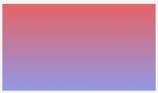

```css
.card {
    width: 300px;
    height: 170px;
    background: linear-gradient(#e66465, #9198e5);
}
```

**方向关键字**：

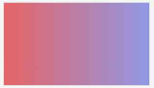

```css
/* 左 -> 右 */
.bar-h {
    background: linear-gradient(to right, #e66465, #9198e5);
}
```

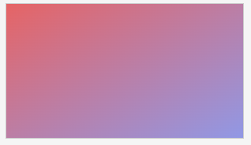

```css
/* 左上 -> 右下，等价于 135deg */
.bar-diag {
    background: linear-gradient(to bottom right, #e66465, #9198e5);
}
```

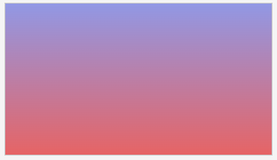

```css
/* 下 -> 上，等价于 0deg */
.bar-up {
    background: linear-gradient(to top, #e66465, #9198e5);
}
```

**自定义角度（四种单位等价写法）**：

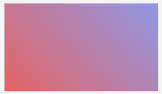

```css
.a45-deg   { background: linear-gradient(45deg,      #e66465, #9198e5); }
```

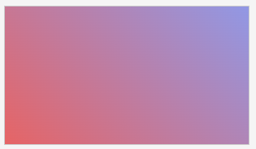

```css
.a45-rad   { background: linear-gradient(0.7854rad,  #e66465, #9198e5); }
```

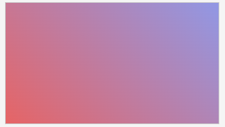

```css
.a45-turn  { background: linear-gradient(0.125turn,  #e66465, #9198e5); }
```

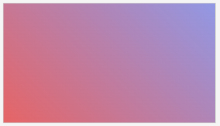

```css
.a45-grad  { background: linear-gradient(50grad,     #e66465, #9198e5); }
```

> 负角与超360° 角同样合法：linear-gradient(-45deg, ...) 与linear-gradient(315deg, ...) 等价；linear-gradient(405deg, ...) 与linear-gradient(45deg, ...) 等价。

**多色标 + 百分比位置**：

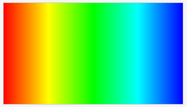

```css
.rainbow {
    width: 300px;
    height: 170px;
    background: linear-gradient(to right,
        #ff0000 0%,
        #ffff00 25%,
        #00ff00 50%,
        #00ffff 75%,
        #0000ff 100%);
}
```

**部分省略位置（自动等分）**：

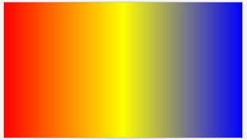

```css
/* 等价于 red 0%, yellow 50%, blue 100% */
.soft {
    background: linear-gradient(to right, red, yellow, blue);
}
```

**硬过渡（同一位置两个色标）**：

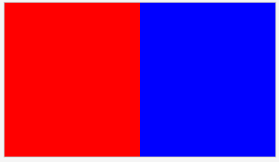

```css
/* 50% 处红蓝突变，无渐变过渡 */
.hard {
    background: linear-gradient(to right,
        #ff0000 0%,
        #ff0000 50%,
        #0000ff 50%,
        #0000ff 100%);
}
```

**越界色标（只显示盒子内的那一段）**：

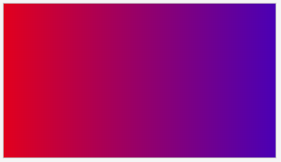

```css
/* 色标位于 -20% 与 150%，盒子内呈现的是该渐变带中间那一段 */
.out-of-range {
    background: linear-gradient(to right, #ff0000 -20%, #0000ff 150%);
}
```

**带透明度的渐变（蒙层）**：

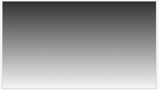

```css
.mask {
    background: linear-gradient(to bottom, rgba(0, 0, 0, 0.8), rgba(0, 0, 0, 0));
}

.mask-hex {
    background: linear-gradient(to bottom, #000000cc, #00000000);
}
```

**清除渐变**：

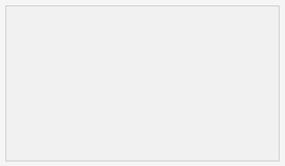

```css
.plain {
    background: none;  /* 清除上一状态残留的渐变 */
    background-color: #f1f1f1;
}
```

#### 边界与容错示例


| 声明                                         | 结果                     | 原因                                      |
| -------------------------------------------- | ------------------------ | ----------------------------------------- |
| LINEAR-GRADIENT(45deg, red, blue)            | 正常解析                 | 函数名大小写不敏感                        |
| linear-gradient(to    right, red, blue)      | 正常解析（等同to right） | 连续空白折叠为单个分隔符                  |
| linear-  gradient(45deg, red, blue)          | **整条声明无效**         | 函数名被空白割裂，非法的function token    |
| linear-gradient(to nowhere, red, blue)       | **渐变禁用**             | 首参数既非方向/角度，也非合法色标         |
| linear-gradient(abcdef, red, blue)           | **渐变禁用**             | 同上，方向位上是无意义记号                |
| linear-gradient(abcdeg, red, blue)           | **整条声明无效**         | 形似  但数值非法，W3C要求整条失效         |
| linear-gradient(45deg, red, notacolor, blue) | 跳过notacolor            | 单个色标非法被跳过，其余色标保留          |
| linear-gradient(45deg, red)                  | 解析失败                 | 至少需要2个合法色标                       |
| linear-gradient(45deg, red, blue             | 解析失败                 | 右括号缺失                                |
| 18个色标                                     | 截断为16个               | LINEAR_GRADIENT_MAX_COLORS = 16           |
| linear-gradient(rgba(255, 0, 0, 0.5), blue)  | 正常解析                 | 参数切分感知括号深度，rgba() 内逗号不拆分 |

> 渐变解析失败时，视图保持原有背景（不回退、不闪色）；绘制阶段若渲染参数构造失败，会退化为填充首色标颜色，避免背景出现空洞。

## Native渐变

### 功能概述

本模块面向Native开发，提供**渐变声明的编程式构造与渲染**能力：开发者可直接组装GradientInfo载荷并挂到任意UIView，绕过CSS解析链路，适用于动态配色、代码生成的色带、主题切换等场景。


| 维度     | Native渐变（本模块）                                    |
| -------- | ------------------------------------------------------- |
| 作用对象 | 任意UIView及其子类（如UIButton）背景绘制接入            |
| 典型场景 | 运行时动态配色、数据驱动色带、无CSS的纯Native界面       |
| 核心类   | GradientInfo、LinearGradientBuilder、UIView、DrawCanvas |

> 跨仓数据契约由graphic_utils_lite的gfx_utils/gradient_info.h定义，ace_engine_lite（解析侧）与ui_lite（绘制侧）共用，两侧通过GradientInfo::DeepCopy() 边界传递所有权。

### 功能接口

#### 数据契约GradientInfo

**字段**：


| 字段       | 类型                 | 说明                                             |
| ---------- | -------------------- | ------------------------------------------------ |
| type       | GradientType         | 渐变族，当前仅LINEAR实现，RADIAL / SWEEP为预留值 |
| direction  | CssGradientDirection | 8个方向关键字 /CUSTOM_ANGLE / NONE               |
| angle      | float                | 自定义角度（度），仅CUSTOM_ANGLE时有效           |
| colorStops | GradientColorStop*   | 堆上分配的色标数组，由析构函数释放               |
| colorCount | uint8_t              | 色标数量，上限LINEAR_GRADIENT_MAX_COLORS（16）   |
| isValid    | bool                 | 载荷是否可绘制                                   |

**方法**：


| 接口                             | 参数                              | 返回值        | 说明                                                                    |
| -------------------------------- | --------------------------------- | ------------- | ----------------------------------------------------------------------- |
| SetColorStops(stopsArray, count) | stopsArray：色标数组；count：数量 | 无            | 深拷贝色标；少于2个被拒绝，超过16个被截断；保留原有direction/angle      |
| Clear()                          | 无                                | 无            | 释放色标数组并复位为无效态                                              |
| DeepCopy()                       | 无                                | GradientInfo* | 克隆一份独立载荷，调用方拥有所有权；源无效或分配失败返回nullptr         |
| ResolveCssAngle()                | 无                                | float         | 返回生效角度（CUSTOM_ANGLE折算到 [0,360)，关键字查表），NaN降级为默认角 |
| GetBeginColor() / GetEndColor()  | 无                                | ColorType     | 首/末色标颜色，与GradientColor::colorBegin/colorEnd兼容                 |
| GetDirectionValue()              | 无                                | uint8_t       | 与GradientColor::direction兼容；CUSTOM_ANGLE降级为TO_BOTTOM             |

**常量**：


| 常量                          | 值        | 说明                                                        |
| ----------------------------- | --------- | ----------------------------------------------------------- |
| GRADIENT_MIN_COLOR_STOP_COUNT | 2         | 最少色标数                                                  |
| LINEAR_GRADIENT_MAX_COLORS    | 16        | 最大色标数（超出截断）                                      |
| GRADIENT_OFFSET_MIN / _MAX    | 0.0 / 1.0 | 绘制线段范围                                                |
| GRADIENT_OFFSET_UNSPECIFIED   | -1.0      | 「CSS未指定位置」哨兵，用IsGradientOffsetUnspecified() 判定 |
| GRADIENT_OFFSET_EXTENT_LIMIT  | 100.0     | 越界位置的最大量级（±10000%）                              |

##### GradientInfo所有权与拷贝约定

GradientInfo最终被UIView的Style独占持有，Style::SetGradientInfo(GradientInfo*) 是唯一合法的挂接入口。调用方需要遵守以下约定：

- **所有权转移**：调用view-&gt;SetGradientInfo(info) 后，info的所有权即转移给视图，调用方**不得再访问、修改或释放**该指针；视图析构或再次设置渐变时会自动释放旧载荷。
- **禁止共享**：同一个GradientInfo* 不能同时挂到多个UIView / Style上，否则多个所有者会各自delete同一块内存，导致double free。如需多视图共用同一份渐变，应对每个视图调用info-&gt;DeepCopy() 后分别挂接。
- **拷贝不携带渐变**：Style的拷贝构造和拷贝赋值**不会**复制源对象的GradientInfo（目标对象保持自己的payload，或为空）。因此复制一个带渐变的视图后，新视图不会自动继承原视图的渐变；需要显式为其重新SetGradientInfo(info-&gt;DeepCopy())。

#### 解析接口CssGradientParser

头文件：frameworks/src/core/stylemgr/app_gradient_parser.h（命名空间OHOS::ACELite::CssGradientParser）


| 接口                                                   | 参数                                                    | 返回值          | 说明                                                                                                           |
| ------------------------------------------------------ | ------------------------------------------------------- | --------------- | -------------------------------------------------------------------------------------------------------------- |
| ParseLinearGradient(value, outInfo)                    | value：完整linear-gradient(...) 声明；outInfo：输出载荷 | bool            | 主入口。产出至少2个归一化色标时返回true；单个色标非法跳过并告警，剩余不足2个或首参数非法时失败                 |
| IsBrokenGradientFunctionToken(value)                   | value：原始声明值                                       | bool            | 词法阶段检测被空白割裂的函数名（如linear-  gradient(），命中则整条声明失效                                     |
| ExtractLinearGradient(declaration, outGradient)        | declaration：完整声明；outGradient：输出函数片段        | bool            | 括号感知地抽取首个完整linear-gradient(...)，用于border-image: linear-gradient(...) 30 / 10px这类带前后缀的声明 |
| ParseDirectionOrAngle(param, info)                     | param：首个参数；info：输出方向/角度                    | bool            | 解析方向关键字或角度；返回false表示应按色标处理                                                                |
| DirectionToCssAngle(dir)                               | dir：方向枚举                                           | float           | 方向关键字 → CSS角度（统一实现转发）                                                                          |
| NormalizeDirectionKeywordToAngle(cssValue, normalized) | cssValue：原声明；normalized：改写结果                  | bool            | 把首部方向关键字改写为角度，to right → 90deg；无关键字可改写时返回false                                       |
| ParseColorStop(stopStr, out)                           | stopStr：单个色标；out：输出色标                        | bool            | 解析red、#ff0000 50% 形式的色标；未写位置时offset置为哨兵                                                      |
| NormalizeColorStops(stops)                             | stops：GradientStopList（原地修改，定长最多16个）       | 无              | 推断省略位置并强制单调不减                                                                                     |
| ClipColorStopsToGradientLine(stops)                    | stops：GradientStopList（原地修改，定长最多16个）       | 无              | 把越界色标带投影回 [0,1] 可见段（W3C 3.4.1），区间内的带原样保留                                               |
| SplitGradientArgs(inner)                               | inner：外层括号内的文本                                 | GradientArgList | 按顶层逗号切分，rgba() 内逗号保留；定长最多32个参数                                                            |
| ParseColorToColorType(colorStr, out)                   | colorStr：颜色字面量；out：输出ColorType                | bool            | 支持命名色 /#RGB / #RRGGBB / #RRGGBBAA / rgb() / rgba()                                                        |
| Trim(str) / ToLower(str) / CollapseWhitespace(str)     | str：输入字符串                                         | std::string     | 去首尾空白 / ASCII小写化 / 折叠连续空白                                                                        |

#### 渲染接口


| 接口                                                                                 | 参数                                                     | 返回值               | 说明                                                                                           |
| ------------------------------------------------------------------------------------ | -------------------------------------------------------- | -------------------- | ---------------------------------------------------------------------------------------------- |
| UIView::SetGradientInfo(GradientInfo*)                                               | info：渐变载荷，视图接管所有权，可为nullptr              | 无                   | 挂接/清除渐变。载荷无效（isValid=false或色标&lt; 2）时被拒绝并由视图释放；每次调用都会触发重绘 |
| LinearGradientBuilder::Build(info, width, height)                                    | info：渐变载荷；width/height：绘制区像素尺寸（须&gt; 0） | GradientRenderParams | 纯逻辑构造渲染参数（角度解析 + 端点计算 + Paint配置 + 矩形路径），可无帧缓冲单测               |
| LinearGradientBuilder::CalcEndpoints(cssAngleDeg, w, h, startPt, endPt)              | cssAngleDeg：已归一化的CSS角度；startPt/endPt：输出端点  | bool                 | 计算渐变线端点：过区域中心，长度为矩形在渐变方向上的投影跨度                                   |
| LinearGradientBuilder::ConvertToLegacy(info, outColor)                               | info：渐变载荷；outColor：输出GradientColor联合体        | bool                 | 降级为旧的两色GradientColor；多色标或自定义角度无法表达时返回false                             |
| DrawCanvas::RenderGradientFill(gfxDstBuffer, vertices, paint, rect, invalidatedArea) | 帧缓冲、顶点路径、Paint、目标矩形、无效区（绝对坐标）    | 无                   | 光栅化渐变填充，由UIView::DrawLinearGradient() 调用                                            |

> GradientRenderParams含三个字段：paint（已配置渐变样式与色标）、vertices（局部坐标下已闭合的矩形路径）、valid（构造是否成功）。valid=false时其余字段处于未定义状态。

### 功能示例

#### Native接口示例

**在视图上挂接渐变**：

```cpp
#include "components/ui_view.h"
#include "gfx_utils/gradient_info.h"

void ApplyGradient(UIView* view)
{
    if (view == nullptr) {
        return;
    }

    GradientInfo* info = new GradientInfo();
    info->type = GradientType::LINEAR;
    info->direction = CssGradientDirection::CUSTOM_ANGLE;
    info->angle = 45.0f;  /* 0 度朝上，顺时针增长 */

    GradientColorStop stops[3];
    stops[0] = GradientColorStop(0xe6, 0x64, 0x65, 0xFF, 0.0f);  /* #e66465 0% */
    stops[1] = GradientColorStop(0xff, 0xff, 0x00, 0xFF, 0.5f);  /* #ffff00 50% */
    stops[2] = GradientColorStop(0x91, 0x98, 0xe5, 0xFF, 1.0f);  /* #9198e5 100% */
    info->SetColorStops(stops, 3);

    if (!info->isValid) {
        delete info;
        return;
    }

    /* 视图接管 info 的所有权，之后不要再访问/释放它 */
    view->SetGradientInfo(info);
}
```

**使用方向关键字（等价于CSS to bottom right）**：

```cpp
void ApplyDiagonalGradient(UIView* view)
{
    GradientInfo* info = new GradientInfo();
    info->direction = CssGradientDirection::TO_BOTTOM_RIGHT;  /* 135deg，关键字方向下无需设置 angle */

    GradientColorStop stops[2];
    stops[0] = GradientColorStop(0xe6, 0x64, 0x65, 0xFF, 0.0f);
    stops[1] = GradientColorStop(0x91, 0x98, 0xe5, 0xFF, 1.0f);
    info->SetColorStops(stops, 2);

    view->SetGradientInfo(info);
}
```

**清除渐变**：

```cpp
void ClearGradient(UIView* view)
{
    view->SetGradientInfo(nullptr);  /* 视图释放旧载荷并回落到纯色背景路径 */
}
```

> **注意：**
> UIView不对外暴露GetGradientInfo() 接口。业务侧如需在设置后读取渐变信息，应在调用SetGradientInfo() 之前自行保留一份副本或字段。

**直接构造渲染参数（无帧缓冲，便于自测）**：

```cpp
#include "components/linear_gradient_builder.h"

void BuildParams(const GradientInfo* info)
{
    GradientRenderParams params = LinearGradientBuilder::Build(info, 300, 170);
    if (!params.valid) {
        return;  /* 载荷非法或绘制区为空 */
    }
    /* params.paint / params.vertices 可直接交给 DrawCanvas::RenderGradientFill */
}
```

**从CSS声明解析（解析侧）**：

```cpp
#include "stylemgr/app_gradient_parser.h"

using OHOS::ACELite::CssGradientParser::ParseLinearGradient;

void ParseFromCss(const std::string& cssValue, UIView* view)
{
    GradientInfo* info = new (std::nothrow) GradientInfo();
    if (info == nullptr) {
        return;
    }
    /* cssValue 需以 linear-gradient( 开头（大小写不敏感） */
    if (!ParseLinearGradient(cssValue, info)) {
        delete info;
        return;
    }
    view->SetGradientInfo(info);
}
```

**抽取带前后缀声明中的渐变片段**：

```cpp
using OHOS::ACELite::CssGradientParser::ExtractLinearGradient;

/* 从任意声明串中抽取出完整的 linear-gradient(...) 片段 */
std::string gradient;
if (ExtractLinearGradient(declaration, gradient)) {
    /* gradient == "linear-gradient(red, blue)"，可再交给 ParseLinearGradient */
}
```
