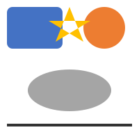
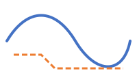
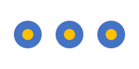
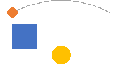
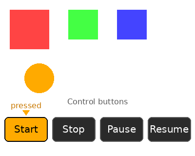
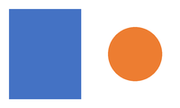

# 轻图形-SVG开发指导

## 功能概述

本模块面向应用开发，提供在声明式页面中嵌入 **SVG矢量图形** 的能力：开发者可以使用SVG标签（&lt;svg&gt;、&lt;rect&gt;、&lt;circle&gt;、&lt;path&gt;等）绘制图标、插画、图表和简单动画，并支持渐变、描边、变换和SMIL动画。

| 维度     | SVG（本模块）                                  |
| -------- | ---------------------------------------------- |
| 作用对象 | 页面内的矢量图形元素                           |
| 典型场景 | 应用图标、状态指示、按钮图标、简单插画、微动效 |
| 核心能力 | 基础图形、路径、文本、图像、渐变、变换、动画   |

当前支持以下 **7类能力**：

1. 文档与视口（&lt;svg&gt;、viewBox、宽高）
2. 基础图形（&lt;rect&gt;、&lt;circle&gt;、&lt;ellipse&gt;、&lt;line&gt;、&lt;polyline&gt;、&lt;polygon&gt;）
3. 通用路径（&lt;path&gt;，支持M/L/H/V/C/S/Q/T/A/Z）
4. 文本与图像（&lt;text&gt;、&lt;tspan&gt;、&lt;image&gt;）
5. 复用与引用（&lt;g&gt;、&lt;defs&gt;、&lt;use&gt;）
6. 填充与描边（纯色、线性/径向渐变、描边样式、不透明度、变换）
7. 动画（&lt;animate&gt;、&lt;animateColor&gt;、&lt;animateTransform&gt;、&lt;animateMotion&gt;、&lt;set&gt;）

## 功能接口

### HML标签

| 标签           | 说明                                            | 备注                 |
| -------------- | ----------------------------------------------- | -------------------- |
| &lt;svg&gt;        | SVG文档根节点，声明视口和坐标系                | 必须作为SVG容器根  |
| &lt;g&gt;          | 分组容器，用于组合元素并统一设置样式/变换       | 可嵌套               |
| &lt;defs&gt;       | 可复用资源定义区，本身不渲染                    | 配合&lt;use&gt;/渐变使用 |
| &lt;rect&gt;       | 矩形，支持圆角                                  | rx、ry圆角      |
| &lt;circle&gt;     | 圆                                              | cx、cy、r      |
| &lt;ellipse&gt;    | 椭圆                                            | cx、cy、rx、ry |
| &lt;line&gt;       | 线段                                            | x1、y1、x2、y2 |
| &lt;polyline&gt;   | 折线                                            | points             |
| &lt;polygon&gt;    | 多边形                                          | points，自动闭合   |
| &lt;path&gt;       | 通用路径                                        | d属性             |
| &lt;text&gt;       | 简单文本                                        | 支持x、y、font-size、text-anchor |
| &lt;tspan&gt;      | 文本子段                                        | 支持x、y、dx、dy |
| &lt;textArea&gt;   | 多行文本区域                                    | 支持width、height、自动换行 |
| &lt;image&gt;      | 内嵌位图                                        | href / xlink:href |
| &lt;use&gt;        | 引用&lt;defs&gt;中定义的元素                      | href / xlink:href |
| &lt;linearGradient&gt; | 线性渐变                                    | 需放在&lt;defs&gt;内   |
| &lt;radialGradient&gt; | 径向渐变                                    | 需放在&lt;defs&gt;内   |
| &lt;solidColor&gt;  | 纯色 paint server                              | 需放在&lt;defs&gt;内   |
| &lt;stop&gt;       | 渐变色标                                        | offset、stop-color、stop-opacity |
| &lt;animate&gt; / &lt;animateColor&gt; / &lt;animateTransform&gt; / &lt;animateMotion&gt; / &lt;set&gt; | SMIL动画 | 作用于父元素或xlink:href目标 |
| &lt;mpath&gt;       | 引用外部路径作为动画运动路径                    | &lt;animateMotion&gt;子元素 |

### 全局属性

| 属性          | 取值范围                                              | 说明                                                         |
| ------------- | ----------------------------------------------------- | ------------------------------------------------------------ |
| id          | 字符串                                                | 元素唯一标识，用于url(#id)引用和&lt;use&gt;                |
| fill        | 颜色名 / #RGB / #RRGGBB / url(#gradientId)      | 填充颜色或渐变引用                                           |
| stroke      | 颜色名 / #RGB / #RRGGBB / url(#gradientId)      | 描边颜色或渐变引用                                           |
| stroke-width| 数值（px）                                            | 描边宽度                                                     |
| stroke-linecap | butt / round / square                        | 线段端点样式                                                 |
| stroke-linejoin| miter / round / bevel                        | 线段连接样式                                                 |
| stroke-miterlimit | 数值                                             | 斜接长度上限                                                 |
| stroke-dasharray  | 逗号/空格分隔的数值序列，如5,3                  | 虚线样式                                                     |
| stroke-dashoffset | 数值（px）                                         | 虚线起始偏移                                                 |
| opacity     | 0 ~ 1                                             | 整体不透明度                                                 |
| fill-opacity| 0 ~ 1                                             | 填充不透明度                                                 |
| stroke-opacity| 0 ~ 1                                           | 描边不透明度                                                 |
| fill-rule   | nonzero / evenodd                                 | 路径填充规则，evenodd用于自相交路径                     |
| transform   | translate() / scale() / rotate() / skewX() / skewY() / matrix() | 变换列表，空格分隔，按SVG语义后乘 |
| style       | property: value; ...                                | 内联样式，等效于同名属性                                     |

### 几何属性

| 元素                 | 属性                                                      | 说明                                     |
| -------------------- | --------------------------------------------------------- | ---------------------------------------- |
| &lt;svg&gt;              | width、height、viewBox、preserveAspectRatio       | 视口、用户坐标系、对齐方式               |
| &lt;rect&gt;             | x、y、width、height、rx、ry                   | 圆角矩形，rx/ry为0时为直角      |
| &lt;circle&gt;           | cx、cy、r                                           | 圆心半径                                 |
| &lt;ellipse&gt;          | cx、cy、rx、ry                                    | 椭圆心、水平/垂直半径                    |
| &lt;line&gt;             | x1、y1、x2、y2                                    | 起点、终点                               |
| &lt;polyline&gt;/&lt;polygon&gt;| points                                                 | 坐标序列，如0,0 50,50 100,0           |
| &lt;path&gt;             | d                                                       | 路径数据命令串                           |
| &lt;text&gt;/&lt;tspan&gt;     | x、y、dx、dy、font-size、text-anchor          | 文本位置与大小                           |
| &lt;image&gt;/&lt;use&gt;      | x、y、width、height、href / xlink:href        | 位置、尺寸、引用目标                     |

### 渐变属性

| 属性                  | 取值范围                                              | 说明                                      |
| --------------------- | ----------------------------------------------------- | ----------------------------------------- |
| &lt;linearGradient&gt;    | x1、y1、x2、y2                                | 渐变起点/终点，默认0% ~ 100%         |
| &lt;radialGradient&gt;    | cx、cy、r、fx、fy                           | 圆心、半径、焦点                          |
| gradientUnits       | userSpaceOnUse / objectBoundingBox                | 渐变坐标系                                |
| gradientTransform   | 变换列表                                              | 渐变自身变换                              |
| spreadMethod        | pad / reflect / repeat                          | 超出渐变范围后的填充方式                  |
| &lt;stop&gt;              | offset、stop-color、stop-opacity                | 色标位置、颜色、不透明度                  |

### 动画属性

| 属性            | 取值范围                                              | 说明                                                         |
| --------------- | ----------------------------------------------------- | ------------------------------------------------------------ |
| attributeName | 属性名                                                | 要动画的目标属性，如x、fill、transform               |
| from / to / by | 属性目标值                                       | 起始/结束/相对偏移                                           |
| values        | 分号分隔的数值序列                                    | 关键帧序列                                                   |
| keyTimes      | 0 ~ 1的分号分隔序列                              | 与values对应的时间点                                     |
| keySplines    | 0 ~ 1的分号分隔控制点序列                        | 与keyTimes对应的贝塞尔缓动                               |
| calcMode      | discrete / linear / paced / spline            | 插值模式                                                     |
| begin / end | 时钟值，如0s、1s、indefinite                   | 开始/结束时间                                                |
| dur           | 时钟值，如2s、indefinite                         | 单次动画时长                                                 |
| repeatCount   | 整数 / indefinite                                   | 重复次数                                                     |
| fill          | freeze / remove                                   | 动画结束后是否保持终态                                       |
| xlink:href / href | #targetId                                     | 动画目标元素（默认作用于父元素）                             |
| type（&lt;animateTransform&gt;）| translate / scale / rotate / skewX / skewY | 变换类型                      |
| path / rotate（&lt;animateMotion&gt;）| 路径字符串 / auto / auto-reverse / 角度 | 运动路径与朝向        |

### JS控制接口

&lt;svg&gt;组件实例提供以下JS方法，用于控制文档级动画生命周期：

| 接口                  | 参数 | 返回值 | 说明                               |
| --------------------- | ---- | ------ | ---------------------------------- |
| startAnimation()    | 无   | 无     | 启动/重启所有SMIL动画            |
| stopAnimation()     | 无   | 无     | 停止并销毁所有动画条目             |
| pauseAnimations()   | 无   | 无     | 暂停当前动画，保留状态             |
| unpauseAnimations() | 无   | 无     | 恢复被暂停的动画                   |

> 动画默认在页面构建完成后自动启动，如需手动控制，可通过ref获取&lt;svg&gt;实例后调用。

### Native接口

Native侧通过SvgEngine类以**编程方式**构建SVG文档树，不依赖HML解析。头文件位于foundation/arkui/ui_lite/interfaces/kits/svg/svg_engine.h，使用时包含：

```cpp
#include "svg_engine.h"
```

SvgEngine全部为静态方法，是SVG文档创建的**唯一公开入口**：

| 接口 | 参数 | 返回值 | 说明 |
| --- | --- | --- | --- |
| CreateDocument() | 无 | SvgDocumentHandle | 创建SVG文档，失败返回nullptr |
| DestroyDocument(doc) | doc：文档句柄 | 无 | 摘除根视图、递归释放整棵树并销毁文档 |
| CreateElement(doc, type) | doc：文档句柄<br>type：SvgElementType | SvgElementHandle | 按类型创建元素（如SVG_ROOT、SVG_RECT、SVG_ANIMATE） |
| SetAttribute(elem, name, value) | elem：元素句柄<br>name：属性名<br>value：属性值 | 无 | 设置元素属性，取值与HML同名属性一致 |
| AppendChild(parent, child) | parent：父元素<br>child：子元素 | 无 | 建立父子关系，已挂载的子元素会被忽略（幂等） |
| SetRoot(doc, root) | doc：文档句柄<br>root：根元素 | 无 | 设置文档根元素，须在AttachToView之前调用 |
| AttachToView(doc, parentView) | doc：文档句柄<br>parentView：宿主视图 | UIView* | 将SVG根视图挂到宿主（须为UIViewGroup），返回根视图；失败返回nullptr |
| UpdateRootViewport(doc, w, h) | doc：文档句柄<br>w/h：视口宽高 | 无 | 宿主尺寸变化时同步视口并重算viewBox变换 |
| Render(doc) / Invalidate(doc) | doc：文档句柄 | 无 | 触发重绘，两者等价 |
| StartAnimation(doc) | doc：文档句柄 | 无 | 启动/重启文档内所有SMIL动画 |
| StopAnimation(doc) | doc：文档句柄 | 无 | 停止并销毁所有动画条目 |
| PauseAnimations(doc) | doc：文档句柄 | 无 | 暂停动画，保留当前状态 |
| UnpauseAnimations(doc) | doc：文档句柄 | 无 | 从暂停点恢复 |

**句柄与所有权**

- SvgDocumentHandle与SvgElementHandle均为void*不透明句柄，不应解引用或自行delete。
- 文档拥有根元素及整棵树：DestroyDocument()会先摘除根视图、再递归释放所有元素，最后销毁文档。
- id资源表只保存指针，元素本身由树结构持有，因此清空该表不会重复释放。

> SvgElementType枚举覆盖SVG标签全集（图形、容器、渐变、文本、动画等），取值见头文件svg_engine.h。

## 功能示例

### 基础图形

```hml
<svg width="200" height="200" viewBox="0 0 200 200">
    <rect x="10" y="10" width="80" height="60" rx="8" fill="#4472C4" />
    <circle cx="150" cy="40" r="30" fill="#ED7D31" />
    <ellipse cx="100" cy="130" rx="60" ry="30" fill="#A5A5A5" />
    <line x1="10" y1="180" x2="190" y2="180" stroke="#333" stroke-width="4" />
    <polygon points="100,10 120,60 70,30 130,30 80,60" fill="#FFC000" fill-rule="evenodd" />
</svg>
```



### 路径与描边

```hml
<svg width="200" height="120" viewBox="0 0 200 120">
    <path d="M 10 60 C 40 10, 80 10, 110 60 S 180 110, 190 60"
          fill="none" stroke="#4472C4" stroke-width="4" stroke-linecap="round" />
    <path d="M 20 80 L 60 80 L 80 100 L 180 100"
          fill="none" stroke="#ED7D31" stroke-width="3" stroke-dasharray="8,4" />
</svg>
```



### 渐变填充

```hml
<svg width="200" height="120" viewBox="0 0 200 120">
    <defs>
        <linearGradient id="gradLinear" x1="0%" y1="0%" x2="100%" y2="0%">
            <stop offset="0%" stop-color="#4472C4" />
            <stop offset="100%" stop-color="#ED7D31" />
        </linearGradient>
        <radialGradient id="gradRadial" cx="50%" cy="50%" r="50%" fx="30%" fy="30%">
            <stop offset="0%" stop-color="#FFC000" stop-opacity="0.9" />
            <stop offset="100%" stop-color="#ED7D31" stop-opacity="0.3" />
        </radialGradient>
    </defs>
    <rect x="10" y="10" width="80" height="100" fill="url(#gradLinear)" />
    <circle cx="150" cy="60" r="50" fill="url(#gradRadial)" />
</svg>
```


### 变换与分组

```hml
<svg width="200" height="120" viewBox="0 0 200 120">
    <g transform="translate(100, 60) rotate(45) scale(0.8)">
        <rect x="-30" y="-30" width="60" height="60" fill="#4472C4" opacity="0.8" />
        <rect x="-15" y="-15" width="30" height="30" fill="#FFC000" />
    </g>
</svg>
```


### 文本

```hml
<svg width="200" height="80" viewBox="0 0 200 80">
    <text x="100" y="40" font-size="24" text-anchor="middle" fill="#333">Hello SVG</text>
    <text x="100" y="65" font-size="14" fill="#666">
        <tspan dx="-30" fill="#ED7D31">ACE</tspan>
        <tspan dx="6">Lite</tspan>
    </text>
</svg>
```


> **说明**
>
> 1. &lt;text&gt;的y是**基线**位置，字形会自y向上排列，顶部约在y - font-size处。请为y留出足够空间，否则文字顶部会被&lt;svg&gt;视口裁切。
> 2. text-anchor只对&lt;text&gt;自身的直接文本生效（如上方Hello SVG居中）。当文本由&lt;tspan&gt;组成时，整串不会按text-anchor重新居中，此时请使用x / dx显式定位（如上方的ACE Lite）。
> 3. 建议将&lt;tspan&gt;与&lt;text&gt;写在同一行、中间不留空白，避免空白字符参与排版宽度计算。

### &lt;defs&gt;与&lt;use&gt;复用

```hml
<svg width="200" height="100" viewBox="0 0 200 100">
    <defs>
        <g id="icon">
            <circle cx="0" cy="0" r="20" fill="#4472C4" />
            <circle cx="0" cy="0" r="8" fill="#FFC000" />
        </g>
    </defs>
    <use href="#icon" x="40" y="50" />
    <use href="#icon" x="100" y="50" />
    <use href="#icon" x="160" y="50" />
</svg>
```



### SMIL动画

```hml
<svg width="200" height="120" viewBox="0 0 200 120">
    <rect x="20" y="40" width="40" height="40" fill="#4472C4">
        <animate attributeName="x" from="20" to="140" dur="2s" repeatCount="indefinite" />
        <animateColor attributeName="fill" from="#4472C4" to="#ED7D31" dur="2s" repeatCount="indefinite" />
    </rect>

    <circle cx="100" cy="90" r="15" fill="#FFC000">
        <animateTransform attributeName="transform" type="scale" from="1" to="1.5" dur="1s" repeatCount="indefinite" />
    </circle>

    <path id="motionPath" d="M 20 20 Q 100 -20 180 20" fill="none" stroke="#A5A5A5" />
    <circle r="8" fill="#ED7D31">
        <animateMotion dur="3s" repeatCount="indefinite" rotate="auto">
            <mpath href="#motionPath" />
        </animateMotion>
    </circle>
</svg>
```



### 通过JS控制动画

&lt;svg&gt;组件实例提供startAnimation()、stopAnimation()、pauseAnimations()、unpauseAnimations()四个方法，可手动控制文档内所有SMIL动画的生命周期。下面以Start / Stop / Pause / Resume四个按钮为例，演示如何通过ref获取&lt;svg&gt;实例并调用这四个接口。

> **说明**
> - 动画默认在页面构建完成后自动播放；ref声明的名称（本例svgRef）须与JS中this.$refs.svgRef一致。
> - stopAnimation()会销毁动画条目，停止后需再次调用startAnimation()才能重新播放；pauseAnimations() / unpauseAnimations()仅冻结 / 恢复，保留当前帧。

**HML**

```hml
<div class="container">
  <list class="content">
    <list-item class="svg-item">
      <svg ref="svgRef" width="400" height="240" viewBox="0 0 200 120">
        <rect x="10" y="10" width="40" height="40" fill="#FF4444">
          <animate attributeName="opacity" from="1" to="0" dur="2s" repeatCount="indefinite" />
        </rect>
        <rect x="70" y="10" width="30" height="30" fill="#44FF44">
          <animateTransform attributeName="transform" type="rotate" from="0" to="360" dur="3s" repeatCount="indefinite" />
        </rect>
        <rect x="120" y="10" width="30" height="30" fill="#4444FF">
          <animateTransform attributeName="transform" type="scale" from="1" to="0.3" dur="2s" repeatCount="indefinite" />
        </rect>
        <circle cx="40" cy="80" r="15" fill="#FFAA00">
          <animateTransform attributeName="transform" type="translate" from="0 0" to="120 0" dur="2s" repeatCount="indefinite" />
        </circle>
      </svg>
    </list-item>
    <list-item class="btn-item">
      <input class="play-btn" type="button" value="Start" onclick="startPlay" />
      <input class="play-btn" type="button" value="Stop" onclick="stopPlay" />
      <input class="play-btn" type="button" value="Pause" onclick="pausePlay" />
      <input class="play-btn" type="button" value="Resume" onclick="resumePlay" />
    </list-item>
  </list>
</div>
```

**CSS**（控制按钮所在行的布局与按钮样式）

```css
.content {
  flex-direction: column;
  width: 100%;
  height: 424px;
  padding: 12px;
}
.svg-item {
  width: 100%;
  height: 260px;
  justify-content: center;
  align-items: center;
}
.btn-item {
  width: 100%;
  height: 80px;
  justify-content: center;
  align-items: center;
}
.play-btn {
  width: 120px;
  height: 56px;
  margin-left: 20px;
  margin-right: 20px;
  font-size: 24px;
  color: #ffffff;
  background-color: #2a2a2a;
  border-radius: 10px;
}
```

**JS**

```javascript
export default {
  startPlay() {
    if (this.$refs.svgRef) {
      this.$refs.svgRef.startAnimation();
    }
  },
  stopPlay() {
    if (this.$refs.svgRef) {
      this.$refs.svgRef.stopAnimation();
    }
  },
  pausePlay() {
    if (this.$refs.svgRef) {
      this.$refs.svgRef.pauseAnimations();
    }
  },
  resumePlay() {
    if (this.$refs.svgRef) {
      this.$refs.svgRef.unpauseAnimations();
    }
  }
}
```



### Native接口示例

Native侧通过SvgEngine构建SVG文档树并挂到UIViewGroup宿主上，配合SvgElementType枚举逐层创建元素。以下三段示例（CreateSvgDemo / StartSvgAnimation / DestroySvgDemo）可直接使用，宿主视图由调用方的父视图托管。

示例最终呈现的效果为一个蓝色矩形与一个橙色圆，圆的半径按values="30;50;30"在2秒内线性脉动并无限循环：



**构建静态图形**：

```cpp
#include "svg_engine.h"
#include "components/ui_view_group.h"

namespace {
UIViewGroup* g_svgHost = nullptr;   // Host view that carries the SVG content (must be a UIViewGroup)
SvgDocumentHandle g_doc = nullptr;
SvgElementHandle g_root = nullptr;
SvgElementHandle g_circle = nullptr;
}

// Create a w x h SVG canvas at (x, y) inside the parent view and draw static shapes
void CreateSvgDemo(UIViewGroup* parent, int16_t x, int16_t y, int16_t w, int16_t h)
{
    // 1. Create the document and the root element
    g_doc = SvgEngine::CreateDocument();
    if (g_doc == nullptr) {
        return;
    }
    g_root = SvgEngine::CreateElement(g_doc, SVG_ROOT);
    if (g_root == nullptr) {
        SvgEngine::DestroyDocument(g_doc);
        g_doc = nullptr;
        return;
    }

    // 2. Set the viewport and the user coordinate system
    SvgEngine::SetAttribute(g_root, "width", "200");
    SvgEngine::SetAttribute(g_root, "height", "120");
    SvgEngine::SetAttribute(g_root, "viewBox", "0 0 200 120");

    // 3. Create the shapes and append them to the root
    SvgElementHandle rect = SvgEngine::CreateElement(g_doc, SVG_RECT);
    SvgEngine::SetAttribute(rect, "x", "10");
    SvgEngine::SetAttribute(rect, "y", "10");
    SvgEngine::SetAttribute(rect, "width", "80");
    SvgEngine::SetAttribute(rect, "height", "100");
    SvgEngine::SetAttribute(rect, "fill", "#4472C4");
    SvgEngine::AppendChild(g_root, rect);

    g_circle = SvgEngine::CreateElement(g_doc, SVG_CIRCLE);
    SvgEngine::SetAttribute(g_circle, "cx", "150");
    SvgEngine::SetAttribute(g_circle, "cy", "60");
    SvgEngine::SetAttribute(g_circle, "r", "30");
    SvgEngine::SetAttribute(g_circle, "fill", "#ED7D31");
    SvgEngine::AppendChild(g_root, g_circle);

    // 4. Set the root, attach it to the host view and trigger the first render
    //    (SetRoot must be called before AttachToView)
    SvgEngine::SetRoot(g_doc, g_root);

    g_svgHost = new UIViewGroup();
    g_svgHost->SetPosition(x, y, w, h);
    parent->Add(g_svgHost);
    SvgEngine::AttachToView(g_doc, g_svgHost);
    SvgEngine::UpdateRootViewport(g_doc, w, h);
    SvgEngine::Render(g_doc);
}
```

**添加SMIL动画并控制生命周期**：动画元素挂到被作用的元素上，随后由文档级接口统一启停。

```cpp
// The animation element is attached to the element it targets,
// then started and stopped through the document-level APIs
bool StartSvgAnimation()
{
    if (g_doc == nullptr || g_circle == nullptr) {
        return false;
    }
    SvgElementHandle anim = SvgEngine::CreateElement(g_doc, SVG_ANIMATE);
    SvgEngine::SetAttribute(anim, "attributeName", "r");
    SvgEngine::SetAttribute(anim, "values", "30;50;30");
    SvgEngine::SetAttribute(anim, "dur", "2s");
    SvgEngine::SetAttribute(anim, "repeatCount", "indefinite");
    SvgEngine::AppendChild(g_circle, anim);

    SvgEngine::Render(g_doc);
    SvgEngine::StartAnimation(g_doc); // Must be called after the animation element is attached
    return true;
}

// Pause / resume / stop (triggered by buttons or business events)
SvgEngine::PauseAnimations(g_doc);
SvgEngine::UnpauseAnimations(g_doc);
SvgEngine::StopAnimation(g_doc);
```

**销毁与资源释放**：

```cpp
void DestroySvgDemo()
{
    if (g_doc == nullptr) {
        return;
    }
    SvgEngine::StopAnimation(g_doc);    // Stop animations first to avoid dangling element pointers
    SvgEngine::DestroyDocument(g_doc);  // Detach the root view and release the whole tree recursively
    g_doc = nullptr;
    g_root = nullptr;
    g_circle = nullptr;
    // The host view is owned by the parent view and released with it; just clear the reference here
    g_svgHost = nullptr;
}
```

> **注意**
>
> 1. AttachToView的宿主必须是UIViewGroup（内部会做dynamic_cast），传入普通UIView会失败并返回nullptr。
> 2. SetRoot必须先于AttachToView调用，否则取不到根视图。
> 3. 宿主尺寸变化后需调用UpdateRootViewport同步视口，否则viewBox变换按旧尺寸计算。
> 4. DestroyDocument内部会先停止并销毁动画器，因此销毁前不强制调用StopAnimation；若需在中途停动画（保留文档），则单独调用StopAnimation。
> 5. 元素句柄由文档持有，**不要**自行delete；AppendChild幂等，重复挂载同一子元素会被忽略。

## 特性开关控制

当前功能使用宏开关隔离。ace_engine_lite仓库使用ace_engine_lite_enable_svg_component_config，ui_lite仓库使用ui_lite_enable_svg_component_config，graphic_utils_lite仓库使用graphic_utils_lite_enable_svg_component_config。

以hispark_taurus_linux_ex为例，在产品的config.json中开启：

```json
{
  "subsystems": [
    {
      "subsystem": "arkui",
      "components": [
        {
          "component": "ace_engine_lite",
          "features": [
            "ace_engine_lite_enable_svg_component_config = true"
          ]
        },
        {
          "component": "ui_lite",
          "features": [
            "ui_lite_enable_graphic_font_config = true",
            "ui_lite_enable_svg_component_config = true"
          ]
        }
      ]
    },
    {
      "subsystem": "graphic",
      "components": [
        {
          "component": "graphic_utils_lite",
          "features": [
            "graphic_utils_lite_enable_svg_component_config = true"
          ]
        }
      ]
    }
  ]
}
```

> 关闭开关后，&lt;svg&gt;及其子元素将不被识别，页面中对应节点不会渲染。

## 使用约束与注意事项

1. **根节点**：所有SVG元素必须包含在一个&lt;svg&gt;根节点内；SVG根节点不支持嵌套。
2. **坐标单位**：本阶段主要支持像素（px）数值；部分属性支持百分比，如x1="0%"。
3. **文本字体**：&lt;text&gt;使用系统默认字体，font-family、font-style、font-weight等暂不支持。
4. **文本基线**：&lt;text&gt;的y表示**基线**而非文字顶部，字形自y向上排列。设置y时须预留不小于font-size的上方空间，否则文字顶部会被视口裁切。
5. **文本锚点与&lt;tspan&gt;**：text-anchor只作用于&lt;text&gt;自身的直接文本；由&lt;tspan&gt;组成的文本串不会整体按text-anchor对齐，需通过x（绝对定位）或dx（相对偏移）自行排布。
6. **引用路径**：fill="url(#id)"、href="#id"、xlink:href="#id"中的#均可识别；若引用不存在，按默认值处理。
7. **动画**：动画默认自动播放；调用stopAnimation()后需再次调用startAnimation()才能播放。
8. **性能建议**：复杂路径和大量渐变会提高渲染开销，建议对静态图标做适量简化。

9. **不支持/预留元素**：以下SVG元素当前仅保留枚举占位，ACE层不会将其路由到SVG引擎，也不保证渲染或行为：

   &lt;a&gt;、&lt;switch&gt;、&lt;symbol&gt;、&lt;iframe&gt;、&lt;tbreak&gt;、&lt;tref&gt;、&lt;desc&gt;、&lt;title&gt;、&lt;metadata&gt;、&lt;script&gt;、&lt;style&gt;、&lt;font&gt;、&lt;font-face&gt;、&lt;font-face-src&gt;、&lt;font-face-uri&gt;、&lt;glyph&gt;、&lt;hkern&gt;、&lt;missing-glyph&gt;、&lt;handler&gt;、&lt;listener&gt;、&lt;prefetch&gt;、&lt;discard&gt;、&lt;audio&gt;、&lt;animation&gt;、&lt;foreignObject&gt;、&lt;object&gt;、&lt;applet&gt;、&lt;video&gt;。
