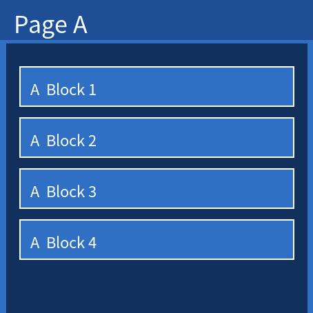
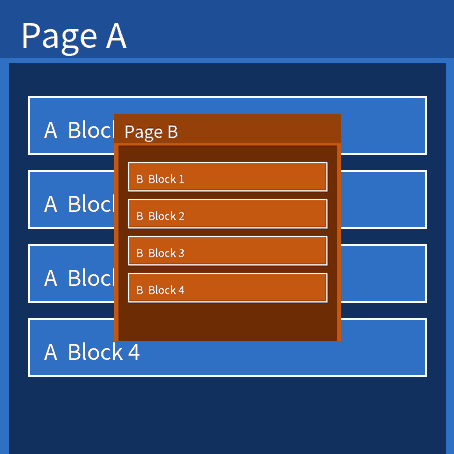

# 轻量系统路由页面转场动效开发指导

> **注意：**
>
> 页面转场动效受编译宏 `ENABLE_PAGE_TRANSITION_EFFECT` 控制，由产品配置项 `ace_engine_lite_feature_page_transition_effect` 开启，默认关闭。未开启时，`router.replace` / `router.replaceUrl` 保持原有的直接切换行为；传入 `animation` 参数不会报错，但不会有任何动效。使用前请确认目标产物已开启该特性。

## 功能概述

本模块面向应用开发，提供页面切换转场动效能力：开发者在调用路由替换接口时额外传入 `animation` 参数，即可让新旧页面以淡入淡出、缩放或平移的方式过渡，取代原有的“旧页消失、新页直接出现”的硬切换。

| 维度     | 页面转场动效（本模块）                                     |
| -------- | ---------------------------------------------------------- |
| 作用对象 | 整页（页面根视图）                                          |
| 触发接口 | `router.replace` / `router.replaceUrl`                    |
| 典型场景 | 列表页进入详情页、向导页前进后退、设置页层级切换              |
| 核心参数 | `animation.type`（动效类型）与 `animation.duration`（时长） |

本模块共提供 10 种动效，按运动方式归为 4 类：

| 类别     | `type` 取值                                                          | 效果                                                                          |
| -------- | -------------------------------------------------------------------- | ----------------------------------------------------------------------------- |
| 淡入淡出 | `fade`                                                             | 新页由全透明渐变到不透明，旧页由不透明渐变到全透明，交叉过渡                    |
| 交叉缩放 | `scale`                                                            | 以屏幕中心为轴，新页由 0.5 倍放大到 1.0 倍，旧页由 1.0 倍缩小到 0.5 倍          |
| 联动平移 | `slide_left`、`slide_right`、`slide_up`、`slide_down`         | 新旧页同向联动：新页从一侧滑入的同时，旧页向另一侧滑出，形成前后推动的效果      |
| 覆盖平移 | `slide_over_left`、`slide_over_right`、`slide_over_up`、`slide_over_down` | 仅新页滑入并覆盖旧页，旧页保持原位不动                                     |

> **说明：**
>
> - 动效进度由轻量系统 UI 动画框架（Animator）逐帧驱动，其逐帧机制见[动画开发指导](../../subsystems/subsys-graphics-animation-guide.md)；缓动曲线固定为三次缓入缓出（cubic ease-in-out），不支持配置。
> - 动效期间，被替换的旧页面及其根视图会一直保持存活，直到动效结束后才被释放；因此转场期间的内存占用会同时包含新旧两个页面。

## 功能接口

### JS 接口

| 接口                       | 参数                          | 返回值 | 说明                                                         |
| -------------------------- | ----------------------------- | ------ | ------------------------------------------------------------ |
| `router.replace(options)`    | `options`：路由替换选项     | 无     | 用应用内的某个页面替换当前页面，并销毁被替换的页面。`options.animation` 生效时按动效过渡 |
| `router.replaceUrl(options)` | `options`：路由替换选项     | 无     | 与 `router.replace` 行为一致，`options.animation` 同样生效  |

> **注意：**
>
> 轻量系统上，`router` 模块只对外提供 `replace` 与 `replaceUrl` 两个接口，其余路由接口（如 `pushUrl`、`back`、`getParams` 等）在轻量系统上不可用。上述两个接口均支持转场动效，且行为一致。

> **说明：**
>
> `router` 模块也可以用旧别名 `@system.router` 导入，两者指向同一实现。已有工程若使用 `@system.router`，无需改动即可使用转场动效；新代码建议使用 `@ohos.router`。

**RouterOptions（与转场相关的字段）**

| 字段        | 类型                      | 可选 | 说明                                                                                     |
| ----------- | ------------------------- | ---- | ---------------------------------------------------------------------------------------- |
| `url`       | string                    | 否   | 目标页面的路径，由配置文件的 pages 列表提供，例如 `pages/index/index`                     |
| `params`    | Object                    | 是   | 路由跳转时传递到目标页面的数据。其中的字段会被挂到目标页面的视图模型上，页面中以 `this.<字段名>` 读取 |
| `animation` | PageTransitionAnimation   | 是   | 页面切换动效配置。不传、传 `null` 或传非对象时，页面直接切换，没有任何动效（原有行为）    |

**PageTransitionAnimation**

| 字段       | 类型   | 可选 | 说明                                                                                 |
| ---------- | ------ | ---- | ------------------------------------------------------------------------------------ |
| `type`     | string | 否   | 动效类型，合法值见 [功能概述](#功能概述)中的 4 类共 10 个取值。传入其他值按无动效处理  |
| `duration` | number | 是   | 动效时长，单位为毫秒（ms），取值范围 [0,5000]，默认值 300。取值 0 表示无动效         |

**参数降级规则**

动效仅在“类型合法且时长大于 0”时生效；任一条件不满足，本次页面切换都按原有行为直接切换，且不会报错。

| 传入情况                             | 实际行为                                                     |
| ------------------------------------ | ------------------------------------------------------------ |
| 不传 `animation`、传 `null` 或非对象 | 无动效，直接切换                                             |
| `type` 为 10 个合法值之外的字符串   | 无动效，直接切换，运行日志打印 warn                           |
| `duration` 不传或非数字            | 取默认值 300                                                 |
| `duration` 为 0                     | 无动效，直接切换                                             |
| `duration` 小于 0、为 `NaN` 或为 0 到 1 之间的小数 | 均按 0 处理，即无动效（0 到 1 之间的小数取整后为 0）          |
| `duration` 大于 5000                | 按 5000 处理                                                 |

此外，以下几种情况即使参数合法也不会播放动效，而是回退为直接切换（转场进行中再次发起的路由请求不在此列，它既不切换页面也不降级，见[约束与注意事项](#约束与注意事项)第 5 条）：

- 应用当前处于后台（页面切换在后台完成）；
- 当前没有上一个页面（例如首次进入页面，没有可供过渡的旧页面）；
- 转场对象创建或启动失败（例如内存不足），运行日志打印 error。

## 功能示例

### 基础用法

在 `router.replace` 的入参中增加 `animation` 字段即可。下面的例子中，单击按钮后，将以淡入淡出的方式切换到 `pages/index/index` 页面，动效时长为 300ms。

```js
import router from '@ohos.router';

export default {
  switchPage() {
    router.replace({
      url: 'pages/index/index',
      animation: {
        type: 'fade',
        duration: 300
      }
    });
  }
}
```

按钮通过 HML 的 `onclick` 属性绑定到页面的 `switchPage` 方法：

```html
<!-- index.hml -->
<div class="container">
  <input type="button" value="切换页面" onclick="switchPage"></input>
</div>
```

### 各动效类型示例

`animation.type` 取下列任一值即可得到对应的转场效果；`duration` 省略时取默认值 300ms。

下图为各动效的运动示意，图中 Page A 为当前页（被替换的旧页），Page B 为目标页（替换后展示的新页）。

**淡入淡出**：



```js
import router from '@ohos.router';

export default {
  switchPage() {
    router.replace({
      url: 'pages/index/index',
      animation: {
        type: 'fade',
        duration: 300
      }
    });
  }
}
```

**缩放**：



```js
import router from '@ohos.router';

export default {
  switchPage() {
    router.replace({
      url: 'pages/index/index',
      animation: {
        type: 'scale',
        duration: 300
      }
    });
  }
}
```

**左滑（新页自左侧滑入，旧页向右侧滑出）**：


```js
import router from '@ohos.router';

export default {
  switchPage() {
    router.replace({
      url: 'pages/index/index',
      animation: {
        type: 'slide_left',
        duration: 300
      }
    });
  }
}
```

**右滑（新页自右侧滑入，旧页向左侧滑出）**：


```js
import router from '@ohos.router';

export default {
  switchPage() {
    router.replace({
      url: 'pages/index/index',
      animation: {
        type: 'slide_right',
        duration: 300
      }
    });
  }
}
```

**上滑（新页自上方滑入，旧页向下方滑出）**：


```js
import router from '@ohos.router';

export default {
  switchPage() {
    router.replace({
      url: 'pages/index/index',
      animation: {
        type: 'slide_up',
        duration: 300
      }
    });
  }
}
```

**下滑（新页自下方滑入，旧页向上方滑出）**：


```js
import router from '@ohos.router';

export default {
  switchPage() {
    router.replace({
      url: 'pages/index/index',
      animation: {
        type: 'slide_down',
        duration: 300
      }
    });
  }
}
```

**左覆盖（新页自左侧滑入覆盖旧页，旧页不动）**：


```js
import router from '@ohos.router';

export default {
  switchPage() {
    router.replace({
      url: 'pages/index/index',
      animation: {
        type: 'slide_over_left',
        duration: 300
      }
    });
  }
}
```

**右覆盖（新页自右侧滑入覆盖旧页，旧页不动）**：


```js
import router from '@ohos.router';

export default {
  switchPage() {
    router.replace({
      url: 'pages/index/index',
      animation: {
        type: 'slide_over_right',
        duration: 300
      }
    });
  }
}
```

**上覆盖（新页自上方滑入覆盖旧页，旧页不动）**：


```js
import router from '@ohos.router';

export default {
  switchPage() {
    router.replace({
      url: 'pages/index/index',
      animation: {
        type: 'slide_over_up',
        duration: 300
      }
    });
  }
}
```

**下覆盖（新页自下方滑入覆盖旧页，旧页不动）**：


```js
import router from '@ohos.router';

export default {
  switchPage() {
    router.replace({
      url: 'pages/index/index',
      animation: {
        type: 'slide_over_down',
        duration: 300
      }
    });
  }
}
```

### 携带参数并播放动效

`animation` 与 `params` 可以同时使用，转场动效不影响参数传递。轻量系统上，`params` 中的字段会被直接挂到目标页面的视图模型上，在目标页面中通过 `this.<字段名>` 读取。

```js
// 在当前页面中
router.replace({
  url: 'pages/detail/detail',
  params: {
    data1: 'message'
  },
  animation: {
    type: 'slide_over_left',
    duration: 400
  }
});
```

```js
// 在 detail 页面中
export default {
  onInit() {
    console.info('showData1:' + this.data1);
  }
}
```

### 关闭动效

以下三种写法都表示“不要动效”，页面直接切换：

```js
// 1. 不传 animation
router.replace({ url: 'pages/index/index' });

// 2. animation 传 null
router.replace({ url: 'pages/index/index', animation: null });

// 3. animation 合法但 duration 为 0
router.replace({
  url: 'pages/index/index',
  animation: {
    type: 'fade',
    duration: 0
  }
});
```

## 约束与注意事项

1. 能力默认关闭。未开启 `ace_engine_lite_feature_page_transition_effect` 时，本模块的代码完全不会被编译进产物，`animation` 参数会被忽略。若发现设置了动效却没有效果，请先确认目标产物已开启该特性。

2. 只作用于整页替换。动效的作用对象是页面根视图，不对页面内的单个组件生效；单个组件的动画请参考[动画开发指导](../../subsystems/subsys-graphics-animation-guide.md)。

3. 动效期间旧页面仍然存活。被替换的旧页面及其根视图要到动效结束后才释放。在低内存设备上，过长的 `duration` 会延长新旧页面并存的时间，建议按实际场景取 200~500ms。

4. 动效会延长页面切换的完成时间。对切换实时性有要求的场景（例如按键响应路径），建议不设置动效或使用较短的 `duration`。

5. 动效期间不接受新的路由请求。上一次转场尚未结束时再次调用 `router.replace` / `router.replaceUrl`，该请求会被直接忽略（仅打印一条 info 日志），既不会排队等待，也不会降级为无动效切换；请在动效结束后再发起下一次跳转，或对触发入口做防重复单击处理。

6. 动效类型字符串区分大小写，且使用下划线连接，例如 `slide_left` 而非 `slideLeft` 或 `SLIDE_LEFT`；写错会被当作非法类型并按无动效处理，且仅有一条 warn 日志，不易察觉。
