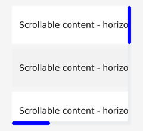
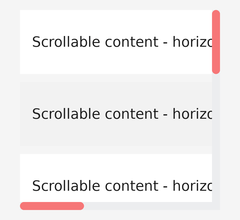

# ScrollBar组件开发指导

## 功能概述

本模块面向Native侧应用开发。开发者可配置滚动指示器的宽度、颜色、圆角、最小长度以及滑块透明度，且透明度仅作用于滑块（前景），不影响轨道背景。

| 维度     | ScrollBar组件能力        |
| -------- | --------------------------------------------- |
| 作用对象 | UIAbstractScroll的X/Y方向滚动指示器     |
| 典型场景 | 自定义滚动条宽度/颜色、圆角滑块、半透明指示器 |
| 核心类   | UIAbstractScroll、UIAbstractScrollBar    |

本模块在此基础上提供轻量、可验证的Native API，覆盖 **5 类能力**：

1. 宽度：设置矩形滚动条宽度或弧形滚动条线宽。
2. 颜色：设置滚动指示器前景滑块颜色。
3. 圆角：设置矩形滚动条滑块圆角；圆屏场景映射为弧形线帽能力。
4. 最小长度：设置内容较长时滑块的最小可见长度。
5. 透明度：设置滑块（前景）透明度，与控件透明度及淡入淡出动画叠加生效。

未配置时保持现有滚动条默认显示行为不变。

## 功能接口

### 样式结构体

```cpp
struct ScrollIndicatorStyle {
    uint16_t width = 0;
    uint16_t minLength = 0;
    uint16_t borderRadius = 0;
    ColorType color = Color::Black();
    uint8_t opacity = OPA_OPAQUE;
};
```

### 配置接口

| 接口 | 参数 | 返回值 | 说明 |
| --- | --- | --- | --- |
| SetIndicatorStyle(const ScrollIndicatorStyle& style) | style：完整样式 | 无 | 一次性设置宽度、颜色、圆角、最小长度和透明度；width为 0 或大于INT16_MAX时恢复默认值 4，minLength为 0 或大于INT16_MAX时恢复默认值 10；组件未配置时的默认值为width=4、minLength=10、borderRadius=0、color=Color::White()、opacity=OPA_OPAQUE |
| GetIndicatorStyle() const | 无 | ScrollIndicatorStyle | 获取当前完整样式配置 |
| ResetIndicatorStyle() | 无 | 无 | 清空自定义样式并恢复默认值：width=4、minLength=10、borderRadius=0、color=Color::White()、opacity=OPA_OPAQUE |
| SetIndicatorWidth(uint16_t width) | width：宽度（px） | 无 | 设置滚动指示器宽度；0 或大于INT16_MAX时恢复默认值 4；默认值为 4 |
| GetIndicatorWidth() const | 无 | uint16_t | 获取当前宽度 |
| SetIndicatorColor(ColorType color) | color：颜色 | 无 | 设置滑块颜色；默认值为Color::White() |
| GetIndicatorColor() const | 无 | ColorType | 获取当前颜色 |
| SetIndicatorBorderRadius(uint16_t borderRadius) | borderRadius：圆角（px） | 无 | 设置滑块圆角；默认值为 0 |
| GetIndicatorBorderRadius() const | 无 | uint16_t | 获取当前圆角 |
| SetIndicatorMinLength(uint16_t minLength) | minLength：最小长度（px） | 无 | 设置滑块最小长度；0 或大于INT16_MAX时恢复默认值 10；默认值为 10 |
| GetIndicatorMinLength() const | 无 | uint16_t | 获取当前最小长度 |
| SetIndicatorOpacity(uint8_t opacity) | opacity：透明度 | 无 | 设置滑块透明度，仅作用于滑块前景；默认值为OPA_OPAQUE |
| GetIndicatorOpacity() const | 无 | uint8_t | 获取当前滑块透明度 |

### 滚动条创建接口

| 接口 | 参数 | 返回值 | 说明 |
| --- | --- | --- | --- |
| SetXScrollBarVisible(bool visible) | visible：是否显示水平滚动条 | 无 | 显示或隐藏水平滚动条；创建后自动同步已配置的indicatorStyle；默认值为false |
| SetYScrollBarVisible(bool visible) | visible：是否显示垂直滚动条 | 无 | 显示或隐藏垂直滚动条；创建后自动同步已配置的indicatorStyle；默认值为false |

## 功能示例

[示例工程](https://gitcode.com/openharmony/applications_sample_camera/tree/master/graphic)

### 设置完整样式

```cpp
#include "components/ui_scroll_view.h"
#include "components/ui_label.h"

void SetupScrollIndicatorStyle()
{
    static constexpr uint16_t CONTENT_ROW_COUNT = 40;
    UILabel rows[CONTENT_ROW_COUNT];
    UIScrollView scrollView;
    scrollView.SetPosition(20, 10, 200, 200);
    scrollView.SetYScrollBarVisible(true);
    scrollView.SetXScrollBarVisible(true);

    for (uint16_t i = 0; i < CONTENT_ROW_COUNT; i++) {
        rows[i].SetPosition(0, i * 72, 600, 64);
        ColorType color = (i % 2 == 0) ? Color::White() :
            Color::GetColorFromRGB(0xF2, 0xF2, 0xF2);
        rows[i].SetStyle(STYLE_BACKGROUND_COLOR, color.full);
        rows[i].SetStyle(STYLE_BACKGROUND_OPA, OPA_OPAQUE);
        rows[i].SetStyle(STYLE_PADDING_LEFT, 12);
        rows[i].SetText("Scrollable content - horizontal content - more content");
        rows[i].SetTextColor(Color::Black());
        rows[i].SetAlign(TEXT_ALIGNMENT_LEFT, TEXT_ALIGNMENT_CENTER);
        scrollView.Add(&rows[i]);
    }

    ScrollIndicatorStyle style;
    style.width = 6;
    style.minLength = 64;
    style.borderRadius = 3;
    style.color = Color::Blue();
    style.opacity = OPA_OPAQUE;

    scrollView.SetIndicatorStyle(style);
}
```




### 单项设置

```cpp
#include "components/ui_scroll_view.h"
#include "components/ui_label.h"

void SetupScrollIndicatorItems()
{
    static constexpr uint16_t CONTENT_ROW_COUNT = 40;
    UILabel rows[CONTENT_ROW_COUNT];
    UIScrollView scrollView;
    scrollView.SetPosition(20, 10, 200, 200);
    scrollView.SetYScrollBarVisible(true);
    scrollView.SetXScrollBarVisible(true);

    for (uint16_t i = 0; i < CONTENT_ROW_COUNT; i++) {
        rows[i].SetPosition(0, i * 72, 600, 64);
        ColorType color = (i % 2 == 0) ? Color::White() :
            Color::GetColorFromRGB(0xF2, 0xF2, 0xF2);
        rows[i].SetStyle(STYLE_BACKGROUND_COLOR, color.full);
        rows[i].SetStyle(STYLE_BACKGROUND_OPA, OPA_OPAQUE);
        rows[i].SetStyle(STYLE_PADDING_LEFT, 12);
        rows[i].SetText("Scrollable content - horizontal content - more content");
        rows[i].SetTextColor(Color::Black());
        rows[i].SetAlign(TEXT_ALIGNMENT_LEFT, TEXT_ALIGNMENT_CENTER);
        scrollView.Add(&rows[i]);
    }

    scrollView.SetIndicatorWidth(8);
    scrollView.SetIndicatorColor(Color::Red());
    scrollView.SetIndicatorBorderRadius(4);
    scrollView.SetIndicatorMinLength(64);
    scrollView.SetIndicatorOpacity(128);
}
```




## 特性开关控制

当前功能使用宏开关隔离，ui_lite仓使用ui_lite_enable_scroller_indicator_style_adapt，目前只在hispark_taurus_linux_ex打开。

`/vendor/hisilicon/hispark_taurus_linux_ex/config.json`

```json
{
  "subsystem": "arkui",
  "components": [
    {
      "component": "ui_lite",
      "features": [
        "ui_lite_enable_scroller_indicator_style_adapt = true"
      ]
    }
  ]
}
```
