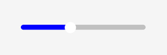
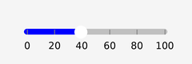
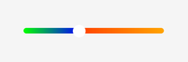

# Slider组件开发指导

## 功能概述

本模块面向Native侧应用开发。开发者可通过原生C++ 接口配置Slider的交互与视觉表现，满足不同场景下的进度调节需求。

| 维度     | Slider组件能力                            |
| -------- | ----------------------------------------------------- |
| 作用对象 | UISlider的轨道、滑块、刻度、Toast                 |
| 典型场景 | 音量调节带刻度吸附、禁用状态提示、渐变色轨道、值Toast |
| 核心类   | UISlider                                            |

本模块在此基础上提供轻量、可验证的Native API，覆盖 **7 类能力**：

1. 禁用与禁用提示：设置disabled状态及点击/拖动时的Toast文案。
2. 刻度列表：自定义刻度值，支持排序去重与最大数量限制。
3. 刻度吸附：交互时将当前值吸附到最近刻度。
4. 刻度标识：在轨道上绘制刻度线或刻度点。
5. 刻度文本：在刻度位置显示对应数值。
6. 渐变色：为背景轨道与选中进度轨道设置渐变色。
7. 扩大点击区域：让整个组件区域均可响应点击/拖动。

未配置新增能力时，保持Slider既有默认行为不变。

## 功能接口

### 配置接口

| 接口 | 参数 | 返回值 | 说明 |
| --- | --- | --- | --- |
| SetDisabled(bool disabled) | disabled：是否禁用 | 无 | 禁用后屏蔽点击、拖动操作；默认值为false |
| SetDisabledToastMsg(const char* msg) | msg：禁用提示文案 | 无 | 设置禁用提示文案；传入nullptr或空字符串时清空提示，超过 64 个字符时截断保存；默认未配置 |
| SetValues(const int32_t* values, uint16_t count) | values：刻度数组；count：数量 | 无 | 设置刻度数组；传入nullptr或count=0 时清空配置；最多保存 32 个，超出时截断，并进行排序和去重；未配置时按SetStep() 生成刻度；默认未配置，已保存数量为 0 |
| SetBgGradientColors(const ColorType* colors, uint16_t count) | colors：背景渐变色数组；count：数量 | 无 | 设置背景渐变色数组；传入nullptr或count=0 时清空配置；最多保存 8 个，超出时截断；少于 2 个时使用单色绘制；默认未配置渐变色，背景单色为Color::Black() |
| SetOnTintGradientColors(const ColorType* colors, uint16_t count) | colors：前景渐变色数组；count：数量 | 无 | 设置前景渐变色数组；传入nullptr或count=0 时清空配置；最多保存 8 个，超出时截断；少于 2 个时使用单色绘制；默认未配置渐变色，前景单色为Color::White() |
| SetShowMarkings(bool enable) | enable：是否显示刻度标识 | 无 | 控制刻度线/点绘制；默认值为false |
| EnableMarkings(bool enable) | enable：是否显示刻度标识 | 无 | 与SetShowMarkings等价；默认值为false |
| SetMarkingsType(MarkingsType type) | type：刻度类型 | 无 | 设置刻度类型；支持MARKINGS_LINE或MARKINGS_DOT，非法值恢复为MARKINGS_LINE；默认值为MARKINGS_LINE |
| SetMarkingsSize(int16_t size) | size：刻度大小（px） | 无 | 设置刻度大小；size<=0 或size>64 时恢复默认值 4 px；默认值为 4 px |
| SetShowMarkText(bool enable) | enable：是否显示刻度文本 | 无 | 在刻度旁显示数值；默认值为false |
| EnableMarkText(bool enable) | enable：是否显示刻度文本 | 无 | 与SetShowMarkText等价；默认值为false |
| SetExpandClickArea(bool enable) | enable：是否扩大点击区域 | 无 | 开启后整个组件区域响应事件；默认值为false |
| EnableToast(bool enable) | enable：是否显示值Toast | 无 | 点击/拖动时显示当前值；关闭时清除可见Toast；默认值为false |
| EnableTicks(bool enable) | enable：是否开启刻度吸附 | 无 | 配置了values时按values吸附，否则按step吸附；默认值为false |

### 查询接口

| 接口 | 参数 | 返回值 | 说明 |
| --- | --- | --- | --- |
| IsDisabled() const | 无 | bool | 查询禁用状态 |
| GetDisabledToastMsg() const | 无 | const char* | 查询禁用提示文案；未配置时返回nullptr |
| GetValuesCount() const | 无 | uint16_t | 查询已保存刻度数量 |
| IsMarkingsEnabled() const | 无 | bool | 查询刻度标识显示状态 |
| GetMarkingsType() const | 无 | MarkingsType | 查询刻度标识类型 |
| GetMarkingsSize() const | 无 | int16_t | 查询刻度标识大小 |
| IsMarkTextEnabled() const | 无 | bool | 查询刻度文本显示状态 |
| IsToastEnabled() const | 无 | bool | 查询值Toast开关状态 |
| IsTicksEnabled() const | 无 | bool | 查询刻度吸附开关状态 |
| IsExpandClickAreaEnabled() const | 无 | bool | 查询扩大点击区域开关状态 |
| GetBgGradientColorsCount() const | 无 | uint16_t | 查询背景渐变色数量 |
| GetOnTintGradientColorsCount() const | 无 | uint16_t | 查询前景渐变色数量 |

## 功能示例

[示例工程](https://gitcode.com/openharmony/applications_sample_camera/tree/master/graphic)

### 禁用状态与禁用提示

```cpp
#include "components/ui_slider.h"

void SetupSliderDisabled()
{
    UISlider slider;
    slider.SetPosition(20, 0, 200, 80);
    slider.SetValidWidth(180);
    slider.SetValidHeight(8);
    slider.SetCapType(CapType::CAP_ROUND);
    slider.SetKnobWidth(16);
    slider.SetKnobRadius(8);
    slider.SetKnobColor(Color::White());
    slider.SetSliderColor(Color::Silver(), Color::Blue());

    slider.SetRange(100, 0);
    slider.SetValue(40);

    slider.SetDisabled(true);
    slider.SetDisabledToastMsg("slider disabled");

    slider.SetExpandClickArea(true);
}
```



### 刻度、刻度吸附与值Toast

```cpp
#include "components/ui_slider.h"

void SetupSliderTicks()
{
    UISlider slider;
    slider.SetPosition(20, 0, 200, 80);
    slider.SetValidWidth(180);
    slider.SetValidHeight(8);
    slider.SetCapType(CapType::CAP_ROUND);
    slider.SetKnobWidth(16);
    slider.SetKnobRadius(8);
    slider.SetKnobColor(Color::White());
    slider.SetSliderColor(Color::Silver(), Color::Blue());

    slider.SetRange(100, 0);
    slider.SetValue(40);
    slider.SetStep(10);

    int32_t values[] = {0, 20, 40, 60, 80, 100};
    slider.SetValues(values, sizeof(values) / sizeof(values[0]));

    slider.SetShowMarkings(true);
    slider.SetMarkingsType(UISlider::MARKINGS_LINE);
    slider.SetMarkingsSize(6);
    slider.SetShowMarkText(true);

    slider.EnableTicks(true);
    slider.EnableToast(true);
}
```



### 轨道渐变色

```cpp
#include "components/ui_slider.h"

void SetupSliderGradient()
{
    UISlider slider;
    slider.SetPosition(20, 0, 200, 80);
    slider.SetValidWidth(180);
    slider.SetValidHeight(8);
    slider.SetCapType(CapType::CAP_ROUND);
    slider.SetKnobWidth(16);
    slider.SetKnobRadius(8);
    slider.SetKnobColor(Color::White());

    slider.SetRange(100, 0);
    slider.SetValue(40);

    ColorType bgColors[] = {Color::Red(), Color::Orange()};
    slider.SetBgGradientColors(bgColors, sizeof(bgColors) / sizeof(bgColors[0]));

    ColorType fgColors[] = {Color::Green(), Color::Blue()};
    slider.SetOnTintGradientColors(fgColors, sizeof(fgColors) / sizeof(fgColors[0]));
}
```



## 特性开关控制

当前功能使用宏开关隔离，ui_lite仓使用ui_lite_enable_slider_config，目前只在hispark_taurus_linux_ex打开。

`/vendor/hisilicon/hispark_taurus_linux_ex/config.json`

```json
{
  "subsystem": "arkui",
  "components": [
    {
      "component": "ui_lite",
      "features": [
        "ui_lite_enable_slider_config = true"
      ]
    }
  ]
}
```
