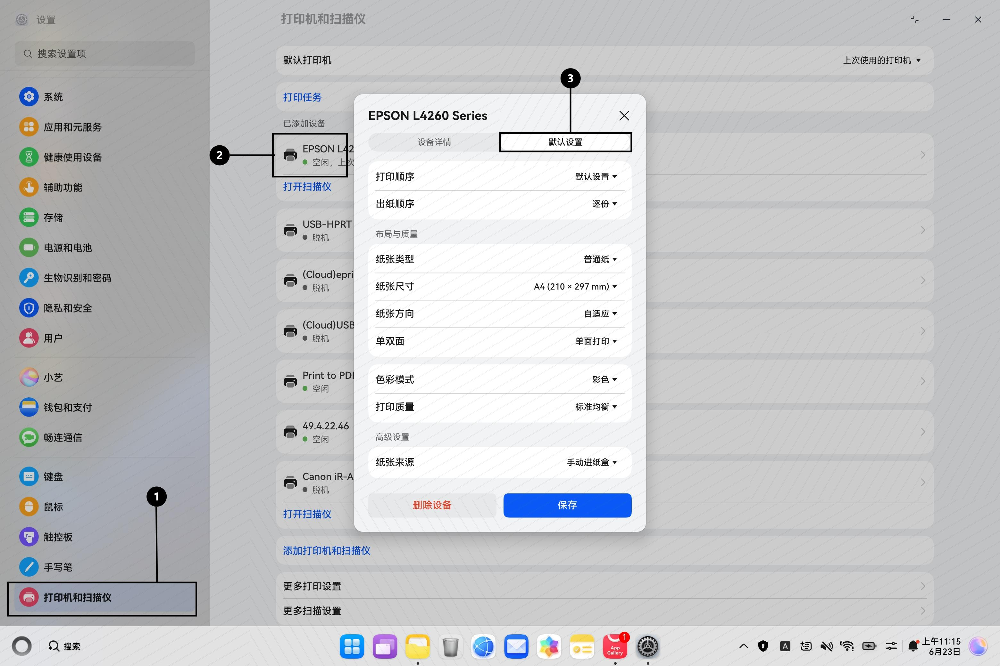
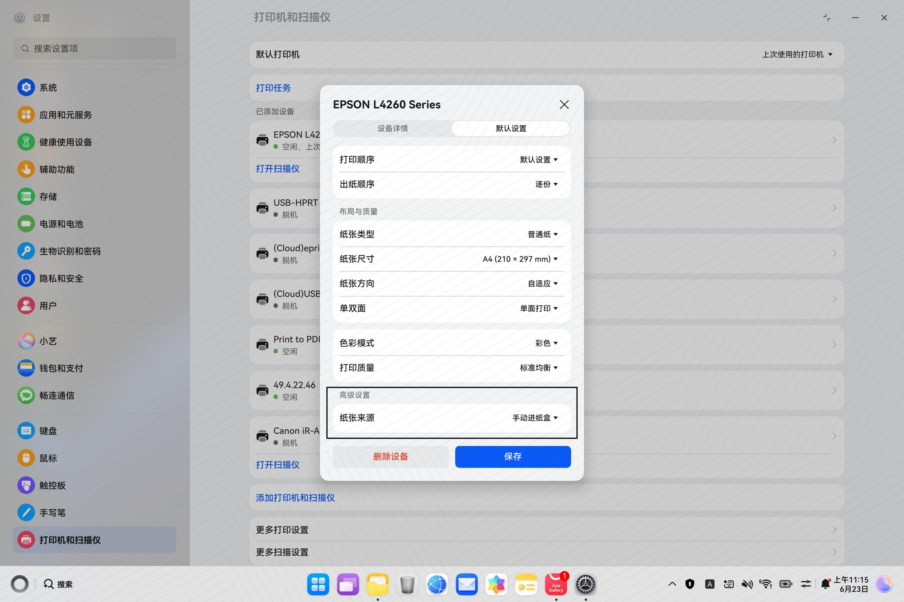

# 打印驱动（PostScript Printer Description）首选项开发指南

## 基本概念

PPD（PostScript Printer Description）是描述打印机特性的标准文件格式。OpenHarmony 打印子系统内置 CUPS 引擎，通过解析 PPD 文件中的 `*OpenUI` 字段生成打印首选项界面。开发者修改 PPD 文件即可定制首选项。

PPD 同时支持 `*.Translation` 多语言机制：英文为默认语言，通过 `*<语言代码>.Translation` 行将原文映射到译文，CUPS 根据系统语言自动匹配。

## 首选项配置

### 标准模板

```ppd
*OpenUI *功能字段/显示名称: 控件类型
*OrderDependency: 排序权重 依赖阶段 *功能字段
*Default功能字段: 默认值
*功能字段 选项值/显示名称: "PostScript代码"
*CloseUI: *功能字段
```

| 参数 | 含义 | 常用值 |
|------|------|--------|
| `功能字段` | PPD 内部标识符 | `Duplex`（单双面）、`PageSize`（纸张尺寸）、`ColorModel`（色彩模式） |
| `显示名称` | UI 中显示的标签（英文默认） | `Duplex`（单双面）、`PageSize`（纸张尺寸） |
| `控件类型` | UI 控件 | `PickOne`（单选） |
| `OrderDependency` | 显示顺序，`数字 阶段 *字段名`；数字越小越靠上，阶段一般用 `AnySetup` | `20 AnySetup *Duplex` |
| `DefaultXXX` | 首选项默认值，须等于某个已定义选项值 | `None`、`A4` |
| `CloseUI` | 结束定义，`*字段名` 须与 `OpenUI` 一致 | `*CloseUI: *Duplex` |

### 配置样例

```ppd
*OpenUI *Duplex/Duplex: PickOne
*OrderDependency: 20 AnySetup *Duplex
*DefaultDuplex: None
*Duplex None/Off: "<</Duplex false>>setpagedevice"
*Duplex DuplexNoTumble/Long Edge Binding: "<</Duplex true/Tumble false>>setpagedevice"
*Duplex DuplexTumble/Short Edge Binding: "<</Duplex true/Tumble true>>setpagedevice"
*CloseUI: *Duplex
```

## 功能字段速查

| 功能 | *OpenUI 字段 | 选项键值 | 备注 |
|------|------------|---------|------|
| **色彩模式** | `*ColorModel` | `RGB/Color`: `"<</cupsColorSpace 1/cupsColorOrder 0/cupsCompression 0>>setpagedevice"`<br>`Gray/Grayscale`: `"<</cupsColorSpace 3/cupsColorOrder 0/cupsCompression 0>>setpagedevice"` | 黑白为固定选项。<br>`*ColorDevice: False` 则仅显示黑白。<br>`*DefaultColorModel: RGB` |
| **单双面** | `*Duplex` | `None/Off`: `"<</Duplex false>>setpagedevice"`<br>`DuplexNoTumble/Long Edge Binding`: `"<</Duplex true/Tumble false>>setpagedevice"`<br>`DuplexTumble/Short Edge Binding`: `"<</Duplex true/Tumble true>>setpagedevice"` | 单面为固定选项。<br>`DuplexNoTumble`/`DuplexTumble` 显示名称固定不可自定义（英文 CUPS 固定显示 `Long Edge Binding`/`Short Edge Binding`）。<br>`*DefaultDuplex: None` |
| **纸张尺寸** | `*PageSize` | `A4/A4`: `"<</PageSize[595 842]/ImagingBBox null>>setpagedevice"`<br>`A5/A5`: `"<</PageSize[420 595]/ImagingBBox null>>setpagedevice"`<br>`Letter/Letter`: `"<</PageSize[612 792]/ImagingBBox null>>setpagedevice"` | `[width height]` 单位为**点**（1点=1/72英寸）。换算：`点数 = mm × 72 ÷ 25.4`。<br>A4(210×297mm)=[595 842]。<br>**须与 `*PaperDimension` 成对配置**，数值一致。<br>`*DefaultPageSize: A4` |
| | `*PaperDimension` | `A4/A4`: `"595 842"`<br>`A5/A5`: `"420 595"`<br>`Letter/Letter`: `"612 792"` | 声明物理纸张尺寸（点），和 `*PageSize` 搭配。<br>`*DefaultPaperDimension: A4` |
| **纸张类型** | `*MediaType` | `Plain/Plain Paper`: `"<</MediaType (Plain)>>setpagedevice"`<br>`Photo/Photo Paper`: `"<</MediaType (Photo)>>setpagedevice"`<br>`Glossy/Glossy Paper`: `"<</MediaType (Glossy)>>setpagedevice"` | 影响打印质量的可用性。<br>`*DefaultMediaType: Plain` |
| **打印质量** | `*cupsPrintQuality` | `Normal/Normal`: `"<</HWResolution[600 600]/cupsCompression 0>>setpagedevice"`<br>`High/Best`: `"<</HWResolution[600 1200]/cupsCompression 0>>setpagedevice"`<br>`Draft/Draft`: `"<</HWResolution[300 400]/cupsCompression 0>>setpagedevice"` | 三种显示名称固定不可自定义（英文 CUPS 固定显示 `Draft`/`Normal`/`Best`）。<br>"快速省墨"仅普通纸模式下可选。<br>`*DefaultcupsPrintQuality: Normal` |
| **纸张来源** | `*InputSlot` | `Auto/Auto Select`: `"<</InputSlot 0>>setpagedevice"`<br>`ManualFeed/Manual Feed`: `"<</InputSlot 1>>setpagedevice"`<br>`AutoFeed/Auto Feed Tray`: `"<</InputSlot 2>>setpagedevice"` | 进纸盒编号因机型而异，需参阅技术手册。<br>`*DefaultInputSlot: Auto` |

## 多语言Translation

### 声明支持的语言

在 PPD 头部添加 `*cupsLanguages`：

```ppd
*cupsLanguages: "zh_CN en"
```

语言代码按空格分隔：

| 代码 | 语言 | 代码 | 语言 |
|------|------|------|------|
| `en` | 英文 | `fr` | 法文 |
| `zh_CN` | 简体中文 | `de` | 德文 |
| `zh_TW` | 繁体中文 | `es` | 西班牙文 |
| `ja` | 日文 | `pt` | 葡萄牙文 |
| `ko` | 韩文 | `ru` | 俄文 |

### Translation 语法

```
*<语言代码>.Translation <原文>/<译文>: ""
```

| 参数 | 说明 |
|------|------|
| `<语言代码>` | 如 `zh_CN`、`ja` |
| `<原文>` | 与英文默认行中 `/` 前的文本**完全一致**（逐字符匹配） |
| `<译文>` | 目标语言的翻译文本 |
| `""` | 空 PostScript 调用，表示该行仅做翻译声明，不传递打印指令 |

### 配置样例

以下将「功能字段速查」章节的部分功能字段配置为中英翻译：

```ppd
*cupsLanguages: "zh_CN en"

*%===== Input Slot =======
*OpenUI *InputSlot/InputSlot: PickOne
*OrderDependency: 60 AnySetup *InputSlot
*DefaultInputSlot: Auto
*InputSlot Auto/Auto: "<</InputSlot 0>>setpagedevice"
*InputSlot ManualFeed/ManualFeed: "<</InputSlot 1>>setpagedevice"
*InputSlot AutoFeed/AutoFeed: "<</InputSlot 2>>setpagedevice"
*CloseUI: *InputSlot

*%===== Simplified Chinese localization =======
*zh_CN.Translation InputSlot/纸张来源: ""
*zh_CN.InputSlot Auto/打印机自动选择: ""
*zh_CN.InputSlot ManualFeed/手动进纸盒: ""
*zh_CN.InputSlot AutoFeed/自动进纸盒: ""
```

## 约束条件（UIConstraints）

当某个选项在另一选项取特定值时应被禁用，通过 `*UIConstraints` 声明：

```ppd
*UIConstraints: *MediaType Photo  *cupsPrintQuality Draft
*UIConstraints: *MediaType Glossy *cupsPrintQuality Draft
```

> 含义：纸张类型为"相片纸"或"光面纸"时，"快速省墨"灰色不可选。

**语法**：`*UIConstraints: *字段A 值A *字段B 值B`——A 取该值时，B 的该值被禁用。

## 首选项验证

**在 设置 → 打印机和扫描仪 → 点击任一连接的打印机 → 默认设置 中可查看打印首选项。首选项配置的作用是：在打印没有设置参数时，使用首选项中的默认配置。**



**新增首选项——纸张来源示例**



## 常见问题

| 现象 | 可能原因 | 解决 |
|------|---------|------|
| PPD 语法报错 | 引号不配对、`*` 遗漏、`OpenUI`/`CloseUI` 字段名不一致 | 对照模板修复语法 |
| 选项不显示 | `*OpenUI`/`*CloseUI` 未成对或字段名不一致 | 检查闭合 |
| 选项选择提示设置冲突，已回退 | 被 `*UIConstraints` 约束 | 检查约束是否误配 |
| 纸张尺寸跟PPD定义不一致 | `*PaperDimension` 没有配置 | 配置 `*PaperDimension` |
| 切换系统语言后仍显示英文 | `*cupsLanguages` 未包含该语言代码或 `*.Translation` 未配置 | 检查 `*cupsLanguages` 声明和翻译行是否齐全 |
| 部分文本已翻译、部分仍为英文 | 对应选项的 `*.Translation` 行遗漏或原文不匹配 | 逐行排查 `*.Translation` 的 `<原文>` 是否与英文默认行完全一致 |

## PPD示例
```ppd
*PPD-Adobe: "4.3"
*FormatVersion: "xx"
*FileVersion: "xx"
*LanguageEncoding: UTF-8
*LanguageVersion: English
*PCFileName: "CustomPCFileName.ppd"
*Manufacturer: "CustomManufacturer"
*PSVersion: "1"
*ModelName: "CustomModelName"
*NickName: "CustomNickName"
*ShortNickName: "CustomShortNickName"
*cupsFilter: "application/vnd.cups-pdf application/vnd.cups-pdf 0 -"
*cupsLanguages: "zh_CN"
*cupsPJLDisplay: "omit"

*%色彩模式中"彩色"是由ColorDevice确定
*ColorDevice: True
*%===== Color Model =======
*OpenUI *ColorModel/黑白: PickOne
*OrderDependency: 10 AnySetup *ColorModel
*DefaultColorModel: Gray
*ColorModel Gray/黑白: "<</cupsColorSpace 3/cupsColorOrder 0/cupsCompression 0>>setpagedevice"
*CloseUI: *ColorModel
*%===== Duplex =======
*OpenUI *Duplex/单双面: PickOne
*OrderDependency: 20 AnySetup *Duplex
*DefaultDuplex: None
*Duplex None/单面打印: "<</Duplex false>>setpagedevice"
*%中文名目前不允许自定义
*Duplex DuplexNoTumble/双面打印沿长边翻转: "<</Duplex true/Tumble false>>setpagedevice"
*Duplex DuplexTumble/双面打印沿短边翻转: "<</Duplex true/Tumble true>>setpagedevice"
*CloseUI: *Duplex
*%===== PageSize =======
*OpenUI *PageSize/纸张尺寸: PickOne
*OrderDependency: 30 AnySetup *PageSize
*DefaultPageSize: A4
*PageSize A4/A4: "<</PageSize[595 842]/ImagingBBox null>>setpagedevice"
*PageSize A5/A5: "<</PageSize[420 595]/ImagingBBox null>>setpagedevice"
*CloseUI: *PageSize
*DefaultPaperDimension: A4
*PaperDimension A4/A4 (210 x 297mm): "595 842"
*PaperDimension A5/A5 (148 x 210mm): "420 595"
*%===== Media Type =======
*OpenUI *MediaType/纸张类型: PickOne
*OrderDependency: 40 AnySetup *MediaType
*DefaultMediaType: Plain
*MediaType Plain/普通纸: "<</MediaType (0) >> setpagedevice"
*MediaType Photo/相片纸: "<</MediaType (10) >> setpagedevice"
*CloseUI: *MediaType
*%===== cupsPrintQuality =======
*OpenUI *cupsPrintQuality/打印质量: PickOne
*OrderDependency: 50 AnySetup *cupsPrintQuality
*DefaultcupsPrintQuality: Normal
*%只有"纸张类型"选择"普通纸"才显示快速省墨，并且中文名不允许自定义
*cupsPrintQuality Normal/标准均衡: "<</HWResolution[600 600]/cupsCompression 0>>setpagedevice"
*cupsPrintQuality High/质量最佳: "<</HWResolution[600 1200]/cupsCompression 0>>setpagedevice"
*cupsPrintQuality Draft/快速省墨: "<</HWResolution[300 400]/cupsCompression 0>>setpagedevice"
*CloseUI: *cupsPrintQuality
*%===== Input Slot =======
*OpenUI *InputSlot/InputSlot: PickOne
*OrderDependency: 60 AnySetup *InputSlot
*DefaultInputSlot: Auto
*InputSlot Auto/Auto: "<</InputSlot 0>>setpagedevice"
*InputSlot ManualFeed/ManualFeed: "<</InputSlot 1>>setpagedevice"
*InputSlot AutoFeed/AutoFeed: "<</InputSlot 2>>setpagedevice"
*CloseUI: *InputSlot
*%===== Simplified Chinese localization =======
*zh_CN.Translation InputSlot/纸张来源: ""
*zh_CN.InputSlot Auto/打印机自动选择: ""
*zh_CN.InputSlot ManualFeed/手动进纸盒: ""
*zh_CN.InputSlot AutoFeed/自动进纸盒: ""
```
